# KiValidateDpcWatchdogConfiguration

- RVA: `0x005B5E38`–`0x005B5FF5` (길이 `445` bytes)
- VA: `0x00000001405B5E38`
- 실행 섹션: `.text`
- PDB 이름 있음: `예`; PDB Function 태그: `아니요`
- unwind 정보 RVA: `0x000C9DA4`
- 디코드: `135`개 명령, `445/445` bytes 표시
- 미해석 바이트: `0` (있으면 어셈블리에 `.byte`로 보존)

> 이 문서는 커널 이미지의 기계어와 PDB 기호를 분석해 생성했습니다. 4번과 5번은 함수 원형과 자료형을 바이너리 사용 방식에서 추정한 C 해석이며 원본 소스 복구 결과는 아닙니다.

## 1. Dependencies

- 직접 호출 지점: **1**; 고유 호출 대상: **1**
- 직접 호출자로 확인된 함수: **1**
- RIP 상대 이미지 참조: **7**

### Outgoing calls
- `0x005B5E80` → [memcpy](../6C/memcpy_function_006C6840.md) (function, `0x006C6840`)

### Direct callers
- [KeUpdateDpcWatchdogConfiguration](KeUpdateDpcWatchdogConfiguration_function_005B5A34.md) at `0x005B5AD3`

### Static image references
- `0x005B5ED3` → RVA `0x00FC5034` (`ALMOSTRO`; read)
- `0x005B5EE2` → RVA `0x00FC502C` (`ALMOSTRO`; read)
- `0x005B5EF1` → RVA `0x00FC5040` (`ALMOSTRO`; read)
- `0x005B5F00` → RVA `0x00FC503C` (`ALMOSTRO`; read)
- `0x005B5F0F` → RVA `0x00FC5028` (`ALMOSTRO`; read)
- `0x005B5F1E` → RVA `0x00FC5024` (`ALMOSTRO`; read)
- `0x005B5F2D` → RVA `0x00FC5048` (`ALMOSTRO`; read)

## 2. Other-region calls and transfers

- 다른 실행 섹션으로 향하는 call: **0**
- 별도 외부 분기/꼬리 이동을 확인하지 못했습니다.

## 3. Assembly (complete function range)

```asm
005B5E38  48 89 5C 24 08                  mov qword ptr [rsp + 8], rbx
005B5E3D  57                              push rdi
005B5E3E  48 83 EC 20                     sub rsp, 0x20
005B5E42  49 8B D9                        mov rbx, r9
005B5E45  41 8B F8                        mov edi, r8d
005B5E48  41 81 E8 E4 00 00 00            sub r8d, 0xe4
005B5E4F  74 0B                           je 0x1405b5e5c
005B5E51  41 83 F8 01                     cmp r8d, 1
005B5E55  75 14                           jne 0x1405b5e6b
005B5E57  83 FA 20                        cmp edx, 0x20
005B5E5A  EB 03                           jmp 0x1405b5e5f
005B5E5C  83 FA 14                        cmp edx, 0x14
005B5E5F  74 0A                           je 0x1405b5e6b
005B5E61  B9 04 00 00 C0                  mov ecx, 0xc0000004
005B5E66  E9 7C 01 00 00                  jmp 0x1405b5fe7
005B5E6B  0F 57 C0                        xorps xmm0, xmm0
005B5E6E  41 0F 11 01                     movups xmmword ptr [r9], xmm0
005B5E72  41 0F 11 41 10                  movups xmmword ptr [r9 + 0x10], xmm0
005B5E77  44 8B C2                        mov r8d, edx
005B5E7A  48 8B D1                        mov rdx, rcx
005B5E7D  48 8B CB                        mov rcx, rbx
005B5E80  E8 BB 09 11 00                  call 0x1406c6840
005B5E85  90                              nop
005B5E86  8B 0B                           mov ecx, dword ptr [rbx]
005B5E88  0F B6 D1                        movzx edx, cl
005B5E8B  8D 42 FF                        lea eax, [rdx - 1]
005B5E8E  83 F8 01                        cmp eax, 1
005B5E91  77 12                           ja 0x1405b5ea5
005B5E93  81 EF E4 00 00 00               sub edi, 0xe4
005B5E99  74 14                           je 0x1405b5eaf
005B5E9B  83 FF 01                        cmp edi, 1
005B5E9E  75 1C                           jne 0x1405b5ebc
005B5EA0  83 FA 02                        cmp edx, 2
005B5EA3  74 17                           je 0x1405b5ebc
005B5EA5  B9 0D 00 00 C0                  mov ecx, 0xc000000d
005B5EAA  E9 38 01 00 00                  jmp 0x1405b5fe7
005B5EAF  83 FA 01                        cmp edx, 1
005B5EB2  75 F1                           jne 0x1405b5ea5
005B5EB4  F7 C1 00 70 00 00               test ecx, 0x7000
005B5EBA  75 E9                           jne 0x1405b5ea5
005B5EBC  8B C1                           mov eax, ecx
005B5EBE  C1 E8 08                        shr eax, 8
005B5EC1  33 D2                           xor edx, edx
005B5EC3  85 C0                           test eax, eax
005B5EC5  74 DE                           je 0x1405b5ea5
005B5EC7  81 F9 00 80 00 00               cmp ecx, 0x8000
005B5ECD  73 D6                           jae 0x1405b5ea5
005B5ECF  A8 01                           test al, 1
005B5ED1  75 09                           jne 0x1405b5edc
005B5ED3  8B 05 5B F1 A0 00               mov eax, dword ptr [rip + 0xa0f15b]
005B5ED9  89 43 04                        mov dword ptr [rbx + 4], eax
005B5EDC  0F BA E1 09                     bt ecx, 9
005B5EE0  72 09                           jb 0x1405b5eeb
005B5EE2  8B 05 44 F1 A0 00               mov eax, dword ptr [rip + 0xa0f144]
005B5EE8  89 43 08                        mov dword ptr [rbx + 8], eax
005B5EEB  0F BA E1 0A                     bt ecx, 0xa
005B5EEF  72 09                           jb 0x1405b5efa
005B5EF1  8B 05 49 F1 A0 00               mov eax, dword ptr [rip + 0xa0f149]
005B5EF7  89 43 0C                        mov dword ptr [rbx + 0xc], eax
005B5EFA  0F BA E1 0B                     bt ecx, 0xb
005B5EFE  72 09                           jb 0x1405b5f09
005B5F00  8B 05 36 F1 A0 00               mov eax, dword ptr [rip + 0xa0f136]
005B5F06  89 43 10                        mov dword ptr [rbx + 0x10], eax
005B5F09  0F BA E1 0C                     bt ecx, 0xc
005B5F0D  72 09                           jb 0x1405b5f18
005B5F0F  8B 05 13 F1 A0 00               mov eax, dword ptr [rip + 0xa0f113]
005B5F15  89 43 14                        mov dword ptr [rbx + 0x14], eax
005B5F18  0F BA E1 0D                     bt ecx, 0xd
005B5F1C  72 09                           jb 0x1405b5f27
005B5F1E  8B 05 00 F1 A0 00               mov eax, dword ptr [rip + 0xa0f100]
005B5F24  89 43 18                        mov dword ptr [rbx + 0x18], eax
005B5F27  0F BA E1 0E                     bt ecx, 0xe
005B5F2B  72 09                           jb 0x1405b5f36
005B5F2D  8B 05 15 F1 A0 00               mov eax, dword ptr [rip + 0xa0f115]
005B5F33  89 43 1C                        mov dword ptr [rbx + 0x1c], eax
005B5F36  44 8B 43 04                     mov r8d, dword ptr [rbx + 4]
005B5F3A  41 8D 40 FF                     lea eax, [r8 - 1]
005B5F3E  83 F8 12                        cmp eax, 0x12
005B5F41  0F 86 5E FF FF FF               jbe 0x1405b5ea5
005B5F47  44 8B 4B 08                     mov r9d, dword ptr [rbx + 8]
005B5F4B  41 8D 41 FF                     lea eax, [r9 - 1]
005B5F4F  3D CE 07 00 00                  cmp eax, 0x7ce
005B5F54  0F 86 4B FF FF FF               jbe 0x1405b5ea5
005B5F5A  8B 4B 0C                        mov ecx, dword ptr [rbx + 0xc]
005B5F5D  85 C9                           test ecx, ecx
005B5F5F  74 17                           je 0x1405b5f78
005B5F61  83 F9 14                        cmp ecx, 0x14
005B5F64  0F 82 3B FF FF FF               jb 0x1405b5ea5
005B5F6A  45 85 C0                        test r8d, r8d
005B5F6D  74 09                           je 0x1405b5f78
005B5F6F  41 3B C8                        cmp ecx, r8d
005B5F72  0F 87 2D FF FF FF               ja 0x1405b5ea5
005B5F78  8B 43 10                        mov eax, dword ptr [rbx + 0x10]
005B5F7B  85 C0                           test eax, eax
005B5F7D  74 19                           je 0x1405b5f98
005B5F7F  3D D0 07 00 00                  cmp eax, 0x7d0
005B5F84  0F 82 1B FF FF FF               jb 0x1405b5ea5
005B5F8A  45 85 C9                        test r9d, r9d
005B5F8D  74 09                           je 0x1405b5f98
005B5F8F  41 3B C1                        cmp eax, r9d
005B5F92  0F 87 0D FF FF FF               ja 0x1405b5ea5
005B5F98  44 8B 43 14                     mov r8d, dword ptr [rbx + 0x14]
005B5F9C  45 85 C0                        test r8d, r8d
005B5F9F  74 14                           je 0x1405b5fb5
005B5FA1  85 C9                           test ecx, ecx
005B5FA3  75 07                           jne 0x1405b5fac
005B5FA5  8B 4B 04                        mov ecx, dword ptr [rbx + 4]
005B5FA8  85 C9                           test ecx, ecx
005B5FAA  74 09                           je 0x1405b5fb5
005B5FAC  44 3B C1                        cmp r8d, ecx
005B5FAF  0F 87 F0 FE FF FF               ja 0x1405b5ea5
005B5FB5  8B 4B 18                        mov ecx, dword ptr [rbx + 0x18]
005B5FB8  85 C9                           test ecx, ecx
005B5FBA  74 13                           je 0x1405b5fcf
005B5FBC  85 C0                           test eax, eax
005B5FBE  75 07                           jne 0x1405b5fc7
005B5FC0  41 8B C1                        mov eax, r9d
005B5FC3  85 C0                           test eax, eax
005B5FC5  74 08                           je 0x1405b5fcf
005B5FC7  3B C8                           cmp ecx, eax
005B5FC9  0F 87 D6 FE FF FF               ja 0x1405b5ea5
005B5FCF  8B 43 1C                        mov eax, dword ptr [rbx + 0x1c]
005B5FD2  FF C8                           dec eax
005B5FD4  B9 0D 00 00 C0                  mov ecx, 0xc000000d
005B5FD9  3D FE 1F 00 00                  cmp eax, 0x1ffe
005B5FDE  0F 46 D1                        cmovbe edx, ecx
005B5FE1  8B CA                           mov ecx, edx
005B5FE3  EB 02                           jmp 0x1405b5fe7
005B5FE5  8B C8                           mov ecx, eax
005B5FE7  8B C1                           mov eax, ecx
005B5FE9  48 8B 5C 24 30                  mov rbx, qword ptr [rsp + 0x30]
005B5FEE  48 83 C4 20                     add rsp, 0x20
005B5FF2  5F                              pop rdi
005B5FF3  C3                              ret
005B5FF4  CC                              int3
```

## 4. C-style interpretation (structured pseudocode)

```c
__int64 __fastcall KiValidateDpcWatchdogConfiguration(__int64 a1, int a2, int a3, __int64 a4)
{
    __int64 result;
    __int64 v_rdi;
    __int64 v_rsp;
    unsigned __int64 v_stack_p8;

    v_stack_p8 = v_rbx;
    v_rsp = (v_rsp) - (32);
    a3 = (unsigned int)((a3) - (228));
    if (condition_is_equal) goto loc_005B5E5C;
    if (a3 != 1) goto loc_005B5E6B;
    goto loc_005B5E5F;
loc_005B5E5C:
loc_005B5E5F:
    if (a2 == 20) goto loc_005B5E6B;
    goto loc_005B5FE7;
loc_005B5E6B:
    *(unsigned __int64 *)(a4) = v_xmm0;
    *(unsigned __int64 *)(a4 + 16) = v_xmm0;
    result = memcpy(a4, (unsigned int)(0xC0000004ULL), (unsigned int)(a2), a4);
    if (((unsigned int)((unsigned __int8)((unsigned int)(*(unsigned int *)(a4))) - 1)) > 1) goto loc_005B5EA5;
    v_rdi = (unsigned int)(((unsigned int)(a3)) - (228));
    if (condition_is_equal) goto loc_005B5EAF;
    if (((unsigned int)(v_rdi)) != 1) goto loc_005B5EBC;
    if (((unsigned int)((unsigned __int8)((unsigned int)(*(unsigned int *)(a4))))) == 2) goto loc_005B5EBC;
loc_005B5EA5:
    goto loc_005B5FE7;
loc_005B5EAF:
    if (((unsigned int)((unsigned __int8)((unsigned int)(*(unsigned int *)(a4))))) != 1) goto loc_005B5EA5;
    if ((((unsigned int)((unsigned int)(0xC000000DULL))) & (0x7000ULL)) != 0) goto loc_005B5EA5;
loc_005B5EBC:
    result = (unsigned int)(((unsigned int)((unsigned int)((unsigned int)(0xC000000DULL)))) >> (8));
    a2 = 0;
    if ((unsigned int)(result) == 0) goto loc_005B5EA5;
    if (((unsigned int)((unsigned int)(0xC000000DULL))) >= 0x8000ULL) goto loc_005B5EA5;
    if ((((unsigned __int8)(result)) & (1)) == 0) {
        result = *(unsigned int *)(v_rip + 10547547);
        *(unsigned int *)(a4 + 4) = (unsigned int)(result);
    }
    if (!(condition_is_below)) {
        result = *(unsigned int *)(v_rip + 10547524);
        *(unsigned int *)(a4 + 8) = (unsigned int)(result);
    }
    if (!(condition_is_below)) {
        result = *(unsigned int *)(v_rip + 10547529);
        *(unsigned int *)(a4 + 12) = (unsigned int)(result);
    }
    if (!(condition_is_below)) {
        result = *(unsigned int *)(v_rip + 10547510);
        *(unsigned int *)(a4 + 16) = (unsigned int)(result);
    }
    if (!(condition_is_below)) {
        result = *(unsigned int *)(v_rip + 10547475);
        *(unsigned int *)(a4 + 20) = (unsigned int)(result);
    }
    if (!(condition_is_below)) {
        result = *(unsigned int *)(v_rip + 10547456);
        *(unsigned int *)(a4 + 24) = (unsigned int)(result);
    }
    if (!(condition_is_below)) {
        result = *(unsigned int *)(v_rip + 10547477);
        *(unsigned int *)(a4 + 28) = (unsigned int)(result);
    }
    if (((unsigned int)((unsigned int)(*(unsigned int *)(a4 + 4)) - 1)) <= 18) goto loc_005B5EA5;
    if (((unsigned int)((unsigned int)(*(unsigned int *)(a4 + 8)) - 1)) <= 0x7CEULL) goto loc_005B5EA5;
    if ((unsigned int)((unsigned int)(*(unsigned int *)(a4 + 12))) == 0) goto loc_005B5F78;
    if (((unsigned int)((unsigned int)(*(unsigned int *)(a4 + 12)))) < 20) goto loc_005B5EA5;
    if ((unsigned int)((unsigned int)(*(unsigned int *)(a4 + 4))) == 0) goto loc_005B5F78;
    if (((unsigned int)((unsigned int)(*(unsigned int *)(a4 + 12)))) > ((unsigned int)((unsigned int)(*(unsigned int *)(a4 + 4))))) goto loc_005B5EA5;
loc_005B5F78:
    if ((unsigned int)((unsigned int)(*(unsigned int *)(a4 + 16))) == 0) goto loc_005B5F98;
    if (((unsigned int)((unsigned int)(*(unsigned int *)(a4 + 16)))) < 0x7D0ULL) goto loc_005B5EA5;
    if ((unsigned int)((unsigned int)(*(unsigned int *)(a4 + 8))) == 0) goto loc_005B5F98;
    if (((unsigned int)((unsigned int)(*(unsigned int *)(a4 + 16)))) > ((unsigned int)((unsigned int)(*(unsigned int *)(a4 + 8))))) goto loc_005B5EA5;
loc_005B5F98:
    if ((unsigned int)((unsigned int)(*(unsigned int *)(a4 + 20))) == 0) goto loc_005B5FB5;
    if ((unsigned int)((unsigned int)(*(unsigned int *)(a4 + 12))) != 0) goto loc_005B5FAC;
    if ((unsigned int)((unsigned int)(*(unsigned int *)(a4 + 4))) == 0) goto loc_005B5FB5;
loc_005B5FAC:
    if (((unsigned int)((unsigned int)(*(unsigned int *)(a4 + 20)))) > ((unsigned int)((unsigned int)(*(unsigned int *)(a4 + 4))))) goto loc_005B5EA5;
loc_005B5FB5:
    if ((unsigned int)((unsigned int)(*(unsigned int *)(a4 + 24))) == 0) goto loc_005B5FCF;
    if ((unsigned int)((unsigned int)(*(unsigned int *)(a4 + 16))) != 0) goto loc_005B5FC7;
    if ((unsigned int)((unsigned int)((unsigned int)((unsigned int)(*(unsigned int *)(a4 + 8))))) == 0) goto loc_005B5FCF;
loc_005B5FC7:
    if (((unsigned int)((unsigned int)(*(unsigned int *)(a4 + 24)))) > ((unsigned int)((unsigned int)((unsigned int)((unsigned int)(*(unsigned int *)(a4 + 8))))))) goto loc_005B5EA5;
loc_005B5FCF:
    result = (unsigned int)(((unsigned int)(*(unsigned int *)(a4 + 28))) - 1);
    if (((unsigned int)(result)) <= 0x1FFEULL) { a2 = (unsigned int)((unsigned int)(0xC000000DULL)); }
    goto loc_005B5FE7;
loc_005B5FE7:
    v_rsp = (v_rsp) + (32);
    return (unsigned int)((unsigned int)((unsigned int)(a2)));
}
```

## 5. (Beta) C Style

```c
int64_t KiValidateDpcWatchdogConfiguration(int64_t Arg1, int32_t Arg2, int32_t Arg3, void *Arg4)
{
    uint8_t *arg4 = (uint8_t *)Arg4;

    int64_t result;
    int64_t local_rdi;
    int64_t local_rsp;
    uint64_t v_stack_p8;

    v_stack_p8 = local_rbx;
    local_rsp = (local_rsp) - (32);
    Arg3 = (uint32_t)((Arg3) - (228));
    if (condition_is_equal) goto loc_005B5E5C;
    if (Arg3 != 1) goto loc_005B5E6B;
    goto loc_005B5E5F;
loc_005B5E5C:
loc_005B5E5F:
    if (Arg2 == 20) goto loc_005B5E6B;
    goto loc_005B5FE7;
loc_005B5E6B:
    *(uint64_t *)(arg4) = v_xmm0;
    *(uint64_t *)(arg4 + 0x10) = v_xmm0;
    result = memcpy(Arg4, (uint32_t)(0xC0000004ULL), (uint32_t)(Arg2), Arg4);
    if (((uint32_t)((uint8_t)((uint32_t)(*(uint32_t *)(arg4))) - 1)) > 1) goto loc_005B5EA5;
    local_rdi = (uint32_t)(((uint32_t)(Arg3)) - (228));
    if (condition_is_equal) goto loc_005B5EAF;
    if (((uint32_t)(local_rdi)) != 1) goto loc_005B5EBC;
    if (((uint32_t)((uint8_t)((uint32_t)(*(uint32_t *)(arg4))))) == 2) goto loc_005B5EBC;
loc_005B5EA5:
    goto loc_005B5FE7;
loc_005B5EAF:
    if (((uint32_t)((uint8_t)((uint32_t)(*(uint32_t *)(arg4))))) != 1) goto loc_005B5EA5;
    if ((((uint32_t)((uint32_t)(0xC000000DULL))) & (0x7000ULL)) != 0) goto loc_005B5EA5;
loc_005B5EBC:
    result = (uint32_t)(((uint32_t)((uint32_t)((uint32_t)(0xC000000DULL)))) >> (8));
    Arg2 = 0;
    if ((uint32_t)(result) == 0) goto loc_005B5EA5;
    if (((uint32_t)((uint32_t)(0xC000000DULL))) >= 0x8000ULL) goto loc_005B5EA5;
    if ((((uint8_t)(result)) & (1)) == 0) {
        result = *(uint32_t *)(v_rip + 0xA0F15B);
        *(uint32_t *)(arg4 + 0x4) = (uint32_t)(result);
    }
    if (!(condition_is_below)) {
        result = *(uint32_t *)(v_rip + 0xA0F144);
        *(uint32_t *)(arg4 + 0x8) = (uint32_t)(result);
    }
    if (!(condition_is_below)) {
        result = *(uint32_t *)(v_rip + 0xA0F149);
        *(uint32_t *)(arg4 + 0xC) = (uint32_t)(result);
    }
    if (!(condition_is_below)) {
        result = *(uint32_t *)(v_rip + 0xA0F136);
        *(uint32_t *)(arg4 + 0x10) = (uint32_t)(result);
    }
    if (!(condition_is_below)) {
        result = *(uint32_t *)(v_rip + 0xA0F113);
        *(uint32_t *)(arg4 + 0x14) = (uint32_t)(result);
    }
    if (!(condition_is_below)) {
        result = *(uint32_t *)(v_rip + 0xA0F100);
        *(uint32_t *)(arg4 + 0x18) = (uint32_t)(result);
    }
    if (!(condition_is_below)) {
        result = *(uint32_t *)(v_rip + 0xA0F115);
        *(uint32_t *)(arg4 + 0x1C) = (uint32_t)(result);
    }
    if (((uint32_t)((uint32_t)(*(uint32_t *)(arg4 + 0x4)) - 1)) <= 18) goto loc_005B5EA5;
    if (((uint32_t)((uint32_t)(*(uint32_t *)(arg4 + 0x8)) - 1)) <= 0x7CEULL) goto loc_005B5EA5;
    if ((uint32_t)((uint32_t)(*(uint32_t *)(arg4 + 0xC))) == 0) goto loc_005B5F78;
    if (((uint32_t)((uint32_t)(*(uint32_t *)(arg4 + 0xC)))) < 20) goto loc_005B5EA5;
    if ((uint32_t)((uint32_t)(*(uint32_t *)(arg4 + 0x4))) == 0) goto loc_005B5F78;
    if (((uint32_t)((uint32_t)(*(uint32_t *)(arg4 + 0xC)))) > ((uint32_t)((uint32_t)(*(uint32_t *)(arg4 + 0x4))))) goto loc_005B5EA5;
loc_005B5F78:
    if ((uint32_t)((uint32_t)(*(uint32_t *)(arg4 + 0x10))) == 0) goto loc_005B5F98;
    if (((uint32_t)((uint32_t)(*(uint32_t *)(arg4 + 0x10)))) < 0x7D0ULL) goto loc_005B5EA5;
    if ((uint32_t)((uint32_t)(*(uint32_t *)(arg4 + 0x8))) == 0) goto loc_005B5F98;
    if (((uint32_t)((uint32_t)(*(uint32_t *)(arg4 + 0x10)))) > ((uint32_t)((uint32_t)(*(uint32_t *)(arg4 + 0x8))))) goto loc_005B5EA5;
loc_005B5F98:
    if ((uint32_t)((uint32_t)(*(uint32_t *)(arg4 + 0x14))) == 0) goto loc_005B5FB5;
    if ((uint32_t)((uint32_t)(*(uint32_t *)(arg4 + 0xC))) != 0) goto loc_005B5FAC;
    if ((uint32_t)((uint32_t)(*(uint32_t *)(arg4 + 0x4))) == 0) goto loc_005B5FB5;
loc_005B5FAC:
    if (((uint32_t)((uint32_t)(*(uint32_t *)(arg4 + 0x14)))) > ((uint32_t)((uint32_t)(*(uint32_t *)(arg4 + 0x4))))) goto loc_005B5EA5;
loc_005B5FB5:
    if ((uint32_t)((uint32_t)(*(uint32_t *)(arg4 + 0x18))) == 0) goto loc_005B5FCF;
    if ((uint32_t)((uint32_t)(*(uint32_t *)(arg4 + 0x10))) != 0) goto loc_005B5FC7;
    if ((uint32_t)((uint32_t)((uint32_t)((uint32_t)(*(uint32_t *)(arg4 + 0x8))))) == 0) goto loc_005B5FCF;
loc_005B5FC7:
    if (((uint32_t)((uint32_t)(*(uint32_t *)(arg4 + 0x18)))) > ((uint32_t)((uint32_t)((uint32_t)((uint32_t)(*(uint32_t *)(arg4 + 0x8))))))) goto loc_005B5EA5;
loc_005B5FCF:
    result = (uint32_t)(((uint32_t)(*(uint32_t *)(arg4 + 0x1C))) - 1);
    if (((uint32_t)(result)) <= 0x1FFEULL) { Arg2 = (uint32_t)((uint32_t)(0xC000000DULL)); }
    goto loc_005B5FE7;
loc_005B5FE7:
    local_rsp = (local_rsp) + (32);
    return (uint32_t)((uint32_t)((uint32_t)(Arg2)));
}
```

### 관측된 메모리 오프셋

구조체 형식이 확인되지 않은 접근은 인자 기준의 오프셋으로만 기록했습니다.

| 기준 인자 | 오프셋 표현 | 폭 (bit) | 접근 |
|---|---:|---:|---|
| `Arg4` | `+ 0x0` | `32` | `R` |
| `Arg4` | `+ 0x0` | `128` | `R` |
| `Arg4` | `+ 0x4` | `32` | `R` |
| `Arg4` | `+ 0x4` | `32` | `W` |
| `Arg4` | `+ 0x8` | `32` | `R` |
| `Arg4` | `+ 0x8` | `32` | `W` |
| `Arg4` | `+ 0xC` | `32` | `R` |
| `Arg4` | `+ 0xC` | `32` | `W` |
| `Arg4` | `+ 0x10` | `32` | `R` |
| `Arg4` | `+ 0x10` | `32` | `W` |
| `Arg4` | `+ 0x10` | `128` | `R` |
| `Arg4` | `+ 0x14` | `32` | `R` |
| `Arg4` | `+ 0x14` | `32` | `W` |
| `Arg4` | `+ 0x18` | `32` | `R` |
| `Arg4` | `+ 0x18` | `32` | `W` |
| `Arg4` | `+ 0x1C` | `32` | `R` |
| `Arg4` | `+ 0x1C` | `32` | `W` |

## 6. Execution-region graph

[열기: 2D/3D 그래프와 함수 탐색 컨트롤 패널](../../../control-panel.html?section=text&rva=0x005B5E38&view=graph)

- 2D 그래프는 위에서 아래로 흐르고, 3D 그래프는 빈 공간을 드래그해 회전합니다. Shift+드래그는 이동, 휠은 확대·축소, 함수 노드 선택은 대상 보고서 이동입니다.

### Static fallback

```mermaid
flowchart TD
  bb_005B5E38[BB_005B5E38]
  bb_005B5E51[BB_005B5E51]
  bb_005B5E57[BB_005B5E57]
  bb_005B5E5C[BB_005B5E5C]
  bb_005B5E5F[BB_005B5E5F]
  bb_005B5E61[BB_005B5E61]
  bb_005B5E6B[BB_005B5E6B]
  bb_005B5E93[BB_005B5E93]
  bb_005B5E9B[BB_005B5E9B]
  bb_005B5EA0[BB_005B5EA0]
  bb_005B5EA5[BB_005B5EA5]
  bb_005B5EAF[BB_005B5EAF]
  bb_005B5EB4[BB_005B5EB4]
  bb_005B5EBC[BB_005B5EBC]
  bb_005B5EC7[BB_005B5EC7]
  bb_005B5ECF[BB_005B5ECF]
  bb_005B5ED3[BB_005B5ED3]
  bb_005B5EDC[BB_005B5EDC]
  bb_005B5EE2[BB_005B5EE2]
  bb_005B5EEB[BB_005B5EEB]
  bb_005B5EF1[BB_005B5EF1]
  bb_005B5EFA[BB_005B5EFA]
  bb_005B5F00[BB_005B5F00]
  bb_005B5F09[BB_005B5F09]
  bb_005B5F0F[BB_005B5F0F]
  bb_005B5F18[BB_005B5F18]
  bb_005B5F1E[BB_005B5F1E]
  bb_005B5F27[BB_005B5F27]
  bb_005B5F2D[BB_005B5F2D]
  bb_005B5F36[BB_005B5F36]
  bb_005B5F47[BB_005B5F47]
  bb_005B5F5A[BB_005B5F5A]
  bb_005B5F61[BB_005B5F61]
  bb_005B5F6A[BB_005B5F6A]
  bb_005B5F6F[BB_005B5F6F]
  bb_005B5F78[BB_005B5F78]
  bb_005B5F7F[BB_005B5F7F]
  bb_005B5F8A[BB_005B5F8A]
  bb_005B5F8F[BB_005B5F8F]
  bb_005B5F98[BB_005B5F98]
  bb_005B5FA1[BB_005B5FA1]
  bb_005B5FA5[BB_005B5FA5]
  bb_005B5FAC[BB_005B5FAC]
  bb_005B5FB5[BB_005B5FB5]
  bb_005B5FBC[BB_005B5FBC]
  bb_005B5FC0[BB_005B5FC0]
  bb_005B5FC7[BB_005B5FC7]
  bb_005B5FCF[BB_005B5FCF]
  bb_005B5FE5[BB_005B5FE5]
  bb_005B5FE7[BB_005B5FE7]
  bb_005B5FF4[BB_005B5FF4]
  bb_005B5E38 -->|branch| bb_005B5E5C
  bb_005B5E38 -->|fallthrough| bb_005B5E51
  bb_005B5E51 -->|branch| bb_005B5E6B
  bb_005B5E51 -->|fallthrough| bb_005B5E57
  bb_005B5E57 -->|branch| bb_005B5E5F
  bb_005B5E5C -->|flow| bb_005B5E5F
  bb_005B5E5F -->|branch| bb_005B5E6B
  bb_005B5E5F -->|fallthrough| bb_005B5E61
  bb_005B5E61 -->|branch| bb_005B5FE7
  bb_005B5E6B -->|branch| bb_005B5EA5
  bb_005B5E6B -->|fallthrough| bb_005B5E93
  bb_005B5E93 -->|branch| bb_005B5EAF
  bb_005B5E93 -->|fallthrough| bb_005B5E9B
  bb_005B5E9B -->|branch| bb_005B5EBC
  bb_005B5E9B -->|fallthrough| bb_005B5EA0
  bb_005B5EA0 -->|branch| bb_005B5EBC
  bb_005B5EA0 -->|fallthrough| bb_005B5EA5
  bb_005B5EA5 -->|branch| bb_005B5FE7
  bb_005B5EAF -->|branch| bb_005B5EA5
  bb_005B5EAF -->|fallthrough| bb_005B5EB4
  bb_005B5EB4 -->|branch| bb_005B5EA5
  bb_005B5EB4 -->|fallthrough| bb_005B5EBC
  bb_005B5EBC -->|branch| bb_005B5EA5
  bb_005B5EBC -->|fallthrough| bb_005B5EC7
  bb_005B5EC7 -->|branch| bb_005B5EA5
  bb_005B5EC7 -->|fallthrough| bb_005B5ECF
  bb_005B5ECF -->|branch| bb_005B5EDC
  bb_005B5ECF -->|fallthrough| bb_005B5ED3
  bb_005B5ED3 -->|flow| bb_005B5EDC
  bb_005B5EDC -->|branch| bb_005B5EEB
  bb_005B5EDC -->|fallthrough| bb_005B5EE2
  bb_005B5EE2 -->|flow| bb_005B5EEB
  bb_005B5EEB -->|branch| bb_005B5EFA
  bb_005B5EEB -->|fallthrough| bb_005B5EF1
  bb_005B5EF1 -->|flow| bb_005B5EFA
  bb_005B5EFA -->|branch| bb_005B5F09
  bb_005B5EFA -->|fallthrough| bb_005B5F00
  bb_005B5F00 -->|flow| bb_005B5F09
  bb_005B5F09 -->|branch| bb_005B5F18
  bb_005B5F09 -->|fallthrough| bb_005B5F0F
  bb_005B5F0F -->|flow| bb_005B5F18
  bb_005B5F18 -->|branch| bb_005B5F27
  bb_005B5F18 -->|fallthrough| bb_005B5F1E
  bb_005B5F1E -->|flow| bb_005B5F27
  bb_005B5F27 -->|branch| bb_005B5F36
  bb_005B5F27 -->|fallthrough| bb_005B5F2D
  bb_005B5F2D -->|flow| bb_005B5F36
  bb_005B5F36 -->|branch| bb_005B5EA5
  bb_005B5F36 -->|fallthrough| bb_005B5F47
  bb_005B5F47 -->|branch| bb_005B5EA5
  bb_005B5F47 -->|fallthrough| bb_005B5F5A
  bb_005B5F5A -->|branch| bb_005B5F78
  bb_005B5F5A -->|fallthrough| bb_005B5F61
  bb_005B5F61 -->|branch| bb_005B5EA5
  bb_005B5F61 -->|fallthrough| bb_005B5F6A
  bb_005B5F6A -->|branch| bb_005B5F78
  bb_005B5F6A -->|fallthrough| bb_005B5F6F
  bb_005B5F6F -->|branch| bb_005B5EA5
  bb_005B5F6F -->|fallthrough| bb_005B5F78
  bb_005B5F78 -->|branch| bb_005B5F98
  bb_005B5F78 -->|fallthrough| bb_005B5F7F
  bb_005B5F7F -->|branch| bb_005B5EA5
  bb_005B5F7F -->|fallthrough| bb_005B5F8A
  bb_005B5F8A -->|branch| bb_005B5F98
  bb_005B5F8A -->|fallthrough| bb_005B5F8F
  bb_005B5F8F -->|branch| bb_005B5EA5
  bb_005B5F8F -->|fallthrough| bb_005B5F98
  bb_005B5F98 -->|branch| bb_005B5FB5
  bb_005B5F98 -->|fallthrough| bb_005B5FA1
  bb_005B5FA1 -->|branch| bb_005B5FAC
  bb_005B5FA1 -->|fallthrough| bb_005B5FA5
  bb_005B5FA5 -->|branch| bb_005B5FB5
  bb_005B5FA5 -->|fallthrough| bb_005B5FAC
  bb_005B5FAC -->|branch| bb_005B5EA5
  bb_005B5FAC -->|fallthrough| bb_005B5FB5
  bb_005B5FB5 -->|branch| bb_005B5FCF
  bb_005B5FB5 -->|fallthrough| bb_005B5FBC
  bb_005B5FBC -->|branch| bb_005B5FC7
  bb_005B5FBC -->|fallthrough| bb_005B5FC0
  bb_005B5FC0 -->|branch| bb_005B5FCF
  bb_005B5FC0 -->|fallthrough| bb_005B5FC7
  bb_005B5FC7 -->|branch| bb_005B5EA5
  bb_005B5FC7 -->|fallthrough| bb_005B5FCF
  bb_005B5FCF -->|branch| bb_005B5FE7
  bb_005B5FE5 -->|flow| bb_005B5FE7
```


