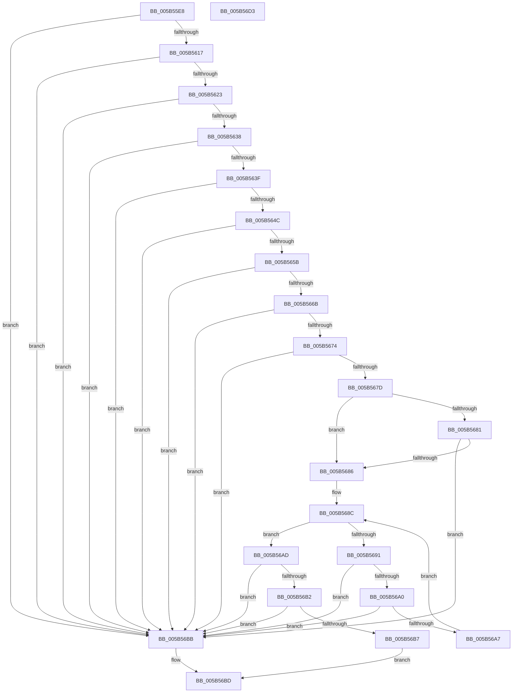

# KiValidateTriageDumpDataArray

- RVA: `0x005B55E8`–`0x005B56D4` (길이 `236` bytes)
- VA: `0x00000001405B55E8`
- 실행 섹션: `.text`
- PDB 이름 있음: `예`; PDB Function 태그: `아니요`
- unwind 정보 RVA: `0x0006F978`
- 디코드: `76`개 명령, `236/236` bytes 표시
- 미해석 바이트: `0` (있으면 어셈블리에 `.byte`로 보존)

> 이 문서는 커널 이미지의 기계어와 PDB 기호를 분석해 생성했습니다. 4번과 5번은 함수 원형과 자료형을 바이너리 사용 방식에서 추정한 C 해석이며 원본 소스 복구 결과는 아닙니다.

## 1. Dependencies

- 직접 호출 지점: **4**; 고유 호출 대상: **1**
- 직접 호출자로 확인된 함수: **3**
- RIP 상대 이미지 참조: **0**

### Outgoing calls
- `0x005B5608` → [KiIsAddressRangeValid](../4B/KiIsAddressRangeValid_function_004B0278.md) (function, `0x004B0278`)
- `0x005B5643` → [KiIsAddressRangeValid](../4B/KiIsAddressRangeValid_function_004B0278.md) (function, `0x004B0278`)
- `0x005B5652` → [KiIsAddressRangeValid](../4B/KiIsAddressRangeValid_function_004B0278.md) (function, `0x004B0278`)
- `0x005B5662` → [KiIsAddressRangeValid](../4B/KiIsAddressRangeValid_function_004B0278.md) (function, `0x004B0278`)

### Direct callers
- [IopLiveDumpAddTriageDumpData](../59/IopLiveDumpAddTriageDumpData_function_00599190.md) at `0x00599266`
- [KeAddTriageDumpDataBlock](KeAddTriageDumpDataBlock_function_005B26B0.md) at `0x005B26DB`
- [KiInvokeBugCheckAddTriageDumpDataCallbacks](KiInvokeBugCheckAddTriageDumpDataCallbacks_function_005B4F88.md) at `0x005B50A2`

### Static image references
- 디코드된 RIP-relative 메모리 참조가 없습니다.

## 2. Other-region calls and transfers

- 다른 실행 섹션으로 향하는 call: **0**
- 별도 외부 분기/꼬리 이동을 확인하지 못했습니다.

## 3. Assembly (complete function range)

```asm
005B55E8  48 89 5C 24 08                  mov qword ptr [rsp + 8], rbx
005B55ED  48 89 74 24 10                  mov qword ptr [rsp + 0x10], rsi
005B55F2  48 89 7C 24 18                  mov qword ptr [rsp + 0x18], rdi
005B55F7  41 56                           push r14
005B55F9  48 83 EC 20                     sub rsp, 0x20
005B55FD  BA 30 00 00 00                  mov edx, 0x30
005B5602  41 8B F0                        mov esi, r8d
005B5605  48 8B D9                        mov rbx, rcx
005B5608  E8 6B AC EF FF                  call 0x1404b0278
005B560D  33 FF                           xor edi, edi
005B560F  84 C0                           test al, al
005B5611  0F 84 A4 00 00 00               je 0x1405b56bb
005B5617  8B 43 14                        mov eax, dword ptr [rbx + 0x14]
005B561A  39 43 10                        cmp dword ptr [rbx + 0x10], eax
005B561D  0F 87 98 00 00 00               ja 0x1405b56bb
005B5623  8B D0                           mov edx, eax
005B5625  41 BE FF FF FF FF               mov r14d, 0xffffffff
005B562B  48 C1 E2 04                     shl rdx, 4
005B562F  49 3B D6                        cmp rdx, r14
005B5632  0F 87 83 00 00 00               ja 0x1405b56bb
005B5638  8D 42 30                        lea eax, [rdx + 0x30]
005B563B  3B C2                           cmp eax, edx
005B563D  72 7C                           jb 0x1405b56bb
005B563F  48 8D 4B 30                     lea rcx, [rbx + 0x30]
005B5643  E8 30 AC EF FF                  call 0x1404b0278
005B5648  84 C0                           test al, al
005B564A  74 6F                           je 0x1405b56bb
005B564C  48 8B 0B                        mov rcx, qword ptr [rbx]
005B564F  8D 57 10                        lea edx, [rdi + 0x10]
005B5652  E8 21 AC EF FF                  call 0x1404b0278
005B5657  84 C0                           test al, al
005B5659  74 60                           je 0x1405b56bb
005B565B  48 8B 4B 08                     mov rcx, qword ptr [rbx + 8]
005B565F  8D 57 10                        lea edx, [rdi + 0x10]
005B5662  E8 11 AC EF FF                  call 0x1404b0278
005B5667  84 C0                           test al, al
005B5669  74 50                           je 0x1405b56bb
005B566B  48 8B 03                        mov rax, qword ptr [rbx]
005B566E  48 39 58 08                     cmp qword ptr [rax + 8], rbx
005B5672  75 47                           jne 0x1405b56bb
005B5674  48 8B 43 08                     mov rax, qword ptr [rbx + 8]
005B5678  48 39 18                        cmp qword ptr [rax], rbx
005B567B  75 3E                           jne 0x1405b56bb
005B567D  85 F6                           test esi, esi
005B567F  74 05                           je 0x1405b5686
005B5681  39 73 1C                        cmp dword ptr [rbx + 0x1c], esi
005B5684  77 35                           ja 0x1405b56bb
005B5686  44 8B 43 10                     mov r8d, dword ptr [rbx + 0x10]
005B568A  8B CF                           mov ecx, edi
005B568C  41 3B C8                        cmp ecx, r8d
005B568F  73 1C                           jae 0x1405b56ad
005B5691  8B C1                           mov eax, ecx
005B5693  48 03 C0                        add rax, rax
005B5696  48 8B 54 C3 38                  mov rdx, qword ptr [rbx + rax*8 + 0x38]
005B569B  49 3B D6                        cmp rdx, r14
005B569E  77 1B                           ja 0x1405b56bb
005B56A0  8D 04 3A                        lea eax, [rdx + rdi]
005B56A3  3B C7                           cmp eax, edi
005B56A5  72 14                           jb 0x1405b56bb
005B56A7  8B F8                           mov edi, eax
005B56A9  FF C1                           inc ecx
005B56AB  EB DF                           jmp 0x1405b568c
005B56AD  39 7B 18                        cmp dword ptr [rbx + 0x18], edi
005B56B0  75 09                           jne 0x1405b56bb
005B56B2  3B 7B 1C                        cmp edi, dword ptr [rbx + 0x1c]
005B56B5  77 04                           ja 0x1405b56bb
005B56B7  B0 01                           mov al, 1
005B56B9  EB 02                           jmp 0x1405b56bd
005B56BB  32 C0                           xor al, al
005B56BD  48 8B 5C 24 30                  mov rbx, qword ptr [rsp + 0x30]
005B56C2  48 8B 74 24 38                  mov rsi, qword ptr [rsp + 0x38]
005B56C7  48 8B 7C 24 40                  mov rdi, qword ptr [rsp + 0x40]
005B56CC  48 83 C4 20                     add rsp, 0x20
005B56D0  41 5E                           pop r14
005B56D2  C3                              ret
005B56D3  CC                              int3
```

## 4. C-style interpretation (structured pseudocode)

```c
__int64 __fastcall KiValidateTriageDumpDataArray(__int64 a1, __int64 a2, int a3)
{
    __int64 result;
    __int64 v_rdi;
    __int64 v_rsp;
    unsigned __int64 v_stack_p10;
    unsigned __int64 v_stack_p18;
    unsigned __int64 v_stack_p8;

    v_stack_p8 = v_rbx;
    v_stack_p10 = v_rsi;
    v_stack_p18 = v_rdi;
    v_rsp = (v_rsp) - (32);
    result = KiIsAddressRangeValid(a1, 48, a3, a4);
    v_rdi = 0;
    if ((unsigned __int8)(result) == 0) goto loc_005B56BB;
    if ((*(unsigned int *)(a1 + 16)) > ((unsigned int)((unsigned int)(*(unsigned int *)(a1 + 20))))) goto loc_005B56BB;
    a2 = ((unsigned int)((unsigned int)((unsigned int)(*(unsigned int *)(a1 + 20))))) << (4);
    if (a2 > ((unsigned int)(0xFFFFFFFFULL))) goto loc_005B56BB;
    if (((unsigned int)(a2 + 48)) < ((unsigned int)(a2))) goto loc_005B56BB;
    result = KiIsAddressRangeValid(a1 + 48, a2, a3, a4);
    if ((unsigned __int8)(result) == 0) goto loc_005B56BB;
    result = KiIsAddressRangeValid(*(unsigned __int64 *)(a1), v_rdi + 16, a3, a4);
    if ((unsigned __int8)(result) == 0) goto loc_005B56BB;
    result = KiIsAddressRangeValid(*(unsigned __int64 *)(a1 + 8), v_rdi + 16, a3, a4);
    if ((unsigned __int8)(result) == 0) goto loc_005B56BB;
    if ((*(unsigned __int64 *)(*(unsigned __int64 *)(a1) + 8)) != a1) goto loc_005B56BB;
    if ((*(unsigned __int64 *)(*(unsigned __int64 *)(a1 + 8))) != a1) goto loc_005B56BB;
    if ((unsigned int)((unsigned int)(a3)) == 0) goto loc_005B5686;
    if ((*(unsigned int *)(a1 + 28)) > ((unsigned int)((unsigned int)(a3)))) goto loc_005B56BB;
loc_005B5686:
loc_005B568C:
    if (0 >= ((unsigned int)((unsigned int)(*(unsigned int *)(a1 + 16))))) goto loc_005B56AD;
    result = (0) + (0);
    if ((*(unsigned __int64 *)(a1 + result * 8 + 56)) > ((unsigned int)(0xFFFFFFFFULL))) goto loc_005B56BB;
    if (((unsigned int)(*(unsigned __int64 *)(a1 + result * 8 + 56) + v_rdi * 1)) < 0) goto loc_005B56BB;
    a1 = (unsigned int)((0) + 1);
    goto loc_005B568C;
loc_005B56AD:
    if ((*(unsigned int *)(a1 + 24)) != ((unsigned int)((unsigned int)((unsigned int)(*(unsigned __int64 *)(a1 + result * 8 + 56) + v_rdi * 1))))) goto loc_005B56BB;
    if (((unsigned int)((unsigned int)((unsigned int)(*(unsigned __int64 *)(a1 + result * 8 + 56) + v_rdi * 1)))) > (*(unsigned int *)(a1 + 28))) goto loc_005B56BB;
    goto loc_005B56BD;
loc_005B56BB:
    result = 0;
loc_005B56BD:
    v_rsp = (v_rsp) + (32);
    return result;
}
```

## 5. (Beta) C Style

```c
int64_t KiValidateTriageDumpDataArray(void *Arg1, int64_t Arg2, int32_t Arg3)
{
    uint8_t *arg1 = (uint8_t *)Arg1;

    int64_t result;
    int64_t local_rdi;
    int64_t local_rsp;
    uint64_t v_stack_p10;
    uint64_t v_stack_p18;
    uint64_t v_stack_p8;

    v_stack_p8 = local_rbx;
    v_stack_p10 = local_rsi;
    v_stack_p18 = local_rdi;
    local_rsp = (local_rsp) - (32);
    result = KiIsAddressRangeValid(Arg1, 48, Arg3, a4);
    local_rdi = 0;
    if ((uint8_t)(result) == 0) goto loc_005B56BB;
    if ((*(uint32_t *)(arg1 + 0x10)) > ((uint32_t)((uint32_t)(*(uint32_t *)(arg1 + 0x14))))) goto loc_005B56BB;
    Arg2 = ((uint32_t)((uint32_t)((uint32_t)(*(uint32_t *)(arg1 + 0x14))))) << (4);
    if (Arg2 > ((uint32_t)(0xFFFFFFFFULL))) goto loc_005B56BB;
    if (((uint32_t)(Arg2 + 48)) < ((uint32_t)(Arg2))) goto loc_005B56BB;
    result = KiIsAddressRangeValid(Arg1 + 48, Arg2, Arg3, a4);
    if ((uint8_t)(result) == 0) goto loc_005B56BB;
    result = KiIsAddressRangeValid(*(uint64_t *)(arg1), local_rdi + 16, Arg3, a4);
    if ((uint8_t)(result) == 0) goto loc_005B56BB;
    result = KiIsAddressRangeValid(*(uint64_t *)(arg1 + 0x8), local_rdi + 16, Arg3, a4);
    if ((uint8_t)(result) == 0) goto loc_005B56BB;
    if ((*(uint64_t *)(*(uint64_t *)(arg1) + 0x8)) != Arg1) goto loc_005B56BB;
    if ((*(uint64_t *)(*(uint64_t *)(arg1 + 0x8))) != Arg1) goto loc_005B56BB;
    if ((uint32_t)((uint32_t)(Arg3)) == 0) goto loc_005B5686;
    if ((*(uint32_t *)(arg1 + 0x1C)) > ((uint32_t)((uint32_t)(Arg3)))) goto loc_005B56BB;
loc_005B5686:
loc_005B568C:
    if (0 >= ((uint32_t)((uint32_t)(*(uint32_t *)(arg1 + 0x10))))) goto loc_005B56AD;
    result = (0) + (0);
    if ((*(uint64_t *)(arg1 + result * 8 + 0x38)) > ((uint32_t)(0xFFFFFFFFULL))) goto loc_005B56BB;
    if (((uint32_t)(*(uint64_t *)(arg1 + result * 8 + 0x38) + local_rdi * 1)) < 0) goto loc_005B56BB;
    Arg1 = (uint32_t)((0) + 1);
    goto loc_005B568C;
loc_005B56AD:
    if ((*(uint32_t *)(arg1 + 0x18)) != ((uint32_t)((uint32_t)((uint32_t)(*(uint64_t *)(arg1 + result * 8 + 0x38) + local_rdi * 1))))) goto loc_005B56BB;
    if (((uint32_t)((uint32_t)((uint32_t)(*(uint64_t *)(arg1 + result * 8 + 0x38) + local_rdi * 1)))) > (*(uint32_t *)(arg1 + 0x1C))) goto loc_005B56BB;
    goto loc_005B56BD;
loc_005B56BB:
    result = 0;
loc_005B56BD:
    local_rsp = (local_rsp) + (32);
    return result;
}
```

### 관측된 메모리 오프셋

구조체 형식이 확인되지 않은 접근은 인자 기준의 오프셋으로만 기록했습니다.

| 기준 인자 | 오프셋 표현 | 폭 (bit) | 접근 |
|---|---:|---:|---|
| `Arg1` | `+ 0x0` | `64` | `R` |
| `Arg1` | `+ 0x8` | `64` | `R` |
| `Arg1` | `+ 0x10` | `32` | `R` |
| `Arg1` | `+ 0x14` | `32` | `R` |
| `Arg1` | `+ 0x18` | `32` | `R` |
| `Arg1` | `+ 0x1C` | `32` | `R` |
| `Arg1` | `+ 0x30` | `64` | `R` |
| `Arg1` | `+ 0x38 + rax*8` | `64` | `R` |

## 6. Execution-region graph

[열기: 2D/3D 그래프와 함수 탐색 컨트롤 패널](../../../control-panel.html?section=text&rva=0x005B55E8&view=graph)

- 2D 그래프는 위에서 아래로 흐르고, 3D 그래프는 빈 공간을 드래그해 회전합니다. Shift+드래그는 이동, 휠은 확대·축소, 함수 노드 선택은 대상 보고서 이동입니다.

### Static fallback


