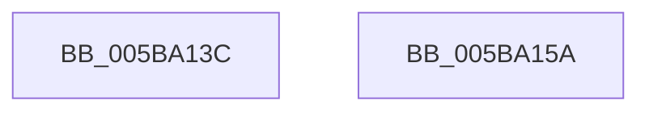

# KiXSavesManagesIpt

- RVA: `0x005BA13C`–`0x005BA15B` (길이 `31` bytes)
- VA: `0x00000001405BA13C`
- 실행 섹션: `.text`
- PDB 이름 있음: `예`; PDB Function 태그: `아니요`
- unwind 정보 RVA: `0x000DB714`
- 디코드: `8`개 명령, `31/31` bytes 표시
- 미해석 바이트: `0` (있으면 어셈블리에 `.byte`로 보존)

> 이 문서는 커널 이미지의 기계어와 PDB 기호를 분석해 생성했습니다. 4번과 5번은 함수 원형과 자료형을 바이너리 사용 방식에서 추정한 C 해석이며 원본 소스 복구 결과는 아닙니다.

## 1. Dependencies

- 직접 호출 지점: **0**; 고유 호출 대상: **0**
- 직접 호출자로 확인된 함수: **1**
- RIP 상대 이미지 참조: **2**

### Outgoing calls
- 직접 디코드된 call 명령이 없습니다.

### Direct callers
- [KiQueryIptSupport](../../pagelk/B6/KiQueryIptSupport_function_00B67690.md) at `0x00B676A4`

### Static image references
- `0x005BA13C` → RVA `0x00FC6C60` (`ALMOSTRO`; read)
- `0x005BA148` → RVA `0x00FC6B30` (`ALMOSTRO`; read)

## 2. Other-region calls and transfers

- 다른 실행 섹션으로 향하는 call: **0**
- 별도 외부 분기/꼬리 이동을 확인하지 못했습니다.

## 3. Assembly (complete function range)

```asm
005BA13C  48 0F BA 25 1B CB A0 00 08      bt qword ptr [rip + 0xa0cb1b], 8
005BA145  0F 92 C1                        setb cl
005BA148  48 0F BA 25 DF C9 A0 00 17      bt qword ptr [rip + 0xa0c9df], 0x17
005BA151  0F 92 C0                        setb al
005BA154  84 C8                           test al, cl
005BA156  0F 95 C0                        setne al
005BA159  C3                              ret
005BA15A  CC                              int3
```

## 4. C-style interpretation (structured pseudocode)

```c
__int64 __fastcall KiXSavesManagesIpt(void)
{
    __int64 result;

    a1 = (condition_is_below) ? 1 : 0;
    result = (condition_is_below) ? 1 : 0;
    result = ((((unsigned __int8)(result)) & ((unsigned __int8)(a1))) != 0) ? 1 : 0;
    return result;
}
```

## 5. (Beta) C Style

```c
void KiXSavesManagesIpt(void)
{
    int64_t result;

    a1 = (condition_is_below) ? 1 : 0;
    result = (condition_is_below) ? 1 : 0;
    result = ((((uint8_t)(result)) & ((uint8_t)(a1))) != 0) ? 1 : 0;
    return result;
}
```

## 6. Execution-region graph

[열기: 2D/3D 그래프와 함수 탐색 컨트롤 패널](../../../control-panel.html?section=text&rva=0x005BA13C&view=graph)

- 2D 그래프는 위에서 아래로 흐르고, 3D 그래프는 빈 공간을 드래그해 회전합니다. Shift+드래그는 이동, 휠은 확대·축소, 함수 노드 선택은 대상 보고서 이동입니다.

### Static fallback


