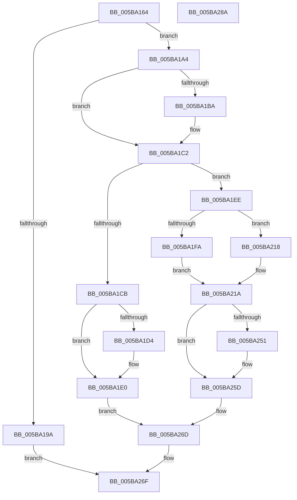

# KxEnableOptionalXStateFeatures

- RVA: `0x005BA164`–`0x005BA28B` (길이 `295` bytes)
- VA: `0x00000001405BA164`
- 실행 섹션: `.text`
- PDB 이름 있음: `예`; PDB Function 태그: `아니요`
- unwind 정보 RVA: `0x0005E6B4`
- 디코드: `78`개 명령, `295/295` bytes 표시
- 미해석 바이트: `0` (있으면 어셈블리에 `.byte`로 보존)

> 이 문서는 커널 이미지의 기계어와 PDB 기호를 분석해 생성했습니다. 4번과 5번은 함수 원형과 자료형을 바이너리 사용 방식에서 추정한 C 해석이며 원본 소스 복구 결과는 아닙니다.

## 1. Dependencies

- 직접 호출 지점: **5**; 고유 호출 대상: **4**
- 직접 호출자로 확인된 함수: **2**
- RIP 상대 이미지 참조: **2**

### Outgoing calls
- `0x005BA1BD` → [KiRaiseIrqlProcessIrqlFlags](../4F/KiRaiseIrqlProcessIrqlFlags_function_004F56FC.md) (function, `0x004F56FC`)
- `0x005BA1DB` → [KiLowerIrqlProcessIrqlFlags](../4F/KiLowerIrqlProcessIrqlFlags_function_004F5698.md) (function, `0x004F5698`)
- `0x005BA20F` → [memset](../6C/memset_function_006C6C40.md) (function, `0x006C6C40`)
- `0x005BA258` → [KiLowerIrqlProcessIrqlFlags](../4F/KiLowerIrqlProcessIrqlFlags_function_004F5698.md) (function, `0x004F5698`)
- `0x005BA268` → [KeCopyXfdMaskToTeb](../4A/KeCopyXfdMaskToTeb_function_004A6410.md) (function, `0x004A6410`)

### Direct callers
- [KiEnableOptionalXStateFeatures](../3D/KiEnableOptionalXStateFeatures_function_003D8BE8.md) at `0x003D8C81`
- [KeEnableOptionalXStateFeaturesApc](KeEnableOptionalXStateFeaturesApc_function_005B9B90.md) at `0x005B9BB6`

### Static image references
- `0x005BA1B1` → RVA `0x00FC6D20` (`ALMOSTRO`; read)
- `0x005BA1FA` → RVA `0x00FC6C54` (`ALMOSTRO`; read)

## 2. Other-region calls and transfers

- 다른 실행 섹션으로 향하는 call: **0**
- 별도 외부 분기/꼬리 이동을 확인하지 못했습니다.

## 3. Assembly (complete function range)

```asm
005BA164  48 8B C4                        mov rax, rsp
005BA167  48 89 58 08                     mov qword ptr [rax + 8], rbx
005BA16B  48 89 68 10                     mov qword ptr [rax + 0x10], rbp
005BA16F  48 89 70 18                     mov qword ptr [rax + 0x18], rsi
005BA173  48 89 78 20                     mov qword ptr [rax + 0x20], rdi
005BA177  41 56                           push r14
005BA179  48 83 EC 20                     sub rsp, 0x20
005BA17D  48 8B 81 20 02 00 00            mov rax, qword ptr [rcx + 0x220]
005BA184  4D 8B F1                        mov r14, r9
005BA187  49 8B E8                        mov rbp, r8
005BA18A  48 8B F2                        mov rsi, rdx
005BA18D  48 8B D9                        mov rbx, rcx
005BA190  48 83 B8 10 03 00 00 00         cmp qword ptr [rax + 0x310], 0
005BA198  74 0A                           je 0x1405ba1a4
005BA19A  B8 BB 00 00 C0                  mov eax, 0xc00000bb
005BA19F  E9 CB 00 00 00                  jmp 0x1405ba26f
005BA1A4  44 0F 20 C7                     mov rdi, cr8
005BA1A8  BA 02 00 00 00                  mov edx, 2
005BA1AD  44 0F 22 C2                     mov cr8, rdx
005BA1B1  83 3D 68 CB A0 00 00            cmp dword ptr [rip + 0xa0cb68], 0
005BA1B8  74 08                           je 0x1405ba1c2
005BA1BA  40 8A CF                        mov cl, dil
005BA1BD  E8 3A B5 F3 FF                  call 0x1404f56fc
005BA1C2  48 85 B3 28 04 00 00            test qword ptr [rbx + 0x428], rsi
005BA1C9  75 23                           jne 0x1405ba1ee
005BA1CB  83 3D 4E CB A0 00 00            cmp dword ptr [rip + 0xa0cb4e], 0
005BA1D2  74 0C                           je 0x1405ba1e0
005BA1D4  44 0F 20 C1                     mov rcx, cr8
005BA1D8  40 8A D7                        mov dl, dil
005BA1DB  E8 B8 B4 F3 FF                  call 0x1404f5698
005BA1E0  40 0F B6 C7                     movzx eax, dil
005BA1E4  44 0F 22 C0                     mov cr8, rax
005BA1E8  41 C6 06 00                     mov byte ptr [r14], 0
005BA1EC  EB 7F                           jmp 0x1405ba26d
005BA1EE  8B 43 74                        mov eax, dword ptr [rbx + 0x74]
005BA1F1  B9 00 00 80 00                  mov ecx, 0x800000
005BA1F6  85 C1                           test ecx, eax
005BA1F8  75 1E                           jne 0x1405ba218
005BA1FA  44 8B 05 53 CA A0 00            mov r8d, dword ptr [rip + 0xa0ca53]
005BA201  0B C1                           or eax, ecx
005BA203  48 8B CD                        mov rcx, rbp
005BA206  89 43 74                        mov dword ptr [rbx + 0x74], eax
005BA209  33 D2                           xor edx, edx
005BA20B  48 89 6B 60                     mov qword ptr [rbx + 0x60], rbp
005BA20F  E8 2C CA 10 00                  call 0x1406c6c40
005BA214  B0 01                           mov al, 1
005BA216  EB 02                           jmp 0x1405ba21a
005BA218  32 C0                           xor al, al
005BA21A  41 88 06                        mov byte ptr [r14], al
005BA21D  B9 C4 01 00 00                  mov ecx, 0x1c4
005BA222  48 09 B3 50 02 00 00            or qword ptr [rbx + 0x250], rsi
005BA229  48 F7 D6                        not rsi
005BA22C  48 21 B3 28 04 00 00            and qword ptr [rbx + 0x428], rsi
005BA233  0F 32                           rdmsr
005BA235  48 C1 E2 20                     shl rdx, 0x20
005BA239  48 0B C2                        or rax, rdx
005BA23C  48 23 C6                        and rax, rsi
005BA23F  48 8B D0                        mov rdx, rax
005BA242  48 C1 EA 20                     shr rdx, 0x20
005BA246  0F 30                           wrmsr
005BA248  83 3D D1 CA A0 00 00            cmp dword ptr [rip + 0xa0cad1], 0
005BA24F  74 0C                           je 0x1405ba25d
005BA251  44 0F 20 C1                     mov rcx, cr8
005BA255  40 8A D7                        mov dl, dil
005BA258  E8 3B B4 F3 FF                  call 0x1404f5698
005BA25D  40 0F B6 C7                     movzx eax, dil
005BA261  44 0F 22 C0                     mov cr8, rax
005BA265  48 8B CB                        mov rcx, rbx
005BA268  E8 A3 C1 EE FF                  call 0x1404a6410
005BA26D  33 C0                           xor eax, eax
005BA26F  48 8B 5C 24 30                  mov rbx, qword ptr [rsp + 0x30]
005BA274  48 8B 6C 24 38                  mov rbp, qword ptr [rsp + 0x38]
005BA279  48 8B 74 24 40                  mov rsi, qword ptr [rsp + 0x40]
005BA27E  48 8B 7C 24 48                  mov rdi, qword ptr [rsp + 0x48]
005BA283  48 83 C4 20                     add rsp, 0x20
005BA287  41 5E                           pop r14
005BA289  C3                              ret
005BA28A  CC                              int3
```

## 4. C-style interpretation (structured pseudocode)

```c
__int64 __fastcall KxEnableOptionalXStateFeatures(__int64 a1, __int64 a2, __int64 a3, __int64 a4)
{
    __int64 result;
    __int64 v_rsi;
    __int64 v_rsp;
    unsigned __int64 v_stack_p10;
    unsigned __int64 v_stack_p18;
    unsigned __int64 v_stack_p20;
    unsigned __int64 v_stack_p8;

    *(unsigned __int64 *)(v_rsp + 8) = v_rbx;
    *(unsigned __int64 *)(v_rsp + 16) = v_rbp;
    *(unsigned __int64 *)(v_rsp + 24) = v_rsi;
    *(unsigned __int64 *)(v_rsp + 32) = v_rdi;
    v_rsp = (v_rsp) - (32);
    if ((*(unsigned __int64 *)(*(unsigned __int64 *)(a1 + 544) + 784)) == 0) goto loc_005BA1A4;
    goto loc_005BA26F;
loc_005BA1A4:
    result = (unsigned int)(0xC00000BBULL);
    if ((*(unsigned int *)(v_rip + 10537832)) != 0) {
        a1 = (unsigned __int8)(v_cr8);
        result = KiRaiseIrqlProcessIrqlFlags(a1, 2, a3, a4);
    }
    if (((*(unsigned __int64 *)(a1 + 1064)) & (a2)) != 0) goto loc_005BA1EE;
    if ((*(unsigned int *)(v_rip + 10537806)) != 0) {
        a1 = 2;
        a2 = (unsigned __int8)(v_cr8);
        result = KiLowerIrqlProcessIrqlFlags(a1, a2, a3, a4);
    }
    *(unsigned __int8 *)(a4) = 0;
    goto loc_005BA26D;
loc_005BA1EE:
    if ((((unsigned int)((unsigned int)(0x800000ULL))) & ((unsigned int)((unsigned int)(*(unsigned int *)(a1 + 116))))) != 0) goto loc_005BA218;
    result = (unsigned int)(((unsigned int)(*(unsigned int *)(a1 + 116))) | ((unsigned int)((unsigned int)(0x800000ULL))));
    *(unsigned int *)(a1 + 116) = (unsigned int)(result);
    a2 = 0;
    *(unsigned __int64 *)(a1 + 96) = a3;
    result = memset(a3, a2, (unsigned int)(*(unsigned int *)(v_rip + 10537555)), a4);
    goto loc_005BA21A;
loc_005BA218:
    result = 0;
loc_005BA21A:
    *(unsigned __int8 *)(a4) = 0;
    v_rsi = ~(a2);
    a2 = (a2) << (32);
    result = (result) | (a2);
    result = (result) & (v_rsi);
    a2 = (result) >> (32);
    if ((*(unsigned int *)(v_rip + 10537681)) != 0) {
        a1 = (unsigned __int8)(v_cr8);
        a2 = (unsigned __int8)(v_cr8);
        result = KiLowerIrqlProcessIrqlFlags(a1, a2, (unsigned int)(*(unsigned int *)(v_rip + 10537555)), a4);
    }
    result = KeCopyXfdMaskToTeb(a1, a2, (unsigned int)(*(unsigned int *)(v_rip + 10537555)), a4);
loc_005BA26D:
    result = 0;
loc_005BA26F:
    v_rsp = (v_rsp) + (32);
    return result;
}
```

## 5. (Beta) C Style

```c
int64_t KxEnableOptionalXStateFeatures(void *Arg1, int64_t Arg2, int64_t Arg3, void *Arg4)
{
    uint8_t *arg1 = (uint8_t *)Arg1;
    uint8_t *arg4 = (uint8_t *)Arg4;

    int64_t result;
    int64_t local_rsi;
    int64_t local_rsp;
    uint64_t v_stack_p10;
    uint64_t v_stack_p18;
    uint64_t v_stack_p20;
    uint64_t v_stack_p8;

    *(uint64_t *)(local_rsp + 0x8) = local_rbx;
    *(uint64_t *)(local_rsp + 0x10) = local_rbp;
    *(uint64_t *)(local_rsp + 0x18) = local_rsi;
    *(uint64_t *)(local_rsp + 0x20) = local_rdi;
    local_rsp = (local_rsp) - (32);
    if ((*(uint64_t *)(*(uint64_t *)(arg1 + 0x220) + 0x310)) == 0) goto loc_005BA1A4;
    goto loc_005BA26F;
loc_005BA1A4:
    result = (uint32_t)(0xC00000BBULL);
    if ((*(uint32_t *)(v_rip + 0xA0CB68)) != 0) {
        Arg1 = (uint8_t)(v_cr8);
        result = KiRaiseIrqlProcessIrqlFlags(Arg1, 2, Arg3, Arg4);
    }
    if (((*(uint64_t *)(arg1 + 0x428)) & (Arg2)) != 0) goto loc_005BA1EE;
    if ((*(uint32_t *)(v_rip + 0xA0CB4E)) != 0) {
        Arg1 = 2;
        Arg2 = (uint8_t)(v_cr8);
        result = KiLowerIrqlProcessIrqlFlags(Arg1, Arg2, Arg3, Arg4);
    }
    *(uint8_t *)(arg4) = 0;
    goto loc_005BA26D;
loc_005BA1EE:
    if ((((uint32_t)((uint32_t)(0x800000ULL))) & ((uint32_t)((uint32_t)(*(uint32_t *)(arg1 + 0x74))))) != 0) goto loc_005BA218;
    result = (uint32_t)(((uint32_t)(*(uint32_t *)(arg1 + 0x74))) | ((uint32_t)((uint32_t)(0x800000ULL))));
    *(uint32_t *)(arg1 + 0x74) = (uint32_t)(result);
    Arg2 = 0;
    *(uint64_t *)(arg1 + 0x60) = Arg3;
    result = memset(Arg3, Arg2, (uint32_t)(*(uint32_t *)(v_rip + 0xA0CA53)), Arg4);
    goto loc_005BA21A;
loc_005BA218:
    result = 0;
loc_005BA21A:
    *(uint8_t *)(arg4) = 0;
    local_rsi = ~(Arg2);
    Arg2 = (Arg2) << (32);
    result = (result) | (Arg2);
    result = (result) & (local_rsi);
    Arg2 = (result) >> (32);
    if ((*(uint32_t *)(v_rip + 0xA0CAD1)) != 0) {
        Arg1 = (uint8_t)(v_cr8);
        Arg2 = (uint8_t)(v_cr8);
        result = KiLowerIrqlProcessIrqlFlags(Arg1, Arg2, (uint32_t)(*(uint32_t *)(v_rip + 0xA0CA53)), Arg4);
    }
    result = KeCopyXfdMaskToTeb(Arg1, Arg2, (uint32_t)(*(uint32_t *)(v_rip + 0xA0CA53)), Arg4);
loc_005BA26D:
    result = 0;
loc_005BA26F:
    local_rsp = (local_rsp) + (32);
    return result;
}
```

### 관측된 메모리 오프셋

구조체 형식이 확인되지 않은 접근은 인자 기준의 오프셋으로만 기록했습니다.

| 기준 인자 | 오프셋 표현 | 폭 (bit) | 접근 |
|---|---:|---:|---|
| `Arg1` | `+ 0x60` | `64` | `W` |
| `Arg1` | `+ 0x74` | `32` | `R` |
| `Arg1` | `+ 0x74` | `32` | `W` |
| `Arg1` | `+ 0x220` | `64` | `R` |
| `Arg1` | `+ 0x250` | `64` | `R/W` |
| `Arg1` | `+ 0x428` | `64` | `R` |
| `Arg1` | `+ 0x428` | `64` | `R/W` |
| `Arg4` | `+ 0x0` | `8` | `W` |

## 6. Execution-region graph

[열기: 2D/3D 그래프와 함수 탐색 컨트롤 패널](../../../control-panel.html?section=text&rva=0x005BA164&view=graph)

- 2D 그래프는 위에서 아래로 흐르고, 3D 그래프는 빈 공간을 드래그해 회전합니다. Shift+드래그는 이동, 휠은 확대·축소, 함수 노드 선택은 대상 보고서 이동입니다.

### Static fallback


