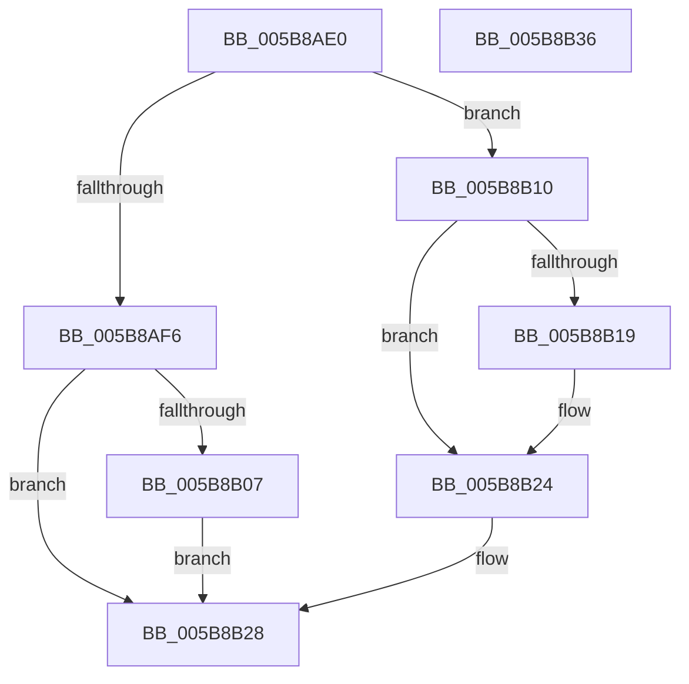

# KzSetIrqlUnsafe

- RVA: `0x005B8AE0`–`0x005B8B37` (길이 `87` bytes)
- VA: `0x00000001405B8AE0`
- 실행 섹션: `.text`
- PDB 이름 있음: `예`; PDB Function 태그: `아니요`
- unwind 정보 RVA: `0x0005CAAC`
- 디코드: `26`개 명령, `87/87` bytes 표시
- 미해석 바이트: `0` (있으면 어셈블리에 `.byte`로 보존)

> 이 문서는 커널 이미지의 기계어와 PDB 기호를 분석해 생성했습니다. 4번과 5번은 함수 원형과 자료형을 바이너리 사용 방식에서 추정한 C 해석이며 원본 소스 복구 결과는 아닙니다.

## 1. Dependencies

- 직접 호출 지점: **2**; 고유 호출 대상: **2**
- 직접 호출자로 확인된 함수: **24**
- RIP 상대 이미지 참조: **1**

### Outgoing calls
- `0x005B8B09` → [KiRaiseIrqlProcessIrqlFlags](../4F/KiRaiseIrqlProcessIrqlFlags_function_004F56FC.md) (function, `0x004F56FC`)
- `0x005B8B1F` → [KiLowerIrqlProcessIrqlFlags](../4F/KiLowerIrqlProcessIrqlFlags_function_004F5698.md) (function, `0x004F5698`)

### Direct callers
- [KiIdleLoop](../6B/KiIdleLoop_function_006B2910.md) at `0x006B2951`
- [KiIdleLoop](../6B/KiIdleLoop_function_006B2910.md) at `0x006B2973`
- [KiChainedDispatch](../6B/KiChainedDispatch_function_006B3480.md) at `0x006B34F1`
- [KiScanInterruptObjectList](../6B/KiScanInterruptObjectList_function_006B3860.md) at `0x006B3875`
- [KiInterruptSubDispatch](../6B/KiInterruptSubDispatch_function_006B3990.md) at `0x006B39A1`
- [KiInterruptSubDispatchNoLock](../6B/KiInterruptSubDispatchNoLock_function_006B3A30.md) at `0x006B3A41`
- [KiInterruptSubDispatchNoLockNoEtw](../6B/KiInterruptSubDispatchNoLockNoEtw_function_006B3AD0.md) at `0x006B3AE1`
- [KiInterruptDispatch](../6B/KiInterruptDispatch_function_006B3B30.md) at `0x006B3BA1`
- [KiInterruptDispatchNoLock](../6B/KiInterruptDispatchNoLock_function_006B3F10.md) at `0x006B3F81`
- [KiInterruptDispatchNoLockNoEtw](../6B/KiInterruptDispatchNoLockNoEtw_function_006B42F0.md) at `0x006B4361`
- [KiInterruptDispatchNoEOI](../6B/KiInterruptDispatchNoEOI_function_006B46D0.md) at `0x006B4739`
- [KiSpuriousDispatchNoEOI](../6B/KiSpuriousDispatchNoEOI_function_006B4AA0.md) at `0x006B4AAE`
- [KiSpuriousDispatchNoEOI](../6B/KiSpuriousDispatchNoEOI_function_006B4AA0.md) at `0x006B4AFD`
- [KxIsrLinkage](../6B/KxIsrLinkage_function_006B5680.md) at `0x006B5A18`
- [KxIsrLinkage](../6B/KxIsrLinkage_function_006B5680.md) at `0x006B5AAC`
- [KiApcInterrupt](../6B/KiApcInterrupt_function_006B5E20.md) at `0x006B6195`
- [KiApcInterrupt](../6B/KiApcInterrupt_function_006B5E20.md) at `0x006B61D9`
- [KiHvInterruptDispatch](../6B/KiHvInterruptDispatch_function_006B7750.md) at `0x006B77CE`
- [KiVmbusInterruptDispatch](../6B/KiVmbusInterruptDispatch_function_006B7B40.md) at `0x006B7BAA`
- [KiHvInterruptSubDispatch](../6B/KiHvInterruptSubDispatch_function_006B7F10.md) at `0x006B7F22`
- [KiVmbusInterruptSubDispatch](../6B/KiVmbusInterruptSubDispatch_function_006B7FC0.md) at `0x006B7FD2`
- [KiSwInterrupt](../6B/KiSwInterrupt_function_006B8070.md) at `0x006B83E8`
- [KiSwInterrupt](../6B/KiSwInterrupt_function_006B8070.md) at `0x006B8445`
- [KiDpcInterrupt](../6B/KiDpcInterrupt_function_006B87C0.md) at `0x006B8B2C`
- [KiDpcInterrupt](../6B/KiDpcInterrupt_function_006B87C0.md) at `0x006B8B6D`
- [KiIpiInterrupt](../6B/KiIpiInterrupt_function_006B8F20.md) at `0x006B92EF`
- [KiIpiInterruptSubDispatch](../6B/KiIpiInterruptSubDispatch_function_006B9660.md) at `0x006B9672`
- [KiNmiInterrupt](../6B/KiNmiInterrupt_function_006BD3C0.md) at `0x006BD5AA`
- [KiNmiInterrupt](../6B/KiNmiInterrupt_function_006BD3C0.md) at `0x006BD644`
- [KiMcheckAbort](../6C/KiMcheckAbort_function_006C16C0.md) at `0x006C18AA`
- [KiMcheckAbort](../6C/KiMcheckAbort_function_006C16C0.md) at `0x006C19CF`
- [KiSystemStartup](../../pagelk/B5/KiSystemStartup_function_00B5B3C0.md) at `0x00B5B5BB`

### Static image references
- `0x005B8AFE` → RVA `0x00FC6D20` (`ALMOSTRO`; read)

## 2. Other-region calls and transfers

- 다른 실행 섹션으로 향하는 call: **0**
- 별도 외부 분기/꼬리 이동을 확인하지 못했습니다.

## 3. Assembly (complete function range)

```asm
005B8AE0  48 89 5C 24 08                  mov qword ptr [rsp + 8], rbx
005B8AE5  57                              push rdi
005B8AE6  48 83 EC 20                     sub rsp, 0x20
005B8AEA  0F B6 D9                        movzx ebx, cl
005B8AED  44 0F 20 C7                     mov rdi, cr8
005B8AF1  40 3A FB                        cmp dil, bl
005B8AF4  77 1A                           ja 0x1405b8b10
005B8AF6  44 0F 20 C1                     mov rcx, cr8
005B8AFA  44 0F 22 C3                     mov cr8, rbx
005B8AFE  83 3D 1B E2 A0 00 00            cmp dword ptr [rip + 0xa0e21b], 0
005B8B05  74 21                           je 0x1405b8b28
005B8B07  8A D3                           mov dl, bl
005B8B09  E8 EE CB F3 FF                  call 0x1404f56fc
005B8B0E  EB 18                           jmp 0x1405b8b28
005B8B10  83 3D 09 E2 A0 00 00            cmp dword ptr [rip + 0xa0e209], 0
005B8B17  74 0B                           je 0x1405b8b24
005B8B19  44 0F 20 C1                     mov rcx, cr8
005B8B1D  8A D3                           mov dl, bl
005B8B1F  E8 74 CB F3 FF                  call 0x1404f5698
005B8B24  44 0F 22 C3                     mov cr8, rbx
005B8B28  48 8B 5C 24 30                  mov rbx, qword ptr [rsp + 0x30]
005B8B2D  40 8A C7                        mov al, dil
005B8B30  48 83 C4 20                     add rsp, 0x20
005B8B34  5F                              pop rdi
005B8B35  C3                              ret
005B8B36  CC                              int3
```

## 4. C-style interpretation (structured pseudocode)

```c
__int64 __fastcall KzSetIrqlUnsafe(unsigned __int8 a1)
{
    __int64 result;
    __int64 v_rsp;
    unsigned __int64 v_stack_p8;

    v_stack_p8 = v_rbx;
    v_rsp = (v_rsp) - (32);
    if (((unsigned __int8)(v_cr8)) > a1) goto loc_005B8B10;
    if ((*(unsigned int *)(v_rip + 10543643)) == 0) goto loc_005B8B28;
    result = KiRaiseIrqlProcessIrqlFlags(v_cr8, a1, a3, a4);
    goto loc_005B8B28;
loc_005B8B10:
    if ((*(unsigned int *)(v_rip + 10543625)) != 0) {
        a1 = a1;
        a2 = a1;
        result = KiLowerIrqlProcessIrqlFlags(a1, a2, a3, a4);
    }
loc_005B8B28:
    v_rsp = (v_rsp) + (32);
    return (unsigned __int8)(v_cr8);
}
```

## 5. (Beta) C Style

```c
int64_t KzSetIrqlUnsafe(uint8_t Arg1)
{
    int64_t result;
    int64_t local_rsp;
    uint64_t v_stack_p8;

    v_stack_p8 = local_rbx;
    local_rsp = (local_rsp) - (32);
    if (((uint8_t)(v_cr8)) > Arg1) goto loc_005B8B10;
    if ((*(uint32_t *)(v_rip + 0xA0E21B)) == 0) goto loc_005B8B28;
    result = KiRaiseIrqlProcessIrqlFlags(v_cr8, Arg1, a3, a4);
    goto loc_005B8B28;
loc_005B8B10:
    if ((*(uint32_t *)(v_rip + 0xA0E209)) != 0) {
        Arg1 = Arg1;
        a2 = Arg1;
        result = KiLowerIrqlProcessIrqlFlags(Arg1, a2, a3, a4);
    }
loc_005B8B28:
    local_rsp = (local_rsp) + (32);
    return (uint8_t)(v_cr8);
}
```

## 6. Execution-region graph

[열기: 2D/3D 그래프와 함수 탐색 컨트롤 패널](../../../control-panel.html?section=text&rva=0x005B8AE0&view=graph)

- 2D 그래프는 위에서 아래로 흐르고, 3D 그래프는 빈 공간을 드래그해 회전합니다. Shift+드래그는 이동, 휠은 확대·축소, 함수 노드 선택은 대상 보고서 이동입니다.

### Static fallback


