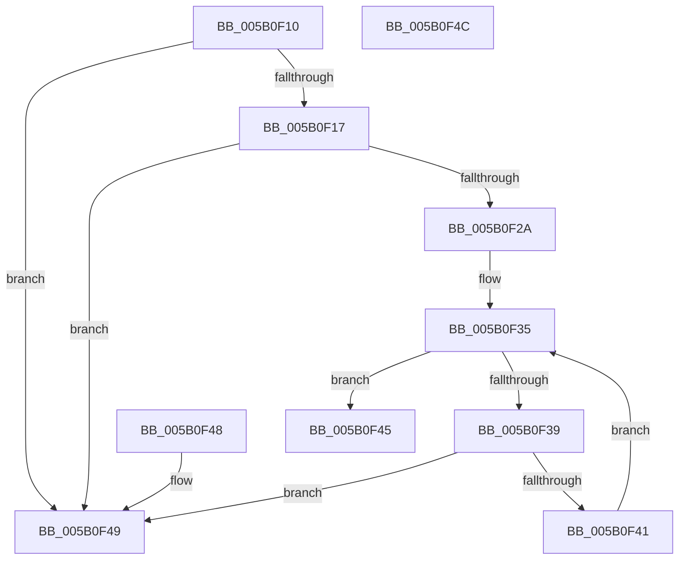

# RunLengthEncode

- RVA: `0x005B0F10`–`0x005B0F4D` (길이 `61` bytes)
- VA: `0x00000001405B0F10`
- 실행 섹션: `.text`
- PDB 이름 있음: `예`; PDB Function 태그: `아니요`
- unwind 정보 RVA: `0x000DB714`
- 디코드: `25`개 명령, `61/61` bytes 표시
- 미해석 바이트: `0` (있으면 어셈블리에 `.byte`로 보존)

> 이 문서는 커널 이미지의 기계어와 PDB 기호를 분석해 생성했습니다. 4번과 5번은 함수 원형과 자료형을 바이너리 사용 방식에서 추정한 C 해석이며 원본 소스 복구 결과는 아닙니다.

## 1. Dependencies

- 직접 호출 지점: **0**; 고유 호출 대상: **0**
- 직접 호출자로 확인된 함수: **1**
- RIP 상대 이미지 참조: **0**

### Outgoing calls
- 직접 디코드된 call 명령이 없습니다.

### Direct callers
- [KdpReadPhysicalMemory](../../pagekd/B8/KdpReadPhysicalMemory_function_00B877D8.md) at `0x00B878D3`

### Static image references
- 디코드된 RIP-relative 메모리 참조가 없습니다.

## 2. Other-region calls and transfers

- 다른 실행 섹션으로 향하는 call: **0**
- 별도 외부 분기/꼬리 이동을 확인하지 못했습니다.

## 3. Assembly (complete function range)

```asm
005B0F10  4C 8B C9                        mov r9, rcx
005B0F13  85 D2                           test edx, edx
005B0F15  74 32                           je 0x1405b0f49
005B0F17  41 F6 C1 03                     test r9b, 3
005B0F1B  41 0F 94 C0                     sete r8b
005B0F1F  F6 C2 03                        test dl, 3
005B0F22  0F 94 C0                        sete al
005B0F25  44 84 C0                        test al, r8b
005B0F28  74 1F                           je 0x1405b0f49
005B0F2A  44 8B 01                        mov r8d, dword ptr [rcx]
005B0F2D  B9 01 00 00 00                  mov ecx, 1
005B0F32  C1 EA 02                        shr edx, 2
005B0F35  3B CA                           cmp ecx, edx
005B0F37  73 0C                           jae 0x1405b0f45
005B0F39  8B C1                           mov eax, ecx
005B0F3B  45 39 04 81                     cmp dword ptr [r9 + rax*4], r8d
005B0F3F  75 08                           jne 0x1405b0f49
005B0F41  FF C1                           inc ecx
005B0F43  EB F0                           jmp 0x1405b0f35
005B0F45  B0 01                           mov al, 1
005B0F47  C3                              ret
005B0F48  CC                              int3
005B0F49  32 C0                           xor al, al
005B0F4B  C3                              ret
005B0F4C  CC                              int3
```

## 4. C-style interpretation (structured pseudocode)

```c
__int64 __fastcall RunLengthEncode(__int64 a1, int a2)
{
    __int64 result;

    if (a2 == 0) goto loc_005B0F49;
    a3 = ((((unsigned __int8)(a1)) & (3)) == 0) ? 1 : 0;
    result = ((((unsigned __int8)(a2)) & (3)) == 0) ? 1 : 0;
    if ((((unsigned __int8)(result)) & ((unsigned __int8)(a3))) == 0) goto loc_005B0F49;
    a2 = (unsigned int)((a2) >> (2));
loc_005B0F35:
    if (1 >= a2) goto loc_005B0F45;
    if ((*(unsigned int *)(a1 + 1 * 4)) != ((unsigned int)((unsigned int)(*(unsigned int *)(a1))))) goto loc_005B0F49;
    a1 = (unsigned int)((1) + 1);
    goto loc_005B0F35;
loc_005B0F45:
    return 1;
loc_005B0F49:
    result = 0;
    return result;
}
```

## 5. (Beta) C Style

```c
int64_t RunLengthEncode(void *Arg1, int32_t Arg2)
{
    uint8_t *arg1 = (uint8_t *)Arg1;

    int64_t result;

    if (Arg2 == 0) goto loc_005B0F49;
    a3 = ((((uint8_t)(Arg1)) & (3)) == 0) ? 1 : 0;
    result = ((((uint8_t)(Arg2)) & (3)) == 0) ? 1 : 0;
    if ((((uint8_t)(result)) & ((uint8_t)(a3))) == 0) goto loc_005B0F49;
    Arg2 = (uint32_t)((Arg2) >> (2));
loc_005B0F35:
    if (1 >= Arg2) goto loc_005B0F45;
    if ((*(uint32_t *)(arg1 + 0x1 * 4)) != ((uint32_t)((uint32_t)(*(uint32_t *)(arg1))))) goto loc_005B0F49;
    Arg1 = (uint32_t)((1) + 1);
    goto loc_005B0F35;
loc_005B0F45:
    return 1;
loc_005B0F49:
    result = 0;
    return result;
}
```

### 관측된 메모리 오프셋

구조체 형식이 확인되지 않은 접근은 인자 기준의 오프셋으로만 기록했습니다.

| 기준 인자 | 오프셋 표현 | 폭 (bit) | 접근 |
|---|---:|---:|---|
| `Arg1` | `+ 0x0` | `32` | `R` |

## 6. Execution-region graph

[열기: 2D/3D 그래프와 함수 탐색 컨트롤 패널](../../../control-panel.html?section=text&rva=0x005B0F10&view=graph)

- 2D 그래프는 위에서 아래로 흐르고, 3D 그래프는 빈 공간을 드래그해 회전합니다. Shift+드래그는 이동, 휠은 확대·축소, 함수 노드 선택은 대상 보고서 이동입니다.

### Static fallback


