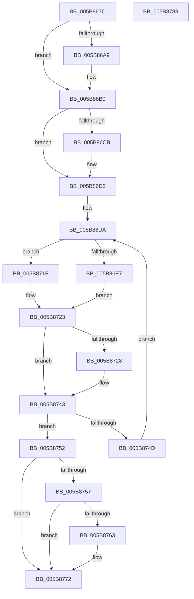

# wil_details_FeatureStateCache_ReevaluateCachedVariantState

- RVA: `0x005B867C`–`0x005B8789` (길이 `269` bytes)
- VA: `0x00000001405B867C`
- 실행 섹션: `.text`
- PDB 이름 있음: `예`; PDB Function 태그: `아니요`
- unwind 정보 RVA: `0x000A44D8`
- 디코드: `80`개 명령, `269/269` bytes 표시
- 미해석 바이트: `0` (있으면 어셈블리에 `.byte`로 보존)

> 이 문서는 커널 이미지의 기계어와 PDB 기호를 분석해 생성했습니다. 4번과 5번은 함수 원형과 자료형을 바이너리 사용 방식에서 추정한 C 해석이며 원본 소스 복구 결과는 아닙니다.

## 1. Dependencies

- 직접 호출 지점: **3**; 고유 호출 대상: **2**
- 직접 호출자로 확인된 함수: **1**
- RIP 상대 이미지 참조: **2**

### Outgoing calls
- `0x005B86A9` → [guard_dispatch_icall](../6B/guard_dispatch_icall_function_006BAAD0.md) (function, `0x006BAAD0`)
- `0x005B86B8` → [wil_details_GetCurrentVariantState](wil_details_GetCurrentVariantState_function_005B8790.md) (function, `0x005B8790`)
- `0x005B876D` → [guard_dispatch_icall](../6B/guard_dispatch_icall_function_006BAAD0.md) (function, `0x006BAAD0`)

### Direct callers
- [wil_details_FeatureStateCache_GetCachedVariantState](../4A/wil_details_FeatureStateCache_GetCachedVariantState_function_004A3F44.md) at `0x004A3F5C`

### Static image references
- `0x005B868E` → RVA `0x00E0F508` (`.data`; read)
- `0x005B8757` → RVA `0x00E0F3F8` (`.data`; read)

## 2. Other-region calls and transfers

- 다른 실행 섹션으로 향하는 call: **0**
- 별도 외부 분기/꼬리 이동을 확인하지 못했습니다.

## 3. Assembly (complete function range)

```asm
005B867C  48 89 5C 24 18                  mov qword ptr [rsp + 0x18], rbx
005B8681  48 89 6C 24 20                  mov qword ptr [rsp + 0x20], rbp
005B8686  56                              push rsi
005B8687  57                              push rdi
005B8688  41 56                           push r14
005B868A  48 83 EC 20                     sub rsp, 0x20
005B868E  48 8B 05 73 6E 85 00            mov rax, qword ptr [rip + 0x856e73]
005B8695  33 F6                           xor esi, esi
005B8697  21 74 24 40                     and dword ptr [rsp + 0x40], esi
005B869B  49 8B E8                        mov rbp, r8
005B869E  48 8B DA                        mov rbx, rdx
005B86A1  4C 8B F1                        mov r14, rcx
005B86A4  48 85 C0                        test rax, rax
005B86A7  74 07                           je 0x1405b86b0
005B86A9  E8 22 24 10 00                  call 0x1406baad0
005B86AE  8B F0                           mov esi, eax
005B86B0  48 8D 54 24 40                  lea rdx, [rsp + 0x40]
005B86B5  48 8B CD                        mov rcx, rbp
005B86B8  E8 D3 00 00 00                  call 0x1405b8790
005B86BD  80 7D 1C 00                     cmp byte ptr [rbp + 0x1c], 0
005B86C1  48 8B C8                        mov rcx, rax
005B86C4  48 89 44 24 48                  mov qword ptr [rsp + 0x48], rax
005B86C9  75 0A                           jne 0x1405b86d5
005B86CB  8B D6                           mov edx, esi
005B86CD  F7 DA                           neg edx
005B86CF  1B C0                           sbb eax, eax
005B86D1  21 44 24 40                     and dword ptr [rsp + 0x40], eax
005B86D5  44 8B 4C 24 4C                  mov r9d, dword ptr [rsp + 0x4c]
005B86DA  48 89 5C 24 48                  mov qword ptr [rsp + 0x48], rbx
005B86DF  48 8B FB                        mov rdi, rbx
005B86E2  F6 C3 08                        test bl, 8
005B86E5  75 37                           jne 0x1405b871e
005B86E7  44 8B C3                        mov r8d, ebx
005B86EA  44 89 4C 24 4C                  mov dword ptr [rsp + 0x4c], r9d
005B86EF  41 81 E0 FF 07 FC FF            and r8d, 0xfffc07ff
005B86F6  8B C1                           mov eax, ecx
005B86F8  25 00 F8 03 00                  and eax, 0x3f800
005B86FD  44 0B C0                        or r8d, eax
005B8700  8B 44 24 40                     mov eax, dword ptr [rsp + 0x40]
005B8704  F7 D8                           neg eax
005B8706  1B D2                           sbb edx, edx
005B8708  41 83 E0 F7                     and r8d, 0xfffffff7
005B870C  83 E2 08                        and edx, 8
005B870F  44 0B C2                        or r8d, edx
005B8712  44 89 44 24 48                  mov dword ptr [rsp + 0x48], r8d
005B8717  48 8B 7C 24 48                  mov rdi, qword ptr [rsp + 0x48]
005B871C  EB 05                           jmp 0x1405b8723
005B871E  44 8B 44 24 48                  mov r8d, dword ptr [rsp + 0x48]
005B8723  F6 C3 04                        test bl, 4
005B8726  75 1B                           jne 0x1405b8743
005B8728  41 0F BA F0 0A                  btr r8d, 0xa
005B872D  8B C1                           mov eax, ecx
005B872F  25 00 04 00 00                  and eax, 0x400
005B8734  41 0B C0                        or eax, r8d
005B8737  83 C8 04                        or eax, 4
005B873A  89 44 24 48                     mov dword ptr [rsp + 0x48], eax
005B873E  48 8B 7C 24 48                  mov rdi, qword ptr [rsp + 0x48]
005B8743  48 8B C3                        mov rax, rbx
005B8746  F0 49 0F B1 3E                  lock cmpxchg qword ptr [r14], rdi
005B874B  74 05                           je 0x1405b8752
005B874D  48 8B D8                        mov rbx, rax
005B8750  EB 88                           jmp 0x1405b86da
005B8752  F6 C3 04                        test bl, 4
005B8755  75 1B                           jne 0x1405b8772
005B8757  48 8B 05 9A 6C 85 00            mov rax, qword ptr [rip + 0x856c9a]
005B875E  48 85 C0                        test rax, rax
005B8761  74 0F                           je 0x1405b8772
005B8763  0F B6 55 1C                     movzx edx, byte ptr [rbp + 0x1c]
005B8767  44 8B C6                        mov r8d, esi
005B876A  49 8B CE                        mov rcx, r14
005B876D  E8 5E 23 10 00                  call 0x1406baad0
005B8772  48 8B 5C 24 50                  mov rbx, qword ptr [rsp + 0x50]
005B8777  48 8B C7                        mov rax, rdi
005B877A  48 8B 6C 24 58                  mov rbp, qword ptr [rsp + 0x58]
005B877F  48 83 C4 20                     add rsp, 0x20
005B8783  41 5E                           pop r14
005B8785  5F                              pop rdi
005B8786  5E                              pop rsi
005B8787  C3                              ret
005B8788  CC                              int3
```

## 4. C-style interpretation (structured pseudocode)

```c
__int64 __fastcall wil_details_FeatureStateCache_ReevaluateCachedVariantState(__int64 a1, __int64 a2, __int64 a3)
{
    __int64 result;
    __int64 v_rdi;
    __int64 v_rsi;
    __int64 v_rsp;
    unsigned __int64 v_stack_p10;
    unsigned int v_stack_p14;
    unsigned __int64 v_stack_p18;
    unsigned __int64 v_stack_p20;
    unsigned int v_stack_p8;

    v_stack_p18 = v_rbx;
    v_stack_p20 = v_rbp;
    v_rsp = (v_rsp) - (32);
    v_rsi = 0;
    result = *(unsigned __int64 *)(v_rip + 8744563);
    if (*(unsigned __int64 *)(v_rip + 8744563) != 0) {
        result = guard_dispatch_icall(a1, a2, a3, a4);
        v_rsi = (unsigned int)(result);
    }
    result = wil_details_GetCurrentVariantState(a3, v_stack_p8, a3, a4);
    v_stack_p10 = result;
    if ((*(unsigned __int8 *)(a3 + 28)) == 0) {
        a2 = (unsigned int)(v_rsi);
        a2 = (unsigned int)(-(a2));
    }
loc_005B86DA:
    v_stack_p10 = a2;
    if ((((unsigned __int8)(a2)) & (8)) != 0) goto loc_005B871E;
    v_stack_p14 = (unsigned int)((unsigned int)(v_stack_p14));
    a3 = (unsigned int)(((unsigned int)((unsigned int)(a2))) & (0xFFFC07FFULL));
    result = (unsigned int)(((unsigned int)((unsigned int)(result))) & (0x3F800ULL));
    a3 = (unsigned int)((a3) | ((unsigned int)(result)));
    result = (unsigned int)(-((unsigned int)(v_stack_p8)));
    a3 = (unsigned int)((a3) & (0xFFFFFFF7ULL));
    a2 = (unsigned int)((a2) & (8));
    a3 = (unsigned int)((a3) | ((unsigned int)(a2)));
    v_stack_p10 = (unsigned int)(a3);
    goto loc_005B8723;
loc_005B871E:
loc_005B8723:
    v_rdi = v_stack_p10;
    if ((((unsigned __int8)(a2)) & (4)) == 0) {
        result = (unsigned int)(result);
        result = (unsigned int)((result) & (0x400ULL));
        result = (unsigned int)((result) | ((unsigned int)((unsigned int)(v_stack_p10))));
        result = (unsigned int)((result) | (4));
        v_stack_p10 = (unsigned int)(result);
        v_rdi = v_stack_p10;
    }
    if (condition_is_equal) goto loc_005B8752;
    goto loc_005B86DA;
loc_005B8752:
    if ((((unsigned __int8)(a2)) & (4)) != 0) goto loc_005B8772;
    result = *(unsigned __int64 *)(v_rip + 8744090);
    if (*(unsigned __int64 *)(v_rip + 8744090) != 0) {
        a2 = *(unsigned __int8 *)(a3 + 28);
        a3 = (unsigned int)(v_rsi);
        a1 = a1;
        result = guard_dispatch_icall(a1, a2, a3, (unsigned int)(v_stack_p14));
    }
    v_rsp = (v_rsp) + (32);
    return v_rdi;
}
```

## 5. (Beta) C Style

```c
int64_t wil_details_FeatureStateCache_ReevaluateCachedVariantState(void *Arg1, int64_t Arg2, void *Arg3)
{
    uint8_t *arg1 = (uint8_t *)Arg1;
    uint8_t *arg3 = (uint8_t *)Arg3;

    int64_t result;
    int64_t local_rdi;
    int64_t local_rsi;
    int64_t local_rsp;
    uint64_t v_stack_p10;
    uint32_t v_stack_p14;
    uint64_t v_stack_p18;
    uint64_t v_stack_p20;
    uint32_t v_stack_p8;

    v_stack_p18 = local_rbx;
    v_stack_p20 = local_rbp;
    local_rsp = (local_rsp) - (32);
    local_rsi = 0;
    result = *(uint64_t *)(v_rip + 0x856E73);
    if (*(uint64_t *)(v_rip + 0x856E73) != 0) {
        result = guard_dispatch_icall(Arg1, Arg2, Arg3, a4);
        local_rsi = (uint32_t)(result);
    }
    result = wil_details_GetCurrentVariantState(Arg3, v_stack_p8, Arg3, a4);
    v_stack_p10 = result;
    if ((*(uint8_t *)(arg3 + 0x1C)) == 0) {
        Arg2 = (uint32_t)(local_rsi);
        Arg2 = (uint32_t)(-(Arg2));
    }
loc_005B86DA:
    v_stack_p10 = Arg2;
    if ((((uint8_t)(Arg2)) & (8)) != 0) goto loc_005B871E;
    v_stack_p14 = (uint32_t)((uint32_t)(v_stack_p14));
    Arg3 = (uint32_t)(((uint32_t)((uint32_t)(Arg2))) & (0xFFFC07FFULL));
    result = (uint32_t)(((uint32_t)((uint32_t)(result))) & (0x3F800ULL));
    Arg3 = (uint32_t)((Arg3) | ((uint32_t)(result)));
    result = (uint32_t)(-((uint32_t)(v_stack_p8)));
    Arg3 = (uint32_t)((Arg3) & (0xFFFFFFF7ULL));
    Arg2 = (uint32_t)((Arg2) & (8));
    Arg3 = (uint32_t)((Arg3) | ((uint32_t)(Arg2)));
    v_stack_p10 = (uint32_t)(Arg3);
    goto loc_005B8723;
loc_005B871E:
loc_005B8723:
    local_rdi = v_stack_p10;
    if ((((uint8_t)(Arg2)) & (4)) == 0) {
        result = (uint32_t)(result);
        result = (uint32_t)((result) & (0x400ULL));
        result = (uint32_t)((result) | ((uint32_t)((uint32_t)(v_stack_p10))));
        result = (uint32_t)((result) | (4));
        v_stack_p10 = (uint32_t)(result);
        local_rdi = v_stack_p10;
    }
    if (condition_is_equal) goto loc_005B8752;
    goto loc_005B86DA;
loc_005B8752:
    if ((((uint8_t)(Arg2)) & (4)) != 0) goto loc_005B8772;
    result = *(uint64_t *)(v_rip + 0x856C9A);
    if (*(uint64_t *)(v_rip + 0x856C9A) != 0) {
        Arg2 = *(uint8_t *)(arg3 + 0x1C);
        Arg3 = (uint32_t)(local_rsi);
        Arg1 = Arg1;
        result = guard_dispatch_icall(Arg1, Arg2, Arg3, (uint32_t)(v_stack_p14));
    }
    local_rsp = (local_rsp) + (32);
    return local_rdi;
}
```

### 관측된 메모리 오프셋

구조체 형식이 확인되지 않은 접근은 인자 기준의 오프셋으로만 기록했습니다.

| 기준 인자 | 오프셋 표현 | 폭 (bit) | 접근 |
|---|---:|---:|---|
| `Arg1` | `+ 0x0` | `64` | `R` |
| `Arg3` | `+ 0x1C` | `8` | `R` |

## 6. Execution-region graph

[열기: 2D/3D 그래프와 함수 탐색 컨트롤 패널](../../../control-panel.html?section=text&rva=0x005B867C&view=graph)

- 2D 그래프는 위에서 아래로 흐르고, 3D 그래프는 빈 공간을 드래그해 회전합니다. Shift+드래그는 이동, 휠은 확대·축소, 함수 노드 선택은 대상 보고서 이동입니다.

### Static fallback


