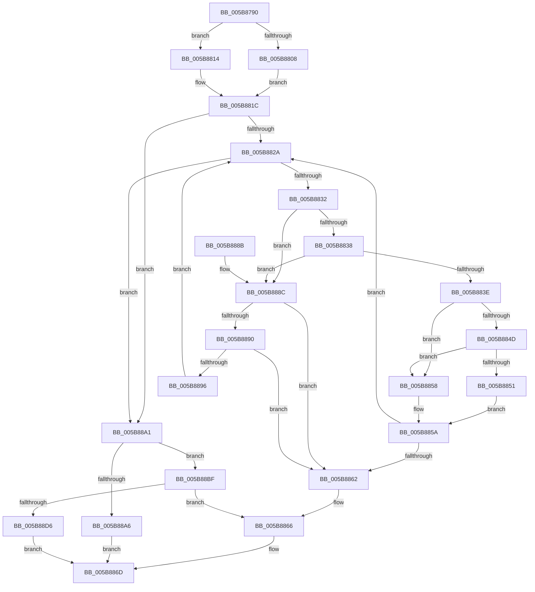

# wil_details_GetCurrentVariantState

- RVA: `0x005B8790`–`0x005B88DD` (길이 `333` bytes)
- VA: `0x00000001405B8790`
- 실행 섹션: `.text`
- PDB 이름 있음: `예`; PDB Function 태그: `아니요`
- unwind 정보 RVA: `0x000C9F9C`
- 디코드: `104`개 명령, `333/333` bytes 표시
- 미해석 바이트: `0` (있으면 어셈블리에 `.byte`로 보존)

> 이 문서는 커널 이미지의 기계어와 PDB 기호를 분석해 생성했습니다. 4번과 5번은 함수 원형과 자료형을 바이너리 사용 방식에서 추정한 C 해석이며 원본 소스 복구 결과는 아닙니다.

## 1. Dependencies

- 직접 호출 지점: **2**; 고유 호출 대상: **2**
- 직접 호출자로 확인된 함수: **1**
- RIP 상대 이미지 참조: **0**

### Outgoing calls
- `0x005B87DB` → [wil_RtlStagingConfig_QueryFeatureState](../../page/AC/wil_RtlStagingConfig_QueryFeatureState_function_00AC069C.md) (function, `0x00AC069C`)
- `0x005B8844` → [wil_details_FeatureStateCache_GetCachedFeatureEnabledState](../3F/wil_details_FeatureStateCache_GetCachedFeatureEnabledState_function_003FE950.md) (function, `0x003FE950`)

### Direct callers
- [wil_details_FeatureStateCache_ReevaluateCachedVariantState](wil_details_FeatureStateCache_ReevaluateCachedVariantState_function_005B867C.md) at `0x005B86B8`

### Static image references
- 디코드된 RIP-relative 메모리 참조가 없습니다.

## 2. Other-region calls and transfers

- 다른 실행 섹션으로 향하는 call: **1**
  - `0x005B87DB` → [wil_RtlStagingConfig_QueryFeatureState](../../page/AC/wil_RtlStagingConfig_QueryFeatureState_function_00AC069C.md) (`.text` → `PAGE`)
- 별도 외부 분기/꼬리 이동을 확인하지 못했습니다.

## 3. Assembly (complete function range)

```asm
005B8790  4C 8B DC                        mov r11, rsp
005B8793  49 89 5B 10                     mov qword ptr [r11 + 0x10], rbx
005B8797  49 89 6B 18                     mov qword ptr [r11 + 0x18], rbp
005B879B  49 89 73 20                     mov qword ptr [r11 + 0x20], rsi
005B879F  57                              push rdi
005B87A0  41 56                           push r14
005B87A2  41 57                           push r15
005B87A4  48 83 EC 40                     sub rsp, 0x40
005B87A8  8A 41 1C                        mov al, byte ptr [rcx + 0x1c]
005B87AB  4C 8B CA                        mov r9, rdx
005B87AE  8B 51 18                        mov edx, dword ptr [rcx + 0x18]
005B87B1  2C 02                           sub al, 2
005B87B3  45 33 C0                        xor r8d, r8d
005B87B6  0F 57 C0                        xorps xmm0, xmm0
005B87B9  3C 01                           cmp al, 1
005B87BB  48 8B D9                        mov rbx, rcx
005B87BE  41 C7 01 01 00 00 00            mov dword ptr [r9], 1
005B87C5  49 8D 4B C8                     lea rcx, [r11 - 0x38]
005B87C9  41 0F 96 C0                     setbe r8b
005B87CD  33 C0                           xor eax, eax
005B87CF  0F 11 44 24 20                  movups xmmword ptr [rsp + 0x20], xmm0
005B87D4  45 33 C9                        xor r9d, r9d
005B87D7  49 89 43 D8                     mov qword ptr [r11 - 0x28], rax
005B87DB  E8 BC 7E 50 00                  call 0x140ac069c
005B87E0  48 83 64 24 60 00               and qword ptr [rsp + 0x60], 0
005B87E6  8B 4C 24 30                     mov ecx, dword ptr [rsp + 0x30]
005B87EA  F7 D9                           neg ecx
005B87EC  8B 4C 24 34                     mov ecx, dword ptr [rsp + 0x34]
005B87F0  1B D2                           sbb edx, edx
005B87F2  81 E2 00 04 00 00               and edx, 0x400
005B87F8  F7 D9                           neg ecx
005B87FA  1B ED                           sbb ebp, ebp
005B87FC  81 E5 00 08 00 00               and ebp, 0x800
005B8802  0B EA                           or ebp, edx
005B8804  85 C0                           test eax, eax
005B8806  74 0C                           je 0x1405b8814
005B8808  44 8A 74 24 24                  mov r14b, byte ptr [rsp + 0x24]
005B880D  44 8B 7C 24 2C                  mov r15d, dword ptr [rsp + 0x2c]
005B8812  EB 08                           jmp 0x1405b881c
005B8814  44 8A 73 28                     mov r14b, byte ptr [rbx + 0x28]
005B8818  44 8B 7B 30                     mov r15d, dword ptr [rbx + 0x30]
005B881C  48 8B 73 20                     mov rsi, qword ptr [rbx + 0x20]
005B8820  BF 01 00 00 00                  mov edi, 1
005B8825  48 85 F6                        test rsi, rsi
005B8828  74 77                           je 0x1405b88a1
005B882A  48 8B 06                        mov rax, qword ptr [rsi]
005B882D  48 85 C0                        test rax, rax
005B8830  74 6F                           je 0x1405b88a1
005B8832  80 78 1E 00                     cmp byte ptr [rax + 0x1e], 0
005B8836  75 54                           jne 0x1405b888c
005B8838  80 78 1D 00                     cmp byte ptr [rax + 0x1d], 0
005B883C  75 4E                           jne 0x1405b888c
005B883E  48 8B 08                        mov rcx, qword ptr [rax]
005B8841  48 8B D0                        mov rdx, rax
005B8844  E8 07 61 E4 FF                  call 0x1403fe950
005B8849  85 FF                           test edi, edi
005B884B  74 0B                           je 0x1405b8858
005B884D  A8 01                           test al, 1
005B884F  74 07                           je 0x1405b8858
005B8851  BF 01 00 00 00                  mov edi, 1
005B8856  EB 02                           jmp 0x1405b885a
005B8858  33 FF                           xor edi, edi
005B885A  48 83 C6 08                     add rsi, 8
005B885E  85 FF                           test edi, edi
005B8860  75 C8                           jne 0x1405b882a
005B8862  89 6C 24 60                     mov dword ptr [rsp + 0x60], ebp
005B8866  8B 43 30                        mov eax, dword ptr [rbx + 0x30]
005B8869  89 44 24 64                     mov dword ptr [rsp + 0x64], eax
005B886D  48 8B 44 24 60                  mov rax, qword ptr [rsp + 0x60]
005B8872  48 8B 5C 24 68                  mov rbx, qword ptr [rsp + 0x68]
005B8877  48 8B 6C 24 70                  mov rbp, qword ptr [rsp + 0x70]
005B887C  48 8B 74 24 78                  mov rsi, qword ptr [rsp + 0x78]
005B8881  48 83 C4 40                     add rsp, 0x40
005B8885  41 5F                           pop r15
005B8887  41 5E                           pop r14
005B8889  5F                              pop rdi
005B888A  C3                              ret
005B888B  CC                              int3
005B888C  85 FF                           test edi, edi
005B888E  74 D2                           je 0x1405b8862
005B8890  80 78 1F 00                     cmp byte ptr [rax + 0x1f], 0
005B8894  74 CC                           je 0x1405b8862
005B8896  BF 01 00 00 00                  mov edi, 1
005B889B  48 83 C6 08                     add rsi, 8
005B889F  EB 89                           jmp 0x1405b882a
005B88A1  45 84 F6                        test r14b, r14b
005B88A4  75 19                           jne 0x1405b88bf
005B88A6  8B 43 30                        mov eax, dword ptr [rbx + 0x30]
005B88A9  89 44 24 64                     mov dword ptr [rsp + 0x64], eax
005B88AD  0F B6 43 28                     movzx eax, byte ptr [rbx + 0x28]
005B88B1  83 E0 3F                        and eax, 0x3f
005B88B4  C1 E0 0C                        shl eax, 0xc
005B88B7  0B C5                           or eax, ebp
005B88B9  89 44 24 60                     mov dword ptr [rsp + 0x60], eax
005B88BD  EB AE                           jmp 0x1405b886d
005B88BF  41 0F B6 CE                     movzx ecx, r14b
005B88C3  83 E1 3F                        and ecx, 0x3f
005B88C6  C1 E1 0C                        shl ecx, 0xc
005B88C9  33 CD                           xor ecx, ebp
005B88CB  83 7C 24 28 00                  cmp dword ptr [rsp + 0x28], 0
005B88D0  89 4C 24 60                     mov dword ptr [rsp + 0x60], ecx
005B88D4  74 90                           je 0x1405b8866
005B88D6  44 89 7C 24 64                  mov dword ptr [rsp + 0x64], r15d
005B88DB  EB 90                           jmp 0x1405b886d
```

## 4. C-style interpretation (structured pseudocode)

```c
__int64 __fastcall wil_details_GetCurrentVariantState(__int64 a1, __int64 a2, int a3)
{
    __int64 result;
    __int64 v_rbp;
    __int64 v_rdi;
    __int64 v_rsi;
    __int64 v_rsp;
    unsigned int v_stack_m24;
    unsigned int v_stack_m28;
    unsigned int v_stack_m2C;
    unsigned __int8 v_stack_m34;
    unsigned __int64 v_stack_m38;
    unsigned __int64 v_stack_p10;
    unsigned __int64 v_stack_p18;
    unsigned __int64 v_stack_p20;
    unsigned int v_stack_p28;
    unsigned int v_stack_p60;
    unsigned int v_stack_p64;
    unsigned __int64 v_stack_p8;
    unsigned int v_stack_pC;

    *(unsigned __int64 *)(v_rsp + 16) = v_rbx;
    *(unsigned __int64 *)(v_rsp + 24) = v_rbp;
    *(unsigned __int64 *)(v_rsp + 32) = v_rsi;
    v_rsp = (v_rsp) - (64);
    result = (unsigned __int8)((*(unsigned __int8 *)(a1 + 28)) - (2));
    a3 = 0;
    *(unsigned int *)(a2) = 1;
    a3 = (((unsigned __int8)(result)) <= 1) ? 1 : 0;
    result = 0;
    v_stack_m38 = v_xmm0;
    a4 = 0;
    *(unsigned __int64 *)(v_rsp - 40) = 0;
    result = wil_RtlStagingConfig_QueryFeatureState(v_rsp - 56, (unsigned int)(*(unsigned int *)(a1 + 24)), a3, a4);
    a1 = (unsigned int)(-((unsigned int)(v_stack_m28)));
    a2 = (unsigned int)(((unsigned int)(*(unsigned int *)(a1 + 24))) & (0x400ULL));
    a1 = (unsigned int)(-((unsigned int)(v_stack_m24)));
    v_rbp = (unsigned int)((v_rbp) & (0x800ULL));
    v_rbp = (unsigned int)((v_rbp) | ((unsigned int)(a2)));
    if ((unsigned int)(result) == 0) goto loc_005B8814;
    goto loc_005B881C;
loc_005B8814:
loc_005B881C:
    if (*(unsigned __int64 *)(a1 + 32) == 0) goto loc_005B88A1;
loc_005B882A:
    if (*(unsigned __int64 *)(*(unsigned __int64 *)(a1 + 32)) == 0) goto loc_005B88A1;
    if ((*(unsigned __int8 *)(*(unsigned __int64 *)(*(unsigned __int64 *)(a1 + 32)) + 30)) != 0) goto loc_005B888C;
    if ((*(unsigned __int8 *)(*(unsigned __int64 *)(*(unsigned __int64 *)(a1 + 32)) + 29)) != 0) goto loc_005B888C;
    result = wil_details_FeatureStateCache_GetCachedFeatureEnabledState(*(unsigned __int64 *)(*(unsigned __int64 *)(*(unsigned __int64 *)(a1 + 32))), *(unsigned __int64 *)(*(unsigned __int64 *)(a1 + 32)), a3, a4);
    if (1 == 0) goto loc_005B8858;
    if ((((unsigned __int8)(result)) & (1)) == 0) goto loc_005B8858;
    goto loc_005B885A;
loc_005B8858:
    v_rdi = 0;
loc_005B885A:
    v_rsi = (*(unsigned __int64 *)(a1 + 32)) + (8);
    if (0 != 0) goto loc_005B882A;
loc_005B8862:
    v_stack_p8 = (unsigned int)(v_rbp);
loc_005B8866:
    v_stack_pC = (unsigned int)((unsigned int)(*(unsigned int *)(a1 + 48)));
loc_005B886D:
    v_rsp = (v_rsp) + (64);
    return v_stack_p8;
loc_005B888C:
    if (0 == 0) goto loc_005B8862;
    if ((*(unsigned __int8 *)(v_stack_p8 + 31)) == 0) goto loc_005B8862;
    v_rsi = (v_stack_p20) + (8);
    goto loc_005B882A;
loc_005B88A1:
    if ((unsigned __int8)(*(unsigned __int8 *)(a1 + 40)) != 0) goto loc_005B88BF;
    v_stack_p64 = (unsigned int)((unsigned int)(*(unsigned int *)(v_stack_p10 + 48)));
    result = (unsigned int)((*(unsigned __int8 *)(v_stack_p10 + 40)) & (63));
    result = (unsigned int)((result) << (12));
    result = (unsigned int)((result) | ((unsigned int)(v_stack_p18)));
    v_stack_p60 = (unsigned int)(result);
    goto loc_005B886D;
loc_005B88BF:
    a1 = (unsigned int)(((unsigned __int8)(*(unsigned __int8 *)(a1 + 40))) & (63));
    a1 = (unsigned int)((a1) << (12));
    a1 = (unsigned int)((a1) ^ ((unsigned int)(v_stack_p18)));
    v_stack_p60 = (unsigned int)(a1);
    if (v_stack_p28 == 0) goto loc_005B8866;
    v_stack_p64 = (unsigned int)((unsigned int)(*(unsigned int *)(a1 + 48)));
    goto loc_005B886D;
}
```

## 5. (Beta) C Style

```c
int64_t wil_details_GetCurrentVariantState(void *Arg1, void *Arg2, int32_t Arg3)
{
    uint8_t *arg1 = (uint8_t *)Arg1;
    uint8_t *arg2 = (uint8_t *)Arg2;

    int64_t result;
    int64_t local_rbp;
    int64_t local_rdi;
    int64_t local_rsi;
    int64_t local_rsp;
    uint32_t v_stack_m24;
    uint32_t v_stack_m28;
    uint32_t v_stack_m2C;
    uint8_t v_stack_m34;
    uint64_t v_stack_m38;
    uint64_t v_stack_p10;
    uint64_t v_stack_p18;
    uint64_t v_stack_p20;
    uint32_t v_stack_p28;
    uint32_t v_stack_p60;
    uint32_t v_stack_p64;
    uint64_t v_stack_p8;
    uint32_t v_stack_pC;

    *(uint64_t *)(local_rsp + 0x10) = local_rbx;
    *(uint64_t *)(local_rsp + 0x18) = local_rbp;
    *(uint64_t *)(local_rsp + 0x20) = local_rsi;
    local_rsp = (local_rsp) - (64);
    result = (uint8_t)((*(uint8_t *)(arg1 + 0x1C)) - (2));
    Arg3 = 0;
    *(uint32_t *)(arg2) = 1;
    Arg3 = (((uint8_t)(result)) <= 1) ? 1 : 0;
    result = 0;
    v_stack_m38 = v_xmm0;
    a4 = 0;
    *(uint64_t *)(local_rsp - 0x28) = 0;
    result = wil_RtlStagingConfig_QueryFeatureState(local_rsp - 56, (uint32_t)(*(uint32_t *)(arg1 + 0x18)), Arg3, a4);
    Arg1 = (uint32_t)(-((uint32_t)(v_stack_m28)));
    Arg2 = (uint32_t)(((uint32_t)(*(uint32_t *)(arg1 + 0x18))) & (0x400ULL));
    Arg1 = (uint32_t)(-((uint32_t)(v_stack_m24)));
    local_rbp = (uint32_t)((local_rbp) & (0x800ULL));
    local_rbp = (uint32_t)((local_rbp) | ((uint32_t)(Arg2)));
    if ((uint32_t)(result) == 0) goto loc_005B8814;
    goto loc_005B881C;
loc_005B8814:
loc_005B881C:
    if (*(uint64_t *)(arg1 + 0x20) == 0) goto loc_005B88A1;
loc_005B882A:
    if (*(uint64_t *)(*(uint64_t *)(arg1 + 0x20)) == 0) goto loc_005B88A1;
    if ((*(uint8_t *)(*(uint64_t *)(*(uint64_t *)(arg1 + 0x20)) + 0x1E)) != 0) goto loc_005B888C;
    if ((*(uint8_t *)(*(uint64_t *)(*(uint64_t *)(arg1 + 0x20)) + 0x1D)) != 0) goto loc_005B888C;
    result = wil_details_FeatureStateCache_GetCachedFeatureEnabledState(*(uint64_t *)(*(uint64_t *)(*(uint64_t *)(arg1 + 0x20))), *(uint64_t *)(*(uint64_t *)(arg1 + 0x20)), Arg3, a4);
    if (1 == 0) goto loc_005B8858;
    if ((((uint8_t)(result)) & (1)) == 0) goto loc_005B8858;
    goto loc_005B885A;
loc_005B8858:
    local_rdi = 0;
loc_005B885A:
    local_rsi = (*(uint64_t *)(arg1 + 0x20)) + (8);
    if (0 != 0) goto loc_005B882A;
loc_005B8862:
    v_stack_p8 = (uint32_t)(local_rbp);
loc_005B8866:
    v_stack_pC = (uint32_t)((uint32_t)(*(uint32_t *)(arg1 + 0x30)));
loc_005B886D:
    local_rsp = (local_rsp) + (64);
    return v_stack_p8;
loc_005B888C:
    if (0 == 0) goto loc_005B8862;
    if ((*(uint8_t *)(v_stack_p8 + 0x1F)) == 0) goto loc_005B8862;
    local_rsi = (v_stack_p20) + (8);
    goto loc_005B882A;
loc_005B88A1:
    if ((uint8_t)(*(uint8_t *)(arg1 + 0x28)) != 0) goto loc_005B88BF;
    v_stack_p64 = (uint32_t)((uint32_t)(*(uint32_t *)(v_stack_p10 + 0x30)));
    result = (uint32_t)((*(uint8_t *)(v_stack_p10 + 0x28)) & (63));
    result = (uint32_t)((result) << (12));
    result = (uint32_t)((result) | ((uint32_t)(v_stack_p18)));
    v_stack_p60 = (uint32_t)(result);
    goto loc_005B886D;
loc_005B88BF:
    Arg1 = (uint32_t)(((uint8_t)(*(uint8_t *)(arg1 + 0x28))) & (63));
    Arg1 = (uint32_t)((Arg1) << (12));
    Arg1 = (uint32_t)((Arg1) ^ ((uint32_t)(v_stack_p18)));
    v_stack_p60 = (uint32_t)(Arg1);
    if (v_stack_p28 == 0) goto loc_005B8866;
    v_stack_p64 = (uint32_t)((uint32_t)(*(uint32_t *)(arg1 + 0x30)));
    goto loc_005B886D;
}
```

### 관측된 메모리 오프셋

구조체 형식이 확인되지 않은 접근은 인자 기준의 오프셋으로만 기록했습니다.

| 기준 인자 | 오프셋 표현 | 폭 (bit) | 접근 |
|---|---:|---:|---|
| `Arg1` | `+ 0x18` | `32` | `R` |
| `Arg1` | `+ 0x1C` | `8` | `R` |
| `Arg1` | `+ 0x20` | `64` | `R` |
| `Arg1` | `+ 0x28` | `8` | `R` |
| `Arg1` | `+ 0x30` | `32` | `R` |
| `Arg2` | `+ 0x0` | `32` | `W` |

## 6. Execution-region graph

[열기: 2D/3D 그래프와 함수 탐색 컨트롤 패널](../../../control-panel.html?section=text&rva=0x005B8790&view=graph)

- 2D 그래프는 위에서 아래로 흐르고, 3D 그래프는 빈 공간을 드래그해 회전합니다. Shift+드래그는 이동, 휠은 확대·축소, 함수 노드 선택은 대상 보고서 이동입니다.

### Static fallback


