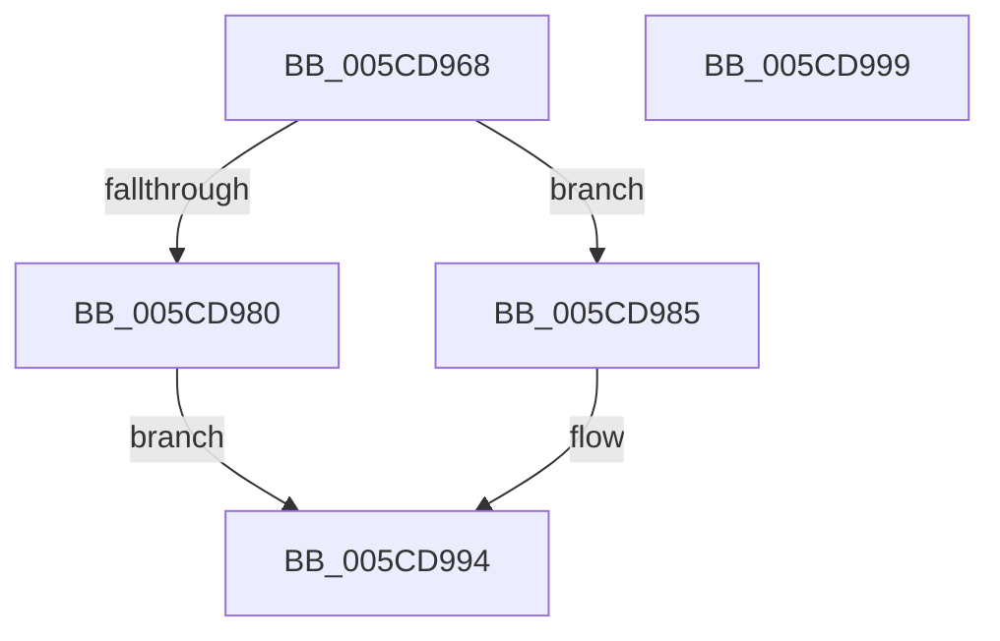

# Feature_OutsideInProtection__private_IsEnabledDeviceUsageNoInline

- RVA: `0x005CD968`–`0x005CD99A` (길이 `50` bytes)
- VA: `0x00000001405CD968`
- 실행 섹션: `.text`
- PDB 이름 있음: `예`; PDB Function 태그: `아니요`
- unwind 정보 RVA: `0x0005C788`
- 디코드: `14`개 명령, `50/50` bytes 표시
- 미해석 바이트: `0` (있으면 어셈블리에 `.byte`로 보존)

> 이 문서는 커널 이미지의 기계어와 PDB 기호를 분석해 생성했습니다. 4번과 5번은 함수 원형과 자료형을 바이너리 사용 방식에서 추정한 C 해석이며 원본 소스 복구 결과는 아닙니다.

## 1. Dependencies

- 직접 호출 지점: **1**; 고유 호출 대상: **1**
- 직접 호출자로 확인된 함수: **26**
- RIP 상대 이미지 참조: **1**

### Outgoing calls
- `0x005CD98F` → [Feature_OutsideInProtection__private_IsEnabledFallback](Feature_OutsideInProtection__private_IsEnabledFallback_function_005CD9A0.md) (function, `0x005CD9A0`)

### Direct callers
- [SeAccessCheckWithHint](../3A/SeAccessCheckWithHint_function_003A6C30.md) at `0x003A6F49`
- [SeAccessCheckWithHint](../3A/SeAccessCheckWithHint_function_003A6C30.md) at `0x003A7618`
- [SeAccessCheckByType](../44/SeAccessCheckByType_function_00440BC8.md) at `0x0044137F`
- [SeAccessCheckByType](../44/SeAccessCheckByType_function_00440BC8.md) at `0x00442221`
- [SepCommonAccessCheckEx](../47/SepCommonAccessCheckEx_function_0047602C.md) at `0x004765A9`
- [SepCommonAccessCheckEx](../47/SepCommonAccessCheckEx_function_0047602C.md) at `0x00477219`
- [sub_004E9AEF](../4E/Unknown_function_004E9AEF.md) at `0x004E9AF7`
- [sub_004E9AEF](../4E/Unknown_function_004E9AEF.md) at `0x004E9B93`
- [SeGetProcessAntiTamperIdentity](../60/SeGetProcessAntiTamperIdentity_function_00606740.md) at `0x00606752`
- [SeGetProcessAntiTamperUIPolicy](../60/SeGetProcessAntiTamperUIPolicy_function_00606800.md) at `0x0060682C`
- [SeExchangePrimaryToken](../../page/7A/SeExchangePrimaryToken_function_007A07BC.md) at `0x007A08C2`
- [SeQuerySecurityAccessMask](../../page/87/SeQuerySecurityAccessMask_function_008739EC.md) at `0x00873A54`
- [PsOpenProcess](../../page/89/PsOpenProcess_function_00894A30.md) at `0x00894CD0`
- [SeQueryInformationToken](../../page/8B/SeQueryInformationToken_function_008B5090.md) at `0x008B6068`
- [SeQueryInformationToken](../../page/8B/SeQueryInformationToken_function_008B5090.md) at `0x008B6139`
- [SeQueryInformationToken](../../page/8B/SeQueryInformationToken_function_008B5090.md) at `0x008B61D5`
- [SeQueryInformationToken](../../page/8B/SeQueryInformationToken_function_008B5090.md) at `0x008B63A2`
- [PsOpenThread](../../page/9C/PsOpenThread_function_009C5CC0.md) at `0x009C5E9A`
- [PsOpenThread](../../page/9C/PsOpenThread_function_009C5CC0.md) at `0x009C5F65`
- [PspBuildCreateProcessContext](../../page/9E/PspBuildCreateProcessContext_function_009ED6E0.md) at `0x009EE49E`
- [PspAllocateProcess](../../page/A1/PspAllocateProcess_function_00A13B3C.md) at `0x00A14D2D`
- [PspAllocateProcess](../../page/A1/PspAllocateProcess_function_00A13B3C.md) at `0x00A1597F`
- [PspAllocateProcess](../../page/A1/PspAllocateProcess_function_00A13B3C.md) at `0x00A1615C`
- [SepAccessCheckAndAuditAlarm](../../page/A1/SepAccessCheckAndAuditAlarm_function_00A1AF4C.md) at `0x00A1B976`
- [SepAccessCheckAndAuditAlarm](../../page/A1/SepAccessCheckAndAuditAlarm_function_00A1AF4C.md) at `0x00A1C4A4`
- [SepDeleteLogonSessionTrack](../../page/AA/SepDeleteLogonSessionTrack_function_00AA04E0.md) at `0x00AA0689`
- [SeSubProcessToken](../../page/AA/SeSubProcessToken_function_00AAD570.md) at `0x00AAD8C6`
- [NtSetSecurityObject](../../page/AD/NtSetSecurityObject_function_00ADE2B0.md) at `0x00ADE307`
- [PspProcessOpen](../../page/AE/PspProcessOpen_function_00AE3620.md) at `0x00AE3692`
- [NtCreateUserProcess](../../page/AE/NtCreateUserProcess_function_00AEA680.md) at `0x00AEB54F`
- [PspUpdateCreateInfo](../../page/AE/PspUpdateCreateInfo_function_00AEC060.md) at `0x00AEC14E`
- [NtQueryInformationToken](../../page/AE/NtQueryInformationToken_function_00AECDD0.md) at `0x00AEFF80`
- [NtQueryInformationToken](../../page/AE/NtQueryInformationToken_function_00AECDD0.md) at `0x00AF0122`
- [NtQueryInformationToken](../../page/AE/NtQueryInformationToken_function_00AECDD0.md) at `0x00AF025B`
- [NtQueryInformationToken](../../page/AE/NtQueryInformationToken_function_00AECDD0.md) at `0x00AF0499`
- [SeSetSessionIdToken](../../page/AF/SeSetSessionIdToken_function_00AF1F0C.md) at `0x00AF1F7A`
- [SepTokenDeleteMethod](../../page/AF/SepTokenDeleteMethod_function_00AF23D0.md) at `0x00AF24D6`
- [SepTokenDeleteMethod](../../page/AF/SepTokenDeleteMethod_function_00AF23D0.md) at `0x00AF2591`
- [SepDeReferenceLogonSession](../../page/AF/SepDeReferenceLogonSession_function_00AF25EC.md) at `0x00AF2829`
- [SepVariableInitialization](../../init/C4/SepVariableInitialization_function_00C483A4.md) at `0x00C4A57E`
- [PspInitPhase0](../../init/C7/PspInitPhase0_function_00C77E2C.md) at `0x00C78332`
- [PspInitPhase0](../../init/C7/PspInitPhase0_function_00C77E2C.md) at `0x00C783CB`

### Static image references
- `0x005CD972` → RVA `0x00FC4A70` (`.data`; read)

## 2. Other-region calls and transfers

- 다른 실행 섹션으로 향하는 call: **0**
- 별도 외부 분기/꼬리 이동을 확인하지 못했습니다.

## 3. Assembly (complete function range)

```asm
005CD968  48 83 EC 28                     sub rsp, 0x28
005CD96C  48 83 64 24 30 00               and qword ptr [rsp + 0x30], 0
005CD972  8B 05 F8 70 9F 00               mov eax, dword ptr [rip + 0x9f70f8]
005CD978  89 44 24 30                     mov dword ptr [rsp + 0x30], eax
005CD97C  A8 10                           test al, 0x10
005CD97E  74 05                           je 0x1405cd985
005CD980  83 E0 01                        and eax, 1
005CD983  EB 0F                           jmp 0x1405cd994
005CD985  48 8B 4C 24 30                  mov rcx, qword ptr [rsp + 0x30]
005CD98A  BA 03 00 00 00                  mov edx, 3
005CD98F  E8 0C 00 00 00                  call 0x1405cd9a0
005CD994  48 83 C4 28                     add rsp, 0x28
005CD998  C3                              ret
005CD999  CC                              int3
```

## 4. C-style interpretation (structured pseudocode)

```c
__int64 __fastcall Feature_OutsideInProtection__private_IsEnabledDeviceUsageNoInline(void)
{
    __int64 result;
    __int64 v_rsp;
    unsigned __int64 v_stack_p8;

    v_rsp = (v_rsp) - (40);
    v_stack_p8 = (unsigned int)((unsigned int)(*(unsigned int *)(v_rip + 10449144)));
    if ((((unsigned __int8)((unsigned int)(*(unsigned int *)(v_rip + 10449144)))) & (16)) == 0) goto loc_005CD985;
    result = (unsigned int)(((unsigned int)(*(unsigned int *)(v_rip + 10449144))) & (1));
    goto loc_005CD994;
loc_005CD985:
    result = Feature_OutsideInProtection__private_IsEnabledFallback(v_stack_p8, 3, a3, a4);
loc_005CD994:
    v_rsp = (v_rsp) + (40);
    return result;
}
```

## 5. (Beta) C Style

```c
void Feature_OutsideInProtection__private_IsEnabledDeviceUsageNoInline(void)
{
    int64_t result;
    int64_t local_rsp;
    uint64_t v_stack_p8;

    local_rsp = (local_rsp) - (40);
    v_stack_p8 = (uint32_t)((uint32_t)(*(uint32_t *)(v_rip + 0x9F70F8)));
    if ((((uint8_t)((uint32_t)(*(uint32_t *)(v_rip + 0x9F70F8)))) & (16)) == 0) goto loc_005CD985;
    result = (uint32_t)(((uint32_t)(*(uint32_t *)(v_rip + 0x9F70F8))) & (1));
    goto loc_005CD994;
loc_005CD985:
    result = Feature_OutsideInProtection__private_IsEnabledFallback(v_stack_p8, 3, a3, a4);
loc_005CD994:
    local_rsp = (local_rsp) + (40);
    return result;
}
```

## 6. Execution-region graph

[열기: 2D/3D 그래프와 함수 탐색 컨트롤 패널](../../../control-panel.html?section=text&rva=0x005CD968&view=graph)

- 2D 그래프는 위에서 아래로 흐르고, 3D 그래프는 빈 공간을 드래그해 회전합니다. Shift+드래그는 이동, 휠은 확대·축소, 함수 노드 선택은 대상 보고서 이동입니다.

### Static fallback


