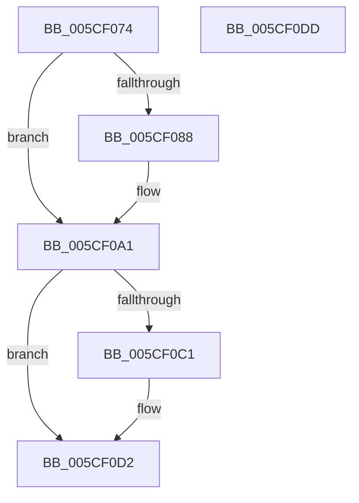

# Feature_Sx_PEP_Notification_Synchronization__private_ReportUsageFallback

- RVA: `0x005CF074`–`0x005CF0DE` (길이 `106` bytes)
- VA: `0x00000001405CF074`
- 실행 섹션: `.text`
- PDB 이름 있음: `예`; PDB Function 태그: `아니요`
- unwind 정보 RVA: `0x0005CAAC`
- 디코드: `29`개 명령, `106/106` bytes 표시
- 미해석 바이트: `0` (있으면 어셈블리에 `.byte`로 보존)

> 이 문서는 커널 이미지의 기계어와 PDB 기호를 분석해 생성했습니다. 4번과 5번은 함수 원형과 자료형을 바이너리 사용 방식에서 추정한 C 해석이며 원본 소스 복구 결과는 아닙니다.

## 1. Dependencies

- 직접 호출 지점: **3**; 고유 호출 대상: **3**
- 직접 호출자로 확인된 함수: **1**
- RIP 상대 이미지 참조: **2**

### Outgoing calls
- `0x005CF099` → [wil_details_FeatureStateCache_ReevaluateCachedFeatureEnabledState](../3F/wil_details_FeatureStateCache_ReevaluateCachedFeatureEnabledState_function_003FE988.md) (function, `0x003FE988`)
- `0x005CF0B4` → [wil_details_FeatureReporting_ReportUsageToService](../53/wil_details_FeatureReporting_ReportUsageToService_function_0053E6E4.md) (function, `0x0053E6E4`)
- `0x005CF0CD` → [wil_details_FeatureStateCache_TryEnableDeviceUsageFastPath](../53/wil_details_FeatureStateCache_TryEnableDeviceUsageFastPath_function_0053E774.md) (function, `0x0053E774`)

### Direct callers
- [Feature_Sx_PEP_Notification_Synchronization__private_ReportUsage](Feature_Sx_PEP_Notification_Synchronization__private_ReportUsage_function_005CF03C.md) at `0x005CF063`

### Static image references
- `0x005CF08B` → RVA `0x000DD5C0` (`.rdata`; read)
- `0x005CF092` → RVA `0x00FC4760` (`.data`; read)

## 2. Other-region calls and transfers

- 다른 실행 섹션으로 향하는 call: **0**
- 별도 외부 분기/꼬리 이동을 확인하지 못했습니다.

## 3. Assembly (complete function range)

```asm
005CF074  48 89 5C 24 08                  mov qword ptr [rsp + 8], rbx
005CF079  57                              push rdi
005CF07A  48 83 EC 20                     sub rsp, 0x20
005CF07E  8B FA                           mov edi, edx
005CF080  48 8B D9                        mov rbx, rcx
005CF083  F6 C1 02                        test cl, 2
005CF086  75 19                           jne 0x1405cf0a1
005CF088  48 8B D1                        mov rdx, rcx
005CF08B  4C 8D 05 2E E5 B0 FF            lea r8, [rip - 0x4f1ad2]
005CF092  48 8D 0D C7 56 9F 00            lea rcx, [rip + 0x9f56c7]
005CF099  E8 EA F8 E2 FF                  call 0x1403fe988
005CF09E  48 8B D8                        mov rbx, rax
005CF0A1  41 B9 01 00 00 00               mov r9d, 1
005CF0A7  48 8D 0D 12 E5 B0 FF            lea rcx, [rip - 0x4f1aee]
005CF0AE  44 8B C7                        mov r8d, edi
005CF0B1  48 8B D3                        mov rdx, rbx
005CF0B4  E8 2B F6 F6 FF                  call 0x14053e6e4
005CF0B9  8D 47 FD                        lea eax, [rdi - 3]
005CF0BC  83 F8 01                        cmp eax, 1
005CF0BF  77 11                           ja 0x1405cf0d2
005CF0C1  4C 8D 05 F8 E4 B0 FF            lea r8, [rip - 0x4f1b08]
005CF0C8  8B D7                           mov edx, edi
005CF0CA  48 8B CB                        mov rcx, rbx
005CF0CD  E8 A2 F6 F6 FF                  call 0x14053e774
005CF0D2  48 8B 5C 24 30                  mov rbx, qword ptr [rsp + 0x30]
005CF0D7  48 83 C4 20                     add rsp, 0x20
005CF0DB  5F                              pop rdi
005CF0DC  C3                              ret
005CF0DD  CC                              int3
```

## 4. C-style interpretation (structured pseudocode)

```c
__int64 __fastcall Feature_Sx_PEP_Notification_Synchronization__private_ReportUsageFallback(__int64 a1, int a2)
{
    __int64 result;
    __int64 v_rbx;
    __int64 v_rsp;
    unsigned __int64 v_stack_p8;

    v_stack_p8 = v_rbx;
    v_rsp = (v_rsp) - (32);
    v_rbx = a1;
    if ((((unsigned __int8)(a1)) & (2)) == 0) {
        a2 = a1;
        a3 = v_rip - 5184210;
        a1 = v_rip + 10442439;
        result = wil_details_FeatureStateCache_ReevaluateCachedFeatureEnabledState(a1, a2, a3, a4);
        v_rbx = result;
    }
    result = wil_details_FeatureReporting_ReportUsageToService(v_rip - 5184238, v_rbx, (unsigned int)((unsigned int)((unsigned int)(a2))), 1);
    result = (unsigned int)(a2) - 3;
    if (((unsigned int)((unsigned int)(a2) - 3)) <= 1) {
        a3 = v_rip - 5184264;
        a2 = (unsigned int)((unsigned int)(a2));
        a1 = v_rbx;
        result = wil_details_FeatureStateCache_TryEnableDeviceUsageFastPath(a1, a2, a3, 1);
    }
    v_rsp = (v_rsp) + (32);
    return result;
}
```

## 5. (Beta) C Style

```c
int64_t Feature_Sx_PEP_Notification_Synchronization__private_ReportUsageFallback(int64_t Arg1, void *Arg2)
{
    uint8_t *arg2 = (uint8_t *)Arg2;

    int64_t result;
    int64_t local_rbx;
    int64_t local_rsp;
    uint64_t v_stack_p8;

    v_stack_p8 = local_rbx;
    local_rsp = (local_rsp) - (32);
    local_rbx = Arg1;
    if ((((uint8_t)(Arg1)) & (2)) == 0) {
        Arg2 = Arg1;
        a3 = v_rip - 5184210;
        Arg1 = v_rip + 10442439;
        result = wil_details_FeatureStateCache_ReevaluateCachedFeatureEnabledState(Arg1, Arg2, a3, a4);
        local_rbx = result;
    }
    result = wil_details_FeatureReporting_ReportUsageToService(v_rip - 5184238, local_rbx, (uint32_t)((uint32_t)((uint32_t)(Arg2))), 1);
    result = (uint32_t)(Arg2) - 3;
    if (((uint32_t)((uint32_t)(Arg2) - 3)) <= 1) {
        a3 = v_rip - 5184264;
        Arg2 = (uint32_t)((uint32_t)(Arg2));
        Arg1 = local_rbx;
        result = wil_details_FeatureStateCache_TryEnableDeviceUsageFastPath(Arg1, Arg2, a3, 1);
    }
    local_rsp = (local_rsp) + (32);
    return result;
}
```

### 관측된 메모리 오프셋

구조체 형식이 확인되지 않은 접근은 인자 기준의 오프셋으로만 기록했습니다.

| 기준 인자 | 오프셋 표현 | 폭 (bit) | 접근 |
|---|---:|---:|---|
| `Arg2` | `- 0x3` | `32` | `R` |

## 6. Execution-region graph

[열기: 2D/3D 그래프와 함수 탐색 컨트롤 패널](../../../control-panel.html?section=text&rva=0x005CF074&view=graph)

- 2D 그래프는 위에서 아래로 흐르고, 3D 그래프는 빈 공간을 드래그해 회전합니다. Shift+드래그는 이동, 휠은 확대·축소, 함수 노드 선택은 대상 보고서 이동입니다.

### Static fallback


