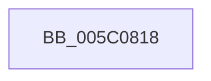

# IntPartCriticalFailure

- RVA: `0x005C0818`–`0x005C0839` (길이 `33` bytes)
- VA: `0x00000001405C0818`
- 실행 섹션: `.text`
- PDB 이름 있음: `예`; PDB Function 태그: `아니요`
- unwind 정보 RVA: `0x000622F0`
- 디코드: `8`개 명령, `33/33` bytes 표시
- 미해석 바이트: `0` (있으면 어셈블리에 `.byte`로 보존)

> 이 문서는 커널 이미지의 기계어와 PDB 기호를 분석해 생성했습니다. 4번과 5번은 함수 원형과 자료형을 바이너리 사용 방식에서 추정한 C 해석이며 원본 소스 복구 결과는 아닙니다.

## 1. Dependencies

- 직접 호출 지점: **1**; 고유 호출 대상: **1**
- 직접 호출자로 확인된 함수: **4**
- RIP 상대 이미지 참조: **0**

### Outgoing calls
- `0x005C0833` → [KeBugCheckEx](../4F/KeBugCheckEx_function_004FD660.md) (function, `0x004FD660`)

### Direct callers
- [IntPartCreate](../../init/C6/IntPartCreate_function_00C6D5C4.md) at `0x00C6D69A`
- [IntpAssignProcessorsToPartitions](../../init/C6/IntpAssignProcessorsToPartitions_function_00C6D750.md) at `0x00C6D7D8`
- [IntpAddNextProcessorToPartition](../../init/C6/IntpAddNextProcessorToPartition_function_00C6D7FC.md) at `0x00C6D819`
- [IntpAllocateProcessorContext](../../init/C6/IntpAllocateProcessorContext_function_00C6D844.md) at `0x00C6D903`

### Static image references
- 디코드된 RIP-relative 메모리 참조가 없습니다.

## 2. Other-region calls and transfers

- 다른 실행 섹션으로 향하는 call: **0**
- 별도 외부 분기/꼬리 이동을 확인하지 못했습니다.

## 3. Assembly (complete function range)

```asm
005C0818  48 83 EC 38                     sub rsp, 0x38
005C081C  41 B8 05 01 00 00               mov r8d, 0x105
005C0822  48 89 54 24 20                  mov qword ptr [rsp + 0x20], rdx
005C0827  4C 8B C9                        mov r9, rcx
005C082A  BA 01 40 00 00                  mov edx, 0x4001
005C082F  41 8D 48 9B                     lea ecx, [r8 - 0x65]
005C0833  E8 28 CE F3 FF                  call 0x1404fd660
005C0838  CC                              int3
```

## 4. C-style interpretation (structured pseudocode)

```c
__int64 __fastcall IntPartCriticalFailure(__int64 a1, __int64 a2)
{
    __int64 result;
    __int64 v_rsp;
    unsigned __int64 v_stack_m18;

    v_rsp = (v_rsp) - (56);
    v_stack_m18 = a2;
    result = KeBugCheckEx(261 - 101, (unsigned int)(0x4001ULL), 261, a1);
    return result;
}
```

## 5. (Beta) C Style

```c
int64_t IntPartCriticalFailure(int64_t Arg1, int64_t Arg2)
{
    int64_t result;
    int64_t local_rsp;
    uint64_t v_stack_m18;

    local_rsp = (local_rsp) - (56);
    v_stack_m18 = Arg2;
    result = KeBugCheckEx(261 - 101, (uint32_t)(0x4001ULL), 261, Arg1);
    return result;
}
```

## 6. Execution-region graph

[열기: 2D/3D 그래프와 함수 탐색 컨트롤 패널](../../../control-panel.html?section=text&rva=0x005C0818&view=graph)

- 2D 그래프는 위에서 아래로 흐르고, 3D 그래프는 빈 공간을 드래그해 회전합니다. Shift+드래그는 이동, 휠은 확대·축소, 함수 노드 선택은 대상 보고서 이동입니다.

### Static fallback


