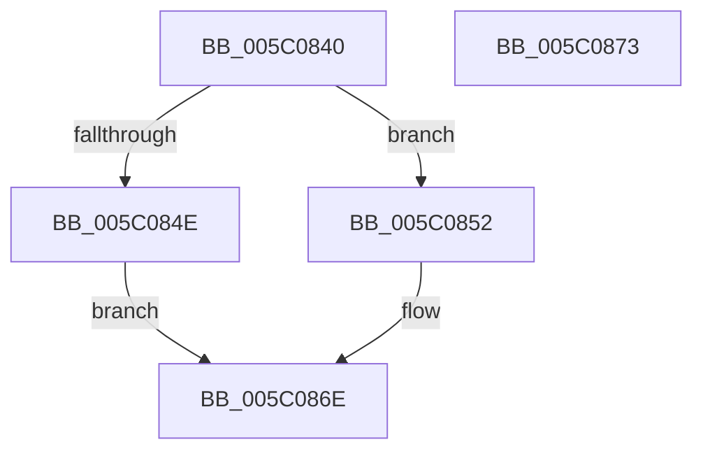

# IntPartGetProcessorEfficiencyClass

- RVA: `0x005C0840`–`0x005C0874` (길이 `52` bytes)
- VA: `0x00000001405C0840`
- 실행 섹션: `.text`
- PDB 이름 있음: `예`; PDB Function 태그: `아니요`
- unwind 정보 RVA: `0x0005C788`
- 디코드: `15`개 명령, `52/52` bytes 표시
- 미해석 바이트: `0` (있으면 어셈블리에 `.byte`로 보존)

> 이 문서는 커널 이미지의 기계어와 PDB 기호를 분석해 생성했습니다. 4번과 5번은 함수 원형과 자료형을 바이너리 사용 방식에서 추정한 C 해석이며 원본 소스 복구 결과는 아닙니다.

## 1. Dependencies

- 직접 호출 지점: **1**; 고유 호출 대상: **1**
- 직접 호출자로 확인된 함수: **2**
- RIP 상대 이미지 참조: **2**

### Outgoing calls
- `0x005C0852` → [KeGetProcessorIndexFromNumber](../2D/KeGetProcessorIndexFromNumber_function_002DD2D0.md) (function, `0x002DD2D0`)

### Direct callers
- [IntPartGetClassAffinityGroup](../../init/C6/IntPartGetClassAffinityGroup_function_00C6D2DC.md) at `0x00C6D30F`
- [IntPartGetClassAffinityGroup](../../init/C6/IntPartGetClassAffinityGroup_function_00C6D2DC.md) at `0x00C6D36A`
- [IntpAllocateProcessorContext](../../init/C6/IntpAllocateProcessorContext_function_00C6D844.md) at `0x00C6D8B7`

### Static image references
- `0x005C0844` → RVA `0x00FC6D1C` (`ALMOSTRO`; read)
- `0x005C0859` → RVA `0x00FC8C40` (`ALMOSTRO`; read)

## 2. Other-region calls and transfers

- 다른 실행 섹션으로 향하는 call: **0**
- 별도 외부 분기/꼬리 이동을 확인하지 못했습니다.

## 3. Assembly (complete function range)

```asm
005C0840  48 83 EC 28                     sub rsp, 0x28
005C0844  8B 05 D2 64 A0 00               mov eax, dword ptr [rip + 0xa064d2]
005C084A  A8 10                           test al, 0x10
005C084C  74 04                           je 0x1405c0852
005C084E  32 C0                           xor al, al
005C0850  EB 1C                           jmp 0x1405c086e
005C0852  E8 79 CA D1 FF                  call 0x1402dd2d0
005C0857  8B C0                           mov eax, eax
005C0859  48 8D 0D E0 83 A0 00            lea rcx, [rip + 0xa083e0]
005C0860  48 8B 04 C1                     mov rax, qword ptr [rcx + rax*8]
005C0864  80 B8 08 8A 00 00 00            cmp byte ptr [rax + 0x8a08], 0
005C086B  0F 95 C0                        setne al
005C086E  48 83 C4 28                     add rsp, 0x28
005C0872  C3                              ret
005C0873  CC                              int3
```

## 4. C-style interpretation (structured pseudocode)

```c
__int64 __fastcall IntPartGetProcessorEfficiencyClass(void)
{
    __int64 result;
    __int64 v_rsp;

    v_rsp = (v_rsp) - (40);
    if ((((unsigned __int8)((unsigned int)(*(unsigned int *)(v_rip + 10511570)))) & (16)) == 0) goto loc_005C0852;
    result = 0;
    goto loc_005C086E;
loc_005C0852:
    result = KeGetProcessorIndexFromNumber(a1, a2, a3, a4);
    result = ((*(unsigned __int8 *)(*(unsigned __int64 *)(v_rip + 10519520 + (unsigned int)((unsigned int)(result)) * 8) + 35336)) != 0) ? 1 : 0;
loc_005C086E:
    v_rsp = (v_rsp) + (40);
    return result;
}
```

## 5. (Beta) C Style

```c
void IntPartGetProcessorEfficiencyClass(void)
{
    int64_t result;
    int64_t local_rsp;

    local_rsp = (local_rsp) - (40);
    if ((((uint8_t)((uint32_t)(*(uint32_t *)(v_rip + 0xA064D2)))) & (16)) == 0) goto loc_005C0852;
    result = 0;
    goto loc_005C086E;
loc_005C0852:
    result = KeGetProcessorIndexFromNumber(a1, a2, a3, a4);
    result = ((*(uint8_t *)(*(uint64_t *)(v_rip + 0xA083E0 + (uint32_t)((uint32_t)(result)) * 8) + 0x8A08)) != 0) ? 1 : 0;
loc_005C086E:
    local_rsp = (local_rsp) + (40);
    return result;
}
```

## 6. Execution-region graph

[열기: 2D/3D 그래프와 함수 탐색 컨트롤 패널](../../../control-panel.html?section=text&rva=0x005C0840&view=graph)

- 2D 그래프는 위에서 아래로 흐르고, 3D 그래프는 빈 공간을 드래그해 회전합니다. Shift+드래그는 이동, 휠은 확대·축소, 함수 노드 선택은 대상 보고서 이동입니다.

### Static fallback


