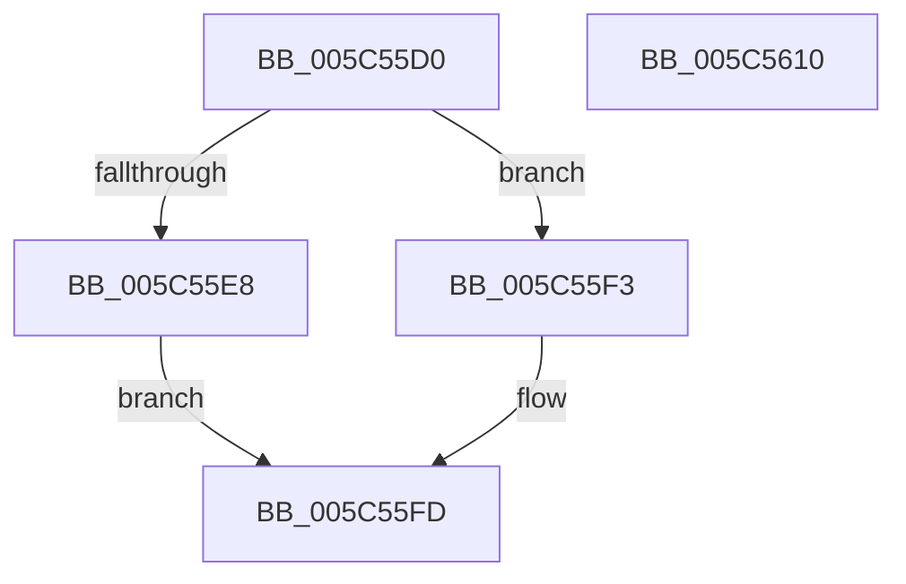

# KeAbCrossThreadDeleteDpcRoutine

- RVA: `0x005C55D0`–`0x005C5611` (길이 `65` bytes)
- VA: `0x00000001405C55D0`
- 실행 섹션: `.text`
- PDB 이름 있음: `예`; PDB Function 태그: `아니요`
- unwind 정보 RVA: `0x0005CF00`
- 디코드: `21`개 명령, `65/65` bytes 표시
- 미해석 바이트: `0` (있으면 어셈블리에 `.byte`로 보존)

> 이 문서는 커널 이미지의 기계어와 PDB 기호를 분석해 생성했습니다. 4번과 5번은 함수 원형과 자료형을 바이너리 사용 방식에서 추정한 C 해석이며 원본 소스 복구 결과는 아닙니다.

## 1. Dependencies

- 직접 호출 지점: **2**; 고유 호출 대상: **2**
- 직접 호출자로 확인된 함수: **0**
- RIP 상대 이미지 참조: **0**

### Outgoing calls
- `0x005C55EC` → [KeAbMarkCrossThreadReleasable](../3B/KeAbMarkCrossThreadReleasable_function_003BE8AC.md) (function, `0x003BE8AC`)
- `0x005C5605` → [KeSetEvent](../33/KeSetEvent_function_0033F310.md) (function, `0x0033F310`)

### Direct callers
- 이 함수 시작 RVA로 연결되는 직접 call은 확인되지 않았습니다. 간접 호출은 완전히 역산할 수 없습니다.

### Static image references
- 디코드된 RIP-relative 메모리 참조가 없습니다.

## 2. Other-region calls and transfers

- 다른 실행 섹션으로 향하는 call: **0**
- 별도 외부 분기/꼬리 이동을 확인하지 못했습니다.

## 3. Assembly (complete function range)

```asm
005C55D0  40 53                           push rbx
005C55D2  48 83 EC 20                     sub rsp, 0x20
005C55D6  65 48 8B 04 25 88 01 00 00      mov rax, qword ptr gs:[0x188]
005C55DF  48 8B DA                        mov rbx, rdx
005C55E2  48 3B 42 28                     cmp rax, qword ptr [rdx + 0x28]
005C55E6  75 0B                           jne 0x1405c55f3
005C55E8  48 8B 52 20                     mov rdx, qword ptr [rdx + 0x20]
005C55EC  E8 BB 92 DF FF                  call 0x1403be8ac
005C55F1  EB 0A                           jmp 0x1405c55fd
005C55F3  48 8B 4A 20                     mov rcx, qword ptr [rdx + 0x20]
005C55F7  8A 01                           mov al, byte ptr [rcx]
005C55F9  0C 01                           or al, 1
005C55FB  88 01                           mov byte ptr [rcx], al
005C55FD  45 33 C0                        xor r8d, r8d
005C5600  33 D2                           xor edx, edx
005C5602  48 8B CB                        mov rcx, rbx
005C5605  E8 06 9D D7 FF                  call 0x14033f310
005C560A  48 83 C4 20                     add rsp, 0x20
005C560E  5B                              pop rbx
005C560F  C3                              ret
005C5610  CC                              int3
```

## 4. C-style interpretation (structured pseudocode)

```c
__int64 __fastcall KeAbCrossThreadDeleteDpcRoutine(__int64 a1, __int64 a2, int a3)
{
    __int64 result;
    __int64 v_rsp;

    v_rsp = (v_rsp) - (32);
    if ((*(unsigned __int64 *)(gs_base + (0 + 392))) != (*(unsigned __int64 *)(a2 + 40))) goto loc_005C55F3;
    result = KeAbMarkCrossThreadReleasable(a1, *(unsigned __int64 *)(a2 + 32), a3, a4);
    goto loc_005C55FD;
loc_005C55F3:
    result = (unsigned __int8)((*(unsigned __int8 *)(*(unsigned __int64 *)(*(unsigned __int64 *)(a2 + 32) + 32))) | (1));
    *(unsigned __int8 *)(*(unsigned __int64 *)(*(unsigned __int64 *)(a2 + 32) + 32)) = (unsigned __int8)(result);
loc_005C55FD:
    a3 = 0;
    a2 = 0;
    result = KeSetEvent(0, a2, a3, a4);
    v_rsp = (v_rsp) + (32);
    return result;
}
```

## 5. (Beta) C Style

```c
int64_t KeAbCrossThreadDeleteDpcRoutine(int64_t Arg1, void *Arg2, int32_t Arg3)
{
    uint8_t *arg2 = (uint8_t *)Arg2;

    int64_t result;
    int64_t local_rsp;

    local_rsp = (local_rsp) - (32);
    if ((*(uint64_t *)(gs_base + (0 + 0x188))) != (*(uint64_t *)(arg2 + 0x28))) goto loc_005C55F3;
    result = KeAbMarkCrossThreadReleasable(Arg1, *(uint64_t *)(arg2 + 0x20), Arg3, a4);
    goto loc_005C55FD;
loc_005C55F3:
    result = (uint8_t)((*(uint8_t *)(*(uint64_t *)(*(uint64_t *)(arg2 + 0x20) + 0x20))) | (1));
    *(uint8_t *)(*(uint64_t *)(*(uint64_t *)(arg2 + 0x20) + 0x20)) = (uint8_t)(result);
loc_005C55FD:
    Arg3 = 0;
    Arg2 = 0;
    result = KeSetEvent(0, Arg2, Arg3, a4);
    local_rsp = (local_rsp) + (32);
    return result;
}
```

### 관측된 메모리 오프셋

구조체 형식이 확인되지 않은 접근은 인자 기준의 오프셋으로만 기록했습니다.

| 기준 인자 | 오프셋 표현 | 폭 (bit) | 접근 |
|---|---:|---:|---|
| `Arg2` | `+ 0x20` | `64` | `R` |
| `Arg2` | `+ 0x28` | `64` | `R` |

## 6. Execution-region graph

[열기: 2D/3D 그래프와 함수 탐색 컨트롤 패널](../../../control-panel.html?section=text&rva=0x005C55D0&view=graph)

- 2D 그래프는 위에서 아래로 흐르고, 3D 그래프는 빈 공간을 드래그해 회전합니다. Shift+드래그는 이동, 휠은 확대·축소, 함수 노드 선택은 대상 보고서 이동입니다.

### Static fallback


