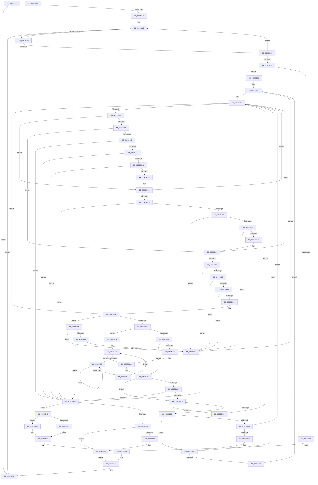

# KeAbCrossThreadDelete

- RVA: `0x005C517C`–`0x005C55C5` (길이 `1,097` bytes)
- VA: `0x00000001405C517C`
- 실행 섹션: `.text`
- PDB 이름 있음: `예`; PDB Function 태그: `아니요`
- unwind 정보 RVA: `0x000CAA70`
- 디코드: `286`개 명령, `1,097/1,097` bytes 표시
- 미해석 바이트: `0` (있으면 어셈블리에 `.byte`로 보존)

> 이 문서는 커널 이미지의 기계어와 PDB 기호를 분석해 생성했습니다. 4번과 5번은 함수 원형과 자료형을 바이너리 사용 방식에서 추정한 C 해석이며 원본 소스 복구 결과는 아닙니다.

## 1. Dependencies

- 직접 호출 지점: **20**; 고유 호출 대상: **14**
- 직접 호출자로 확인된 함수: **1**
- RIP 상대 이미지 참조: **4**

### Outgoing calls
- `0x005C51D2` → [KeAbThreadAreAllEntriesFree](../3E/KeAbThreadAreAllEntriesFree_function_003ECB20.md) (function, `0x003ECB20`)
- `0x005C5267` → [KiAcquireThreadLockRaiseToDpc](../39/KiAcquireThreadLockRaiseToDpc_function_00396280.md) (function, `0x00396280`)
- `0x005C52D1` → [KiAcquirePrcbLocksForIsolationUnit](../30/KiAcquirePrcbLocksForIsolationUnit_function_0030ED60.md) (function, `0x0030ED60`)
- `0x005C5321` → [KiAcquirePrcbLocksForIsolationUnit](../30/KiAcquirePrcbLocksForIsolationUnit_function_0030ED60.md) (function, `0x0030ED60`)
- `0x005C53A1` → [KxWaitForLockOwnerShip](../25/KxWaitForLockOwnerShip_function_00257EB0.md) (function, `0x00257EB0`)
- `0x005C53FD` → [KxWaitForLockChainValid](../21/KxWaitForLockChainValid_function_00217AA0.md) (function, `0x00217AA0`)
- `0x005C5425` → [KeWakeAddressAll](../21/KeWakeAddressAll_function_00217C20.md) (function, `0x00217C20`)
- `0x005C5442` → [KeYieldProcessorEx](../3F/KeYieldProcessorEx_function_003FBD00.md) (function, `0x003FBD00`)
- `0x005C5465` → [KiAcquirePrcbLocksForIsolationUnit](../30/KiAcquirePrcbLocksForIsolationUnit_function_0030ED60.md) (function, `0x0030ED60`)
- `0x005C5483` → [KiReleasePrcbLocksForIsolationUnit](../39/KiReleasePrcbLocksForIsolationUnit_function_00399C50.md) (function, `0x00399C50`)
- `0x005C54B3` → [KiReleaseThreadStateLock](../21/KiReleaseThreadStateLock_function_00217910.md) (function, `0x00217910`)
- `0x005C54BE` → [KiReleaseThreadLockLowerIrql](../3C/KiReleaseThreadLockLowerIrql_function_003C65D0.md) (function, `0x003C65D0`)
- `0x005C5530` → [KeInsertQueueDpc](../20/KeInsertQueueDpc_function_00207C50.md) (function, `0x00207C50`)
- `0x005C5546` → [KeWaitForSingleObject](../20/KeWaitForSingleObject_function_0020E6B0.md) (function, `0x0020E6B0`)
- `0x005C555D` → [KiReleaseThreadStateLock](../21/KiReleaseThreadStateLock_function_00217910.md) (function, `0x00217910`)
- `0x005C5568` → [KiReleaseThreadLockLowerIrql](../3C/KiReleaseThreadLockLowerIrql_function_003C65D0.md) (function, `0x003C65D0`)
- `0x005C556F` → [KiReleaseThreadStateLock](../21/KiReleaseThreadStateLock_function_00217910.md) (function, `0x00217910`)
- `0x005C557A` → [KiReleaseThreadLockLowerIrql](../3C/KiReleaseThreadLockLowerIrql_function_003C65D0.md) (function, `0x003C65D0`)
- `0x005C5588` → [KeGenericCallDpcEx](../2C/KeGenericCallDpcEx_function_002C99F4.md) (function, `0x002C99F4`)
- `0x005C55A4` → [KiAbCrossThreadRelease](../41/KiAbCrossThreadRelease_function_004167C8.md) (function, `0x004167C8`)

### Direct callers
- [sub_006E2698](../6E/Unknown_function_006E2698.md) at `0x006E269B`

### Static image references
- `0x005C526C` → RVA `0x00FC8C40` (`ALMOSTRO`; read)
- `0x005C536D` → RVA `0x00FC6B38` (`ALMOSTRO`; read)
- `0x005C54DD` → RVA `0x005C55D0` (`KeAbCrossThreadDeleteDpcRoutine`; read)
- `0x005C5581` → RVA `0x004A6860` (`EtwpSynchronizationDpc`; read)

## 2. Other-region calls and transfers

- 다른 실행 섹션으로 향하는 call: **0**
- 별도 외부 분기/꼬리 이동을 확인하지 못했습니다.

## 3. Assembly (complete function range)

```asm
005C517C  48 89 5C 24 08                  mov qword ptr [rsp + 8], rbx
005C5181  55                              push rbp
005C5182  56                              push rsi
005C5183  57                              push rdi
005C5184  41 54                           push r12
005C5186  41 55                           push r13
005C5188  41 56                           push r14
005C518A  41 57                           push r15
005C518C  48 8D 6C 24 D9                  lea rbp, [rsp - 0x27]
005C5191  48 81 EC C0 00 00 00            sub rsp, 0xc0
005C5198  0F 57 C0                        xorps xmm0, xmm0
005C519B  33 C0                           xor eax, eax
005C519D  4C 8B E9                        mov r13, rcx
005C51A0  48 89 45 17                     mov qword ptr [rbp + 0x17], rax
005C51A4  33 F6                           xor esi, esi
005C51A6  89 45 1F                        mov dword ptr [rbp + 0x1f], eax
005C51A9  48 8B CA                        mov rcx, rdx
005C51AC  89 75 7F                        mov dword ptr [rbp + 0x7f], esi
005C51AF  0F 11 45 B7                     movups xmmword ptr [rbp - 0x49], xmm0
005C51B3  40 88 75 77                     mov byte ptr [rbp + 0x77], sil
005C51B7  48 8B DA                        mov rbx, rdx
005C51BA  0F 11 45 C7                     movups xmmword ptr [rbp - 0x39], xmm0
005C51BE  0F 11 45 D7                     movups xmmword ptr [rbp - 0x29], xmm0
005C51C2  0F 11 45 E7                     movups xmmword ptr [rbp - 0x19], xmm0
005C51C6  0F 11 45 F7                     movups xmmword ptr [rbp - 9], xmm0
005C51CA  0F 11 45 07                     movups xmmword ptr [rbp + 7], xmm0
005C51CE  0F 11 45 9F                     movups xmmword ptr [rbp - 0x61], xmm0
005C51D2  E8 49 79 E2 FF                  call 0x1403ecb20
005C51D7  85 C0                           test eax, eax
005C51D9  0F 85 CA 03 00 00               jne 0x1405c55a9
005C51DF  4C 8B 8B 70 04 00 00            mov r9, qword ptr [rbx + 0x470]
005C51E6  44 8D 46 01                     lea r8d, [rsi + 1]
005C51EA  4D 8B D5                        mov r10, r13
005C51ED  48 89 75 97                     mov qword ptr [rbp - 0x69], rsi
005C51F1  49 BB FC FF FF FF FF FF FF 7F   movabs r11, 0x7ffffffffffffffc
005C51FB  4D 23 D3                        and r10, r11
005C51FE  41 0F B7 51 08                  movzx edx, word ptr [r9 + 8]
005C5203  41 0F B7 41 0A                  movzx eax, word ptr [r9 + 0xa]
005C5208  41 8A 49 0C                     mov cl, byte ptr [r9 + 0xc]
005C520C  0B C2                           or eax, edx
005C520E  49 D3 E0                        shl r8, cl
005C5211  41 FF C8                        dec r8d
005C5214  44 33 C0                        xor r8d, eax
005C5217  41 0F BD C8                     bsr ecx, r8d
005C521B  89 4D 7F                        mov dword ptr [rbp + 0x7f], ecx
005C521E  0F 84 85 03 00 00               je 0x1405c55a9
005C5224  B8 01 00 00 00                  mov eax, 1
005C5229  D3 E0                           shl eax, cl
005C522B  F7 D0                           not eax
005C522D  44 23 C0                        and r8d, eax
005C5230  8B C1                           mov eax, ecx
005C5232  4C 6B F8 58                     imul r15, rax, 0x58
005C5236  49 83 C7 10                     add r15, 0x10
005C523A  4D 03 F9                        add r15, r9
005C523D  49 8B 07                        mov rax, qword ptr [r15]
005C5240  48 8B C8                        mov rcx, rax
005C5243  49 23 CB                        and rcx, r11
005C5246  49 3B CA                        cmp rcx, r10
005C5249  75 CC                           jne 0x1405c5217
005C524B  41 38 77 0A                     cmp byte ptr [r15 + 0xa], sil
005C524F  74 C6                           je 0x1405c5217
005C5251  48 85 C0                        test rax, rax
005C5254  79 0A                           jns 0x1405c5260
005C5256  41 8A 07                        mov al, byte ptr [r15]
005C5259  0C 01                           or al, 1
005C525B  E9 34 03 00 00                  jmp 0x1405c5594
005C5260  48 8D 55 77                     lea rdx, [rbp + 0x77]
005C5264  48 8B CB                        mov rcx, rbx
005C5267  E8 14 10 DD FF                  call 0x140396280
005C526C  4C 8D 05 CD 39 A0 00            lea r8, [rip + 0xa039cd]
005C5273  44 0F B6 A3 84 01 00 00         movzx r12d, byte ptr [rbx + 0x184]
005C527B  33 D2                           xor edx, edx
005C527D  41 8B CC                        mov ecx, r12d
005C5280  8B FA                           mov edi, edx
005C5282  83 E9 01                        sub ecx, 1
005C5285  0F 84 C9 00 00 00               je 0x1405c5354
005C528B  83 E9 01                        sub ecx, 1
005C528E  74 28                           je 0x1405c52b8
005C5290  83 E9 01                        sub ecx, 1
005C5293  74 6F                           je 0x1405c5304
005C5295  83 F9 02                        cmp ecx, 2
005C5298  0F 85 F1 01 00 00               jne 0x1405c548f
005C529E  8A 43 70                        mov al, byte ptr [rbx + 0x70]
005C52A1  24 07                           and al, 7
005C52A3  3C 01                           cmp al, 1
005C52A5  0F 84 E4 01 00 00               je 0x1405c548f
005C52AB  2C 03                           sub al, 3
005C52AD  3C 03                           cmp al, 3
005C52AF  0F 86 DA 01 00 00               jbe 0x1405c548f
005C52B5  44 8A E1                        mov r12b, cl
005C52B8  44 8B B3 18 02 00 00            mov r14d, dword ptr [rbx + 0x218]
005C52BF  33 F6                           xor esi, esi
005C52C1  45 85 F6                        test r14d, r14d
005C52C4  78 AD                           js 0x1405c5273
005C52C6  4B 8B 34 F0                     mov rsi, qword ptr [r8 + r14*8]
005C52CA  4C 8D 45 97                     lea r8, [rbp - 0x69]
005C52CE  48 8B CE                        mov rcx, rsi
005C52D1  E8 8A 9A D4 FF                  call 0x14030ed60
005C52D6  48 3B 5E 08                     cmp rbx, qword ptr [rsi + 8]
005C52DA  0F 84 AF 01 00 00               je 0x1405c548f
005C52E0  8A 83 84 01 00 00               mov al, byte ptr [rbx + 0x184]
005C52E6  3C 02                           cmp al, 2
005C52E8  0F 85 91 01 00 00               jne 0x1405c547f
005C52EE  8B 83 18 02 00 00               mov eax, dword ptr [rbx + 0x218]
005C52F4  41 3B C6                        cmp eax, r14d
005C52F7  0F 85 82 01 00 00               jne 0x1405c547f
005C52FD  B9 4A 00 00 00                  mov ecx, 0x4a
005C5302  CD 29                           int 0x29
005C5304  44 8B B3 18 02 00 00            mov r14d, dword ptr [rbx + 0x218]
005C530B  33 F6                           xor esi, esi
005C530D  45 85 F6                        test r14d, r14d
005C5310  0F 88 5D FF FF FF               js 0x1405c5273
005C5316  4B 8B 34 F0                     mov rsi, qword ptr [r8 + r14*8]
005C531A  4C 8D 45 97                     lea r8, [rbp - 0x69]
005C531E  48 8B CE                        mov rcx, rsi
005C5321  E8 3A 9A D4 FF                  call 0x14030ed60
005C5326  48 3B 5E 10                     cmp rbx, qword ptr [rsi + 0x10]
005C532A  0F 84 5F 01 00 00               je 0x1405c548f
005C5330  8A 83 84 01 00 00               mov al, byte ptr [rbx + 0x184]
005C5336  3C 03                           cmp al, 3
005C5338  0F 85 41 01 00 00               jne 0x1405c547f
005C533E  8B 83 18 02 00 00               mov eax, dword ptr [rbx + 0x218]
005C5344  41 3B C6                        cmp eax, r14d
005C5347  0F 85 32 01 00 00               jne 0x1405c547f
005C534D  B9 1E 00 00 00                  mov ecx, 0x1e
005C5352  CD 29                           int 0x29
005C5354  44 8B B3 18 02 00 00            mov r14d, dword ptr [rbx + 0x218]
005C535B  33 F6                           xor esi, esi
005C535D  45 85 F6                        test r14d, r14d
005C5360  0F 89 F4 00 00 00               jns 0x1405c545a
005C5366  41 8B C6                        mov eax, r14d
005C5369  0F BA F0 1F                     btr eax, 0x1f
005C536D  F7 05 C1 17 A0 00 00 00 20 00   test dword ptr [rip + 0xa017c1], 0x200000
005C5377  49 8B 04 C0                     mov rax, qword ptr [r8 + rax*8]
005C537B  48 8B B8 48 8E 00 00            mov rdi, qword ptr [rax + 0x8e48]
005C5382  0F 84 A7 00 00 00               je 0x1405c542f
005C5388  48 89 7D A7                     mov qword ptr [rbp - 0x59], rdi
005C538C  48 8D 55 9F                     lea rdx, [rbp - 0x61]
005C5390  48 89 75 9F                     mov qword ptr [rbp - 0x61], rsi
005C5394  90                              nop
005C5395  48 87 17                        xchg qword ptr [rdi], rdx
005C5398  48 85 D2                        test rdx, rdx
005C539B  74 10                           je 0x1405c53ad
005C539D  48 8D 4D 9F                     lea rcx, [rbp - 0x61]
005C53A1  E8 0A 2B C9 FF                  call 0x140257eb0
005C53A6  4C 8D 05 93 38 A0 00            lea r8, [rip + 0xa03893]
005C53AD  8A 83 84 01 00 00               mov al, byte ptr [rbx + 0x184]
005C53B3  3C 01                           cmp al, 1
005C53B5  75 0F                           jne 0x1405c53c6
005C53B7  8B 83 18 02 00 00               mov eax, dword ptr [rbx + 0x218]
005C53BD  41 3B C6                        cmp eax, r14d
005C53C0  0F 84 C9 00 00 00               je 0x1405c548f
005C53C6  F7 05 68 17 A0 00 00 00 20 00   test dword ptr [rip + 0xa01768], 0x200000
005C53D0  74 7F                           je 0x1405c5451
005C53D2  0F 0D 4D 9F                     prefetchw byte ptr [rbp - 0x61]
005C53D6  48 8B 45 9F                     mov rax, qword ptr [rbp - 0x61]
005C53DA  48 85 C0                        test rax, rax
005C53DD  75 23                           jne 0x1405c5402
005C53DF  48 8B 4D A7                     mov rcx, qword ptr [rbp - 0x59]
005C53E3  48 8D 45 9F                     lea rax, [rbp - 0x61]
005C53E7  F0 48 0F B1 31                  lock cmpxchg qword ptr [rcx], rsi
005C53EC  48 8D 4D 9F                     lea rcx, [rbp - 0x61]
005C53F0  48 3B C1                        cmp rax, rcx
005C53F3  0F 84 7A FE FF FF               je 0x1405c5273
005C53F9  48 8D 4D 9F                     lea rcx, [rbp - 0x61]
005C53FD  E8 9E 26 C5 FF                  call 0x140217aa0
005C5402  48 8D 48 08                     lea rcx, [rax + 8]
005C5406  48 89 75 9F                     mov qword ptr [rbp - 0x61], rsi
005C540A  48 8B 55 A7                     mov rdx, qword ptr [rbp - 0x59]
005C540E  4C 8D 05 2B 38 A0 00            lea r8, [rip + 0xa0382b]
005C5415  48 8B C2                        mov rax, rdx
005C5418  48 87 01                        xchg qword ptr [rcx], rax
005C541B  32 C2                           xor al, dl
005C541D  A8 04                           test al, 4
005C541F  0F 84 4E FE FF FF               je 0x1405c5273
005C5425  E8 F6 27 C5 FF                  call 0x140217c20
005C542A  E9 3D FE FF FF                  jmp 0x1405c526c
005C542F  89 75 AF                        mov dword ptr [rbp - 0x51], esi
005C5432  F0 48 0F BA 2F 00               lock bts qword ptr [rdi], 0
005C5438  0F 83 68 FF FF FF               jae 0x1405c53a6
005C543E  48 8D 4D AF                     lea rcx, [rbp - 0x51]
005C5442  E8 B9 68 E3 FF                  call 0x1403fbd00
005C5447  48 8B 07                        mov rax, qword ptr [rdi]
005C544A  48 85 C0                        test rax, rax
005C544D  75 EF                           jne 0x1405c543e
005C544F  EB E1                           jmp 0x1405c5432
005C5451  F0 48 21 37                     lock and qword ptr [rdi], rsi
005C5455  E9 19 FE FF FF                  jmp 0x1405c5273
005C545A  4B 8B 34 F0                     mov rsi, qword ptr [r8 + r14*8]
005C545E  4C 8D 45 97                     lea r8, [rbp - 0x69]
005C5462  48 8B CE                        mov rcx, rsi
005C5465  E8 F6 98 D4 FF                  call 0x14030ed60
005C546A  8A 83 84 01 00 00               mov al, byte ptr [rbx + 0x184]
005C5470  3C 01                           cmp al, 1
005C5472  75 0B                           jne 0x1405c547f
005C5474  8B 83 18 02 00 00               mov eax, dword ptr [rbx + 0x218]
005C547A  41 3B C6                        cmp eax, r14d
005C547D  74 10                           je 0x1405c548f
005C547F  48 8D 4D 97                     lea rcx, [rbp - 0x69]
005C5483  E8 C8 47 DD FF                  call 0x140399c50
005C5488  33 F6                           xor esi, esi
005C548A  E9 DD FD FF FF                  jmp 0x1405c526c
005C548F  4C 8D 45 97                     lea r8, [rbp - 0x69]
005C5493  4C 8B CF                        mov r9, rdi
005C5496  48 8B D6                        mov rdx, rsi
005C5499  41 80 FC 02                     cmp r12b, 2
005C549D  0F 85 AA 00 00 00               jne 0x1405c554d
005C54A3  44 8B B3 18 02 00 00            mov r14d, dword ptr [rbx + 0x218]
005C54AA  48 8D 45 9F                     lea rax, [rbp - 0x61]
005C54AE  48 89 44 24 20                  mov qword ptr [rsp + 0x20], rax
005C54B3  E8 58 24 C5 FF                  call 0x140217910
005C54B8  8A 55 77                        mov dl, byte ptr [rbp + 0x77]
005C54BB  48 8B CB                        mov rcx, rbx
005C54BE  E8 0D 11 E0 FF                  call 0x1403c65d0
005C54C3  33 F6                           xor esi, esi
005C54C5  4C 89 6D CF                     mov qword ptr [rbp - 0x31], r13
005C54C9  48 8D 45 BF                     lea rax, [rbp - 0x41]
005C54CD  48 89 75 1F                     mov qword ptr [rbp + 0x1f], rsi
005C54D1  48 89 45 C7                     mov qword ptr [rbp - 0x39], rax
005C54D5  48 8D 45 BF                     lea rax, [rbp - 0x41]
005C54D9  48 89 45 BF                     mov qword ptr [rbp - 0x41], rax
005C54DD  48 8D 05 EC 00 00 00            lea rax, [rip + 0xec]
005C54E4  48 89 45 FF                     mov qword ptr [rbp - 1], rax
005C54E8  48 8D 45 B7                     lea rax, [rbp - 0x49]
005C54EC  48 89 45 07                     mov qword ptr [rbp + 7], rax
005C54F0  48 8B 45 1F                     mov rax, qword ptr [rbp + 0x1f]
005C54F4  4C 89 7D D7                     mov qword ptr [rbp - 0x29], r15
005C54F8  48 89 5D DF                     mov qword ptr [rbp - 0x21], rbx
005C54FC  66 C7 45 B7 01 00               mov word ptr [rbp - 0x49], 1
005C5502  C6 45 B9 06                     mov byte ptr [rbp - 0x47], 6
005C5506  89 75 BB                        mov dword ptr [rbp - 0x45], esi
005C5509  C7 45 E7 13 01 00 00            mov dword ptr [rbp - 0x19], 0x113
005C5510  48 89 75 F7                     mov qword ptr [rbp - 9], rsi
005C5514  48 85 C0                        test rax, rax
005C5517  75 0E                           jne 0x1405c5527
005C5519  B8 00 08 00 00                  mov eax, 0x800
005C551E  66 44 03 F0                     add r14w, ax
005C5522  66 44 89 75 E9                  mov word ptr [rbp - 0x17], r14w
005C5527  45 33 C0                        xor r8d, r8d
005C552A  48 8D 4D E7                     lea rcx, [rbp - 0x19]
005C552E  33 D2                           xor edx, edx
005C5530  E8 1B 27 C4 FF                  call 0x140207c50
005C5535  45 33 C9                        xor r9d, r9d
005C5538  48 89 74 24 20                  mov qword ptr [rsp + 0x20], rsi
005C553D  45 33 C0                        xor r8d, r8d
005C5540  48 8D 4D B7                     lea rcx, [rbp - 0x49]
005C5544  33 D2                           xor edx, edx
005C5546  E8 65 91 C4 FF                  call 0x14020e6b0
005C554B  EB 4A                           jmp 0x1405c5597
005C554D  8A 43 71                        mov al, byte ptr [rbx + 0x71]
005C5550  84 C0                           test al, al
005C5552  48 8D 45 9F                     lea rax, [rbp - 0x61]
005C5556  48 89 44 24 20                  mov qword ptr [rsp + 0x20], rax
005C555B  75 12                           jne 0x1405c556f
005C555D  E8 AE 23 C5 FF                  call 0x140217910
005C5562  8A 55 77                        mov dl, byte ptr [rbp + 0x77]
005C5565  48 8B CB                        mov rcx, rbx
005C5568  E8 63 10 E0 FF                  call 0x1403c65d0
005C556D  EB 1E                           jmp 0x1405c558d
005C556F  E8 9C 23 C5 FF                  call 0x140217910
005C5574  8A 55 77                        mov dl, byte ptr [rbp + 0x77]
005C5577  48 8B CB                        mov rcx, rbx
005C557A  E8 51 10 E0 FF                  call 0x1403c65d0
005C557F  33 D2                           xor edx, edx
005C5581  48 8D 0D D8 12 EE FF            lea rcx, [rip - 0x11ed28]
005C5588  E8 67 44 D0 FF                  call 0x1402c99f4
005C558D  41 8A 07                        mov al, byte ptr [r15]
005C5590  0C 01                           or al, 1
005C5592  33 F6                           xor esi, esi
005C5594  41 88 07                        mov byte ptr [r15], al
005C5597  F0 09 34 24                     lock or dword ptr [rsp], esi
005C559B  4C 8B C3                        mov r8, rbx
005C559E  49 8B D7                        mov rdx, r15
005C55A1  49 8B CD                        mov rcx, r13
005C55A4  E8 1F 12 E5 FF                  call 0x1404167c8
005C55A9  48 8B 9C 24 00 01 00 00         mov rbx, qword ptr [rsp + 0x100]
005C55B1  48 81 C4 C0 00 00 00            add rsp, 0xc0
005C55B8  41 5F                           pop r15
005C55BA  41 5E                           pop r14
005C55BC  41 5D                           pop r13
005C55BE  41 5C                           pop r12
005C55C0  5F                              pop rdi
005C55C1  5E                              pop rsi
005C55C2  5D                              pop rbp
005C55C3  C3                              ret
005C55C4  CC                              int3
```

## 4. C-style interpretation (structured pseudocode)

```c
__int64 __fastcall KeAbCrossThreadDelete(__int64 a1, __int64 a2)
{
    __int64 result;
    __int64 v_r10;
    __int64 v_r14;
    __int64 v_r15;
    __int64 v_rsi;
    __int64 v_rsp;
    unsigned int v_stack_m40;
    unsigned __int64 v_stack_m48;
    unsigned __int64 v_stack_m58;
    unsigned __int64 v_stack_m5F;
    unsigned __int64 v_stack_m60;
    unsigned __int64 v_stack_m68;
    unsigned __int16 v_stack_m76;
    unsigned __int64 v_stack_m78;
    unsigned __int64 v_stack_m80;
    unsigned __int64 v_stack_m88;
    unsigned __int64 v_stack_m90;
    unsigned __int64 v_stack_m98;
    unsigned __int64 v_stack_mA0;
    unsigned int v_stack_mA4;
    unsigned __int8 v_stack_mA6;
    unsigned __int64 v_stack_mA8;
    unsigned int v_stack_mB0;
    unsigned __int64 v_stack_mB8;
    unsigned __int64 v_stack_mC0;
    unsigned __int64 v_stack_mC8;
    unsigned __int64 v_stack_mD8;
    unsigned int v_stack_mF8;
    unsigned __int8 v_stack_p18;
    unsigned int v_stack_p20;
    unsigned __int64 v_stack_p8;

    v_stack_p8 = v_rbx;
    v_rsp = (v_rsp) - (192);
    result = 0;
    v_stack_m48 = 0;
    v_rsi = 0;
    v_stack_m40 = 0;
    v_stack_p20 = 0;
    v_stack_mA8 = v_xmm0;
    v_stack_p18 = 0;
    v_stack_m98 = v_xmm0;
    v_stack_m88 = v_xmm0;
    v_stack_m78 = v_xmm0;
    v_stack_m68 = v_xmm0;
    v_stack_m58 = v_xmm0;
    v_stack_mC0 = v_xmm0;
    result = KeAbThreadAreAllEntriesFree(a2, a2, a3, a4);
    if ((unsigned int)(result) != 0) goto loc_005C55A9;
    v_stack_mC8 = 0;
    v_r10 = (a1) & (v_r11);
    result = (unsigned int)((*(unsigned __int16 *)(*(unsigned __int64 *)(a2 + 1136) + 10)) | ((unsigned int)(*(unsigned __int16 *)(*(unsigned __int64 *)(a2 + 1136) + 8))));
    a3 = (v_rsi + 1) << ((unsigned __int8)(*(unsigned __int8 *)(*(unsigned __int64 *)(a2 + 1136) + 12)));
    a3 = (unsigned int)((a3) - 1);
    a3 = (unsigned int)((a3) ^ ((unsigned int)(result)));
loc_005C5217:
    v_stack_p20 = (unsigned int)(*(unsigned __int8 *)(*(unsigned __int64 *)(a2 + 1136) + 12));
    if (condition_is_equal) goto loc_005C55A9;
    result = (unsigned int)((1) << ((unsigned __int8)(*(unsigned __int8 *)(*(unsigned __int64 *)(a2 + 1136) + 12))));
    result = (unsigned int)(~(result));
    a3 = (unsigned int)((a3) & ((unsigned int)(result)));
    v_r15 = (v_r15) * ((unsigned int)((unsigned int)(*(unsigned __int8 *)(*(unsigned __int64 *)(a2 + 1136) + 12))));
    v_r15 = (v_r15) + (16);
    v_r15 = (v_r15) + (*(unsigned __int64 *)(a2 + 1136));
    a1 = (*(unsigned __int64 *)(v_r15)) & (v_r11);
    if (a1 != v_r10) goto loc_005C5217;
    if ((*(unsigned __int8 *)(v_r15 + 10)) == 0) goto loc_005C5217;
    if (!sign_flag) goto loc_005C5260;
    result = (unsigned __int8)((*(unsigned __int8 *)(v_r15)) | (1));
    goto loc_005C5594;
loc_005C5260:
    result = KiAcquireThreadLockRaiseToDpc(a2, v_stack_p18, a3, *(unsigned __int64 *)(a2 + 1136));
loc_005C526C:
loc_005C5273:
    a2 = 0;
    a1 = (unsigned int)(((unsigned int)((unsigned int)(*(unsigned __int8 *)(a2 + 388)))) - (1));
    if (condition_is_equal) goto loc_005C5354;
    a1 = (unsigned int)((a1) - (1));
    if (condition_is_equal) goto loc_005C52B8;
    a1 = (unsigned int)((a1) - (1));
    if (condition_is_equal) goto loc_005C5304;
    if (((unsigned int)(a1)) != 2) goto loc_005C548F;
    result = (unsigned __int8)((*(unsigned __int8 *)(a2 + 112)) & (7));
    if (((unsigned __int8)(result)) == 1) goto loc_005C548F;
    result = (unsigned __int8)((result) - (3));
    if (((unsigned __int8)(result)) <= 3) goto loc_005C548F;
loc_005C52B8:
    v_rsi = 0;
    if (sign_flag) goto loc_005C5273;
    result = KiAcquirePrcbLocksForIsolationUnit(*(unsigned __int64 *)(v_rip + 10500557 + (unsigned int)(*(unsigned int *)(a2 + 536)) * 8), a2, v_stack_mC8, *(unsigned __int64 *)(a2 + 1136));
    if (0 == (*(unsigned __int64 *)(*(unsigned __int64 *)(v_rip + 10500557 + (unsigned int)(*(unsigned int *)(a2 + 536)) * 8) + 8))) goto loc_005C548F;
    if (((unsigned __int8)(*(unsigned __int8 *)(a2 + 388))) != 2) goto loc_005C547F;
    if (((unsigned int)((unsigned int)(*(unsigned int *)(a2 + 536)))) != ((unsigned int)((unsigned int)(*(unsigned int *)(a2 + 536))))) goto loc_005C547F;
loc_005C5304:
    v_rsi = 0;
    if (sign_flag) goto loc_005C5273;
    result = KiAcquirePrcbLocksForIsolationUnit(*(unsigned __int64 *)(v_stack_mC8 + (unsigned int)(*(unsigned int *)(a2 + 536)) * 8), a2, v_stack_mC8, *(unsigned __int64 *)(a2 + 1136));
    if (0 == (*(unsigned __int64 *)(*(unsigned __int64 *)(v_stack_mC8 + (unsigned int)(*(unsigned int *)(a2 + 536)) * 8) + 16))) goto loc_005C548F;
    if (((unsigned __int8)(*(unsigned __int8 *)(a2 + 388))) != 3) goto loc_005C547F;
    if (((unsigned int)((unsigned int)(*(unsigned int *)(a2 + 536)))) != ((unsigned int)((unsigned int)(*(unsigned int *)(a2 + 536))))) goto loc_005C547F;
loc_005C5354:
    v_rsi = 0;
    if (!sign_flag) goto loc_005C545A;
    if (((*(unsigned int *)(v_rip + 10491841)) & (0x200000ULL)) == 0) goto loc_005C542F;
    v_stack_mB8 = *(unsigned __int64 *)(*(unsigned __int64 *)(v_stack_mC8 + (unsigned int)((unsigned int)((unsigned int)(*(unsigned int *)(a2 + 536)))) * 8) + 36424);
    v_stack_mC0 = 0;
    if (v_stack_mC0 == 0) goto loc_005C53AD;
    result = KxWaitForLockOwnerShip(v_stack_mC0, v_stack_mC0, v_stack_mC8, *(unsigned __int64 *)(a2 + 1136));
loc_005C53A6:
loc_005C53AD:
    if (((unsigned __int8)(*(unsigned __int8 *)(a2 + 388))) != 1) goto loc_005C53C6;
    if (((unsigned int)((unsigned int)(*(unsigned int *)(a2 + 536)))) == ((unsigned int)((unsigned int)(*(unsigned int *)(a2 + 536))))) goto loc_005C548F;
loc_005C53C6:
    if (((*(unsigned int *)(v_rip + 10491752)) & (0x200000ULL)) == 0) goto loc_005C5451;
    if (v_stack_mC0 != 0) goto loc_005C5402;
    if (v_stack_mC0 == v_stack_mC0) goto loc_005C5273;
    result = KxWaitForLockChainValid(v_stack_mC0, v_stack_mC0, v_rip + 10500243, *(unsigned __int64 *)(a2 + 1136));
loc_005C5402:
    v_stack_mC0 = 0;
    result = (unsigned __int8)((v_stack_mB8) ^ ((unsigned __int8)(v_stack_mB8)));
    if ((((unsigned __int8)(result)) & (4)) == 0) goto loc_005C5273;
    result = KeWakeAddressAll(result + 8, v_stack_mB8, v_rip + 10500139, *(unsigned __int64 *)(a2 + 1136));
    goto loc_005C526C;
loc_005C542F:
    v_stack_mB0 = 0;
loc_005C5432:
    if (condition_is_above_or_equal) goto loc_005C53A6;
loc_005C543E:
    result = KeYieldProcessorEx(v_stack_mB0, v_stack_mB8, v_rip + 10500139, *(unsigned __int64 *)(a2 + 1136));
    if (*(unsigned __int64 *)(*(unsigned __int64 *)(*(unsigned __int64 *)(v_stack_mC8 + (unsigned int)((unsigned int)((unsigned int)(*(unsigned int *)(a2 + 536)))) * 8) + 36424)) != 0) goto loc_005C543E;
    goto loc_005C5432;
loc_005C5451:
    goto loc_005C5273;
loc_005C545A:
    result = KiAcquirePrcbLocksForIsolationUnit(*(unsigned __int64 *)(v_rip + 10500139 + (unsigned int)(*(unsigned int *)(a2 + 536)) * 8), v_stack_mB8, v_stack_mC8, *(unsigned __int64 *)(a2 + 1136));
    if (((unsigned __int8)(*(unsigned __int8 *)(a2 + 388))) != 1) goto loc_005C547F;
    if (((unsigned int)((unsigned int)(*(unsigned int *)(a2 + 536)))) == ((unsigned int)((unsigned int)(*(unsigned int *)(a2 + 536))))) goto loc_005C548F;
loc_005C547F:
    result = KiReleasePrcbLocksForIsolationUnit(v_stack_mC8, v_stack_mB8, v_stack_mC8, *(unsigned __int64 *)(a2 + 1136));
    v_rsi = 0;
    goto loc_005C526C;
loc_005C548F:
    if (((unsigned __int8)((unsigned __int8)(a1))) != 2) goto loc_005C554D;
    v_stack_mD8 = v_stack_mC0;
    result = KiReleaseThreadStateLock(v_stack_mC8, 0, v_stack_mC8, *(unsigned __int64 *)(*(unsigned __int64 *)(v_stack_mC8 + (unsigned int)((unsigned int)((unsigned int)(*(unsigned int *)(a2 + 536)))) * 8) + 36424));
    result = KiReleaseThreadLockLowerIrql(0, v_stack_p18, v_stack_mC8, *(unsigned __int64 *)(*(unsigned __int64 *)(v_stack_mC8 + (unsigned int)((unsigned int)((unsigned int)(*(unsigned int *)(a2 + 536)))) * 8) + 36424));
    v_rsi = 0;
    v_stack_m90 = a1;
    v_stack_m40 = 0;
    v_stack_m98 = v_stack_mA0;
    v_stack_mA0 = v_stack_mA0;
    v_stack_m60 = v_rip + 236;
    v_stack_m58 = v_stack_mA8;
    v_stack_m88 = v_r15;
    v_stack_m80 = 0;
    v_stack_mA8 = 1;
    v_stack_mA6 = 6;
    v_stack_mA4 = 0;
    v_stack_m78 = 275;
    v_stack_m68 = 0;
    result = v_stack_m40;
    v_r14 = (unsigned int)(*(unsigned int *)(a2 + 536));
    if (v_stack_m40 == 0) {
        result = 0x800ULL;
        v_r14 = (unsigned __int16)(((unsigned int)(*(unsigned int *)(a2 + 536))) + ((unsigned __int16)(result)));
        v_stack_m76 = (unsigned __int16)(v_r14);
    }
    a3 = 0;
    a2 = 0;
    result = KeInsertQueueDpc(v_stack_m78, a2, a3, *(unsigned __int64 *)(*(unsigned __int64 *)(v_stack_mC8 + (unsigned int)((unsigned int)((unsigned int)(*(unsigned int *)(a2 + 536)))) * 8) + 36424));
    a4 = 0;
    v_stack_mD8 = 0;
    a3 = 0;
    a2 = 0;
    result = KeWaitForSingleObject(v_stack_mA8, a2, a3, a4);
    goto loc_005C5597;
loc_005C554D:
    v_stack_mD8 = v_stack_mC0;
    if ((unsigned __int8)(*(unsigned __int8 *)(a2 + 113)) != 0) goto loc_005C556F;
    result = KiReleaseThreadStateLock(v_stack_mA8, a2, a3, a4);
    result = KiReleaseThreadLockLowerIrql(0, v_stack_p18, a3, a4);
    goto loc_005C558D;
loc_005C556F:
    result = KiReleaseThreadStateLock(0, v_stack_p18, a3, a4);
    result = KiReleaseThreadLockLowerIrql(0, v_stack_p18, a3, a4);
    a2 = 0;
    result = KeGenericCallDpcEx(v_rip - 1174824, a2, a3, a4);
loc_005C558D:
    result = (unsigned __int8)((*(unsigned __int8 *)(v_r15)) | (1));
    v_rsi = 0;
loc_005C5594:
    *(unsigned __int8 *)(v_r15) = (unsigned __int8)(result);
loc_005C5597:
    result = KiAbCrossThreadRelease(a1, v_r15, 0, a4);
loc_005C55A9:
    v_rsp = (v_rsp) + (192);
    return result;
}
```

## 5. (Beta) C Style

```c
int64_t KeAbCrossThreadDelete(int64_t Arg1, void *Arg2)
{
    uint8_t *arg2 = (uint8_t *)Arg2;

    int64_t result;
    int64_t local_r10;
    int64_t local_r14;
    int64_t local_r15;
    int64_t local_rsi;
    int64_t local_rsp;
    uint32_t v_stack_m40;
    uint64_t v_stack_m48;
    uint64_t v_stack_m58;
    uint64_t v_stack_m5F;
    uint64_t v_stack_m60;
    uint64_t v_stack_m68;
    uint16_t v_stack_m76;
    uint64_t v_stack_m78;
    uint64_t v_stack_m80;
    uint64_t v_stack_m88;
    uint64_t v_stack_m90;
    uint64_t v_stack_m98;
    uint64_t v_stack_mA0;
    uint32_t v_stack_mA4;
    uint8_t v_stack_mA6;
    uint64_t v_stack_mA8;
    uint32_t v_stack_mB0;
    uint64_t v_stack_mB8;
    uint64_t v_stack_mC0;
    uint64_t v_stack_mC8;
    uint64_t v_stack_mD8;
    uint32_t v_stack_mF8;
    uint8_t v_stack_p18;
    uint32_t v_stack_p20;
    uint64_t v_stack_p8;

    v_stack_p8 = local_rbx;
    local_rsp = (local_rsp) - (192);
    result = 0;
    v_stack_m48 = 0;
    local_rsi = 0;
    v_stack_m40 = 0;
    v_stack_p20 = 0;
    v_stack_mA8 = v_xmm0;
    v_stack_p18 = 0;
    v_stack_m98 = v_xmm0;
    v_stack_m88 = v_xmm0;
    v_stack_m78 = v_xmm0;
    v_stack_m68 = v_xmm0;
    v_stack_m58 = v_xmm0;
    v_stack_mC0 = v_xmm0;
    result = KeAbThreadAreAllEntriesFree(Arg2, Arg2, a3, a4);
    if ((uint32_t)(result) != 0) goto loc_005C55A9;
    v_stack_mC8 = 0;
    local_r10 = (Arg1) & (local_r11);
    result = (uint32_t)((*(uint16_t *)(*(uint64_t *)(arg2 + 0x470) + 0xA)) | ((uint32_t)(*(uint16_t *)(*(uint64_t *)(arg2 + 0x470) + 0x8))));
    a3 = (local_rsi + 1) << ((uint8_t)(*(uint8_t *)(*(uint64_t *)(arg2 + 0x470) + 0xC)));
    a3 = (uint32_t)((a3) - 1);
    a3 = (uint32_t)((a3) ^ ((uint32_t)(result)));
loc_005C5217:
    v_stack_p20 = (uint32_t)(*(uint8_t *)(*(uint64_t *)(arg2 + 0x470) + 0xC));
    if (condition_is_equal) goto loc_005C55A9;
    result = (uint32_t)((1) << ((uint8_t)(*(uint8_t *)(*(uint64_t *)(arg2 + 0x470) + 0xC))));
    result = (uint32_t)(~(result));
    a3 = (uint32_t)((a3) & ((uint32_t)(result)));
    local_r15 = (local_r15) * ((uint32_t)((uint32_t)(*(uint8_t *)(*(uint64_t *)(arg2 + 0x470) + 0xC))));
    local_r15 = (local_r15) + (16);
    local_r15 = (local_r15) + (*(uint64_t *)(arg2 + 0x470));
    Arg1 = (*(uint64_t *)(local_r15)) & (local_r11);
    if (Arg1 != local_r10) goto loc_005C5217;
    if ((*(uint8_t *)(local_r15 + 0xA)) == 0) goto loc_005C5217;
    if (!sign_flag) goto loc_005C5260;
    result = (uint8_t)((*(uint8_t *)(local_r15)) | (1));
    goto loc_005C5594;
loc_005C5260:
    result = KiAcquireThreadLockRaiseToDpc(Arg2, v_stack_p18, a3, *(uint64_t *)(arg2 + 0x470));
loc_005C526C:
loc_005C5273:
    Arg2 = 0;
    Arg1 = (uint32_t)(((uint32_t)((uint32_t)(*(uint8_t *)(arg2 + 0x184)))) - (1));
    if (condition_is_equal) goto loc_005C5354;
    Arg1 = (uint32_t)((Arg1) - (1));
    if (condition_is_equal) goto loc_005C52B8;
    Arg1 = (uint32_t)((Arg1) - (1));
    if (condition_is_equal) goto loc_005C5304;
    if (((uint32_t)(Arg1)) != 2) goto loc_005C548F;
    result = (uint8_t)((*(uint8_t *)(arg2 + 0x70)) & (7));
    if (((uint8_t)(result)) == 1) goto loc_005C548F;
    result = (uint8_t)((result) - (3));
    if (((uint8_t)(result)) <= 3) goto loc_005C548F;
loc_005C52B8:
    local_rsi = 0;
    if (sign_flag) goto loc_005C5273;
    result = KiAcquirePrcbLocksForIsolationUnit(*(uint64_t *)(v_rip + 0xA039CD + (uint32_t)(*(uint32_t *)(arg2 + 0x218)) * 8), Arg2, v_stack_mC8, *(uint64_t *)(arg2 + 0x470));
    if (0 == (*(uint64_t *)(*(uint64_t *)(v_rip + 0xA039CD + (uint32_t)(*(uint32_t *)(arg2 + 0x218)) * 8) + 0x8))) goto loc_005C548F;
    if (((uint8_t)(*(uint8_t *)(arg2 + 0x184))) != 2) goto loc_005C547F;
    if (((uint32_t)((uint32_t)(*(uint32_t *)(arg2 + 0x218)))) != ((uint32_t)((uint32_t)(*(uint32_t *)(arg2 + 0x218))))) goto loc_005C547F;
loc_005C5304:
    local_rsi = 0;
    if (sign_flag) goto loc_005C5273;
    result = KiAcquirePrcbLocksForIsolationUnit(*(uint64_t *)(v_stack_mC8 + (uint32_t)(*(uint32_t *)(arg2 + 0x218)) * 8), Arg2, v_stack_mC8, *(uint64_t *)(arg2 + 0x470));
    if (0 == (*(uint64_t *)(*(uint64_t *)(v_stack_mC8 + (uint32_t)(*(uint32_t *)(arg2 + 0x218)) * 8) + 0x10))) goto loc_005C548F;
    if (((uint8_t)(*(uint8_t *)(arg2 + 0x184))) != 3) goto loc_005C547F;
    if (((uint32_t)((uint32_t)(*(uint32_t *)(arg2 + 0x218)))) != ((uint32_t)((uint32_t)(*(uint32_t *)(arg2 + 0x218))))) goto loc_005C547F;
loc_005C5354:
    local_rsi = 0;
    if (!sign_flag) goto loc_005C545A;
    if (((*(uint32_t *)(v_rip + 0xA017C1)) & (0x200000ULL)) == 0) goto loc_005C542F;
    v_stack_mB8 = *(uint64_t *)(*(uint64_t *)(v_stack_mC8 + (uint32_t)((uint32_t)((uint32_t)(*(uint32_t *)(arg2 + 0x218)))) * 8) + 0x8E48);
    v_stack_mC0 = 0;
    if (v_stack_mC0 == 0) goto loc_005C53AD;
    result = KxWaitForLockOwnerShip(v_stack_mC0, v_stack_mC0, v_stack_mC8, *(uint64_t *)(arg2 + 0x470));
loc_005C53A6:
loc_005C53AD:
    if (((uint8_t)(*(uint8_t *)(arg2 + 0x184))) != 1) goto loc_005C53C6;
    if (((uint32_t)((uint32_t)(*(uint32_t *)(arg2 + 0x218)))) == ((uint32_t)((uint32_t)(*(uint32_t *)(arg2 + 0x218))))) goto loc_005C548F;
loc_005C53C6:
    if (((*(uint32_t *)(v_rip + 0xA01768)) & (0x200000ULL)) == 0) goto loc_005C5451;
    if (v_stack_mC0 != 0) goto loc_005C5402;
    if (v_stack_mC0 == v_stack_mC0) goto loc_005C5273;
    result = KxWaitForLockChainValid(v_stack_mC0, v_stack_mC0, v_rip + 10500243, *(uint64_t *)(arg2 + 0x470));
loc_005C5402:
    v_stack_mC0 = 0;
    result = (uint8_t)((v_stack_mB8) ^ ((uint8_t)(v_stack_mB8)));
    if ((((uint8_t)(result)) & (4)) == 0) goto loc_005C5273;
    result = KeWakeAddressAll(result + 8, v_stack_mB8, v_rip + 10500139, *(uint64_t *)(arg2 + 0x470));
    goto loc_005C526C;
loc_005C542F:
    v_stack_mB0 = 0;
loc_005C5432:
    if (condition_is_above_or_equal) goto loc_005C53A6;
loc_005C543E:
    result = KeYieldProcessorEx(v_stack_mB0, v_stack_mB8, v_rip + 10500139, *(uint64_t *)(arg2 + 0x470));
    if (*(uint64_t *)(*(uint64_t *)(*(uint64_t *)(v_stack_mC8 + (uint32_t)((uint32_t)((uint32_t)(*(uint32_t *)(arg2 + 0x218)))) * 8) + 0x8E48)) != 0) goto loc_005C543E;
    goto loc_005C5432;
loc_005C5451:
    goto loc_005C5273;
loc_005C545A:
    result = KiAcquirePrcbLocksForIsolationUnit(*(uint64_t *)(v_rip + 0xA0382B + (uint32_t)(*(uint32_t *)(arg2 + 0x218)) * 8), v_stack_mB8, v_stack_mC8, *(uint64_t *)(arg2 + 0x470));
    if (((uint8_t)(*(uint8_t *)(arg2 + 0x184))) != 1) goto loc_005C547F;
    if (((uint32_t)((uint32_t)(*(uint32_t *)(arg2 + 0x218)))) == ((uint32_t)((uint32_t)(*(uint32_t *)(arg2 + 0x218))))) goto loc_005C548F;
loc_005C547F:
    result = KiReleasePrcbLocksForIsolationUnit(v_stack_mC8, v_stack_mB8, v_stack_mC8, *(uint64_t *)(arg2 + 0x470));
    local_rsi = 0;
    goto loc_005C526C;
loc_005C548F:
    if (((uint8_t)((uint8_t)(Arg1))) != 2) goto loc_005C554D;
    v_stack_mD8 = v_stack_mC0;
    result = KiReleaseThreadStateLock(v_stack_mC8, 0, v_stack_mC8, *(uint64_t *)(*(uint64_t *)(v_stack_mC8 + (uint32_t)((uint32_t)((uint32_t)(*(uint32_t *)(arg2 + 0x218)))) * 8) + 0x8E48));
    result = KiReleaseThreadLockLowerIrql(0, v_stack_p18, v_stack_mC8, *(uint64_t *)(*(uint64_t *)(v_stack_mC8 + (uint32_t)((uint32_t)((uint32_t)(*(uint32_t *)(arg2 + 0x218)))) * 8) + 0x8E48));
    local_rsi = 0;
    v_stack_m90 = Arg1;
    v_stack_m40 = 0;
    v_stack_m98 = v_stack_mA0;
    v_stack_mA0 = v_stack_mA0;
    v_stack_m60 = v_rip + 236;
    v_stack_m58 = v_stack_mA8;
    v_stack_m88 = local_r15;
    v_stack_m80 = 0;
    v_stack_mA8 = 1;
    v_stack_mA6 = 6;
    v_stack_mA4 = 0;
    v_stack_m78 = 275;
    v_stack_m68 = 0;
    result = v_stack_m40;
    local_r14 = (uint32_t)(*(uint32_t *)(arg2 + 0x218));
    if (v_stack_m40 == 0) {
        result = 0x800ULL;
        local_r14 = (uint16_t)(((uint32_t)(*(uint32_t *)(arg2 + 0x218))) + ((uint16_t)(result)));
        v_stack_m76 = (uint16_t)(local_r14);
    }
    a3 = 0;
    Arg2 = 0;
    result = KeInsertQueueDpc(v_stack_m78, Arg2, a3, *(uint64_t *)(*(uint64_t *)(v_stack_mC8 + (uint32_t)((uint32_t)((uint32_t)(*(uint32_t *)(arg2 + 0x218)))) * 8) + 0x8E48));
    a4 = 0;
    v_stack_mD8 = 0;
    a3 = 0;
    Arg2 = 0;
    result = KeWaitForSingleObject(v_stack_mA8, Arg2, a3, a4);
    goto loc_005C5597;
loc_005C554D:
    v_stack_mD8 = v_stack_mC0;
    if ((uint8_t)(*(uint8_t *)(arg2 + 0x71)) != 0) goto loc_005C556F;
    result = KiReleaseThreadStateLock(v_stack_mA8, Arg2, a3, a4);
    result = KiReleaseThreadLockLowerIrql(0, v_stack_p18, a3, a4);
    goto loc_005C558D;
loc_005C556F:
    result = KiReleaseThreadStateLock(0, v_stack_p18, a3, a4);
    result = KiReleaseThreadLockLowerIrql(0, v_stack_p18, a3, a4);
    Arg2 = 0;
    result = KeGenericCallDpcEx(v_rip - 1174824, Arg2, a3, a4);
loc_005C558D:
    result = (uint8_t)((*(uint8_t *)(local_r15)) | (1));
    local_rsi = 0;
loc_005C5594:
    *(uint8_t *)(local_r15) = (uint8_t)(result);
loc_005C5597:
    result = KiAbCrossThreadRelease(Arg1, local_r15, 0, a4);
loc_005C55A9:
    local_rsp = (local_rsp) + (192);
    return result;
}
```

### 관측된 메모리 오프셋

구조체 형식이 확인되지 않은 접근은 인자 기준의 오프셋으로만 기록했습니다.

| 기준 인자 | 오프셋 표현 | 폭 (bit) | 접근 |
|---|---:|---:|---|
| `Arg2` | `+ 0x470` | `64` | `R` |

## 6. Execution-region graph

[열기: 2D/3D 그래프와 함수 탐색 컨트롤 패널](../../../control-panel.html?section=text&rva=0x005C517C&view=graph)

- 2D 그래프는 위에서 아래로 흐르고, 3D 그래프는 빈 공간을 드래그해 회전합니다. Shift+드래그는 이동, 휠은 확대·축소, 함수 노드 선택은 대상 보고서 이동입니다.

### Static fallback


