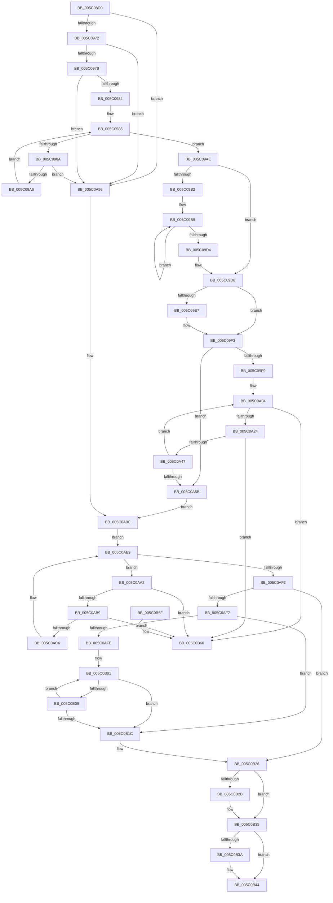

# KeAssignCpuPartitionsToProcess

- RVA: `0x005C08D0`–`0x005C0B67` (길이 `663` bytes)
- VA: `0x00000001405C08D0`
- 실행 섹션: `.text`
- PDB 이름 있음: `예`; PDB Function 태그: `아니요`
- unwind 정보 RVA: `0x000CA6B0`
- 디코드: `190`개 명령, `663/663` bytes 표시
- 미해석 바이트: `0` (있으면 어셈블리에 `.byte`로 보존)

> 이 문서는 커널 이미지의 기계어와 PDB 기호를 분석해 생성했습니다. 4번과 5번은 함수 원형과 자료형을 바이너리 사용 방식에서 추정한 C 해석이며 원본 소스 복구 결과는 아닙니다.

## 1. Dependencies

- 직접 호출 지점: **17**; 고유 호출 대상: **10**
- 직접 호출자로 확인된 함수: **1**
- RIP 상대 이미지 참조: **1**

### Outgoing calls
- `0x005C0931` → [ExAllocatePool2](../../poolcode/B8/ExAllocatePool2_function_00B820F0.md) (function, `0x00B820F0`)
- `0x005C094A` → [ExAllocatePool2](../../poolcode/B8/ExAllocatePool2_function_00B820F0.md) (function, `0x00B820F0`)
- `0x005C0961` → [ExAllocatePool2](../../poolcode/B8/ExAllocatePool2_function_00B820F0.md) (function, `0x00B820F0`)
- `0x005C0998` → [ExAllocatePool2](../../poolcode/B8/ExAllocatePool2_function_00B820F0.md) (function, `0x00B820F0`)
- `0x005C09C5` → [PsReferenceCpuPartition](../../page/78/PsReferenceCpuPartition_function_00783CD4.md) (function, `0x00783CD4`)
- `0x005C09DC` → [KiAcquireCpuPartitionAssignmentLock](../43/KiAcquireCpuPartitionAssignmentLock_function_0043F974.md) (function, `0x0043F974`)
- `0x005C09EE` → [KiRemoveCpuPartitionAssignmentProcess](../43/KiRemoveCpuPartitionAssignmentProcess_function_0043F9FC.md) (function, `0x0043F9FC`)
- `0x005C0A72` → [KiAdjustProcessCpuSetsAfterCpuPartitionChange](KiAdjustProcessCpuSetsAfterCpuPartitionChange_function_005C12DC.md) (function, `0x005C12DC`)
- `0x005C0A7C` → [KiUpdateProcessAvailableCpuState](../3C/KiUpdateProcessAvailableCpuState_function_003C00B4.md) (function, `0x003C00B4`)
- `0x005C0A84` → [KiNotifyAvailableCpusChangeProcess](../4F/KiNotifyAvailableCpusChangeProcess_function_004FCE30.md) (function, `0x004FCE30`)
- `0x005C0A8C` → [KiReleaseCpuPartitionAssignmentLock](../43/KiReleaseCpuPartitionAssignmentLock_function_0043F9C0.md) (function, `0x0043F9C0`)
- `0x005C0ADA` → [PsDereferenceCpuPartition](../../page/78/PsDereferenceCpuPartition_function_00783CBC.md) (function, `0x00783CBC`)
- `0x005C0AE4` → [ExFreePoolWithTag](../../poolcode/B8/ExFreePoolWithTag_function_00B82870.md) (function, `0x00B82870`)
- `0x005C0B0B` → [ExFreePoolWithTag](../../poolcode/B8/ExFreePoolWithTag_function_00B82870.md) (function, `0x00B82870`)
- `0x005C0B21` → [ExFreePoolWithTag](../../poolcode/B8/ExFreePoolWithTag_function_00B82870.md) (function, `0x00B82870`)
- `0x005C0B30` → [ExFreePoolWithTag](../../poolcode/B8/ExFreePoolWithTag_function_00B82870.md) (function, `0x00B82870`)
- `0x005C0B3F` → [ExFreePoolWithTag](../../poolcode/B8/ExFreePoolWithTag_function_00B82870.md) (function, `0x00B82870`)

### Direct callers
- [PspAssignCpuPartitionsToProcess](../../page/78/PspAssignCpuPartitionsToProcess_function_00783FB4.md) at `0x00784072`

### Static image references
- `0x005C090D` → RVA `0x00FC5018` (`ALMOSTRO`; read)

## 2. Other-region calls and transfers

- 다른 실행 섹션으로 향하는 call: **11**
  - `0x005C0931` → [ExAllocatePool2](../../poolcode/B8/ExAllocatePool2_function_00B820F0.md) (`.text` → `POOLCODE`)
  - `0x005C094A` → [ExAllocatePool2](../../poolcode/B8/ExAllocatePool2_function_00B820F0.md) (`.text` → `POOLCODE`)
  - `0x005C0961` → [ExAllocatePool2](../../poolcode/B8/ExAllocatePool2_function_00B820F0.md) (`.text` → `POOLCODE`)
  - `0x005C0998` → [ExAllocatePool2](../../poolcode/B8/ExAllocatePool2_function_00B820F0.md) (`.text` → `POOLCODE`)
  - `0x005C09C5` → [PsReferenceCpuPartition](../../page/78/PsReferenceCpuPartition_function_00783CD4.md) (`.text` → `PAGE`)
  - `0x005C0ADA` → [PsDereferenceCpuPartition](../../page/78/PsDereferenceCpuPartition_function_00783CBC.md) (`.text` → `PAGE`)
  - `0x005C0AE4` → [ExFreePoolWithTag](../../poolcode/B8/ExFreePoolWithTag_function_00B82870.md) (`.text` → `POOLCODE`)
  - `0x005C0B0B` → [ExFreePoolWithTag](../../poolcode/B8/ExFreePoolWithTag_function_00B82870.md) (`.text` → `POOLCODE`)
  - `0x005C0B21` → [ExFreePoolWithTag](../../poolcode/B8/ExFreePoolWithTag_function_00B82870.md) (`.text` → `POOLCODE`)
  - `0x005C0B30` → [ExFreePoolWithTag](../../poolcode/B8/ExFreePoolWithTag_function_00B82870.md) (`.text` → `POOLCODE`)
  - `0x005C0B3F` → [ExFreePoolWithTag](../../poolcode/B8/ExFreePoolWithTag_function_00B82870.md) (`.text` → `POOLCODE`)
- 별도 외부 분기/꼬리 이동을 확인하지 못했습니다.

## 3. Assembly (complete function range)

```asm
005C08D0  48 89 5C 24 18                  mov qword ptr [rsp + 0x18], rbx
005C08D5  44 88 4C 24 20                  mov byte ptr [rsp + 0x20], r9b
005C08DA  48 89 4C 24 08                  mov qword ptr [rsp + 8], rcx
005C08DF  55                              push rbp
005C08E0  56                              push rsi
005C08E1  57                              push rdi
005C08E2  41 54                           push r12
005C08E4  41 55                           push r13
005C08E6  41 56                           push r14
005C08E8  41 57                           push r15
005C08EA  48 8B EC                        mov rbp, rsp
005C08ED  48 83 EC 50                     sub rsp, 0x50
005C08F1  48 8D 45 F0                     lea rax, [rbp - 0x10]
005C08F5  8B F2                           mov esi, edx
005C08F7  48 89 45 F8                     mov qword ptr [rbp - 8], rax
005C08FB  4D 8B F0                        mov r14, r8
005C08FE  48 8D 45 F0                     lea rax, [rbp - 0x10]
005C0902  C6 45 48 00                     mov byte ptr [rbp + 0x48], 0
005C0906  48 89 45 F0                     mov qword ptr [rbp - 0x10], rax
005C090A  45 33 FF                        xor r15d, r15d
005C090D  0F B7 05 04 47 A0 00            movzx eax, word ptr [rip + 0xa04704]
005C0914  BF 4B 69 43 75                  mov edi, 0x7543694b
005C0919  44 8B C7                        mov r8d, edi
005C091C  66 89 45 E0                     mov word ptr [rbp - 0x20], ax
005C0920  8B D8                           mov ebx, eax
005C0922  45 8D 67 40                     lea r12d, [r15 + 0x40]
005C0926  48 8D 14 C5 00 00 00 00         lea rdx, [rax*8]
005C092E  41 8B CC                        mov ecx, r12d
005C0931  E8 BA 17 5C 00                  call 0x140b820f0
005C0936  48 C1 E3 04                     shl rbx, 4
005C093A  44 8B C7                        mov r8d, edi
005C093D  48 8B D3                        mov rdx, rbx
005C0940  48 89 45 E8                     mov qword ptr [rbp - 0x18], rax
005C0944  41 8B CC                        mov ecx, r12d
005C0947  4C 8B E8                        mov r13, rax
005C094A  E8 A1 17 5C 00                  call 0x140b820f0
005C094F  48 8D 14 F5 00 00 00 00         lea rdx, [rsi*8]
005C0957  44 8B C7                        mov r8d, edi
005C095A  41 8D 4F 40                     lea ecx, [r15 + 0x40]
005C095E  4C 8B E0                        mov r12, rax
005C0961  E8 8A 17 5C 00                  call 0x140b820f0
005C0966  48 8B F8                        mov rdi, rax
005C0969  4D 85 ED                        test r13, r13
005C096C  0F 84 24 01 00 00               je 0x1405c0a96
005C0972  4D 85 E4                        test r12, r12
005C0975  0F 84 1B 01 00 00               je 0x1405c0a96
005C097B  48 85 C0                        test rax, rax
005C097E  0F 84 12 01 00 00               je 0x1405c0a96
005C0984  33 DB                           xor ebx, ebx
005C0986  3B DE                           cmp ebx, esi
005C0988  73 24                           jae 0x1405c09ae
005C098A  BA 50 00 00 00                  mov edx, 0x50
005C098F  41 B8 4B 69 43 75               mov r8d, 0x7543694b
005C0995  8D 4A F0                        lea ecx, [rdx - 0x10]
005C0998  E8 53 17 5C 00                  call 0x140b820f0
005C099D  48 85 C0                        test rax, rax
005C09A0  0F 84 F0 00 00 00               je 0x1405c0a96
005C09A6  48 89 04 DF                     mov qword ptr [rdi + rbx*8], rax
005C09AA  FF C3                           inc ebx
005C09AC  EB D8                           jmp 0x1405c0986
005C09AE  85 F6                           test esi, esi
005C09B0  74 26                           je 0x1405c09d8
005C09B2  48 8B 5D 40                     mov rbx, qword ptr [rbp + 0x40]
005C09B6  4C 8B EE                        mov r13, rsi
005C09B9  48 8B 0B                        mov rcx, qword ptr [rbx]
005C09BC  BA 4B 69 43 75                  mov edx, 0x7543694b
005C09C1  48 8B 49 20                     mov rcx, qword ptr [rcx + 0x20]
005C09C5  E8 0A 33 1C 00                  call 0x140783cd4
005C09CA  48 8D 5B 08                     lea rbx, [rbx + 8]
005C09CE  49 83 ED 01                     sub r13, 1
005C09D2  75 E5                           jne 0x1405c09b9
005C09D4  4C 8B 6D E8                     mov r13, qword ptr [rbp - 0x18]
005C09D8  48 8D 4D 48                     lea rcx, [rbp + 0x48]
005C09DC  E8 93 EF E7 FF                  call 0x14043f974
005C09E1  44 38 7D 58                     cmp byte ptr [rbp + 0x58], r15b
005C09E5  74 0C                           je 0x1405c09f3
005C09E7  48 8D 55 F0                     lea rdx, [rbp - 0x10]
005C09EB  49 8B CE                        mov rcx, r14
005C09EE  E8 09 F0 E7 FF                  call 0x14043f9fc
005C09F3  33 C9                           xor ecx, ecx
005C09F5  85 F6                           test esi, esi
005C09F7  74 62                           je 0x1405c0a5b
005C09F9  4C 8B 5D 40                     mov r11, qword ptr [rbp + 0x40]
005C09FD  49 8D 96 B0 01 00 00            lea rdx, [r14 + 0x1b0]
005C0A04  48 8B 04 CF                     mov rax, qword ptr [rdi + rcx*8]
005C0A08  4D 8B 14 CB                     mov r10, qword ptr [r11 + rcx*8]
005C0A0C  4C 89 30                        mov qword ptr [rax], r14
005C0A0F  4C 8D 40 20                     lea r8, [rax + 0x20]
005C0A13  4C 89 50 08                     mov qword ptr [rax + 8], r10
005C0A17  4C 8B 4A 08                     mov r9, qword ptr [rdx + 8]
005C0A1B  49 39 11                        cmp qword ptr [r9], rdx
005C0A1E  0F 85 3C 01 00 00               jne 0x1405c0b60
005C0A24  49 89 10                        mov qword ptr [r8], rdx
005C0A27  48 83 C0 10                     add rax, 0x10
005C0A2B  4D 89 48 08                     mov qword ptr [r8 + 8], r9
005C0A2F  4D 89 01                        mov qword ptr [r9], r8
005C0A32  4C 89 42 08                     mov qword ptr [rdx + 8], r8
005C0A36  4D 8D 42 10                     lea r8, [r10 + 0x10]
005C0A3A  4D 8B 50 08                     mov r10, qword ptr [r8 + 8]
005C0A3E  4D 39 02                        cmp qword ptr [r10], r8
005C0A41  0F 85 19 01 00 00               jne 0x1405c0b60
005C0A47  4C 89 00                        mov qword ptr [rax], r8
005C0A4A  FF C1                           inc ecx
005C0A4C  4C 89 50 08                     mov qword ptr [rax + 8], r10
005C0A50  49 89 02                        mov qword ptr [r10], rax
005C0A53  49 89 40 08                     mov qword ptr [r8 + 8], rax
005C0A57  3B CE                           cmp ecx, esi
005C0A59  72 A9                           jb 0x1405c0a04
005C0A5B  44 0F B7 4D E0                  movzx r9d, word ptr [rbp - 0x20]
005C0A60  48 8D 45 F0                     lea rax, [rbp - 0x10]
005C0A64  4D 8B C5                        mov r8, r13
005C0A67  48 89 44 24 20                  mov qword ptr [rsp + 0x20], rax
005C0A6C  49 8B D4                        mov rdx, r12
005C0A6F  49 8B CE                        mov rcx, r14
005C0A72  E8 65 08 00 00                  call 0x1405c12dc
005C0A77  B2 01                           mov dl, 1
005C0A79  49 8B CE                        mov rcx, r14
005C0A7C  E8 33 F6 DF FF                  call 0x1403c00b4
005C0A81  49 8B CE                        mov rcx, r14
005C0A84  E8 A7 C3 F3 FF                  call 0x1404fce30
005C0A89  8A 4D 48                        mov cl, byte ptr [rbp + 0x48]
005C0A8C  E8 2F EF E7 FF                  call 0x14043f9c0
005C0A91  4C 21 3F                        and qword ptr [rdi], r15
005C0A94  EB 06                           jmp 0x1405c0a9c
005C0A96  41 BF 9A 00 00 C0               mov r15d, 0xc000009a
005C0A9C  48 8B 5D F0                     mov rbx, qword ptr [rbp - 0x10]
005C0AA0  EB 47                           jmp 0x1405c0ae9
005C0AA2  48 8B 03                        mov rax, qword ptr [rbx]
005C0AA5  4C 8D 73 F0                     lea r14, [rbx - 0x10]
005C0AA9  48 8B D3                        mov rdx, rbx
005C0AAC  48 8B D8                        mov rbx, rax
005C0AAF  48 39 50 08                     cmp qword ptr [rax + 8], rdx
005C0AB3  0F 85 A7 00 00 00               jne 0x1405c0b60
005C0AB9  4C 8B 42 08                     mov r8, qword ptr [rdx + 8]
005C0ABD  49 39 10                        cmp qword ptr [r8], rdx
005C0AC0  0F 85 9A 00 00 00               jne 0x1405c0b60
005C0AC6  49 89 00                        mov qword ptr [r8], rax
005C0AC9  BA 4B 69 43 75                  mov edx, 0x7543694b
005C0ACE  4C 89 40 08                     mov qword ptr [rax + 8], r8
005C0AD2  49 8B 4E 08                     mov rcx, qword ptr [r14 + 8]
005C0AD6  48 8B 49 20                     mov rcx, qword ptr [rcx + 0x20]
005C0ADA  E8 DD 31 1C 00                  call 0x140783cbc
005C0ADF  33 D2                           xor edx, edx
005C0AE1  49 8B CE                        mov rcx, r14
005C0AE4  E8 87 1D 5C 00                  call 0x140b82870
005C0AE9  48 8D 45 F0                     lea rax, [rbp - 0x10]
005C0AED  48 3B D8                        cmp rbx, rax
005C0AF0  75 B0                           jne 0x1405c0aa2
005C0AF2  48 85 FF                        test rdi, rdi
005C0AF5  74 2F                           je 0x1405c0b26
005C0AF7  45 33 F6                        xor r14d, r14d
005C0AFA  85 F6                           test esi, esi
005C0AFC  74 1E                           je 0x1405c0b1c
005C0AFE  48 8B DF                        mov rbx, rdi
005C0B01  48 8B 0B                        mov rcx, qword ptr [rbx]
005C0B04  48 85 C9                        test rcx, rcx
005C0B07  74 13                           je 0x1405c0b1c
005C0B09  33 D2                           xor edx, edx
005C0B0B  E8 60 1D 5C 00                  call 0x140b82870
005C0B10  41 FF C6                        inc r14d
005C0B13  48 83 C3 08                     add rbx, 8
005C0B17  44 3B F6                        cmp r14d, esi
005C0B1A  72 E5                           jb 0x1405c0b01
005C0B1C  33 D2                           xor edx, edx
005C0B1E  48 8B CF                        mov rcx, rdi
005C0B21  E8 4A 1D 5C 00                  call 0x140b82870
005C0B26  4D 85 ED                        test r13, r13
005C0B29  74 0A                           je 0x1405c0b35
005C0B2B  33 D2                           xor edx, edx
005C0B2D  49 8B CD                        mov rcx, r13
005C0B30  E8 3B 1D 5C 00                  call 0x140b82870
005C0B35  4D 85 E4                        test r12, r12
005C0B38  74 0A                           je 0x1405c0b44
005C0B3A  33 D2                           xor edx, edx
005C0B3C  49 8B CC                        mov rcx, r12
005C0B3F  E8 2C 1D 5C 00                  call 0x140b82870
005C0B44  48 8B 9C 24 A0 00 00 00         mov rbx, qword ptr [rsp + 0xa0]
005C0B4C  41 8B C7                        mov eax, r15d
005C0B4F  48 83 C4 50                     add rsp, 0x50
005C0B53  41 5F                           pop r15
005C0B55  41 5E                           pop r14
005C0B57  41 5D                           pop r13
005C0B59  41 5C                           pop r12
005C0B5B  5F                              pop rdi
005C0B5C  5E                              pop rsi
005C0B5D  5D                              pop rbp
005C0B5E  C3                              ret
005C0B5F  CC                              int3
005C0B60  B9 03 00 00 00                  mov ecx, 3
005C0B65  CD 29                           int 0x29
```

## 4. C-style interpretation (structured pseudocode)

```c
__int64 __fastcall KeAssignCpuPartitionsToProcess(__int64 a1, int a2, __int64 a3, unsigned __int8 a4)
{
    __int64 result;
    __int64 v_r13;
    __int64 v_r14;
    __int64 v_r15;
    __int64 v_rbx;
    __int64 v_rsp;
    unsigned __int64 v_stack_m40;
    unsigned __int64 v_stack_m48;
    unsigned __int64 v_stack_m50;
    unsigned __int16 v_stack_m58;
    unsigned __int64 v_stack_m68;
    unsigned __int8 v_stack_p10;
    unsigned __int64 v_stack_p18;
    unsigned __int8 v_stack_p20;
    unsigned __int64 v_stack_p8;

    v_stack_p18 = v_rbx;
    v_stack_p20 = a4;
    v_stack_p8 = a1;
    v_rsp = (v_rsp) - (80);
    v_stack_m40 = v_stack_m48;
    v_stack_p10 = 0;
    v_stack_m48 = v_stack_m48;
    v_r15 = 0;
    v_stack_m58 = (unsigned __int16)(*(unsigned __int16 *)(v_rip + 10503940));
    result = ExAllocatePool2((unsigned int)((unsigned int)(v_r15 + 64)), *(unsigned __int16 *)(v_rip + 10503940) * 8, (unsigned int)((unsigned int)((unsigned int)(0x7543694BULL))), a4);
    v_rbx = ((unsigned int)((unsigned int)(*(unsigned __int16 *)(v_rip + 10503940)))) << (4);
    v_stack_m50 = result;
    result = ExAllocatePool2((unsigned int)((unsigned int)(v_r15 + 64)), v_rbx, (unsigned int)((unsigned int)((unsigned int)(0x7543694BULL))), a4);
    result = ExAllocatePool2(v_r15 + 64, (unsigned int)(a2) * 8, (unsigned int)((unsigned int)((unsigned int)(0x7543694BULL))), a4);
    if (result == 0) goto loc_005C0A96;
    if (result == 0) goto loc_005C0A96;
    if (result == 0) goto loc_005C0A96;
    v_rbx = 0;
loc_005C0986:
    if (0 >= ((unsigned int)((unsigned int)(a2)))) goto loc_005C09AE;
    result = ExAllocatePool2(80 - 16, 80, (unsigned int)(0x7543694BULL), a4);
    if (result == 0) goto loc_005C0A96;
    *(unsigned __int64 *)(result + v_rbx * 8) = result;
    v_rbx = (unsigned int)((v_rbx) + 1);
    goto loc_005C0986;
loc_005C09AE:
    if ((unsigned int)((unsigned int)(a2)) == 0) goto loc_005C09D8;
loc_005C09B9:
    result = PsReferenceCpuPartition(*(unsigned __int64 *)(*(unsigned __int64 *)(v_stack_p8) + 32), (unsigned int)(0x7543694BULL), (unsigned int)(0x7543694BULL), a4);
    v_r13 = ((unsigned int)(a2)) - (1);
    if (condition_is_not_equal) goto loc_005C09B9;
loc_005C09D8:
    result = KiAcquireCpuPartitionAssignmentLock(v_stack_p10, (unsigned int)(0x7543694BULL), (unsigned int)(0x7543694BULL), a4);
    if (v_stack_p20 != 0) {
        a2 = v_stack_m48;
        a1 = a3;
        result = KiRemoveCpuPartitionAssignmentProcess(a1, a2, (unsigned int)(0x7543694BULL), a4);
    }
    a1 = 0;
    if ((unsigned int)((unsigned int)(a2)) == 0) goto loc_005C0A5B;
loc_005C0A04:
    *(unsigned __int64 *)(*(unsigned __int64 *)(result + a1 * 8)) = a3;
    *(unsigned __int64 *)(*(unsigned __int64 *)(result + a1 * 8) + 8) = *(unsigned __int64 *)(v_stack_p8 + a1 * 8);
    if ((*(unsigned __int64 *)(*(unsigned __int64 *)(a3 + 432 + 8))) != (a3 + 432)) goto loc_005C0B60;
    *(unsigned __int64 *)(*(unsigned __int64 *)(result + a1 * 8) + 32) = a3 + 432;
    result = (*(unsigned __int64 *)(result + a1 * 8)) + (16);
    *(unsigned __int64 *)(*(unsigned __int64 *)(result + a1 * 8) + 32 + 8) = *(unsigned __int64 *)(a3 + 432 + 8);
    *(unsigned __int64 *)(*(unsigned __int64 *)(a3 + 432 + 8)) = *(unsigned __int64 *)(result + a1 * 8) + 32;
    *(unsigned __int64 *)(a3 + 432 + 8) = *(unsigned __int64 *)(result + a1 * 8) + 32;
    if ((*(unsigned __int64 *)(*(unsigned __int64 *)(*(unsigned __int64 *)(v_stack_p8 + a1 * 8) + 16 + 8))) != (*(unsigned __int64 *)(v_stack_p8 + a1 * 8) + 16)) goto loc_005C0B60;
    *(unsigned __int64 *)(result) = *(unsigned __int64 *)(v_stack_p8 + a1 * 8) + 16;
    a1 = (unsigned int)((a1) + 1);
    *(unsigned __int64 *)(result + 8) = *(unsigned __int64 *)(*(unsigned __int64 *)(v_stack_p8 + a1 * 8) + 16 + 8);
    *(unsigned __int64 *)(*(unsigned __int64 *)(*(unsigned __int64 *)(v_stack_p8 + a1 * 8) + 16 + 8)) = result;
    *(unsigned __int64 *)(*(unsigned __int64 *)(v_stack_p8 + a1 * 8) + 16 + 8) = result;
    if (((unsigned int)(a1)) < ((unsigned int)((unsigned int)(a2)))) goto loc_005C0A04;
loc_005C0A5B:
    v_stack_m68 = v_stack_m48;
    result = KiAdjustProcessCpuSetsAfterCpuPartitionChange(a3, result, v_stack_m50, v_stack_m58);
    result = KiUpdateProcessAvailableCpuState(a3, 1, v_stack_m50, v_stack_m58);
    result = KiNotifyAvailableCpusChangeProcess(a3, 1, v_stack_m50, v_stack_m58);
    result = KiReleaseCpuPartitionAssignmentLock(v_stack_p10, 1, v_stack_m50, v_stack_m58);
    goto loc_005C0A9C;
loc_005C0A96:
loc_005C0A9C:
    goto loc_005C0AE9;
loc_005C0AA2:
    if ((*(unsigned __int64 *)(*(unsigned __int64 *)(v_stack_m48) + 8)) != v_stack_m48) goto loc_005C0B60;
    if ((*(unsigned __int64 *)(*(unsigned __int64 *)(v_stack_m48 + 8))) != v_stack_m48) goto loc_005C0B60;
    *(unsigned __int64 *)(*(unsigned __int64 *)(v_stack_m48 + 8)) = *(unsigned __int64 *)(v_stack_m48);
    *(unsigned __int64 *)(*(unsigned __int64 *)(v_stack_m48) + 8) = *(unsigned __int64 *)(v_stack_m48 + 8);
    result = PsDereferenceCpuPartition(*(unsigned __int64 *)(*(unsigned __int64 *)(v_stack_m48 - 16 + 8) + 32), (unsigned int)(0x7543694BULL), *(unsigned __int64 *)(v_stack_m48 + 8), v_stack_m58);
    a2 = 0;
    result = ExFreePoolWithTag(v_stack_m48 - 16, a2, *(unsigned __int64 *)(v_stack_m48 + 8), v_stack_m58);
loc_005C0AE9:
    if ((*(unsigned __int64 *)(v_stack_m48)) != v_stack_m48) goto loc_005C0AA2;
    if (result == 0) goto loc_005C0B26;
    v_r14 = 0;
    if ((unsigned int)((unsigned int)(a2)) == 0) goto loc_005C0B1C;
loc_005C0B01:
    if (*(unsigned __int64 *)(result) == 0) goto loc_005C0B1C;
    a2 = 0;
    result = ExFreePoolWithTag(*(unsigned __int64 *)(result), a2, *(unsigned __int64 *)(v_stack_m48 + 8), v_stack_m58);
    v_r14 = (unsigned int)((v_r14) + 1);
    v_rbx = (result) + (8);
    if (((unsigned int)(v_r14)) < ((unsigned int)((unsigned int)(a2)))) goto loc_005C0B01;
loc_005C0B1C:
    a2 = 0;
    result = ExFreePoolWithTag(result, a2, *(unsigned __int64 *)(v_stack_m48 + 8), v_stack_m58);
loc_005C0B26:
    if (v_stack_m50 != 0) {
        a2 = 0;
        a1 = v_stack_m50;
        result = ExFreePoolWithTag(a1, a2, *(unsigned __int64 *)(v_stack_m48 + 8), v_stack_m58);
    }
    if (result != 0) {
        a2 = 0;
        a1 = result;
        result = ExFreePoolWithTag(a1, a2, *(unsigned __int64 *)(v_stack_m48 + 8), v_stack_m58);
    }
    v_rsp = (v_rsp) + (80);
    return (unsigned int)((unsigned int)((unsigned int)(0xC000009AULL)));
loc_005C0B60:
    return (unsigned int)((unsigned int)((unsigned int)(0xC000009AULL)));
}
```

## 5. (Beta) C Style

```c
int64_t KeAssignCpuPartitionsToProcess(int64_t Arg1, int32_t Arg2, void *Arg3, uint8_t Arg4)
{
    uint8_t *arg3 = (uint8_t *)Arg3;

    int64_t result;
    int64_t local_r13;
    int64_t local_r14;
    int64_t local_r15;
    int64_t local_rbx;
    int64_t local_rsp;
    uint64_t v_stack_m40;
    uint64_t v_stack_m48;
    uint64_t v_stack_m50;
    uint16_t v_stack_m58;
    uint64_t v_stack_m68;
    uint8_t v_stack_p10;
    uint64_t v_stack_p18;
    uint8_t v_stack_p20;
    uint64_t v_stack_p8;

    v_stack_p18 = local_rbx;
    v_stack_p20 = Arg4;
    v_stack_p8 = Arg1;
    local_rsp = (local_rsp) - (80);
    v_stack_m40 = v_stack_m48;
    v_stack_p10 = 0;
    v_stack_m48 = v_stack_m48;
    local_r15 = 0;
    v_stack_m58 = (uint16_t)(*(uint16_t *)(v_rip + 0xA04704));
    result = ExAllocatePool2((uint32_t)((uint32_t)(local_r15 + 64)), *(uint16_t *)(v_rip + 0xA04704) * 8, (uint32_t)((uint32_t)((uint32_t)(0x7543694BULL))), Arg4);
    local_rbx = ((uint32_t)((uint32_t)(*(uint16_t *)(v_rip + 0xA04704)))) << (4);
    v_stack_m50 = result;
    result = ExAllocatePool2((uint32_t)((uint32_t)(local_r15 + 64)), local_rbx, (uint32_t)((uint32_t)((uint32_t)(0x7543694BULL))), Arg4);
    result = ExAllocatePool2(local_r15 + 64, (uint32_t)(Arg2) * 8, (uint32_t)((uint32_t)((uint32_t)(0x7543694BULL))), Arg4);
    if (result == 0) goto loc_005C0A96;
    if (result == 0) goto loc_005C0A96;
    if (result == 0) goto loc_005C0A96;
    local_rbx = 0;
loc_005C0986:
    if (0 >= ((uint32_t)((uint32_t)(Arg2)))) goto loc_005C09AE;
    result = ExAllocatePool2(80 - 16, 80, (uint32_t)(0x7543694BULL), Arg4);
    if (result == 0) goto loc_005C0A96;
    *(uint64_t *)(result + local_rbx * 8) = result;
    local_rbx = (uint32_t)((local_rbx) + 1);
    goto loc_005C0986;
loc_005C09AE:
    if ((uint32_t)((uint32_t)(Arg2)) == 0) goto loc_005C09D8;
loc_005C09B9:
    result = PsReferenceCpuPartition(*(uint64_t *)(*(uint64_t *)(v_stack_p8) + 0x20), (uint32_t)(0x7543694BULL), (uint32_t)(0x7543694BULL), Arg4);
    local_r13 = ((uint32_t)(Arg2)) - (1);
    if (condition_is_not_equal) goto loc_005C09B9;
loc_005C09D8:
    result = KiAcquireCpuPartitionAssignmentLock(v_stack_p10, (uint32_t)(0x7543694BULL), (uint32_t)(0x7543694BULL), Arg4);
    if (v_stack_p20 != 0) {
        Arg2 = v_stack_m48;
        Arg1 = Arg3;
        result = KiRemoveCpuPartitionAssignmentProcess(Arg1, Arg2, (uint32_t)(0x7543694BULL), Arg4);
    }
    Arg1 = 0;
    if ((uint32_t)((uint32_t)(Arg2)) == 0) goto loc_005C0A5B;
loc_005C0A04:
    *(void **)(*(uint64_t *)(result + Arg1 * 8)) = Arg3;
    *(uint64_t *)(*(uint64_t *)(result + Arg1 * 8) + 0x8) = *(uint64_t *)(v_stack_p8 + Arg1 * 8);
    if ((*(uint64_t *)(*(uint64_t *)(arg3 + 0x1B0 + 0x8))) != (Arg3 + 432)) goto loc_005C0B60;
    *(void **)(*(uint64_t *)(result + Arg1 * 8) + 0x20) = Arg3 + 432;
    result = (*(uint64_t *)(result + Arg1 * 8)) + (16);
    *(uint64_t *)(*(uint64_t *)(result + Arg1 * 8) + 0x20 + 0x8) = *(uint64_t *)(arg3 + 0x1B0 + 0x8);
    *(uint64_t *)(*(uint64_t *)(arg3 + 0x1B0 + 0x8)) = *(uint64_t *)(result + Arg1 * 8) + 32;
    *(uint64_t *)(arg3 + 0x1B0 + 0x8) = *(uint64_t *)(result + Arg1 * 8) + 32;
    if ((*(uint64_t *)(*(uint64_t *)(*(uint64_t *)(v_stack_p8 + Arg1 * 8) + 0x10 + 0x8))) != (*(uint64_t *)(v_stack_p8 + Arg1 * 8) + 16)) goto loc_005C0B60;
    *(uint64_t *)(result) = *(uint64_t *)(v_stack_p8 + Arg1 * 8) + 16;
    Arg1 = (uint32_t)((Arg1) + 1);
    *(uint64_t *)(result + 0x8) = *(uint64_t *)(*(uint64_t *)(v_stack_p8 + Arg1 * 8) + 0x10 + 0x8);
    *(uint64_t *)(*(uint64_t *)(*(uint64_t *)(v_stack_p8 + Arg1 * 8) + 0x10 + 0x8)) = result;
    *(uint64_t *)(*(uint64_t *)(v_stack_p8 + Arg1 * 8) + 0x10 + 0x8) = result;
    if (((uint32_t)(Arg1)) < ((uint32_t)((uint32_t)(Arg2)))) goto loc_005C0A04;
loc_005C0A5B:
    v_stack_m68 = v_stack_m48;
    result = KiAdjustProcessCpuSetsAfterCpuPartitionChange(Arg3, result, v_stack_m50, v_stack_m58);
    result = KiUpdateProcessAvailableCpuState(Arg3, 1, v_stack_m50, v_stack_m58);
    result = KiNotifyAvailableCpusChangeProcess(Arg3, 1, v_stack_m50, v_stack_m58);
    result = KiReleaseCpuPartitionAssignmentLock(v_stack_p10, 1, v_stack_m50, v_stack_m58);
    goto loc_005C0A9C;
loc_005C0A96:
loc_005C0A9C:
    goto loc_005C0AE9;
loc_005C0AA2:
    if ((*(uint64_t *)(*(uint64_t *)(v_stack_m48) + 0x8)) != v_stack_m48) goto loc_005C0B60;
    if ((*(uint64_t *)(*(uint64_t *)(v_stack_m48 + 0x8))) != v_stack_m48) goto loc_005C0B60;
    *(uint64_t *)(*(uint64_t *)(v_stack_m48 + 0x8)) = *(uint64_t *)(v_stack_m48);
    *(uint64_t *)(*(uint64_t *)(v_stack_m48) + 0x8) = *(uint64_t *)(v_stack_m48 + 0x8);
    result = PsDereferenceCpuPartition(*(uint64_t *)(*(uint64_t *)(v_stack_m48 - 0x10 + 0x8) + 0x20), (uint32_t)(0x7543694BULL), *(uint64_t *)(v_stack_m48 + 0x8), v_stack_m58);
    Arg2 = 0;
    result = ExFreePoolWithTag(v_stack_m48 - 16, Arg2, *(uint64_t *)(v_stack_m48 + 0x8), v_stack_m58);
loc_005C0AE9:
    if ((*(uint64_t *)(v_stack_m48)) != v_stack_m48) goto loc_005C0AA2;
    if (result == 0) goto loc_005C0B26;
    local_r14 = 0;
    if ((uint32_t)((uint32_t)(Arg2)) == 0) goto loc_005C0B1C;
loc_005C0B01:
    if (*(uint64_t *)(result) == 0) goto loc_005C0B1C;
    Arg2 = 0;
    result = ExFreePoolWithTag(*(uint64_t *)(result), Arg2, *(uint64_t *)(v_stack_m48 + 0x8), v_stack_m58);
    local_r14 = (uint32_t)((local_r14) + 1);
    local_rbx = (result) + (8);
    if (((uint32_t)(local_r14)) < ((uint32_t)((uint32_t)(Arg2)))) goto loc_005C0B01;
loc_005C0B1C:
    Arg2 = 0;
    result = ExFreePoolWithTag(result, Arg2, *(uint64_t *)(v_stack_m48 + 0x8), v_stack_m58);
loc_005C0B26:
    if (v_stack_m50 != 0) {
        Arg2 = 0;
        Arg1 = v_stack_m50;
        result = ExFreePoolWithTag(Arg1, Arg2, *(uint64_t *)(v_stack_m48 + 0x8), v_stack_m58);
    }
    if (result != 0) {
        Arg2 = 0;
        Arg1 = result;
        result = ExFreePoolWithTag(Arg1, Arg2, *(uint64_t *)(v_stack_m48 + 0x8), v_stack_m58);
    }
    local_rsp = (local_rsp) + (80);
    return (uint32_t)((uint32_t)((uint32_t)(0xC000009AULL)));
loc_005C0B60:
    return (uint32_t)((uint32_t)((uint32_t)(0xC000009AULL)));
}
```

### 관측된 메모리 오프셋

구조체 형식이 확인되지 않은 접근은 인자 기준의 오프셋으로만 기록했습니다.

| 기준 인자 | 오프셋 표현 | 폭 (bit) | 접근 |
|---|---:|---:|---|
| `Arg3` | `+ 0x8` | `64` | `R` |
| `Arg3` | `+ 0x8` | `64` | `W` |
| `Arg3` | `+ 0x1B0` | `64` | `R` |

## 6. Execution-region graph

[열기: 2D/3D 그래프와 함수 탐색 컨트롤 패널](../../../control-panel.html?section=text&rva=0x005C08D0&view=graph)

- 2D 그래프는 위에서 아래로 흐르고, 3D 그래프는 빈 공간을 드래그해 회전합니다. Shift+드래그는 이동, 휠은 확대·축소, 함수 노드 선택은 대상 보고서 이동입니다.

### Static fallback


