# KeBalanceSetManager

- RVA: `0x005C5B30`–`0x005C5DEE` (길이 `702` bytes)
- VA: `0x00000001405C5B30`
- 실행 섹션: `.text`
- PDB 이름 있음: `예`; PDB Function 태그: `아니요`
- unwind 정보 RVA: `0x000CAAB4`
- 디코드: `169`개 명령, `702/702` bytes 표시
- 미해석 바이트: `0` (있으면 어셈블리에 `.byte`로 보존)

> 이 문서는 커널 이미지의 기계어와 PDB 기호를 분석해 생성했습니다. 4번과 5번은 함수 원형과 자료형을 바이너리 사용 방식에서 추정한 C 해석이며 원본 소스 복구 결과는 아닙니다.

## 1. Dependencies

- 직접 호출 지점: **12**; 고유 호출 대상: **9**
- 직접 호출자로 확인된 함수: **0**
- RIP 상대 이미지 참조: **34**

### Outgoing calls
- `0x005C5B51` → [KeSetPriorityThread](../2C/KeSetPriorityThread_function_002C76E0.md) (function, `0x002C76E0`)
- `0x005C5BD1` → [KeWaitForMultipleObjects](../20/KeWaitForMultipleObjects_function_0020D110.md) (function, `0x0020D110`)
- `0x005C5BE7` → [MiWorkingSetManager](../2D/MiWorkingSetManager_function_002DA7E0.md) (function, `0x002DA7E0`)
- `0x005C5C0D` → [ExQueueWorkItem](../2F/ExQueueWorkItem_function_002F9520.md) (function, `0x002F9520`)
- `0x005C5C21` → [KeQueryActiveProcessorCountEx](../24/KeQueryActiveProcessorCountEx_function_00249EF0.md) (function, `0x00249EF0`)
- `0x005C5C92` → [ExpScanSystemLookasideList](../40/ExpScanSystemLookasideList_function_0040FEE4.md) (function, `0x0040FEE4`)
- `0x005C5CB7` → [ExpScanGeneralLookasideList](../40/ExpScanGeneralLookasideList_function_0040FDF0.md) (function, `0x0040FDF0`)
- `0x005C5D06` → [ExQueueWorkItem](../2F/ExQueueWorkItem_function_002F9520.md) (function, `0x002F9520`)
- `0x005C5D14` → [MiWorkingSetManager](../2D/MiWorkingSetManager_function_002DA7E0.md) (function, `0x002DA7E0`)
- `0x005C5D60` → [ExQueueWorkItem](../2F/ExQueueWorkItem_function_002F9520.md) (function, `0x002F9520`)
- `0x005C5D86` → [KeSetEvent](../33/KeSetEvent_function_0033F310.md) (function, `0x0033F310`)
- `0x005C5D97` → [KePulseEvent](../35/KePulseEvent_function_00351EF0.md) (function, `0x00351EF0`)

### Direct callers
- 이 함수 시작 RVA로 연결되는 직접 call은 확인되지 않았습니다. 간접 호출은 완전히 역산할 수 없습니다.

### Static image references
- `0x005C5B56` → RVA `0x00FC7318` (`ALMOSTRO`; read)
- `0x005C5B5D` → RVA `0x00FC8C40` (`ALMOSTRO`; read)
- `0x005C5B71` → RVA `0x00FC6BC6` (`ALMOSTRO`; read)
- `0x005C5B77` → RVA `0x00F22E20` (`.data`; read)
- `0x005C5B86` → RVA `0x00E3D1C0` (`.data`; read)
- `0x005C5B9E` → RVA `0x00F10A40` (`.data`; write)
- `0x005C5BE0` → RVA `0x00E38D00` (`.data`; read)
- `0x005C5BEE` → RVA `0x00F8EBD0` (`.data`; read)
- `0x005C5BFA` → RVA `0x00F8EBB0` (`.data`; read)
- `0x005C5C06` → RVA `0x00F8EBC0` (`.data`; read)
- `0x005C5C12` → RVA `0x00E660C0` (`.data`; read)
- `0x005C5C80` → RVA `0x00E685B4` (`.data`; read)
- `0x005C5C99` → RVA `0x00EFABE0` (`.data`; read)
- `0x005C5CA0` → RVA `0x00EFABB0` (`.data`; read)
- `0x005C5CA9` → RVA `0x00EFABC0` (`.data`; read)
- `0x005C5CB0` → RVA `0x00EFABF0` (`.data`; read)
- `0x005C5CC4` → RVA `0x00E685B4` (`.data`; write)
- `0x005C5CCF` → RVA `0x00E685B4` (`.data`; read/write)
- `0x005C5CD6` → RVA `0x00EFF284` (`.data`; read)
- `0x005C5CDF` → RVA `0x00EFF920` (`.data`; read/write)
- `0x005C5CE7` → RVA `0x00EFF920` (`.data`; write)
- `0x005C5CF3` → RVA `0x00EFF280` (`.data`; read)
- `0x005C5CFF` → RVA `0x00EFF260` (`.data`; read)
- `0x005C5D19` → RVA `0x00F065E0` (`.data`; read)
- `0x005C5D23` → RVA `0x00E0C59C` (`.data`; read)
- `0x005C5D2F` → RVA `0x00E0C59C` (`.data`; write)
- `0x005C5D37` → RVA `0x00F065E8` (`.data`; read)
- `0x005C5D59` → RVA `0x00F06600` (`.data`; read)
- `0x005C5D70` → RVA `0x00E6695C` (`.data`; read)
- `0x005C5D7D` → RVA `0x00F22D80` (`.data`; read)
- `0x005C5D8E` → RVA `0x00F22E40` (`.data`; read)
- `0x005C5D9C` → RVA `0x00F0EFD0` (`.data`; read)
- `0x005C5DD7` → RVA `0x00F10A44` (`.data`; read)
- `0x005C5DE3` → RVA `0x00F10A44` (`.data`; write)

## 2. Other-region calls and transfers

- 다른 실행 섹션으로 향하는 call: **0**
- 별도 외부 분기/꼬리 이동을 확인하지 못했습니다.

## 3. Assembly (complete function range)

```asm
005C5B30  48 89 5C 24 08                  mov qword ptr [rsp + 8], rbx
005C5B35  48 89 6C 24 18                  mov qword ptr [rsp + 0x18], rbp
005C5B3A  57                              push rdi
005C5B3B  41 54                           push r12
005C5B3D  41 57                           push r15
005C5B3F  48 83 EC 50                     sub rsp, 0x50
005C5B43  65 48 8B 0C 25 88 01 00 00      mov rcx, qword ptr gs:[0x188]
005C5B4C  BA 11 00 00 00                  mov edx, 0x11
005C5B51  E8 8A 1B D0 FF                  call 0x1402c76e0
005C5B56  48 8B 05 BB 17 A0 00            mov rax, qword ptr [rip + 0xa017bb]
005C5B5D  4C 8D 3D DC 30 A0 00            lea r15, [rip + 0xa030dc]
005C5B64  B9 80 D1 F0 08                  mov ecx, 0x8f0d180
005C5B69  BB 08 00 00 00                  mov ebx, 8
005C5B6E  48 F7 E1                        mul rcx
005C5B71  8A 0D 4F 10 A0 00               mov cl, byte ptr [rip + 0xa0104f]
005C5B77  48 8D 05 A2 D2 95 00            lea rax, [rip + 0x95d2a2]
005C5B7E  48 89 44 24 40                  mov qword ptr [rsp + 0x40], rax
005C5B83  8D 7B F9                        lea edi, [rbx - 7]
005C5B86  48 8B 05 33 76 87 00            mov rax, qword ptr [rip + 0x877633]
005C5B8D  49 BC 04 00 00 00 80 F7 FF FF   movabs r12, 0xfffff78000000004
005C5B97  48 D3 EA                        shr rdx, cl
005C5B9A  48 83 C0 60                     add rax, 0x60
005C5B9E  89 15 9C AE 94 00               mov dword ptr [rip + 0x94ae9c], edx
005C5BA4  83 CD FF                        or ebp, 0xffffffff
005C5BA7  48 89 44 24 48                  mov qword ptr [rsp + 0x48], rax
005C5BAC  48 83 64 24 38 00               and qword ptr [rsp + 0x38], 0
005C5BB2  48 8D 54 24 40                  lea rdx, [rsp + 0x40]
005C5BB7  48 83 64 24 30 00               and qword ptr [rsp + 0x30], 0
005C5BBD  45 33 C9                        xor r9d, r9d
005C5BC0  C6 44 24 28 00                  mov byte ptr [rsp + 0x28], 0
005C5BC5  44 8B C7                        mov r8d, edi
005C5BC8  C6 44 24 20 00                  mov byte ptr [rsp + 0x20], 0
005C5BCD  41 8D 49 02                     lea ecx, [r9 + 2]
005C5BD1  E8 3A 75 C4 FF                  call 0x14020d110
005C5BD6  85 C0                           test eax, eax
005C5BD8  74 14                           je 0x1405c5bee
005C5BDA  3B C7                           cmp eax, edi
005C5BDC  75 CE                           jne 0x1405c5bac
005C5BDE  8B D7                           mov edx, edi
005C5BE0  48 8D 0D 19 31 87 00            lea rcx, [rip + 0x873119]
005C5BE7  E8 F4 4B D1 FF                  call 0x1402da7e0
005C5BEC  EB BE                           jmp 0x1405c5bac
005C5BEE  48 83 3D DA 8F 9C 00 00         cmp qword ptr [rip + 0x9c8fda], 0
005C5BF6  74 1A                           je 0x1405c5c12
005C5BF8  33 C0                           xor eax, eax
005C5BFA  F0 0F B1 3D AE 8F 9C 00         lock cmpxchg dword ptr [rip + 0x9c8fae], edi
005C5C02  75 0E                           jne 0x1405c5c12
005C5C04  33 D2                           xor edx, edx
005C5C06  48 8D 0D B3 8F 9C 00            lea rcx, [rip + 0x9c8fb3]
005C5C0D  E8 0E 39 D3 FF                  call 0x1402f9520
005C5C12  8B 05 A8 04 8A 00               mov eax, dword ptr [rip + 0x8a04a8]
005C5C18  3B C7                           cmp eax, edi
005C5C1A  7E 64                           jle 0x1405c5c80
005C5C1C  B9 FF FF 00 00                  mov ecx, 0xffff
005C5C21  E8 CA 42 C8 FF                  call 0x140249ef0
005C5C26  44 8B C0                        mov r8d, eax
005C5C29  3B C7                           cmp eax, edi
005C5C2B  76 53                           jbe 0x1405c5c80
005C5C2D  33 D2                           xor edx, edx
005C5C2F  33 C0                           xor eax, eax
005C5C31  49 8B 0C D7                     mov rcx, qword ptr [r15 + rdx*8]
005C5C35  03 D7                           add edx, edi
005C5C37  03 81 9C 2D 00 00               add eax, dword ptr [rcx + 0x2d9c]
005C5C3D  41 3B D0                        cmp edx, r8d
005C5C40  72 EF                           jb 0x1405c5c31
005C5C42  99                              cdq
005C5C43  45 33 C9                        xor r9d, r9d
005C5C46  41 F7 F8                        idiv r8d
005C5C49  44 03 C5                        add r8d, ebp
005C5C4C  33 D2                           xor edx, edx
005C5C4E  4F 8B 14 CF                     mov r10, qword ptr [r15 + r9*8]
005C5C52  8B C8                           mov ecx, eax
005C5C54  41 2B 8A 9C 2D 00 00            sub ecx, dword ptr [r10 + 0x2d9c]
005C5C5B  74 0A                           je 0x1405c5c67
005C5C5D  F0 41 01 8A 9C 2D 00 00         lock add dword ptr [r10 + 0x2d9c], ecx
005C5C65  03 D1                           add edx, ecx
005C5C67  44 03 CF                        add r9d, edi
005C5C6A  45 3B C8                        cmp r9d, r8d
005C5C6D  72 DF                           jb 0x1405c5c4e
005C5C6F  85 D2                           test edx, edx
005C5C71  74 0D                           je 0x1405c5c80
005C5C73  4B 8B 0C CF                     mov rcx, qword ptr [r15 + r9*8]
005C5C77  F7 DA                           neg edx
005C5C79  F0 01 91 9C 2D 00 00            lock add dword ptr [rcx + 0x2d9c], edx
005C5C80  8B 05 2E 29 8A 00               mov eax, dword ptr [rip + 0x8a292e]
005C5C86  85 C0                           test eax, eax
005C5C88  74 1F                           je 0x1405c5ca9
005C5C8A  2B C7                           sub eax, edi
005C5C8C  74 0B                           je 0x1405c5c99
005C5C8E  3B C7                           cmp eax, edi
005C5C90  75 2A                           jne 0x1405c5cbc
005C5C92  E8 4D A2 E4 FF                  call 0x14040fee4
005C5C97  EB 23                           jmp 0x1405c5cbc
005C5C99  48 8D 15 40 4F 93 00            lea rdx, [rip + 0x934f40]
005C5CA0  48 8D 0D 09 4F 93 00            lea rcx, [rip + 0x934f09]
005C5CA7  EB 0E                           jmp 0x1405c5cb7
005C5CA9  48 8D 15 10 4F 93 00            lea rdx, [rip + 0x934f10]
005C5CB0  48 8D 0D 39 4F 93 00            lea rcx, [rip + 0x934f39]
005C5CB7  E8 34 A1 E4 FF                  call 0x14040fdf0
005C5CBC  8B 05 F2 28 8A 00               mov eax, dword ptr [rip + 0x8a28f2]
005C5CC2  03 C7                           add eax, edi
005C5CC4  89 05 EA 28 8A 00               mov dword ptr [rip + 0x8a28ea], eax
005C5CCA  83 F8 03                        cmp eax, 3
005C5CCD  75 07                           jne 0x1405c5cd6
005C5CCF  83 25 DE 28 8A 00 00            and dword ptr [rip + 0x8a28de], 0
005C5CD6  40 38 3D A7 95 93 00            cmp byte ptr [rip + 0x9395a7], dil
005C5CDD  76 2C                           jbe 0x1405c5d0b
005C5CDF  01 2D 3B 9C 93 00               add dword ptr [rip + 0x939c3b], ebp
005C5CE5  75 24                           jne 0x1405c5d0b
005C5CE7  C7 05 2F 9C 93 00 08 00 00 00   mov dword ptr [rip + 0x939c2f], 8
005C5CF1  33 C0                           xor eax, eax
005C5CF3  F0 0F B1 3D 85 95 93 00         lock cmpxchg dword ptr [rip + 0x939585], edi
005C5CFB  75 0E                           jne 0x1405c5d0b
005C5CFD  8B D7                           mov edx, edi
005C5CFF  48 8D 0D 5A 95 93 00            lea rcx, [rip + 0x93955a]
005C5D06  E8 15 38 D3 FF                  call 0x1402f9520
005C5D0B  33 D2                           xor edx, edx
005C5D0D  48 8D 0D EC 2F 87 00            lea rcx, [rip + 0x872fec]
005C5D14  E8 C7 4A D1 FF                  call 0x1402da7e0
005C5D19  48 83 3D BF 08 94 00 00         cmp qword ptr [rip + 0x9408bf], 0
005C5D21  74 42                           je 0x1405c5d65
005C5D23  8B 05 73 68 84 00               mov eax, dword ptr [rip + 0x846873]
005C5D29  85 C0                           test eax, eax
005C5D2B  74 38                           je 0x1405c5d65
005C5D2D  03 C5                           add eax, ebp
005C5D2F  89 05 67 68 84 00               mov dword ptr [rip + 0x846867], eax
005C5D35  75 2E                           jne 0x1405c5d65
005C5D37  0F 0D 0D AA 08 94 00            prefetchw byte ptr [rip + 0x9408aa]
005C5D3E  8B 05 A4 08 94 00               mov eax, dword ptr [rip + 0x9408a4]
005C5D44  8B C8                           mov ecx, eax
005C5D46  83 C9 05                        or ecx, 5
005C5D49  F0 0F B1 0D 97 08 94 00         lock cmpxchg dword ptr [rip + 0x940897], ecx
005C5D51  75 F1                           jne 0x1405c5d44
005C5D53  A8 04                           test al, 4
005C5D55  75 0E                           jne 0x1405c5d65
005C5D57  8B D7                           mov edx, edi
005C5D59  48 8D 0D A0 08 94 00            lea rcx, [rip + 0x9408a0]
005C5D60  E8 BB 37 D3 FF                  call 0x1402f9520
005C5D65  03 DD                           add ebx, ebp
005C5D67  75 33                           jne 0x1405c5d9c
005C5D69  BB 08 00 00 00                  mov ebx, 8
005C5D6E  33 C0                           xor eax, eax
005C5D70  F0 0F B1 3D E4 0B 8A 00         lock cmpxchg dword ptr [rip + 0x8a0be4], edi
005C5D78  75 22                           jne 0x1405c5d9c
005C5D7A  45 33 C0                        xor r8d, r8d
005C5D7D  48 8D 0D FC CF 95 00            lea rcx, [rip + 0x95cffc]
005C5D84  8B D7                           mov edx, edi
005C5D86  E8 85 95 D7 FF                  call 0x14033f310
005C5D8B  45 33 C0                        xor r8d, r8d
005C5D8E  48 8D 0D AB D0 95 00            lea rcx, [rip + 0x95d0ab]
005C5D95  8B D7                           mov edx, edi
005C5D97  E8 54 C1 D8 FF                  call 0x140351ef0
005C5D9C  80 3D 2D 92 94 00 00            cmp byte ptr [rip + 0x94922d], 0
005C5DA3  0F 84 03 FE FF FF               je 0x1405c5bac
005C5DA9  48 B8 20 03 00 00 80 F7 FF FF   movabs rax, 0xfffff78000000320
005C5DB3  48 8B 00                        mov rax, qword ptr [rax]
005C5DB6  41 8B 0C 24                     mov ecx, dword ptr [r12]
005C5DBA  8B D0                           mov edx, eax
005C5DBC  48 0F AF D1                     imul rdx, rcx
005C5DC0  48 C1 E8 20                     shr rax, 0x20
005C5DC4  48 C1 EA 18                     shr rdx, 0x18
005C5DC8  48 0F AF C1                     imul rax, rcx
005C5DCC  48 C1 E0 08                     shl rax, 8
005C5DD0  48 03 D0                        add rdx, rax
005C5DD3  48 C1 EA 0C                     shr rdx, 0xc
005C5DD7  39 15 67 AC 94 00               cmp dword ptr [rip + 0x94ac67], edx
005C5DDD  0F 84 C9 FD FF FF               je 0x1405c5bac
005C5DE3  89 15 5B AC 94 00               mov dword ptr [rip + 0x94ac5b], edx
005C5DE9  E9 BE FD FF FF                  jmp 0x1405c5bac
```

## 4. C-style interpretation (structured pseudocode)

```c
__int64 __fastcall KeBalanceSetManager(__int64 a1, __int64 a2, __int64 a3, int a4)
{
    __int64 result;
    __int64 v_rbp;
    __int64 v_rbx;
    __int64 v_rsp;
    unsigned __int64 v_stack_m20;
    unsigned __int64 v_stack_m28;
    unsigned __int64 v_stack_m30;
    unsigned __int64 v_stack_m38;
    unsigned __int8 v_stack_m40;
    unsigned __int8 v_stack_m48;
    unsigned __int64 v_stack_p18;
    unsigned __int64 v_stack_p8;

    v_stack_p8 = v_rbx;
    v_stack_p18 = v_rbp;
    v_rsp = (v_rsp) - (80);
    result = KeSetPriorityThread(*(unsigned __int64 *)(gs_base + (0 + 392)), 17, a3, a4);
    v_stack_m28 = v_rip + 9818786;
    a2 = (17) >> ((unsigned __int8)(*(unsigned __int8 *)(v_rip + 10489935)));
    result = (*(unsigned __int64 *)(v_rip + 8877619)) + (96);
    *(unsigned int *)(v_rip + 9744028) = (unsigned int)(a2);
    v_rbp = (unsigned int)((v_rbp) | (0xFFFFFFFFULL));
    v_stack_m20 = result;
loc_005C5BAC:
    a4 = 0;
    v_stack_m40 = 0;
    v_stack_m48 = 0;
    result = KeWaitForMultipleObjects(a4 + 2, v_stack_m28, (unsigned int)((unsigned int)(8 - 7)), a4);
    if ((unsigned int)(result) == 0) goto loc_005C5BEE;
    if (((unsigned int)(result)) != ((unsigned int)(8 - 7))) goto loc_005C5BAC;
    result = MiWorkingSetManager(v_rip + 8859929, (unsigned int)((unsigned int)(8 - 7)), (unsigned int)((unsigned int)(8 - 7)), a4);
    goto loc_005C5BAC;
loc_005C5BEE:
    if ((*(unsigned __int64 *)(v_rip + 10260442)) == 0) goto loc_005C5C12;
    result = 0;
    if (!(condition_is_not_equal)) {
        a2 = 0;
        a1 = v_rip + 10260403;
        result = ExQueueWorkItem(a1, a2, (unsigned int)((unsigned int)(8 - 7)), a4);
    }
    if (((unsigned int)((unsigned int)(*(unsigned int *)(v_rip + 9045160)))) <= ((unsigned int)(8 - 7))) goto loc_005C5C80;
    result = KeQueryActiveProcessorCountEx((unsigned int)(0xFFFFULL), a2, (unsigned int)((unsigned int)(8 - 7)), a4);
    if (((unsigned int)(result)) <= ((unsigned int)(8 - 7))) goto loc_005C5C80;
    a2 = 0;
    result = 0;
loc_005C5C31:
    a2 = (unsigned int)((a2) + ((unsigned int)(8 - 7)));
    result = (unsigned int)((result) + (*(unsigned int *)(*(unsigned __int64 *)(v_rip + 10498268 + a2 * 8) + 11676)));
    if (((unsigned int)(a2)) < ((unsigned int)((unsigned int)((unsigned int)(result))))) goto loc_005C5C31;
    a4 = 0;
    a3 = (unsigned int)(((unsigned int)((unsigned int)(result))) + ((unsigned int)(v_rbp)));
    a2 = 0;
loc_005C5C4E:
    a1 = (unsigned int)(((unsigned int)((unsigned int)(result))) - (*(unsigned int *)(*(unsigned __int64 *)(v_rip + 10498268 + a4 * 8) + 11676)));
    if (!(condition_is_equal)) {
        a2 = (unsigned int)((a2) + ((unsigned int)(a1)));
    }
    a4 = (unsigned int)((a4) + ((unsigned int)(8 - 7)));
    if (a4 < ((unsigned int)(a3))) goto loc_005C5C4E;
    if ((unsigned int)(a2) != 0) {
        a1 = *(unsigned __int64 *)(v_rip + 10498268 + a4 * 8);
        a2 = (unsigned int)(-(a2));
    }
    if ((unsigned int)((unsigned int)(*(unsigned int *)(v_rip + 9054510))) == 0) goto loc_005C5CA9;
    result = (unsigned int)(((unsigned int)(*(unsigned int *)(v_rip + 9054510))) - ((unsigned int)(8 - 7)));
    if (condition_is_equal) goto loc_005C5C99;
    if (((unsigned int)(result)) != ((unsigned int)(8 - 7))) goto loc_005C5CBC;
    result = ExpScanSystemLookasideList(a1, a2, a3, a4);
    goto loc_005C5CBC;
loc_005C5C99:
    goto loc_005C5CB7;
loc_005C5CA9:
loc_005C5CB7:
    result = ExpScanGeneralLookasideList(v_rip + 9654073, v_rip + 9654032, a3, a4);
loc_005C5CBC:
    result = (unsigned int)(((unsigned int)(*(unsigned int *)(v_rip + 9054450))) + ((unsigned int)(8 - 7)));
    *(unsigned int *)(v_rip + 9054442) = (unsigned int)(result);
    if (((unsigned int)(result)) == 3) {
    }
    if ((*(unsigned __int8 *)(v_rip + 9672103)) <= ((unsigned __int8)(8 - 7))) goto loc_005C5D0B;
    if ((*(unsigned __int8 *)(v_rip + 9672103)) != ((unsigned __int8)(8 - 7))) goto loc_005C5D0B;
    *(unsigned int *)(v_rip + 9673775) = 8;
    result = 0;
    if (!(condition_is_not_equal)) {
        a2 = (unsigned int)(8 - 7);
        a1 = v_rip + 9672026;
        result = ExQueueWorkItem(a1, a2, a3, a4);
    }
    a2 = 0;
    result = MiWorkingSetManager(v_rip + 8859628, a2, a3, a4);
    if ((*(unsigned __int64 *)(v_rip + 9701567)) == 0) goto loc_005C5D65;
    if ((unsigned int)((unsigned int)(*(unsigned int *)(v_rip + 8677491))) == 0) goto loc_005C5D65;
    result = (unsigned int)(((unsigned int)(*(unsigned int *)(v_rip + 8677491))) + ((unsigned int)(v_rbp)));
    *(unsigned int *)(v_rip + 8677479) = (unsigned int)(result);
    if (condition_is_not_equal) goto loc_005C5D65;
loc_005C5D44:
    a1 = (unsigned int)(((unsigned int)((unsigned int)((unsigned int)(*(unsigned int *)(v_rip + 9701540))))) | (5));
    if (condition_is_not_equal) goto loc_005C5D44;
    result = (unsigned int)(*(unsigned int *)(v_rip + 9701540));
    if ((((unsigned __int8)((unsigned int)(*(unsigned int *)(v_rip + 9701540)))) & (4)) == 0) {
        a2 = (unsigned int)(8 - 7);
        a1 = v_rip + 9701536;
        result = ExQueueWorkItem(a1, a2, a3, a4);
    }
    v_rbx = (unsigned int)((8) + ((unsigned int)(v_rbp)));
    if (condition_is_not_equal) goto loc_005C5D9C;
    result = 0;
    if (!(condition_is_not_equal)) {
        a3 = 0;
        a1 = v_rip + 9818108;
        a2 = (unsigned int)(8 - 7);
        result = KeSetEvent(a1, a2, a3, a4);
        a3 = 0;
        a1 = v_rip + 9818283;
        a2 = (unsigned int)(8 - 7);
        result = KePulseEvent(a1, a2, a3, a4);
    }
    if ((*(unsigned __int8 *)(v_rip + 9736749)) == 0) goto loc_005C5BAC;
    a2 = ((unsigned int)((unsigned int)(*(unsigned __int64 *)(result)))) * ((unsigned int)(*(unsigned int *)(v_r12)));
    result = (*(unsigned __int64 *)(result)) >> (32);
    a2 = (a2) >> (24);
    result = (result) * ((unsigned int)(*(unsigned int *)(v_r12)));
    result = (result) << (8);
    a2 = (a2) + (result);
    a2 = (a2) >> (12);
    if ((*(unsigned int *)(v_rip + 9743463)) == ((unsigned int)(a2))) goto loc_005C5BAC;
    *(unsigned int *)(v_rip + 9743451) = (unsigned int)(a2);
    goto loc_005C5BAC;
}
```

## 5. (Beta) C Style

```c
int64_t KeBalanceSetManager(int64_t Arg1, int64_t Arg2, int64_t Arg3, int32_t Arg4)
{
    int64_t result;
    int64_t local_rbp;
    int64_t local_rbx;
    int64_t local_rsp;
    uint64_t v_stack_m20;
    uint64_t v_stack_m28;
    uint64_t v_stack_m30;
    uint64_t v_stack_m38;
    uint8_t v_stack_m40;
    uint8_t v_stack_m48;
    uint64_t v_stack_p18;
    uint64_t v_stack_p8;

    v_stack_p8 = local_rbx;
    v_stack_p18 = local_rbp;
    local_rsp = (local_rsp) - (80);
    result = KeSetPriorityThread(*(uint64_t *)(gs_base + (0 + 0x188)), 17, Arg3, Arg4);
    v_stack_m28 = v_rip + 9818786;
    Arg2 = (17) >> ((uint8_t)(*(uint8_t *)(v_rip + 0xA0104F)));
    result = (*(uint64_t *)(v_rip + 0x877633)) + (96);
    *(uint32_t *)(v_rip + 0x94AE9C) = (uint32_t)(Arg2);
    local_rbp = (uint32_t)((local_rbp) | (0xFFFFFFFFULL));
    v_stack_m20 = result;
loc_005C5BAC:
    Arg4 = 0;
    v_stack_m40 = 0;
    v_stack_m48 = 0;
    result = KeWaitForMultipleObjects(Arg4 + 2, v_stack_m28, (uint32_t)((uint32_t)(8 - 7)), Arg4);
    if ((uint32_t)(result) == 0) goto loc_005C5BEE;
    if (((uint32_t)(result)) != ((uint32_t)(8 - 7))) goto loc_005C5BAC;
    result = MiWorkingSetManager(v_rip + 8859929, (uint32_t)((uint32_t)(8 - 7)), (uint32_t)((uint32_t)(8 - 7)), Arg4);
    goto loc_005C5BAC;
loc_005C5BEE:
    if ((*(uint64_t *)(v_rip + 0x9C8FDA)) == 0) goto loc_005C5C12;
    result = 0;
    if (!(condition_is_not_equal)) {
        Arg2 = 0;
        Arg1 = v_rip + 10260403;
        result = ExQueueWorkItem(Arg1, Arg2, (uint32_t)((uint32_t)(8 - 7)), Arg4);
    }
    if (((uint32_t)((uint32_t)(*(uint32_t *)(v_rip + 0x8A04A8)))) <= ((uint32_t)(8 - 7))) goto loc_005C5C80;
    result = KeQueryActiveProcessorCountEx((uint32_t)(0xFFFFULL), Arg2, (uint32_t)((uint32_t)(8 - 7)), Arg4);
    if (((uint32_t)(result)) <= ((uint32_t)(8 - 7))) goto loc_005C5C80;
    Arg2 = 0;
    result = 0;
loc_005C5C31:
    Arg2 = (uint32_t)((Arg2) + ((uint32_t)(8 - 7)));
    result = (uint32_t)((result) + (*(uint32_t *)(*(uint64_t *)(v_rip + 0xA030DC + Arg2 * 8) + 0x2D9C)));
    if (((uint32_t)(Arg2)) < ((uint32_t)((uint32_t)((uint32_t)(result))))) goto loc_005C5C31;
    Arg4 = 0;
    Arg3 = (uint32_t)(((uint32_t)((uint32_t)(result))) + ((uint32_t)(local_rbp)));
    Arg2 = 0;
loc_005C5C4E:
    Arg1 = (uint32_t)(((uint32_t)((uint32_t)(result))) - (*(uint32_t *)(*(uint64_t *)(v_rip + 0xA030DC + Arg4 * 8) + 0x2D9C)));
    if (!(condition_is_equal)) {
        Arg2 = (uint32_t)((Arg2) + ((uint32_t)(Arg1)));
    }
    Arg4 = (uint32_t)((Arg4) + ((uint32_t)(8 - 7)));
    if (Arg4 < ((uint32_t)(Arg3))) goto loc_005C5C4E;
    if ((uint32_t)(Arg2) != 0) {
        Arg1 = *(uint64_t *)(v_rip + 0xA030DC + Arg4 * 8);
        Arg2 = (uint32_t)(-(Arg2));
    }
    if ((uint32_t)((uint32_t)(*(uint32_t *)(v_rip + 0x8A292E))) == 0) goto loc_005C5CA9;
    result = (uint32_t)(((uint32_t)(*(uint32_t *)(v_rip + 0x8A292E))) - ((uint32_t)(8 - 7)));
    if (condition_is_equal) goto loc_005C5C99;
    if (((uint32_t)(result)) != ((uint32_t)(8 - 7))) goto loc_005C5CBC;
    result = ExpScanSystemLookasideList(Arg1, Arg2, Arg3, Arg4);
    goto loc_005C5CBC;
loc_005C5C99:
    goto loc_005C5CB7;
loc_005C5CA9:
loc_005C5CB7:
    result = ExpScanGeneralLookasideList(v_rip + 9654073, v_rip + 9654032, Arg3, Arg4);
loc_005C5CBC:
    result = (uint32_t)(((uint32_t)(*(uint32_t *)(v_rip + 0x8A28F2))) + ((uint32_t)(8 - 7)));
    *(uint32_t *)(v_rip + 0x8A28EA) = (uint32_t)(result);
    if (((uint32_t)(result)) == 3) {
    }
    if ((*(uint8_t *)(v_rip + 0x9395A7)) <= ((uint8_t)(8 - 7))) goto loc_005C5D0B;
    if ((*(uint8_t *)(v_rip + 0x9395A7)) != ((uint8_t)(8 - 7))) goto loc_005C5D0B;
    *(uint32_t *)(v_rip + 0x939C2F) = 8;
    result = 0;
    if (!(condition_is_not_equal)) {
        Arg2 = (uint32_t)(8 - 7);
        Arg1 = v_rip + 9672026;
        result = ExQueueWorkItem(Arg1, Arg2, Arg3, Arg4);
    }
    Arg2 = 0;
    result = MiWorkingSetManager(v_rip + 8859628, Arg2, Arg3, Arg4);
    if ((*(uint64_t *)(v_rip + 0x9408BF)) == 0) goto loc_005C5D65;
    if ((uint32_t)((uint32_t)(*(uint32_t *)(v_rip + 0x846873))) == 0) goto loc_005C5D65;
    result = (uint32_t)(((uint32_t)(*(uint32_t *)(v_rip + 0x846873))) + ((uint32_t)(local_rbp)));
    *(uint32_t *)(v_rip + 0x846867) = (uint32_t)(result);
    if (condition_is_not_equal) goto loc_005C5D65;
loc_005C5D44:
    Arg1 = (uint32_t)(((uint32_t)((uint32_t)((uint32_t)(*(uint32_t *)(v_rip + 0x9408A4))))) | (5));
    if (condition_is_not_equal) goto loc_005C5D44;
    result = (uint32_t)(*(uint32_t *)(v_rip + 0x9408A4));
    if ((((uint8_t)((uint32_t)(*(uint32_t *)(v_rip + 0x9408A4)))) & (4)) == 0) {
        Arg2 = (uint32_t)(8 - 7);
        Arg1 = v_rip + 9701536;
        result = ExQueueWorkItem(Arg1, Arg2, Arg3, Arg4);
    }
    local_rbx = (uint32_t)((8) + ((uint32_t)(local_rbp)));
    if (condition_is_not_equal) goto loc_005C5D9C;
    result = 0;
    if (!(condition_is_not_equal)) {
        Arg3 = 0;
        Arg1 = v_rip + 9818108;
        Arg2 = (uint32_t)(8 - 7);
        result = KeSetEvent(Arg1, Arg2, Arg3, Arg4);
        Arg3 = 0;
        Arg1 = v_rip + 9818283;
        Arg2 = (uint32_t)(8 - 7);
        result = KePulseEvent(Arg1, Arg2, Arg3, Arg4);
    }
    if ((*(uint8_t *)(v_rip + 0x94922D)) == 0) goto loc_005C5BAC;
    Arg2 = ((uint32_t)((uint32_t)(*(uint64_t *)(result)))) * ((uint32_t)(*(uint32_t *)(local_r12)));
    result = (*(uint64_t *)(result)) >> (32);
    Arg2 = (Arg2) >> (24);
    result = (result) * ((uint32_t)(*(uint32_t *)(local_r12)));
    result = (result) << (8);
    Arg2 = (Arg2) + (result);
    Arg2 = (Arg2) >> (12);
    if ((*(uint32_t *)(v_rip + 0x94AC67)) == ((uint32_t)(Arg2))) goto loc_005C5BAC;
    *(uint32_t *)(v_rip + 0x94AC5B) = (uint32_t)(Arg2);
    goto loc_005C5BAC;
}
```

## 6. Execution-region graph

[열기: 2D/3D 그래프와 함수 탐색 컨트롤 패널](../../../control-panel.html?section=text&rva=0x005C5B30&view=graph)

- 2D 그래프는 위에서 아래로 흐르고, 3D 그래프는 빈 공간을 드래그해 회전합니다. Shift+드래그는 이동, 휠은 확대·축소, 함수 노드 선택은 대상 보고서 이동입니다.

### Static fallback

```mermaid
flowchart TD
  bb_005C5B30[BB_005C5B30]
  bb_005C5BAC[BB_005C5BAC]
  bb_005C5BDA[BB_005C5BDA]
  bb_005C5BDE[BB_005C5BDE]
  bb_005C5BEE[BB_005C5BEE]
  bb_005C5BF8[BB_005C5BF8]
  bb_005C5C04[BB_005C5C04]
  bb_005C5C12[BB_005C5C12]
  bb_005C5C1C[BB_005C5C1C]
  bb_005C5C2D[BB_005C5C2D]
  bb_005C5C31[BB_005C5C31]
  bb_005C5C42[BB_005C5C42]
  bb_005C5C4E[BB_005C5C4E]
  bb_005C5C5D[BB_005C5C5D]
  bb_005C5C67[BB_005C5C67]
  bb_005C5C6F[BB_005C5C6F]
  bb_005C5C73[BB_005C5C73]
  bb_005C5C80[BB_005C5C80]
  bb_005C5C8A[BB_005C5C8A]
  bb_005C5C8E[BB_005C5C8E]
  bb_005C5C92[BB_005C5C92]
  bb_005C5C99[BB_005C5C99]
  bb_005C5CA9[BB_005C5CA9]
  bb_005C5CB7[BB_005C5CB7]
  bb_005C5CBC[BB_005C5CBC]
  bb_005C5CCF[BB_005C5CCF]
  bb_005C5CD6[BB_005C5CD6]
  bb_005C5CDF[BB_005C5CDF]
  bb_005C5CE7[BB_005C5CE7]
  bb_005C5CFD[BB_005C5CFD]
  bb_005C5D0B[BB_005C5D0B]
  bb_005C5D23[BB_005C5D23]
  bb_005C5D2D[BB_005C5D2D]
  bb_005C5D37[BB_005C5D37]
  bb_005C5D44[BB_005C5D44]
  bb_005C5D53[BB_005C5D53]
  bb_005C5D57[BB_005C5D57]
  bb_005C5D65[BB_005C5D65]
  bb_005C5D69[BB_005C5D69]
  bb_005C5D7A[BB_005C5D7A]
  bb_005C5D9C[BB_005C5D9C]
  bb_005C5DA9[BB_005C5DA9]
  bb_005C5DE3[BB_005C5DE3]
  bb_005C5B30 -->|flow| bb_005C5BAC
  bb_005C5BAC -->|branch| bb_005C5BEE
  bb_005C5BAC -->|fallthrough| bb_005C5BDA
  bb_005C5BDA -->|branch| bb_005C5BAC
  bb_005C5BDA -->|fallthrough| bb_005C5BDE
  bb_005C5BDE -->|branch| bb_005C5BAC
  bb_005C5BEE -->|branch| bb_005C5C12
  bb_005C5BEE -->|fallthrough| bb_005C5BF8
  bb_005C5BF8 -->|branch| bb_005C5C12
  bb_005C5BF8 -->|fallthrough| bb_005C5C04
  bb_005C5C04 -->|flow| bb_005C5C12
  bb_005C5C12 -->|branch| bb_005C5C80
  bb_005C5C12 -->|fallthrough| bb_005C5C1C
  bb_005C5C1C -->|branch| bb_005C5C80
  bb_005C5C1C -->|fallthrough| bb_005C5C2D
  bb_005C5C2D -->|flow| bb_005C5C31
  bb_005C5C31 -->|branch| bb_005C5C31
  bb_005C5C31 -->|fallthrough| bb_005C5C42
  bb_005C5C42 -->|flow| bb_005C5C4E
  bb_005C5C4E -->|branch| bb_005C5C67
  bb_005C5C4E -->|fallthrough| bb_005C5C5D
  bb_005C5C5D -->|flow| bb_005C5C67
  bb_005C5C67 -->|branch| bb_005C5C4E
  bb_005C5C67 -->|fallthrough| bb_005C5C6F
  bb_005C5C6F -->|branch| bb_005C5C80
  bb_005C5C6F -->|fallthrough| bb_005C5C73
  bb_005C5C73 -->|flow| bb_005C5C80
  bb_005C5C80 -->|branch| bb_005C5CA9
  bb_005C5C80 -->|fallthrough| bb_005C5C8A
  bb_005C5C8A -->|branch| bb_005C5C99
  bb_005C5C8A -->|fallthrough| bb_005C5C8E
  bb_005C5C8E -->|branch| bb_005C5CBC
  bb_005C5C8E -->|fallthrough| bb_005C5C92
  bb_005C5C92 -->|branch| bb_005C5CBC
  bb_005C5C99 -->|branch| bb_005C5CB7
  bb_005C5CA9 -->|flow| bb_005C5CB7
  bb_005C5CB7 -->|flow| bb_005C5CBC
  bb_005C5CBC -->|branch| bb_005C5CD6
  bb_005C5CBC -->|fallthrough| bb_005C5CCF
  bb_005C5CCF -->|flow| bb_005C5CD6
  bb_005C5CD6 -->|branch| bb_005C5D0B
  bb_005C5CD6 -->|fallthrough| bb_005C5CDF
  bb_005C5CDF -->|branch| bb_005C5D0B
  bb_005C5CDF -->|fallthrough| bb_005C5CE7
  bb_005C5CE7 -->|branch| bb_005C5D0B
  bb_005C5CE7 -->|fallthrough| bb_005C5CFD
  bb_005C5CFD -->|flow| bb_005C5D0B
  bb_005C5D0B -->|branch| bb_005C5D65
  bb_005C5D0B -->|fallthrough| bb_005C5D23
  bb_005C5D23 -->|branch| bb_005C5D65
  bb_005C5D23 -->|fallthrough| bb_005C5D2D
  bb_005C5D2D -->|branch| bb_005C5D65
  bb_005C5D2D -->|fallthrough| bb_005C5D37
  bb_005C5D37 -->|flow| bb_005C5D44
  bb_005C5D44 -->|branch| bb_005C5D44
  bb_005C5D44 -->|fallthrough| bb_005C5D53
  bb_005C5D53 -->|branch| bb_005C5D65
  bb_005C5D53 -->|fallthrough| bb_005C5D57
  bb_005C5D57 -->|flow| bb_005C5D65
  bb_005C5D65 -->|branch| bb_005C5D9C
  bb_005C5D65 -->|fallthrough| bb_005C5D69
  bb_005C5D69 -->|branch| bb_005C5D9C
  bb_005C5D69 -->|fallthrough| bb_005C5D7A
  bb_005C5D7A -->|flow| bb_005C5D9C
  bb_005C5D9C -->|branch| bb_005C5BAC
  bb_005C5D9C -->|fallthrough| bb_005C5DA9
  bb_005C5DA9 -->|branch| bb_005C5BAC
  bb_005C5DA9 -->|fallthrough| bb_005C5DE3
  bb_005C5DE3 -->|branch| bb_005C5BAC
```


