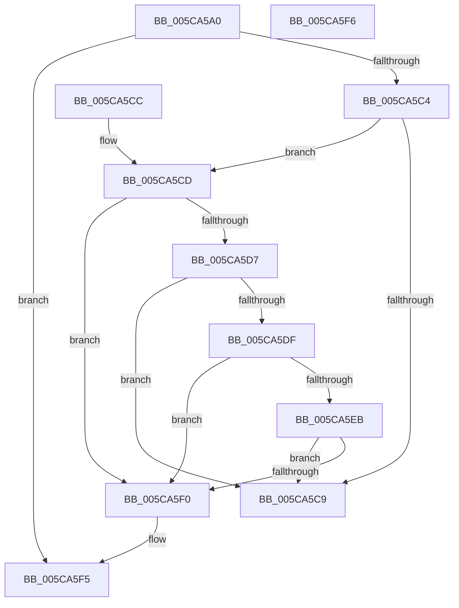

# KeCalculateProcessDefaultQos

- RVA: `0x005CA5A0`–`0x005CA5F7` (길이 `87` bytes)
- VA: `0x00000001405CA5A0`
- 실행 섹션: `.text`
- PDB 이름 있음: `예`; PDB Function 태그: `아니요`
- unwind 정보 RVA: `0x000DB714`
- 디코드: `25`개 명령, `87/87` bytes 표시
- 미해석 바이트: `0` (있으면 어셈블리에 `.byte`로 보존)

> 이 문서는 커널 이미지의 기계어와 PDB 기호를 분석해 생성했습니다. 4번과 5번은 함수 원형과 자료형을 바이너리 사용 방식에서 추정한 C 해석이며 원본 소스 복구 결과는 아닙니다.

## 1. Dependencies

- 직접 호출 지점: **0**; 고유 호출 대상: **0**
- 직접 호출자로 확인된 함수: **2**
- RIP 상대 이미지 참조: **3**

### Outgoing calls
- 직접 디코드된 call 명령이 없습니다.

### Direct callers
- [PspQueryProcessDefaultQos](../5E/PspQueryProcessDefaultQos_function_005E30E0.md) at `0x005E30E7`
- [PspProcessQosChangeNotificationWorker](../../page/78/PspProcessQosChangeNotificationWorker_function_00781740.md) at `0x007817ED`

### Static image references
- `0x005CA5A6` → RVA `0x00FC5518` (`ALMOSTRO`; read)
- `0x005CA5CD` → RVA `0x00FC5080` (`ALMOSTRO`; read)
- `0x005CA5D7` → RVA `0x00FC5118` (`ALMOSTRO`; read)

## 2. Other-region calls and transfers

- 다른 실행 섹션으로 향하는 call: **0**
- 별도 외부 분기/꼬리 이동을 확인하지 못했습니다.

## 3. Assembly (complete function range)

```asm
005CA5A0  8B 81 88 00 00 00               mov eax, dword ptr [rcx + 0x88]
005CA5A6  4C 8D 05 6B AF 9F 00            lea r8, [rip + 0x9faf6b]
005CA5AD  0F BE 91 90 00 00 00            movsx edx, byte ptr [rcx + 0x90]
005CA5B4  48 C1 E8 07                     shr rax, 7
005CA5B8  83 E0 0F                        and eax, 0xf
005CA5BB  41 8B 04 80                     mov eax, dword ptr [r8 + rax*4]
005CA5BF  83 F8 07                        cmp eax, 7
005CA5C2  75 31                           jne 0x1405ca5f5
005CA5C4  80 FA 0F                        cmp dl, 0xf
005CA5C7  7C 04                           jl 0x1405ca5cd
005CA5C9  33 C0                           xor eax, eax
005CA5CB  C3                              ret
005CA5CC  CC                              int3
005CA5CD  8B 05 AD AA 9F 00               mov eax, dword ptr [rip + 0x9faaad]
005CA5D3  A8 02                           test al, 2
005CA5D5  74 19                           je 0x1405ca5f0
005CA5D7  3B 15 3B AB 9F 00               cmp edx, dword ptr [rip + 0x9fab3b]
005CA5DD  7D EA                           jge 0x1405ca5c9
005CA5DF  F7 81 FC 05 00 00 00 10 00 00   test dword ptr [rcx + 0x5fc], 0x1000
005CA5E9  74 05                           je 0x1405ca5f0
005CA5EB  80 FA 08                        cmp dl, 8
005CA5EE  7D D9                           jge 0x1405ca5c9
005CA5F0  B8 06 00 00 00                  mov eax, 6
005CA5F5  C3                              ret
005CA5F6  CC                              int3
```

## 4. C-style interpretation (structured pseudocode)

```c
__int64 __fastcall KeCalculateProcessDefaultQos(__int64 a1)
{
    __int64 result;

    result = ((unsigned int)(*(unsigned int *)(a1 + 136))) >> (7);
    result = (unsigned int)((result) & (15));
    if (((unsigned int)((unsigned int)(*(unsigned int *)(v_rip + 10465131 + result * 4)))) != 7) goto loc_005CA5F5;
    if (((unsigned __int8)((__int8)(*(unsigned __int8 *)(a1 + 144)))) < 15) goto loc_005CA5CD;
loc_005CA5C9:
    result = 0;
    return result;
loc_005CA5CD:
    if ((((unsigned __int8)((unsigned int)(*(unsigned int *)(v_rip + 10463917)))) & (2)) == 0) goto loc_005CA5F0;
    if (((unsigned int)((__int8)(*(unsigned __int8 *)(a1 + 144)))) >= (*(unsigned int *)(v_rip + 10464059))) goto loc_005CA5C9;
    if (((*(unsigned int *)(a1 + 1532)) & (0x1000ULL)) == 0) goto loc_005CA5F0;
    if (((unsigned __int8)((__int8)(*(unsigned __int8 *)(a1 + 144)))) >= 8) goto loc_005CA5C9;
loc_005CA5F0:
loc_005CA5F5:
    return 6;
}
```

## 5. (Beta) C Style

```c
int64_t KeCalculateProcessDefaultQos(void *Arg1)
{
    uint8_t *arg1 = (uint8_t *)Arg1;

    int64_t result;

    result = ((uint32_t)(*(uint32_t *)(arg1 + 0x88))) >> (7);
    result = (uint32_t)((result) & (15));
    if (((uint32_t)((uint32_t)(*(uint32_t *)(v_rip + 0x9FAF6B + result * 4)))) != 7) goto loc_005CA5F5;
    if (((uint8_t)((int8_t)(*(uint8_t *)(arg1 + 0x90)))) < 15) goto loc_005CA5CD;
loc_005CA5C9:
    result = 0;
    return result;
loc_005CA5CD:
    if ((((uint8_t)((uint32_t)(*(uint32_t *)(v_rip + 0x9FAAAD)))) & (2)) == 0) goto loc_005CA5F0;
    if (((uint32_t)((int8_t)(*(uint8_t *)(arg1 + 0x90)))) >= (*(uint32_t *)(v_rip + 0x9FAB3B))) goto loc_005CA5C9;
    if (((*(uint32_t *)(arg1 + 0x5FC)) & (0x1000ULL)) == 0) goto loc_005CA5F0;
    if (((uint8_t)((int8_t)(*(uint8_t *)(arg1 + 0x90)))) >= 8) goto loc_005CA5C9;
loc_005CA5F0:
loc_005CA5F5:
    return 6;
}
```

### 관측된 메모리 오프셋

구조체 형식이 확인되지 않은 접근은 인자 기준의 오프셋으로만 기록했습니다.

| 기준 인자 | 오프셋 표현 | 폭 (bit) | 접근 |
|---|---:|---:|---|
| `Arg1` | `+ 0x88` | `32` | `R` |
| `Arg1` | `+ 0x90` | `8` | `R` |
| `Arg1` | `+ 0x5FC` | `32` | `R` |

## 6. Execution-region graph

[열기: 2D/3D 그래프와 함수 탐색 컨트롤 패널](../../../control-panel.html?section=text&rva=0x005CA5A0&view=graph)

- 2D 그래프는 위에서 아래로 흐르고, 3D 그래프는 빈 공간을 드래그해 회전합니다. Shift+드래그는 이동, 휠은 확대·축소, 함수 노드 선택은 대상 보고서 이동입니다.

### Static fallback


