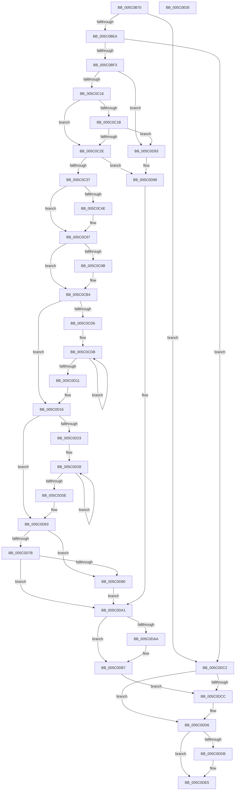

# KeCpuPartitionMoveCpus

- RVA: `0x005C0B70`–`0x005C0E06` (길이 `662` bytes)
- VA: `0x00000001405C0B70`
- 실행 섹션: `.text`
- PDB 이름 있음: `예`; PDB Function 태그: `아니요`
- unwind 정보 RVA: `0x0007FEE0`
- 디코드: `179`개 명령, `662/662` bytes 표시
- 미해석 바이트: `0` (있으면 어셈블리에 `.byte`로 보존)

> 이 문서는 커널 이미지의 기계어와 PDB 기호를 분석해 생성했습니다. 4번과 5번은 함수 원형과 자료형을 바이너리 사용 방식에서 추정한 C 해석이며 원본 소스 복구 결과는 아닙니다.

## 1. Dependencies

- 직접 호출 지점: **27**; 고유 호출 대상: **17**
- 직접 호출자로 확인된 함수: **3**
- RIP 상대 이미지 참조: **4**

### Outgoing calls
- `0x005C0BC4` → [ExAllocatePool2](../../poolcode/B8/ExAllocatePool2_function_00B820F0.md) (function, `0x00B820F0`)
- `0x005C0BD9` → [ExAllocatePool2](../../poolcode/B8/ExAllocatePool2_function_00B820F0.md) (function, `0x00B820F0`)
- `0x005C0BFB` → [KiAcquireCpuPartitionLock](../30/KiAcquireCpuPartitionLock_function_00303374.md) (function, `0x00303374`)
- `0x005C0C09` → [KeIsSubsetAffinityEx](../2C/KeIsSubsetAffinityEx_function_002CDC80.md) (function, `0x002CDC80`)
- `0x005C0C21` → [KeIsEqualAffinityEx](../30/KeIsEqualAffinityEx_function_00305230.md) (function, `0x00305230`)
- `0x005C0C40` → [KeSubtractAffinityEx2](../2D/KeSubtractAffinityEx2_function_002D5BA0.md) (function, `0x002D5BA0`)
- `0x005C0C60` → [KiModifySystemAllowedCpuSetsWithLock](../30/KiModifySystemAllowedCpuSetsWithLock_function_00304278.md) (function, `0x00304278`)
- `0x005C0C6B` → [KxReleaseSpinLock](../20/KxReleaseSpinLock_function_00206670.md) (function, `0x00206670`)
- `0x005C0C74` → [KeAcquireSpinLockAtDpcLevel](../20/KeAcquireSpinLockAtDpcLevel_function_00208430.md) (function, `0x00208430`)
- `0x005C0C82` → [KeOrAffinityEx2](../2C/KeOrAffinityEx2_function_002CF930.md) (function, `0x002CF930`)
- `0x005C0C8D` → [KiCpuPartitionUpdatePrcbs](KiCpuPartitionUpdatePrcbs_function_005C15D4.md) (function, `0x005C15D4`)
- `0x005C0CAD` → [KiModifySystemAllowedCpuSetsWithLock](../30/KiModifySystemAllowedCpuSetsWithLock_function_00304278.md) (function, `0x00304278`)
- `0x005C0CB8` → [KxReleaseSpinLock](../20/KxReleaseSpinLock_function_00206670.md) (function, `0x00206670`)
- `0x005C0CC4` → [KeAcquireSpinLockAtDpcLevel](../20/KeAcquireSpinLockAtDpcLevel_function_00208430.md) (function, `0x00208430`)
- `0x005C0CF5` → [KiAdjustProcessCpuSetsAfterCpuPartitionChange](KiAdjustProcessCpuSetsAfterCpuPartitionChange_function_005C12DC.md) (function, `0x005C12DC`)
- `0x005C0CFF` → [KiUpdateProcessAvailableCpuState](../3C/KiUpdateProcessAvailableCpuState_function_003C00B4.md) (function, `0x003C00B4`)
- `0x005C0D07` → [KiNotifyAvailableCpusChangeProcess](../4F/KiNotifyAvailableCpusChangeProcess_function_004FCE30.md) (function, `0x004FCE30`)
- `0x005C0D42` → [KiAdjustProcessCpuSetsAfterCpuPartitionChange](KiAdjustProcessCpuSetsAfterCpuPartitionChange_function_005C12DC.md) (function, `0x005C12DC`)
- `0x005C0D4C` → [KiUpdateProcessAvailableCpuState](../3C/KiUpdateProcessAvailableCpuState_function_003C00B4.md) (function, `0x003C00B4`)
- `0x005C0D54` → [KiNotifyAvailableCpusChangeProcess](../4F/KiNotifyAvailableCpusChangeProcess_function_004FCE30.md) (function, `0x004FCE30`)
- `0x005C0D6A` → [KxReleaseSpinLock](../20/KxReleaseSpinLock_function_00206670.md) (function, `0x00206670`)
- `0x005C0D80` → [KiUpdateSystemAvailableCpuState](../5B/KiUpdateSystemAvailableCpuState_function_005B9B04.md) (function, `0x005B9B04`)
- `0x005C0D8C` → [KiNotifyAvailableCpusChangeCpuPartition](../5B/KiNotifyAvailableCpusChangeCpuPartition_function_005B9AD8.md) (function, `0x005B9AD8`)
- `0x005C0D9C` → [KxReleaseSpinLock](../20/KxReleaseSpinLock_function_00206670.md) (function, `0x00206670`)
- `0x005C0DB2` → [KiLowerIrqlProcessIrqlFlags](../4F/KiLowerIrqlProcessIrqlFlags_function_004F5698.md) (function, `0x004F5698`)
- `0x005C0DD1` → [ExFreePoolWithTag](../../poolcode/B8/ExFreePoolWithTag_function_00B82870.md) (function, `0x00B82870`)
- `0x005C0DE0` → [ExFreePoolWithTag](../../poolcode/B8/ExFreePoolWithTag_function_00B82870.md) (function, `0x00B82870`)

### Direct callers
- [KeDeleteCpuPartition](../../page/74/KeDeleteCpuPartition_function_00747158.md) at `0x007471E6`
- [NtSetInformationCpuPartition](../../page/78/NtSetInformationCpuPartition_function_00783510.md) at `0x00783745`
- [PsCpuPartitionMoveCpus](../../page/78/PsCpuPartitionMoveCpus_function_00783A6C.md) at `0x00783A79`

### Static image references
- `0x005C0B97` → RVA `0x00FC5018` (`ALMOSTRO`; read)
- `0x005C0C45` → RVA `0x00FC6C20` (`ALMOSTRO`; read)
- `0x005C0CBD` → RVA `0x00F23448` (`.data`; read)
- `0x005C0DA1` → RVA `0x00FC6D20` (`ALMOSTRO`; read)

## 2. Other-region calls and transfers

- 다른 실행 섹션으로 향하는 call: **4**
  - `0x005C0BC4` → [ExAllocatePool2](../../poolcode/B8/ExAllocatePool2_function_00B820F0.md) (`.text` → `POOLCODE`)
  - `0x005C0BD9` → [ExAllocatePool2](../../poolcode/B8/ExAllocatePool2_function_00B820F0.md) (`.text` → `POOLCODE`)
  - `0x005C0DD1` → [ExFreePoolWithTag](../../poolcode/B8/ExFreePoolWithTag_function_00B82870.md) (`.text` → `POOLCODE`)
  - `0x005C0DE0` → [ExFreePoolWithTag](../../poolcode/B8/ExFreePoolWithTag_function_00B82870.md) (`.text` → `POOLCODE`)
- 별도 외부 분기/꼬리 이동을 확인하지 못했습니다.

## 3. Assembly (complete function range)

```asm
005C0B70  48 8B C4                        mov rax, rsp
005C0B73  48 89 58 08                     mov qword ptr [rax + 8], rbx
005C0B77  48 89 68 18                     mov qword ptr [rax + 0x18], rbp
005C0B7B  48 89 70 20                     mov qword ptr [rax + 0x20], rsi
005C0B7F  48 89 50 10                     mov qword ptr [rax + 0x10], rdx
005C0B83  57                              push rdi
005C0B84  41 54                           push r12
005C0B86  41 55                           push r13
005C0B88  41 56                           push r14
005C0B8A  41 57                           push r15
005C0B8C  48 83 EC 40                     sub rsp, 0x40
005C0B90  C6 40 C8 00                     mov byte ptr [rax - 0x38], 0
005C0B94  49 8B E8                        mov rbp, r8
005C0B97  0F B7 05 7A 44 A0 00            movzx eax, word ptr [rip + 0xa0447a]
005C0B9E  48 8B F2                        mov rsi, rdx
005C0BA1  4C 8B F1                        mov r14, rcx
005C0BA4  66 89 44 24 34                  mov word ptr [rsp + 0x34], ax
005C0BA9  33 FF                           xor edi, edi
005C0BAB  41 BC 4B 69 43 75               mov r12d, 0x7543694b
005C0BB1  45 8B C4                        mov r8d, r12d
005C0BB4  45 8A F9                        mov r15b, r9b
005C0BB7  48 8D 14 C5 00 00 00 00         lea rdx, [rax*8]
005C0BBF  8B D8                           mov ebx, eax
005C0BC1  8D 4F 40                        lea ecx, [rdi + 0x40]
005C0BC4  E8 27 15 5C 00                  call 0x140b820f0
005C0BC9  48 C1 E3 04                     shl rbx, 4
005C0BCD  8D 4F 40                        lea ecx, [rdi + 0x40]
005C0BD0  48 8B D3                        mov rdx, rbx
005C0BD3  45 8B C4                        mov r8d, r12d
005C0BD6  4C 8B E8                        mov r13, rax
005C0BD9  E8 12 15 5C 00                  call 0x140b820f0
005C0BDE  4C 8B E0                        mov r12, rax
005C0BE1  4D 85 ED                        test r13, r13
005C0BE4  0F 84 D8 01 00 00               je 0x1405c0dc2
005C0BEA  48 85 C0                        test rax, rax
005C0BED  0F 84 CF 01 00 00               je 0x1405c0dc2
005C0BF3  48 8D 54 24 30                  lea rdx, [rsp + 0x30]
005C0BF8  48 8B CE                        mov rcx, rsi
005C0BFB  E8 74 27 D4 FF                  call 0x140303374
005C0C00  48 8B 1E                        mov rbx, qword ptr [rsi]
005C0C03  48 8B CD                        mov rcx, rbp
005C0C06  48 8B D3                        mov rdx, rbx
005C0C09  E8 72 D0 D0 FF                  call 0x1402cdc80
005C0C0E  85 C0                           test eax, eax
005C0C10  0F 84 7D 01 00 00               je 0x1405c0d93
005C0C16  45 84 FF                        test r15b, r15b
005C0C19  75 13                           jne 0x1405c0c2e
005C0C1B  48 8B D3                        mov rdx, rbx
005C0C1E  48 8B CD                        mov rcx, rbp
005C0C21  E8 0A 46 D4 FF                  call 0x140305230
005C0C26  85 C0                           test eax, eax
005C0C28  0F 85 65 01 00 00               jne 0x1405c0d93
005C0C2E  49 3B F6                        cmp rsi, r14
005C0C31  0F 84 61 01 00 00               je 0x1405c0d98
005C0C37  4C 8B C3                        mov r8, rbx
005C0C3A  48 8B D5                        mov rdx, rbp
005C0C3D  48 8B CB                        mov rcx, rbx
005C0C40  E8 5B 4F D1 FF                  call 0x1402d5ba0
005C0C45  48 3B 35 D4 5F A0 00            cmp rsi, qword ptr [rip + 0xa05fd4]
005C0C4C  75 19                           jne 0x1405c0c67
005C0C4E  45 33 C9                        xor r9d, r9d
005C0C51  C7 44 24 20 02 00 00 00         mov dword ptr [rsp + 0x20], 2
005C0C59  4C 8B C5                        mov r8, rbp
005C0C5C  33 D2                           xor edx, edx
005C0C5E  33 C9                           xor ecx, ecx
005C0C60  E8 13 36 D4 FF                  call 0x140304278
005C0C65  8B F8                           mov edi, eax
005C0C67  48 8D 4E 08                     lea rcx, [rsi + 8]
005C0C6B  E8 00 5A C4 FF                  call 0x140206670
005C0C70  49 8D 4E 08                     lea rcx, [r14 + 8]
005C0C74  E8 B7 77 C4 FF                  call 0x140208430
005C0C79  49 8B 0E                        mov rcx, qword ptr [r14]
005C0C7C  48 8B D5                        mov rdx, rbp
005C0C7F  4C 8B C1                        mov r8, rcx
005C0C82  E8 A9 EC D0 FF                  call 0x1402cf930
005C0C87  48 8B D5                        mov rdx, rbp
005C0C8A  49 8B CE                        mov rcx, r14
005C0C8D  E8 42 09 00 00                  call 0x1405c15d4
005C0C92  4C 3B 35 87 5F A0 00            cmp r14, qword ptr [rip + 0xa05f87]
005C0C99  75 19                           jne 0x1405c0cb4
005C0C9B  45 33 C9                        xor r9d, r9d
005C0C9E  C7 44 24 20 01 00 00 00         mov dword ptr [rsp + 0x20], 1
005C0CA6  4C 8B C5                        mov r8, rbp
005C0CA9  33 D2                           xor edx, edx
005C0CAB  33 C9                           xor ecx, ecx
005C0CAD  E8 C6 35 D4 FF                  call 0x140304278
005C0CB2  8B F8                           mov edi, eax
005C0CB4  49 8D 4E 08                     lea rcx, [r14 + 8]
005C0CB8  E8 B3 59 C4 FF                  call 0x140206670
005C0CBD  48 8D 0D 84 27 96 00            lea rcx, [rip + 0x962784]
005C0CC4  E8 67 77 C4 FF                  call 0x140208430
005C0CC9  48 8D 6E 10                     lea rbp, [rsi + 0x10]
005C0CCD  4C 8B 7D 00                     mov r15, qword ptr [rbp]
005C0CD1  4C 3B FD                        cmp r15, rbp
005C0CD4  74 40                           je 0x1405c0d16
005C0CD6  0F B7 74 24 34                  movzx esi, word ptr [rsp + 0x34]
005C0CDB  49 8B 5F F0                     mov rbx, qword ptr [r15 - 0x10]
005C0CDF  44 0F B7 CE                     movzx r9d, si
005C0CE3  4D 8B 3F                        mov r15, qword ptr [r15]
005C0CE6  48 8B CB                        mov rcx, rbx
005C0CE9  48 83 64 24 20 00               and qword ptr [rsp + 0x20], 0
005C0CEF  4D 8B C5                        mov r8, r13
005C0CF2  49 8B D4                        mov rdx, r12
005C0CF5  E8 E2 05 00 00                  call 0x1405c12dc
005C0CFA  B2 01                           mov dl, 1
005C0CFC  48 8B CB                        mov rcx, rbx
005C0CFF  E8 B0 F3 DF FF                  call 0x1403c00b4
005C0D04  48 8B CB                        mov rcx, rbx
005C0D07  E8 24 C1 F3 FF                  call 0x1404fce30
005C0D0C  4C 3B FD                        cmp r15, rbp
005C0D0F  75 CA                           jne 0x1405c0cdb
005C0D11  48 8B 74 24 78                  mov rsi, qword ptr [rsp + 0x78]
005C0D16  49 8D 6E 10                     lea rbp, [r14 + 0x10]
005C0D1A  4C 8B 7D 00                     mov r15, qword ptr [rbp]
005C0D1E  4C 3B FD                        cmp r15, rbp
005C0D21  74 40                           je 0x1405c0d63
005C0D23  0F B7 74 24 34                  movzx esi, word ptr [rsp + 0x34]
005C0D28  49 8B 5F F0                     mov rbx, qword ptr [r15 - 0x10]
005C0D2C  44 0F B7 CE                     movzx r9d, si
005C0D30  4D 8B 3F                        mov r15, qword ptr [r15]
005C0D33  48 8B CB                        mov rcx, rbx
005C0D36  48 83 64 24 20 00               and qword ptr [rsp + 0x20], 0
005C0D3C  4D 8B C5                        mov r8, r13
005C0D3F  49 8B D4                        mov rdx, r12
005C0D42  E8 95 05 00 00                  call 0x1405c12dc
005C0D47  B2 01                           mov dl, 1
005C0D49  48 8B CB                        mov rcx, rbx
005C0D4C  E8 63 F3 DF FF                  call 0x1403c00b4
005C0D51  48 8B CB                        mov rcx, rbx
005C0D54  E8 D7 C0 F3 FF                  call 0x1404fce30
005C0D59  4C 3B FD                        cmp r15, rbp
005C0D5C  75 CA                           jne 0x1405c0d28
005C0D5E  48 8B 74 24 78                  mov rsi, qword ptr [rsp + 0x78]
005C0D63  48 8D 0D DE 26 96 00            lea rcx, [rip + 0x9626de]
005C0D6A  E8 01 59 C4 FF                  call 0x140206670
005C0D6F  48 8B 05 AA 5E A0 00            mov rax, qword ptr [rip + 0xa05eaa]
005C0D76  48 3B F0                        cmp rsi, rax
005C0D79  74 05                           je 0x1405c0d80
005C0D7B  4C 3B F0                        cmp r14, rax
005C0D7E  75 21                           jne 0x1405c0da1
005C0D80  E8 7F 8D FF FF                  call 0x1405b9b04
005C0D85  48 8B 0D 94 5E A0 00            mov rcx, qword ptr [rip + 0xa05e94]
005C0D8C  E8 47 8D FF FF                  call 0x1405b9ad8
005C0D91  EB 0E                           jmp 0x1405c0da1
005C0D93  BF 0D 00 00 C0                  mov edi, 0xc000000d
005C0D98  48 8D 4E 08                     lea rcx, [rsi + 8]
005C0D9C  E8 CF 58 C4 FF                  call 0x140206670
005C0DA1  83 3D 78 5F A0 00 00            cmp dword ptr [rip + 0xa05f78], 0
005C0DA8  74 0D                           je 0x1405c0db7
005C0DAA  44 0F 20 C1                     mov rcx, cr8
005C0DAE  8A 54 24 30                     mov dl, byte ptr [rsp + 0x30]
005C0DB2  E8 E1 48 F3 FF                  call 0x1404f5698
005C0DB7  0F B6 44 24 30                  movzx eax, byte ptr [rsp + 0x30]
005C0DBC  44 0F 22 C0                     mov cr8, rax
005C0DC0  EB 0A                           jmp 0x1405c0dcc
005C0DC2  BF 9A 00 00 C0                  mov edi, 0xc000009a
005C0DC7  4D 85 ED                        test r13, r13
005C0DCA  74 0A                           je 0x1405c0dd6
005C0DCC  33 D2                           xor edx, edx
005C0DCE  49 8B CD                        mov rcx, r13
005C0DD1  E8 9A 1A 5C 00                  call 0x140b82870
005C0DD6  4D 85 E4                        test r12, r12
005C0DD9  74 0A                           je 0x1405c0de5
005C0DDB  33 D2                           xor edx, edx
005C0DDD  49 8B CC                        mov rcx, r12
005C0DE0  E8 8B 1A 5C 00                  call 0x140b82870
005C0DE5  4C 8D 5C 24 40                  lea r11, [rsp + 0x40]
005C0DEA  8B C7                           mov eax, edi
005C0DEC  49 8B 5B 30                     mov rbx, qword ptr [r11 + 0x30]
005C0DF0  49 8B 6B 40                     mov rbp, qword ptr [r11 + 0x40]
005C0DF4  49 8B 73 48                     mov rsi, qword ptr [r11 + 0x48]
005C0DF8  49 8B E3                        mov rsp, r11
005C0DFB  41 5F                           pop r15
005C0DFD  41 5E                           pop r14
005C0DFF  41 5D                           pop r13
005C0E01  41 5C                           pop r12
005C0E03  5F                              pop rdi
005C0E04  C3                              ret
005C0E05  CC                              int3
```

## 4. C-style interpretation (structured pseudocode)

```c
__int64 __fastcall KeCpuPartitionMoveCpus(__int64 a1, __int64 a2, __int64 a3, int a4)
{
    __int64 result;
    __int64 v_rbx;
    __int64 v_rdi;
    __int64 v_rsp;
    unsigned __int64 v_stack_m28;
    unsigned __int16 v_stack_m34;
    unsigned __int64 v_stack_m38;
    unsigned int v_stack_m48;
    unsigned __int64 v_stack_p10;

    *(unsigned __int64 *)(v_rsp + 8) = v_rbx;
    *(unsigned __int64 *)(v_rsp + 24) = v_rbp;
    *(unsigned __int64 *)(v_rsp + 32) = v_rsi;
    *(unsigned __int64 *)(v_rsp + 16) = a2;
    v_rsp = (v_rsp) - (64);
    *(unsigned __int8 *)(v_rsp - 56) = 0;
    v_stack_m34 = (unsigned __int16)(*(unsigned __int16 *)(v_rip + 10503290));
    v_rdi = 0;
    result = ExAllocatePool2(v_rdi + 64, *(unsigned __int16 *)(v_rip + 10503290) * 8, (unsigned int)((unsigned int)((unsigned int)(0x7543694BULL))), a4);
    v_rbx = ((unsigned int)((unsigned int)(*(unsigned __int16 *)(v_rip + 10503290)))) << (4);
    result = ExAllocatePool2(v_rdi + 64, v_rbx, (unsigned int)((unsigned int)((unsigned int)(0x7543694BULL))), a4);
    if (result == 0) goto loc_005C0DC2;
    if (result == 0) goto loc_005C0DC2;
    result = KiAcquireCpuPartitionLock(a2, v_stack_m38, (unsigned int)((unsigned int)((unsigned int)(0x7543694BULL))), a4);
    result = KeIsSubsetAffinityEx(a3, *(unsigned __int64 *)(a2), (unsigned int)((unsigned int)((unsigned int)(0x7543694BULL))), a4);
    if ((unsigned int)(result) == 0) goto loc_005C0D93;
    if ((unsigned __int8)((unsigned __int8)(a4)) != 0) goto loc_005C0C2E;
    result = KeIsEqualAffinityEx(a3, *(unsigned __int64 *)(a2), (unsigned int)((unsigned int)((unsigned int)(0x7543694BULL))), a4);
    if ((unsigned int)(result) != 0) goto loc_005C0D93;
loc_005C0C2E:
    if (a2 == a1) goto loc_005C0D98;
    result = KeSubtractAffinityEx2(*(unsigned __int64 *)(a2), a3, *(unsigned __int64 *)(a2), a4);
    if (a2 == (*(unsigned __int64 *)(v_rip + 10510292))) {
        a4 = 0;
        v_stack_m48 = 2;
        a3 = a3;
        a2 = 0;
        a1 = 0;
        result = KiModifySystemAllowedCpuSetsWithLock(a1, a2, a3, a4);
        v_rdi = (unsigned int)(result);
    }
    result = KxReleaseSpinLock(a2 + 8, a2, a3, a4);
    result = KeAcquireSpinLockAtDpcLevel(a1 + 8, a2, a3, a4);
    result = KeOrAffinityEx2(*(unsigned __int64 *)(a1), a3, *(unsigned __int64 *)(a1), a4);
    result = KiCpuPartitionUpdatePrcbs(0, a3, *(unsigned __int64 *)(a1), a4);
    if (0 == (*(unsigned __int64 *)(v_rip + 10510215))) {
        a4 = 0;
        v_stack_m48 = 1;
        a3 = a3;
        a2 = 0;
        a1 = 0;
        result = KiModifySystemAllowedCpuSetsWithLock(a1, a2, a3, a4);
        v_rdi = (unsigned int)(result);
    }
    result = KxReleaseSpinLock(a1 + 8, a2, a3, a4);
    result = KeAcquireSpinLockAtDpcLevel(v_rip + 9840516, a2, a3, a4);
    if ((*(unsigned __int64 *)(a2 + 16)) == (a2 + 16)) goto loc_005C0D16;
loc_005C0CDB:
    result = KiAdjustProcessCpuSetsAfterCpuPartitionChange(*(unsigned __int64 *)(*(unsigned __int64 *)(a2 + 16) - 16), result, result, (unsigned __int16)(v_stack_m34));
    result = KiUpdateProcessAvailableCpuState(*(unsigned __int64 *)(*(unsigned __int64 *)(a2 + 16) - 16), 1, result, (unsigned __int16)(v_stack_m34));
    result = KiNotifyAvailableCpusChangeProcess(*(unsigned __int64 *)(*(unsigned __int64 *)(a2 + 16) - 16), 1, result, (unsigned __int16)(v_stack_m34));
    if ((*(unsigned __int64 *)(*(unsigned __int64 *)(a2 + 16))) != (a2 + 16)) goto loc_005C0CDB;
loc_005C0D16:
    if ((*(unsigned __int64 *)(a1 + 16)) == (a1 + 16)) goto loc_005C0D63;
loc_005C0D28:
    result = KiAdjustProcessCpuSetsAfterCpuPartitionChange(*(unsigned __int64 *)(*(unsigned __int64 *)(a1 + 16) - 16), result, result, (unsigned __int16)(v_stack_m34));
    result = KiUpdateProcessAvailableCpuState(*(unsigned __int64 *)(*(unsigned __int64 *)(a1 + 16) - 16), 1, result, (unsigned __int16)(v_stack_m34));
    result = KiNotifyAvailableCpusChangeProcess(*(unsigned __int64 *)(*(unsigned __int64 *)(a1 + 16) - 16), 1, result, (unsigned __int16)(v_stack_m34));
    if ((*(unsigned __int64 *)(*(unsigned __int64 *)(a1 + 16))) != (a1 + 16)) goto loc_005C0D28;
loc_005C0D63:
    result = KxReleaseSpinLock(v_rip + 9840350, 1, result, (unsigned __int16)(v_stack_m34));
    if (v_stack_p10 == (*(unsigned __int64 *)(v_rip + 10509994))) goto loc_005C0D80;
    if (0 != (*(unsigned __int64 *)(v_rip + 10509994))) goto loc_005C0DA1;
loc_005C0D80:
    result = KiUpdateSystemAvailableCpuState(v_rip + 9840350, 1, result, (unsigned __int16)(v_stack_m34));
    result = KiNotifyAvailableCpusChangeCpuPartition(*(unsigned __int64 *)(v_rip + 10509972), 1, result, (unsigned __int16)(v_stack_m34));
    goto loc_005C0DA1;
loc_005C0D93:
loc_005C0D98:
    result = KxReleaseSpinLock(v_stack_p10 + 8, 1, result, (unsigned __int16)(v_stack_m34));
loc_005C0DA1:
    if ((*(unsigned int *)(v_rip + 10510200)) != 0) {
        a1 = v_cr8;
        a2 = v_stack_m38;
        result = KiLowerIrqlProcessIrqlFlags(a1, a2, result, (unsigned __int16)(v_stack_m34));
    }
    goto loc_005C0DCC;
loc_005C0DC2:
    result = v_stack_m38;
    if (result != 0) {
        a2 = 0;
        a1 = result;
        result = ExFreePoolWithTag(a1, a2, result, (unsigned __int16)(v_stack_m34));
    }
    if (result != 0) {
        a2 = 0;
        a1 = result;
        result = ExFreePoolWithTag(a1, a2, result, (unsigned __int16)(v_stack_m34));
    }
    return (unsigned int)((unsigned int)((unsigned int)(0xC000009AULL)));
}
```

## 5. (Beta) C Style

```c
int64_t KeCpuPartitionMoveCpus(void *Arg1, void *Arg2, int64_t Arg3, int32_t Arg4)
{
    uint8_t *arg1 = (uint8_t *)Arg1;
    uint8_t *arg2 = (uint8_t *)Arg2;

    int64_t result;
    int64_t local_rbx;
    int64_t local_rdi;
    int64_t local_rsp;
    uint64_t v_stack_m28;
    uint16_t v_stack_m34;
    uint64_t v_stack_m38;
    uint32_t v_stack_m48;
    uint64_t v_stack_p10;

    *(uint64_t *)(local_rsp + 0x8) = local_rbx;
    *(uint64_t *)(local_rsp + 0x18) = local_rbp;
    *(uint64_t *)(local_rsp + 0x20) = local_rsi;
    *(void **)(local_rsp + 0x10) = Arg2;
    local_rsp = (local_rsp) - (64);
    *(uint8_t *)(local_rsp - 0x38) = 0;
    v_stack_m34 = (uint16_t)(*(uint16_t *)(v_rip + 0xA0447A));
    local_rdi = 0;
    result = ExAllocatePool2(local_rdi + 64, *(uint16_t *)(v_rip + 0xA0447A) * 8, (uint32_t)((uint32_t)((uint32_t)(0x7543694BULL))), Arg4);
    local_rbx = ((uint32_t)((uint32_t)(*(uint16_t *)(v_rip + 0xA0447A)))) << (4);
    result = ExAllocatePool2(local_rdi + 64, local_rbx, (uint32_t)((uint32_t)((uint32_t)(0x7543694BULL))), Arg4);
    if (result == 0) goto loc_005C0DC2;
    if (result == 0) goto loc_005C0DC2;
    result = KiAcquireCpuPartitionLock(Arg2, v_stack_m38, (uint32_t)((uint32_t)((uint32_t)(0x7543694BULL))), Arg4);
    result = KeIsSubsetAffinityEx(Arg3, *(uint64_t *)(arg2), (uint32_t)((uint32_t)((uint32_t)(0x7543694BULL))), Arg4);
    if ((uint32_t)(result) == 0) goto loc_005C0D93;
    if ((uint8_t)((uint8_t)(Arg4)) != 0) goto loc_005C0C2E;
    result = KeIsEqualAffinityEx(Arg3, *(uint64_t *)(arg2), (uint32_t)((uint32_t)((uint32_t)(0x7543694BULL))), Arg4);
    if ((uint32_t)(result) != 0) goto loc_005C0D93;
loc_005C0C2E:
    if (Arg2 == Arg1) goto loc_005C0D98;
    result = KeSubtractAffinityEx2(*(uint64_t *)(arg2), Arg3, *(uint64_t *)(arg2), Arg4);
    if (Arg2 == (*(uint64_t *)(v_rip + 0xA05FD4))) {
        Arg4 = 0;
        v_stack_m48 = 2;
        Arg3 = Arg3;
        Arg2 = 0;
        Arg1 = 0;
        result = KiModifySystemAllowedCpuSetsWithLock(Arg1, Arg2, Arg3, Arg4);
        local_rdi = (uint32_t)(result);
    }
    result = KxReleaseSpinLock(Arg2 + 8, Arg2, Arg3, Arg4);
    result = KeAcquireSpinLockAtDpcLevel(Arg1 + 8, Arg2, Arg3, Arg4);
    result = KeOrAffinityEx2(*(uint64_t *)(arg1), Arg3, *(uint64_t *)(arg1), Arg4);
    result = KiCpuPartitionUpdatePrcbs(0, Arg3, *(uint64_t *)(arg1), Arg4);
    if (0 == (*(uint64_t *)(v_rip + 0xA05F87))) {
        Arg4 = 0;
        v_stack_m48 = 1;
        Arg3 = Arg3;
        Arg2 = 0;
        Arg1 = 0;
        result = KiModifySystemAllowedCpuSetsWithLock(Arg1, Arg2, Arg3, Arg4);
        local_rdi = (uint32_t)(result);
    }
    result = KxReleaseSpinLock(Arg1 + 8, Arg2, Arg3, Arg4);
    result = KeAcquireSpinLockAtDpcLevel(v_rip + 9840516, Arg2, Arg3, Arg4);
    if ((*(uint64_t *)(arg2 + 0x10)) == (Arg2 + 16)) goto loc_005C0D16;
loc_005C0CDB:
    result = KiAdjustProcessCpuSetsAfterCpuPartitionChange(*(uint64_t *)(*(uint64_t *)(arg2 + 0x10) - 0x10), result, result, (uint16_t)(v_stack_m34));
    result = KiUpdateProcessAvailableCpuState(*(uint64_t *)(*(uint64_t *)(arg2 + 0x10) - 0x10), 1, result, (uint16_t)(v_stack_m34));
    result = KiNotifyAvailableCpusChangeProcess(*(uint64_t *)(*(uint64_t *)(arg2 + 0x10) - 0x10), 1, result, (uint16_t)(v_stack_m34));
    if ((*(uint64_t *)(*(uint64_t *)(arg2 + 0x10))) != (Arg2 + 16)) goto loc_005C0CDB;
loc_005C0D16:
    if ((*(uint64_t *)(arg1 + 0x10)) == (Arg1 + 16)) goto loc_005C0D63;
loc_005C0D28:
    result = KiAdjustProcessCpuSetsAfterCpuPartitionChange(*(uint64_t *)(*(uint64_t *)(arg1 + 0x10) - 0x10), result, result, (uint16_t)(v_stack_m34));
    result = KiUpdateProcessAvailableCpuState(*(uint64_t *)(*(uint64_t *)(arg1 + 0x10) - 0x10), 1, result, (uint16_t)(v_stack_m34));
    result = KiNotifyAvailableCpusChangeProcess(*(uint64_t *)(*(uint64_t *)(arg1 + 0x10) - 0x10), 1, result, (uint16_t)(v_stack_m34));
    if ((*(uint64_t *)(*(uint64_t *)(arg1 + 0x10))) != (Arg1 + 16)) goto loc_005C0D28;
loc_005C0D63:
    result = KxReleaseSpinLock(v_rip + 9840350, 1, result, (uint16_t)(v_stack_m34));
    if (v_stack_p10 == (*(uint64_t *)(v_rip + 0xA05EAA))) goto loc_005C0D80;
    if (0 != (*(uint64_t *)(v_rip + 0xA05EAA))) goto loc_005C0DA1;
loc_005C0D80:
    result = KiUpdateSystemAvailableCpuState(v_rip + 9840350, 1, result, (uint16_t)(v_stack_m34));
    result = KiNotifyAvailableCpusChangeCpuPartition(*(uint64_t *)(v_rip + 0xA05E94), 1, result, (uint16_t)(v_stack_m34));
    goto loc_005C0DA1;
loc_005C0D93:
loc_005C0D98:
    result = KxReleaseSpinLock(v_stack_p10 + 8, 1, result, (uint16_t)(v_stack_m34));
loc_005C0DA1:
    if ((*(uint32_t *)(v_rip + 0xA05F78)) != 0) {
        Arg1 = v_cr8;
        Arg2 = v_stack_m38;
        result = KiLowerIrqlProcessIrqlFlags(Arg1, Arg2, result, (uint16_t)(v_stack_m34));
    }
    goto loc_005C0DCC;
loc_005C0DC2:
    result = v_stack_m38;
    if (result != 0) {
        Arg2 = 0;
        Arg1 = result;
        result = ExFreePoolWithTag(Arg1, Arg2, result, (uint16_t)(v_stack_m34));
    }
    if (result != 0) {
        Arg2 = 0;
        Arg1 = result;
        result = ExFreePoolWithTag(Arg1, Arg2, result, (uint16_t)(v_stack_m34));
    }
    return (uint32_t)((uint32_t)((uint32_t)(0xC000009AULL)));
}
```

### 관측된 메모리 오프셋

구조체 형식이 확인되지 않은 접근은 인자 기준의 오프셋으로만 기록했습니다.

| 기준 인자 | 오프셋 표현 | 폭 (bit) | 접근 |
|---|---:|---:|---|
| `Arg1` | `+ 0x0` | `64` | `R` |
| `Arg1` | `+ 0x8` | `64` | `R` |
| `Arg2` | `+ 0x0` | `64` | `R` |

## 6. Execution-region graph

[열기: 2D/3D 그래프와 함수 탐색 컨트롤 패널](../../../control-panel.html?section=text&rva=0x005C0B70&view=graph)

- 2D 그래프는 위에서 아래로 흐르고, 3D 그래프는 빈 공간을 드래그해 회전합니다. Shift+드래그는 이동, 휠은 확대·축소, 함수 노드 선택은 대상 보고서 이동입니다.

### Static fallback


