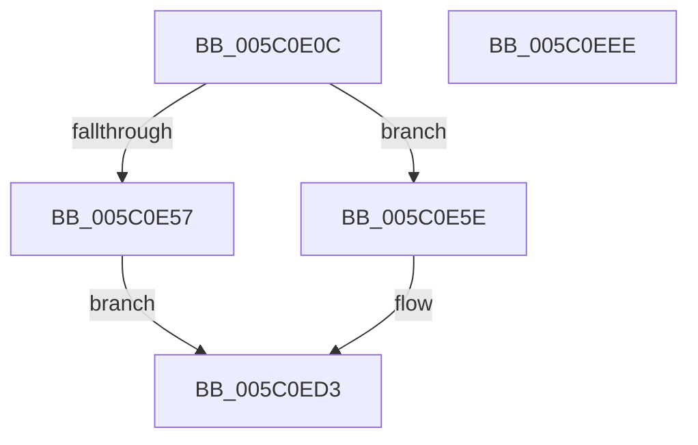

# KeCreateCpuPartition

- RVA: `0x005C0E0C`–`0x005C0EEF` (길이 `227` bytes)
- VA: `0x00000001405C0E0C`
- 실행 섹션: `.text`
- PDB 이름 있음: `예`; PDB Function 태그: `아니요`
- unwind 정보 RVA: `0x00060300`
- 디코드: `61`개 명령, `227/227` bytes 표시
- 미해석 바이트: `0` (있으면 어셈블리에 `.byte`로 보존)

> 이 문서는 커널 이미지의 기계어와 PDB 기호를 분석해 생성했습니다. 4번과 5번은 함수 원형과 자료형을 바이너리 사용 방식에서 추정한 C 해석이며 원본 소스 복구 결과는 아닙니다.

## 1. Dependencies

- 직접 호출 지점: **3**; 고유 호출 대상: **2**
- 직접 호출자로 확인된 함수: **1**
- RIP 상대 이미지 참조: **3**

### Outgoing calls
- `0x005C0E48` → [ExAllocatePool2](../../poolcode/B8/ExAllocatePool2_function_00B820F0.md) (function, `0x00B820F0`)
- `0x005C0E7A` → [memset](../6C/memset_function_006C6C40.md) (function, `0x006C6C40`)
- `0x005C0E9F` → [memset](../6C/memset_function_006C6C40.md) (function, `0x006C6C40`)

### Direct callers
- [PsCreateCpuPartition](../../page/78/PsCreateCpuPartition_function_00783A8C.md) at `0x00783B2F`

### Static image references
- `0x005C0E24` → RVA `0x00FC5014` (`ALMOSTRO`; read)
- `0x005C0EA8` → RVA `0x005B9A90` (`KiAvailableCpusWorkItemCallbackWrapper`; read)
- `0x005C0EB3` → RVA `0x005B9990` (`KiAvailableCpusPartitionWorkItemCallback`; read)

## 2. Other-region calls and transfers

- 다른 실행 섹션으로 향하는 call: **1**
  - `0x005C0E48` → [ExAllocatePool2](../../poolcode/B8/ExAllocatePool2_function_00B820F0.md) (`.text` → `POOLCODE`)
- 별도 외부 분기/꼬리 이동을 확인하지 못했습니다.

## 3. Assembly (complete function range)

```asm
005C0E0C  48 89 5C 24 08                  mov qword ptr [rsp + 8], rbx
005C0E11  48 89 6C 24 10                  mov qword ptr [rsp + 0x10], rbp
005C0E16  48 89 74 24 18                  mov qword ptr [rsp + 0x18], rsi
005C0E1B  57                              push rdi
005C0E1C  41 56                           push r14
005C0E1E  41 57                           push r15
005C0E20  48 83 EC 20                     sub rsp, 0x20
005C0E24  0F B7 1D E9 41 A0 00            movzx ebx, word ptr [rip + 0xa041e9]
005C0E2B  44 8B FA                        mov r15d, edx
005C0E2E  4C 8B F1                        mov r14, rcx
005C0E31  41 B8 4B 69 43 75               mov r8d, 0x7543694b
005C0E37  B9 40 00 00 00                  mov ecx, 0x40
005C0E3C  48 8D 2C DD 00 00 00 00         lea rbp, [rbx*8]
005C0E44  48 8D 55 78                     lea rdx, [rbp + 0x78]
005C0E48  E8 A3 12 5C 00                  call 0x140b820f0
005C0E4D  33 FF                           xor edi, edi
005C0E4F  48 8B F0                        mov rsi, rax
005C0E52  48 85 C0                        test rax, rax
005C0E55  75 07                           jne 0x1405c0e5e
005C0E57  BF 9A 00 00 C0                  mov edi, 0xc000009a
005C0E5C  EB 75                           jmp 0x1405c0ed3
005C0E5E  48 8D 48 70                     lea rcx, [rax + 0x70]
005C0E62  4C 8B C5                        mov r8, rbp
005C0E65  48 89 08                        mov qword ptr [rax], rcx
005C0E68  33 D2                           xor edx, edx
005C0E6A  66 C7 01 01 00                  mov word ptr [rcx], 1
005C0E6F  66 89 59 02                     mov word ptr [rcx + 2], bx
005C0E73  89 79 04                        mov dword ptr [rcx + 4], edi
005C0E76  48 83 C1 08                     add rcx, 8
005C0E7A  E8 C1 5D 10 00                  call 0x1406c6c40
005C0E7F  48 8D 46 10                     lea rax, [rsi + 0x10]
005C0E83  48 89 7E 08                     mov qword ptr [rsi + 8], rdi
005C0E87  33 D2                           xor edx, edx
005C0E89  48 89 40 08                     mov qword ptr [rax + 8], rax
005C0E8D  48 89 00                        mov qword ptr [rax], rax
005C0E90  48 8D 5E 28                     lea rbx, [rsi + 0x28]
005C0E94  48 8B CB                        mov rcx, rbx
005C0E97  4C 89 76 20                     mov qword ptr [rsi + 0x20], r14
005C0E9B  44 8D 42 40                     lea r8d, [rdx + 0x40]
005C0E9F  E8 9C 5D 10 00                  call 0x1406c6c40
005C0EA4  48 89 5B 18                     mov qword ptr [rbx + 0x18], rbx
005C0EA8  48 8D 05 E1 8B FF FF            lea rax, [rip - 0x741f]
005C0EAF  48 89 43 10                     mov qword ptr [rbx + 0x10], rax
005C0EB3  48 8D 05 D6 8A FF FF            lea rax, [rip - 0x752a]
005C0EBA  48 89 3B                        mov qword ptr [rbx], rdi
005C0EBD  48 89 43 30                     mov qword ptr [rbx + 0x30], rax
005C0EC1  48 89 7B 20                     mov qword ptr [rbx + 0x20], rdi
005C0EC5  89 7B 28                        mov dword ptr [rbx + 0x28], edi
005C0EC8  48 89 73 38                     mov qword ptr [rbx + 0x38], rsi
005C0ECC  44 89 7E 68                     mov dword ptr [rsi + 0x68], r15d
005C0ED0  49 89 36                        mov qword ptr [r14], rsi
005C0ED3  48 8B 5C 24 40                  mov rbx, qword ptr [rsp + 0x40]
005C0ED8  8B C7                           mov eax, edi
005C0EDA  48 8B 6C 24 48                  mov rbp, qword ptr [rsp + 0x48]
005C0EDF  48 8B 74 24 50                  mov rsi, qword ptr [rsp + 0x50]
005C0EE4  48 83 C4 20                     add rsp, 0x20
005C0EE8  41 5F                           pop r15
005C0EEA  41 5E                           pop r14
005C0EEC  5F                              pop rdi
005C0EED  C3                              ret
005C0EEE  CC                              int3
```

## 4. C-style interpretation (structured pseudocode)

```c
__int64 __fastcall KeCreateCpuPartition(__int64 a1, int a2)
{
    __int64 result;
    __int64 v_rdi;
    __int64 v_rsp;
    unsigned __int64 v_stack_p10;
    unsigned __int64 v_stack_p18;
    unsigned __int64 v_stack_p8;

    v_stack_p8 = v_rbx;
    v_stack_p10 = v_rbp;
    v_stack_p18 = v_rsi;
    v_rsp = (v_rsp) - (32);
    result = ExAllocatePool2(64, *(unsigned __int16 *)(v_rip + 10502633) * 8 + 120, (unsigned int)(0x7543694BULL), a4);
    v_rdi = 0;
    if (result != 0) goto loc_005C0E5E;
    goto loc_005C0ED3;
loc_005C0E5E:
    *(unsigned __int64 *)(result) = result + 112;
    a2 = 0;
    *(unsigned __int16 *)(result + 112) = 1;
    *(unsigned __int16 *)(result + 112 + 2) = (unsigned __int16)(*(unsigned __int16 *)(v_rip + 10502633));
    *(unsigned int *)(result + 112 + 4) = (unsigned int)((unsigned int)(0xC000009AULL));
    a1 = (result + 112) + (8);
    result = memset(a1, a2, *(unsigned __int16 *)(v_rip + 10502633) * 8, a4);
    *(unsigned __int64 *)(result + 8) = (unsigned int)(0xC000009AULL);
    a2 = 0;
    *(unsigned __int64 *)(result + 16 + 8) = result + 16;
    *(unsigned __int64 *)(result + 16) = result + 16;
    *(unsigned __int64 *)(result + 32) = a1;
    result = memset(result + 40, a2, a2 + 64, a4);
    *(unsigned __int64 *)(result + 40 + 24) = result + 40;
    *(unsigned __int64 *)(result + 40 + 16) = v_rip - 29727;
    *(unsigned __int64 *)(result + 40) = (unsigned int)(0xC000009AULL);
    *(unsigned __int64 *)(result + 40 + 48) = v_rip - 29994;
    *(unsigned __int64 *)(result + 40 + 32) = (unsigned int)(0xC000009AULL);
    *(unsigned int *)(result + 40 + 40) = (unsigned int)((unsigned int)(0xC000009AULL));
    *(unsigned __int64 *)(result + 40 + 56) = result;
    *(unsigned int *)(result + 104) = (unsigned int)((unsigned int)(a2));
    *(unsigned __int64 *)(a1) = result;
loc_005C0ED3:
    v_rsp = (v_rsp) + (32);
    return (unsigned int)((unsigned int)((unsigned int)(0xC000009AULL)));
}
```

## 5. (Beta) C Style

```c
int64_t KeCreateCpuPartition(void *Arg1, int32_t Arg2)
{
    uint8_t *arg1 = (uint8_t *)Arg1;

    int64_t result;
    int64_t local_rdi;
    int64_t local_rsp;
    uint64_t v_stack_p10;
    uint64_t v_stack_p18;
    uint64_t v_stack_p8;

    v_stack_p8 = local_rbx;
    v_stack_p10 = local_rbp;
    v_stack_p18 = local_rsi;
    local_rsp = (local_rsp) - (32);
    result = ExAllocatePool2(64, *(uint16_t *)(v_rip + 0xA041E9) * 8 + 120, (uint32_t)(0x7543694BULL), a4);
    local_rdi = 0;
    if (result != 0) goto loc_005C0E5E;
    goto loc_005C0ED3;
loc_005C0E5E:
    *(uint64_t *)(result) = result + 112;
    Arg2 = 0;
    *(uint16_t *)(result + 0x70) = 1;
    *(uint16_t *)(result + 0x70 + 0x2) = (uint16_t)(*(uint16_t *)(v_rip + 0xA041E9));
    *(uint32_t *)(result + 0x70 + 0x4) = (uint32_t)((uint32_t)(0xC000009AULL));
    Arg1 = (result + 112) + (8);
    result = memset(Arg1, Arg2, *(uint16_t *)(v_rip + 0xA041E9) * 8, a4);
    *(uint64_t *)(result + 0x8) = (uint32_t)(0xC000009AULL);
    Arg2 = 0;
    *(uint64_t *)(result + 0x10 + 0x8) = result + 16;
    *(uint64_t *)(result + 0x10) = result + 16;
    *(void **)(result + 0x20) = Arg1;
    result = memset(result + 40, Arg2, Arg2 + 64, a4);
    *(uint64_t *)(result + 0x28 + 0x18) = result + 40;
    *(uint64_t *)(result + 0x28 + 0x10) = v_rip - 29727;
    *(uint64_t *)(result + 0x28) = (uint32_t)(0xC000009AULL);
    *(uint64_t *)(result + 0x28 + 0x30) = v_rip - 29994;
    *(uint64_t *)(result + 0x28 + 0x20) = (uint32_t)(0xC000009AULL);
    *(uint32_t *)(result + 0x28 + 0x28) = (uint32_t)((uint32_t)(0xC000009AULL));
    *(uint64_t *)(result + 0x28 + 0x38) = result;
    *(uint32_t *)(result + 0x68) = (uint32_t)((uint32_t)(Arg2));
    *(uint64_t *)(arg1) = result;
loc_005C0ED3:
    local_rsp = (local_rsp) + (32);
    return (uint32_t)((uint32_t)((uint32_t)(0xC000009AULL)));
}
```

### 관측된 메모리 오프셋

구조체 형식이 확인되지 않은 접근은 인자 기준의 오프셋으로만 기록했습니다.

| 기준 인자 | 오프셋 표현 | 폭 (bit) | 접근 |
|---|---:|---:|---|
| `Arg1` | `+ 0x0` | `64` | `W` |

## 6. Execution-region graph

[열기: 2D/3D 그래프와 함수 탐색 컨트롤 패널](../../../control-panel.html?section=text&rva=0x005C0E0C&view=graph)

- 2D 그래프는 위에서 아래로 흐르고, 3D 그래프는 빈 공간을 드래그해 회전합니다. Shift+드래그는 이동, 휠은 확대·축소, 함수 노드 선택은 대상 보고서 이동입니다.

### Static fallback


