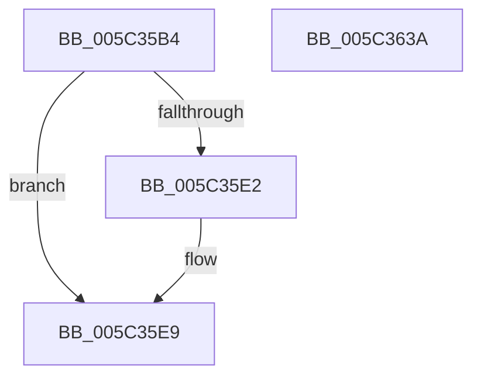

# KeEnableCoreIsolationMitigationPolicyThread

- RVA: `0x005C35B4`–`0x005C363B` (길이 `135` bytes)
- VA: `0x00000001405C35B4`
- 실행 섹션: `.text`
- PDB 이름 있음: `예`; PDB Function 태그: `아니요`
- unwind 정보 RVA: `0x00084918`
- 디코드: `33`개 명령, `135/135` bytes 표시
- 미해석 바이트: `0` (있으면 어셈블리에 `.byte`로 보존)

> 이 문서는 커널 이미지의 기계어와 PDB 기호를 분석해 생성했습니다. 4번과 5번은 함수 원형과 자료형을 바이너리 사용 방식에서 추정한 C 해석이며 원본 소스 복구 결과는 아닙니다.

## 1. Dependencies

- 직접 호출 지점: **4**; 고유 호출 대상: **4**
- 직접 호출자로 확인된 함수: **2**
- RIP 상대 이미지 참조: **1**

### Outgoing calls
- `0x005C35E4` → [KiRaiseIrqlProcessIrqlFlags](../4F/KiRaiseIrqlProcessIrqlFlags_function_004F56FC.md) (function, `0x004F56FC`)
- `0x005C35F9` → [KiAdjustCoreIsolationReasonThread](KiAdjustCoreIsolationReasonThread_function_005C3818.md) (function, `0x005C3818`)
- `0x005C3612` → [KiAdjustUserIsolationDomainThread](KiAdjustUserIsolationDomainThread_function_005C3B54.md) (function, `0x005C3B54`)
- `0x005C3628` → [KiProcessDeferredReadyList](../25/KiProcessDeferredReadyList_function_00250800.md) (function, `0x00250800`)

### Direct callers
- [PspApplyCoreIsolationPolicy](../../page/78/PspApplyCoreIsolationPolicy_function_00783E48.md) at `0x00783EA3`
- [PspInsertThread](../../page/9F/PspInsertThread_function_009F0314.md) at `0x009F08F7`

### Static image references
- `0x005C35D9` → RVA `0x00FC6D20` (`ALMOSTRO`; read)

## 2. Other-region calls and transfers

- 다른 실행 섹션으로 향하는 call: **0**
- 별도 외부 분기/꼬리 이동을 확인하지 못했습니다.

## 3. Assembly (complete function range)

```asm
005C35B4  48 89 5C 24 08                  mov qword ptr [rsp + 8], rbx
005C35B9  48 89 54 24 10                  mov qword ptr [rsp + 0x10], rdx
005C35BE  57                              push rdi
005C35BF  48 83 EC 20                     sub rsp, 0x20
005C35C3  48 8B F9                        mov rdi, rcx
005C35C6  48 83 64 24 38 00               and qword ptr [rsp + 0x38], 0
005C35CC  44 0F 20 C3                     mov rbx, cr8
005C35D0  BA 02 00 00 00                  mov edx, 2
005C35D5  44 0F 22 C2                     mov cr8, rdx
005C35D9  83 3D 40 37 A0 00 00            cmp dword ptr [rip + 0xa03740], 0
005C35E0  74 07                           je 0x1405c35e9
005C35E2  8A CB                           mov cl, bl
005C35E4  E8 13 21 F3 FF                  call 0x1404f56fc
005C35E9  4C 8D 4C 24 38                  lea r9, [rsp + 0x38]
005C35EE  41 B0 01                        mov r8b, 1
005C35F1  BA 01 00 00 00                  mov edx, 1
005C35F6  48 8B CF                        mov rcx, rdi
005C35F9  E8 1A 02 00 00                  call 0x1405c3818
005C35FE  48 8B 97 20 02 00 00            mov rdx, qword ptr [rdi + 0x220]
005C3605  45 33 C0                        xor r8d, r8d
005C3608  48 8B CF                        mov rcx, rdi
005C360B  48 8B 92 60 07 00 00            mov rdx, qword ptr [rdx + 0x760]
005C3612  E8 3D 05 00 00                  call 0x1405c3b54
005C3617  65 48 8B 0C 25 20 00 00 00      mov rcx, qword ptr gs:[0x20]
005C3620  48 8D 54 24 38                  lea rdx, [rsp + 0x38]
005C3625  44 8A C3                        mov r8b, bl
005C3628  E8 D3 D1 C8 FF                  call 0x140250800
005C362D  48 8B 5C 24 30                  mov rbx, qword ptr [rsp + 0x30]
005C3632  33 C0                           xor eax, eax
005C3634  48 83 C4 20                     add rsp, 0x20
005C3638  5F                              pop rdi
005C3639  C3                              ret
005C363A  CC                              int3
```

## 4. C-style interpretation (structured pseudocode)

```c
__int64 __fastcall KeEnableCoreIsolationMitigationPolicyThread(__int64 a1, __int64 a2)
{
    __int64 result;
    __int64 v_rsp;
    unsigned __int64 v_stack_p10;
    unsigned __int64 v_stack_p8;

    v_stack_p8 = v_rbx;
    v_stack_p10 = a2;
    v_rsp = (v_rsp) - (32);
    if ((*(unsigned int *)(v_rip + 10499904)) != 0) {
        a1 = (unsigned __int8)(v_cr8);
        result = KiRaiseIrqlProcessIrqlFlags(a1, 2, a3, a4);
    }
    result = KiAdjustCoreIsolationReasonThread(a1, 1, 1, v_stack_p10);
    a3 = 0;
    result = KiAdjustUserIsolationDomainThread(a1, *(unsigned __int64 *)(*(unsigned __int64 *)(a1 + 544) + 1888), a3, v_stack_p10);
    result = KiProcessDeferredReadyList(*(unsigned __int64 *)(gs_base + (0 + 32)), v_stack_p10, (unsigned __int8)(v_cr8), v_stack_p10);
    result = 0;
    v_rsp = (v_rsp) + (32);
    return result;
}
```

## 5. (Beta) C Style

```c
int64_t KeEnableCoreIsolationMitigationPolicyThread(void *Arg1, int64_t Arg2)
{
    uint8_t *arg1 = (uint8_t *)Arg1;

    int64_t result;
    int64_t local_rsp;
    uint64_t v_stack_p10;
    uint64_t v_stack_p8;

    v_stack_p8 = local_rbx;
    v_stack_p10 = Arg2;
    local_rsp = (local_rsp) - (32);
    if ((*(uint32_t *)(v_rip + 0xA03740)) != 0) {
        Arg1 = (uint8_t)(v_cr8);
        result = KiRaiseIrqlProcessIrqlFlags(Arg1, 2, a3, a4);
    }
    result = KiAdjustCoreIsolationReasonThread(Arg1, 1, 1, v_stack_p10);
    a3 = 0;
    result = KiAdjustUserIsolationDomainThread(Arg1, *(uint64_t *)(*(uint64_t *)(arg1 + 0x220) + 0x760), a3, v_stack_p10);
    result = KiProcessDeferredReadyList(*(uint64_t *)(gs_base + (0 + 0x20)), v_stack_p10, (uint8_t)(v_cr8), v_stack_p10);
    result = 0;
    local_rsp = (local_rsp) + (32);
    return result;
}
```

### 관측된 메모리 오프셋

구조체 형식이 확인되지 않은 접근은 인자 기준의 오프셋으로만 기록했습니다.

| 기준 인자 | 오프셋 표현 | 폭 (bit) | 접근 |
|---|---:|---:|---|
| `Arg1` | `+ 0x220` | `64` | `R` |

## 6. Execution-region graph

[열기: 2D/3D 그래프와 함수 탐색 컨트롤 패널](../../../control-panel.html?section=text&rva=0x005C35B4&view=graph)

- 2D 그래프는 위에서 아래로 흐르고, 3D 그래프는 빈 공간을 드래그해 회전합니다. Shift+드래그는 이동, 휠은 확대·축소, 함수 노드 선택은 대상 보고서 이동입니다.

### Static fallback


