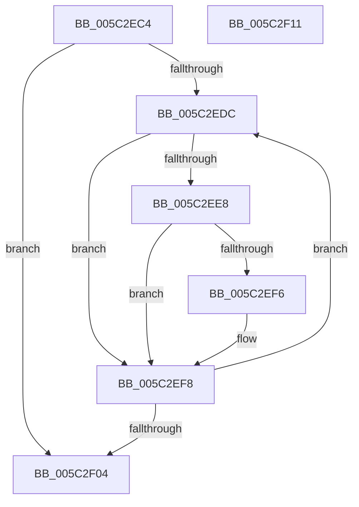

# KeFrozenProcessorCount

- RVA: `0x005C2EC4`–`0x005C2F12` (길이 `78` bytes)
- VA: `0x00000001405C2EC4`
- 실행 섹션: `.text`
- PDB 이름 있음: `예`; PDB Function 태그: `아니요`
- unwind 정보 RVA: `0x0005CAAC`
- 디코드: `27`개 명령, `78/78` bytes 표시
- 미해석 바이트: `0` (있으면 어셈블리에 `.byte`로 보존)

> 이 문서는 커널 이미지의 기계어와 PDB 기호를 분석해 생성했습니다. 4번과 5번은 함수 원형과 자료형을 바이너리 사용 방식에서 추정한 C 해석이며 원본 소스 복구 결과는 아닙니다.

## 1. Dependencies

- 직접 호출 지점: **1**; 고유 호출 대상: **1**
- 직접 호출자로 확인된 함수: **2**
- RIP 상대 이미지 참조: **1**

### Outgoing calls
- `0x005C2EDE` → [KeGetPrcb](../2D/KeGetPrcb_function_002D85D0.md) (function, `0x002D85D0`)

### Direct callers
- [IopBugCheckProgressEfiVariableServicesAvailable](../59/IopBugCheckProgressEfiVariableServicesAvailable_function_00594708.md) at `0x00594715`
- [KiBugCheckRecoveryFreezeOtherProcessors](KiBugCheckRecoveryFreezeOtherProcessors_function_005C7120.md) at `0x005C72F0`
- [KiBugCheckRecoveryFreezeOtherProcessors](KiBugCheckRecoveryFreezeOtherProcessors_function_005C7120.md) at `0x005C730F`

### Static image references
- `0x005C2ECE` → RVA `0x00FC6A80` (`ALMOSTRO`; read)

## 2. Other-region calls and transfers

- 다른 실행 섹션으로 향하는 call: **0**
- 별도 외부 분기/꼬리 이동을 확인하지 못했습니다.

## 3. Assembly (complete function range)

```asm
005C2EC4  48 89 5C 24 08                  mov qword ptr [rsp + 8], rbx
005C2EC9  57                              push rdi
005C2ECA  48 83 EC 20                     sub rsp, 0x20
005C2ECE  8B 05 AC 3B A0 00               mov eax, dword ptr [rip + 0xa03bac]
005C2ED4  33 FF                           xor edi, edi
005C2ED6  33 DB                           xor ebx, ebx
005C2ED8  85 C0                           test eax, eax
005C2EDA  74 28                           je 0x1405c2f04
005C2EDC  8B CB                           mov ecx, ebx
005C2EDE  E8 ED 56 D1 FF                  call 0x1402d85d0
005C2EE3  48 85 C0                        test rax, rax
005C2EE6  74 10                           je 0x1405c2ef8
005C2EE8  8B 88 88 2D 00 00               mov ecx, dword ptr [rax + 0x2d88]
005C2EEE  80 E1 0F                        and cl, 0xf
005C2EF1  80 F9 02                        cmp cl, 2
005C2EF4  75 02                           jne 0x1405c2ef8
005C2EF6  FF C7                           inc edi
005C2EF8  8B 0D 82 3B A0 00               mov ecx, dword ptr [rip + 0xa03b82]
005C2EFE  FF C3                           inc ebx
005C2F00  3B D9                           cmp ebx, ecx
005C2F02  72 D8                           jb 0x1405c2edc
005C2F04  48 8B 5C 24 30                  mov rbx, qword ptr [rsp + 0x30]
005C2F09  8B C7                           mov eax, edi
005C2F0B  48 83 C4 20                     add rsp, 0x20
005C2F0F  5F                              pop rdi
005C2F10  C3                              ret
005C2F11  CC                              int3
```

## 4. C-style interpretation (structured pseudocode)

```c
__int64 __fastcall KeFrozenProcessorCount(void)
{
    __int64 result;
    __int64 v_rbx;
    __int64 v_rdi;
    __int64 v_rsp;
    unsigned __int64 v_stack_p8;

    v_stack_p8 = v_rbx;
    v_rsp = (v_rsp) - (32);
    v_rdi = 0;
    v_rbx = 0;
    if ((unsigned int)((unsigned int)(*(unsigned int *)(v_rip + 10501036))) == 0) goto loc_005C2F04;
loc_005C2EDC:
    result = KeGetPrcb(0, a2, a3, a4);
    if (result == 0) goto loc_005C2EF8;
    a1 = (unsigned __int8)(((unsigned int)(*(unsigned int *)(result + 11656))) & (15));
    if (((unsigned __int8)(a1)) == 2) {
        v_rdi = (unsigned int)((v_rdi) + 1);
    }
    v_rbx = (unsigned int)((v_rbx) + 1);
    if (((unsigned int)(v_rbx)) < ((unsigned int)((unsigned int)(*(unsigned int *)(v_rip + 10500994))))) goto loc_005C2EDC;
loc_005C2F04:
    v_rsp = (v_rsp) + (32);
    return (unsigned int)((unsigned int)(v_rdi));
}
```

## 5. (Beta) C Style

```c
void KeFrozenProcessorCount(void)
{
    int64_t result;
    int64_t local_rbx;
    int64_t local_rdi;
    int64_t local_rsp;
    uint64_t v_stack_p8;

    v_stack_p8 = local_rbx;
    local_rsp = (local_rsp) - (32);
    local_rdi = 0;
    local_rbx = 0;
    if ((uint32_t)((uint32_t)(*(uint32_t *)(v_rip + 0xA03BAC))) == 0) goto loc_005C2F04;
loc_005C2EDC:
    result = KeGetPrcb(0, a2, a3, a4);
    if (result == 0) goto loc_005C2EF8;
    a1 = (uint8_t)(((uint32_t)(*(uint32_t *)(result + 0x2D88))) & (15));
    if (((uint8_t)(a1)) == 2) {
        local_rdi = (uint32_t)((local_rdi) + 1);
    }
    local_rbx = (uint32_t)((local_rbx) + 1);
    if (((uint32_t)(local_rbx)) < ((uint32_t)((uint32_t)(*(uint32_t *)(v_rip + 0xA03B82))))) goto loc_005C2EDC;
loc_005C2F04:
    local_rsp = (local_rsp) + (32);
    return (uint32_t)((uint32_t)(local_rdi));
}
```

## 6. Execution-region graph

[열기: 2D/3D 그래프와 함수 탐색 컨트롤 패널](../../../control-panel.html?section=text&rva=0x005C2EC4&view=graph)

- 2D 그래프는 위에서 아래로 흐르고, 3D 그래프는 빈 공간을 드래그해 회전합니다. Shift+드래그는 이동, 휠은 확대·축소, 함수 노드 선택은 대상 보고서 이동입니다.

### Static fallback


