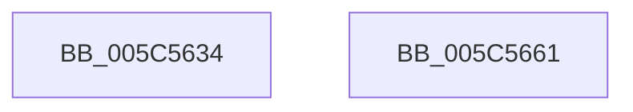

# KeGetAffinitizedInterruptsInfo

- RVA: `0x005C5634`–`0x005C5662` (길이 `46` bytes)
- VA: `0x00000001405C5634`
- 실행 섹션: `.text`
- PDB 이름 있음: `예`; PDB Function 태그: `아니요`
- unwind 정보 RVA: `0x0005CF00`
- 디코드: `13`개 명령, `46/46` bytes 표시
- 미해석 바이트: `0` (있으면 어셈블리에 `.byte`로 보존)

> 이 문서는 커널 이미지의 기계어와 PDB 기호를 분석해 생성했습니다. 4번과 5번은 함수 원형과 자료형을 바이너리 사용 방식에서 추정한 C 해석이며 원본 소스 복구 결과는 아닙니다.

## 1. Dependencies

- 직접 호출 지점: **2**; 고유 호출 대상: **2**
- 직접 호출자로 확인된 함수: **1**
- RIP 상대 이미지 참조: **2**

### Outgoing calls
- `0x005C5648` → [KiCopyAffinityEx](../2C/KiCopyAffinityEx_function_002CE860.md) (function, `0x002CE860`)
- `0x005C5656` → [KeAddProcessorAffinityEx](../25/KeAddProcessorAffinityEx_function_0025B6F0.md) (function, `0x0025B6F0`)

### Direct callers
- [ExpQuerySystemInformation](../../page/A5/ExpQuerySystemInformation_function_00A57858.md) at `0x00A5A6AA`

### Static image references
- `0x005C563E` → RVA `0x00F10AA0` (`.data`; read)
- `0x005C564D` → RVA `0x00F21FB0` (`.data`; read)

## 2. Other-region calls and transfers

- 다른 실행 섹션으로 향하는 call: **0**
- 별도 외부 분기/꼬리 이동을 확인하지 못했습니다.

## 3. Assembly (complete function range)

```asm
005C5634  40 53                           push rbx
005C5636  48 83 EC 20                     sub rsp, 0x20
005C563A  0F B7 51 02                     movzx edx, word ptr [rcx + 2]
005C563E  4C 8D 05 5B B4 94 00            lea r8, [rip + 0x94b45b]
005C5645  48 8B D9                        mov rbx, rcx
005C5648  E8 13 92 D0 FF                  call 0x1402ce860
005C564D  8B 15 5D C9 95 00               mov edx, dword ptr [rip + 0x95c95d]
005C5653  48 8B CB                        mov rcx, rbx
005C5656  E8 95 60 C9 FF                  call 0x14025b6f0
005C565B  48 83 C4 20                     add rsp, 0x20
005C565F  5B                              pop rbx
005C5660  C3                              ret
005C5661  CC                              int3
```

## 4. C-style interpretation (structured pseudocode)

```c
__int64 __fastcall KeGetAffinitizedInterruptsInfo(__int64 a1)
{
    __int64 result;
    __int64 v_rsp;

    v_rsp = (v_rsp) - (32);
    result = KiCopyAffinityEx(a1, *(unsigned __int16 *)(a1 + 2), v_rip + 9745499, a4);
    result = KeAddProcessorAffinityEx(a1, (unsigned int)(*(unsigned int *)(v_rip + 9816413)), v_rip + 9745499, a4);
    v_rsp = (v_rsp) + (32);
    return result;
}
```

## 5. (Beta) C Style

```c
int64_t KeGetAffinitizedInterruptsInfo(void *Arg1)
{
    uint8_t *arg1 = (uint8_t *)Arg1;

    int64_t result;
    int64_t local_rsp;

    local_rsp = (local_rsp) - (32);
    result = KiCopyAffinityEx(Arg1, *(uint16_t *)(arg1 + 0x2), v_rip + 9745499, a4);
    result = KeAddProcessorAffinityEx(Arg1, (uint32_t)(*(uint32_t *)(v_rip + 0x95C95D)), v_rip + 9745499, a4);
    local_rsp = (local_rsp) + (32);
    return result;
}
```

### 관측된 메모리 오프셋

구조체 형식이 확인되지 않은 접근은 인자 기준의 오프셋으로만 기록했습니다.

| 기준 인자 | 오프셋 표현 | 폭 (bit) | 접근 |
|---|---:|---:|---|
| `Arg1` | `+ 0x2` | `16` | `R` |

## 6. Execution-region graph

[열기: 2D/3D 그래프와 함수 탐색 컨트롤 패널](../../../control-panel.html?section=text&rva=0x005C5634&view=graph)

- 2D 그래프는 위에서 아래로 흐르고, 3D 그래프는 빈 공간을 드래그해 회전합니다. Shift+드래그는 이동, 휠은 확대·축소, 함수 노드 선택은 대상 보고서 이동입니다.

### Static fallback


