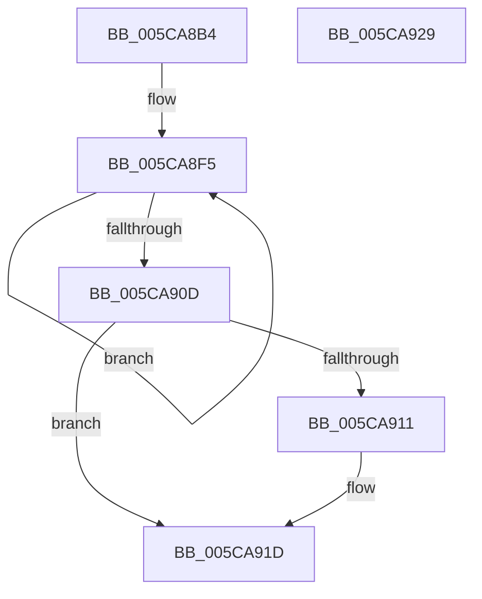

# KeInitializePriQueue

- RVA: `0x005CA8B4`–`0x005CA92A` (길이 `118` bytes)
- VA: `0x00000001405CA8B4`
- 실행 섹션: `.text`
- PDB 이름 있음: `예`; PDB Function 태그: `아니요`
- unwind 정보 RVA: `0x0005CF00`
- 디코드: `33`개 명령, `118/118` bytes 표시
- 미해석 바이트: `0` (있으면 어셈블리에 `.byte`로 보존)

> 이 문서는 커널 이미지의 기계어와 PDB 기호를 분석해 생성했습니다. 4번과 5번은 함수 원형과 자료형을 바이너리 사용 방식에서 추정한 C 해석이며 원본 소스 복구 결과는 아닙니다.

## 1. Dependencies

- 직접 호출 지점: **1**; 고유 호출 대상: **1**
- 직접 호출자로 확인된 함수: **1**
- RIP 상대 이미지 참조: **0**

### Outgoing calls
- `0x005CA916` → [KeQueryActiveProcessorCountEx](../24/KeQueryActiveProcessorCountEx_function_00249EF0.md) (function, `0x00249EF0`)

### Direct callers
- [ExpWorkQueueInitialize](../../page/7D/ExpWorkQueueInitialize_function_007D004C.md) at `0x007D0094`

### Static image references
- 디코드된 RIP-relative 메모리 참조가 없습니다.

## 2. Other-region calls and transfers

- 다른 실행 섹션으로 향하는 call: **0**
- 별도 외부 분기/꼬리 이동을 확인하지 못했습니다.

## 3. Assembly (complete function range)

```asm
005CA8B4  40 53                           push rbx
005CA8B6  48 83 EC 20                     sub rsp, 0x20
005CA8BA  66 C7 01 15 00                  mov word ptr [rcx], 0x15
005CA8BF  48 8D 41 08                     lea rax, [rcx + 8]
005CA8C3  C6 41 02 AC                     mov byte ptr [rcx + 2], 0xac
005CA8C7  45 33 C9                        xor r9d, r9d
005CA8CA  44 89 49 04                     mov dword ptr [rcx + 4], r9d
005CA8CE  48 8B D9                        mov rbx, rcx
005CA8D1  48 89 40 08                     mov qword ptr [rax + 8], rax
005CA8D5  48 89 00                        mov qword ptr [rax], rax
005CA8D8  48 8D 81 A0 02 00 00            lea rax, [rcx + 0x2a0]
005CA8DF  48 89 40 08                     mov qword ptr [rax + 8], rax
005CA8E3  45 8D 41 20                     lea r8d, [r9 + 0x20]
005CA8E7  48 89 00                        mov qword ptr [rax], rax
005CA8EA  48 81 C1 18 02 00 00            add rcx, 0x218
005CA8F1  48 8D 43 18                     lea rax, [rbx + 0x18]
005CA8F5  48 89 40 08                     mov qword ptr [rax + 8], rax
005CA8F9  48 89 00                        mov qword ptr [rax], rax
005CA8FC  48 83 C0 10                     add rax, 0x10
005CA900  44 89 09                        mov dword ptr [rcx], r9d
005CA903  48 8D 49 04                     lea rcx, [rcx + 4]
005CA907  49 83 E8 01                     sub r8, 1
005CA90B  75 E8                           jne 0x1405ca8f5
005CA90D  85 D2                           test edx, edx
005CA90F  75 0C                           jne 0x1405ca91d
005CA911  B9 FF FF 00 00                  mov ecx, 0xffff
005CA916  E8 D5 F5 C7 FF                  call 0x140249ef0
005CA91B  8B D0                           mov edx, eax
005CA91D  89 93 98 02 00 00               mov dword ptr [rbx + 0x298], edx
005CA923  48 83 C4 20                     add rsp, 0x20
005CA927  5B                              pop rbx
005CA928  C3                              ret
005CA929  CC                              int3
```

## 4. C-style interpretation (structured pseudocode)

```c
__int64 __fastcall KeInitializePriQueue(__int64 a1, int a2, __int64 a3, int a4)
{
    __int64 result;
    __int64 v_rsp;

    v_rsp = (v_rsp) - (32);
    *(unsigned __int16 *)(a1) = 21;
    *(unsigned __int8 *)(a1 + 2) = 172;
    a4 = 0;
    *(unsigned int *)(a1 + 4) = 0;
    *(unsigned __int64 *)(a1 + 8 + 8) = a1 + 8;
    *(unsigned __int64 *)(a1 + 8) = a1 + 8;
    *(unsigned __int64 *)(a1 + 672 + 8) = a1 + 672;
    *(unsigned __int64 *)(a1 + 672) = a1 + 672;
    a1 = (a1) + (536);
loc_005CA8F5:
    *(unsigned __int64 *)(a1 + 24 + 8) = a1 + 24;
    *(unsigned __int64 *)(a1 + 24) = a1 + 24;
    result = (a1 + 24) + (16);
    *(unsigned int *)(a1) = 0;
    a3 = (a4 + 32) - (1);
    if (condition_is_not_equal) goto loc_005CA8F5;
    if (a2 == 0) {
        a1 = 0xFFFFULL;
        result = KeQueryActiveProcessorCountEx(a1, a2, a3, a4);
        a2 = (unsigned int)(result);
    }
    *(unsigned int *)(a1 + 664) = a2;
    v_rsp = (v_rsp) + (32);
    return result;
}
```

## 5. (Beta) C Style

```c
int64_t KeInitializePriQueue(void *PriQueue, int32_t Arg2, int64_t Arg3, int32_t Arg4)
{
    uint8_t *priQueue = (uint8_t *)PriQueue;

    int64_t result;
    int64_t local_rsp;

    local_rsp = (local_rsp) - (32);
    *(uint16_t *)(priQueue) = 21;
    *(uint8_t *)(priQueue + 0x2) = 172;
    Arg4 = 0;
    *(uint32_t *)(priQueue + 0x4) = 0;
    *(void **)(priQueue + 0x8 + 0x8) = PriQueue + 8;
    *(void **)(priQueue + 0x8) = PriQueue + 8;
    *(void **)(priQueue + 0x2A0 + 0x8) = PriQueue + 672;
    *(void **)(priQueue + 0x2A0) = PriQueue + 672;
    PriQueue = (PriQueue) + (536);
loc_005CA8F5:
    *(void **)(priQueue + 0x18 + 0x8) = PriQueue + 24;
    *(void **)(priQueue + 0x18) = PriQueue + 24;
    result = (PriQueue + 24) + (16);
    *(uint32_t *)(priQueue) = 0;
    Arg3 = (Arg4 + 32) - (1);
    if (condition_is_not_equal) goto loc_005CA8F5;
    if (Arg2 == 0) {
        PriQueue = 0xFFFFULL;
        result = KeQueryActiveProcessorCountEx(PriQueue, Arg2, Arg3, Arg4);
        Arg2 = (uint32_t)(result);
    }
    *(uint32_t *)(priQueue + 0x298) = Arg2;
    local_rsp = (local_rsp) + (32);
    return result;
}
```

### 관측된 메모리 오프셋

구조체 형식이 확인되지 않은 접근은 인자 기준의 오프셋으로만 기록했습니다.

| 기준 인자 | 오프셋 표현 | 폭 (bit) | 접근 |
|---|---:|---:|---|
| `PriQueue` | `+ 0x0` | `16` | `W` |
| `PriQueue` | `+ 0x0` | `32` | `W` |
| `PriQueue` | `+ 0x0` | `64` | `W` |
| `PriQueue` | `+ 0x2` | `8` | `W` |
| `PriQueue` | `+ 0x4` | `32` | `W` |
| `PriQueue` | `+ 0x4` | `64` | `R` |
| `PriQueue` | `+ 0x8` | `64` | `R` |
| `PriQueue` | `+ 0x8` | `64` | `W` |
| `PriQueue` | `+ 0x18` | `64` | `R` |
| `PriQueue` | `+ 0x298` | `32` | `W` |
| `PriQueue` | `+ 0x2A0` | `64` | `R` |

## 6. Execution-region graph

[열기: 2D/3D 그래프와 함수 탐색 컨트롤 패널](../../../control-panel.html?section=text&rva=0x005CA8B4&view=graph)

- 2D 그래프는 위에서 아래로 흐르고, 3D 그래프는 빈 공간을 드래그해 회전합니다. Shift+드래그는 이동, 휠은 확대·축소, 함수 노드 선택은 대상 보고서 이동입니다.

### Static fallback


