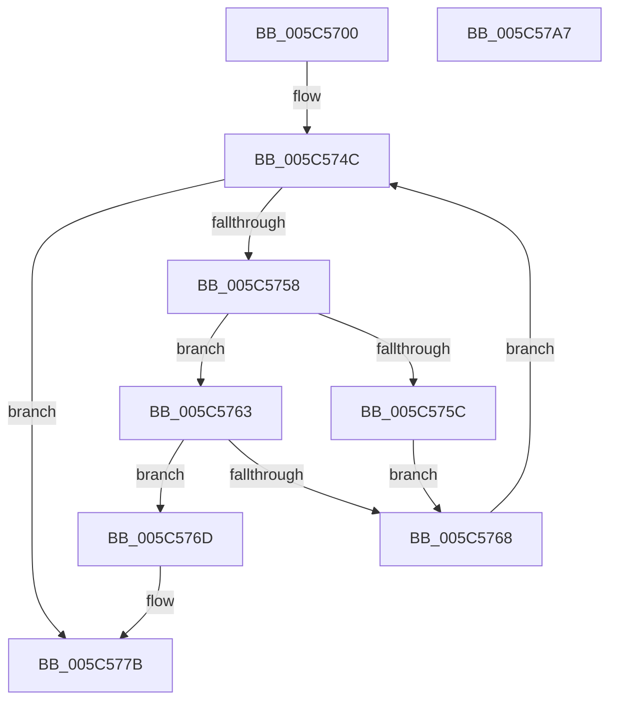

# KeIntSteerAssignCpuSetForGsiv

- RVA: `0x005C5700`–`0x005C57A8` (길이 `168` bytes)
- VA: `0x00000001405C5700`
- 실행 섹션: `.text`
- PDB 이름 있음: `예`; PDB Function 태그: `아니요`
- unwind 정보 RVA: `0x0005E6B4`
- 디코드: `47`개 명령, `168/168` bytes 표시
- 미해석 바이트: `0` (있으면 어셈블리에 `.byte`로 보존)

> 이 문서는 커널 이미지의 기계어와 PDB 기호를 분석해 생성했습니다. 4번과 5번은 함수 원형과 자료형을 바이너리 사용 방식에서 추정한 C 해석이며 원본 소스 복구 결과는 아닙니다.

## 1. Dependencies

- 직접 호출 지점: **4**; 고유 호출 대상: **4**
- 직접 호출자로 확인된 함수: **1**
- RIP 상대 이미지 참조: **2**

### Outgoing calls
- `0x005C5729` → [KeAcquireSpinLockRaiseToDpc](../20/KeAcquireSpinLockRaiseToDpc_function_00208470.md) (function, `0x00208470`)
- `0x005C575C` → [KiIntSteerClearCpuSetAssignment](KiIntSteerClearCpuSetAssignment_function_005C59AC.md) (function, `0x005C59AC`)
- `0x005C5774` → [KiIntSteerAssignCpuSet](KiIntSteerAssignCpuSet_function_005C57B0.md) (function, `0x005C57B0`)
- `0x005C5785` → [KeReleaseSpinLock](../39/KeReleaseSpinLock_function_00392BA0.md) (function, `0x00392BA0`)

### Direct callers
- [NtSetSystemInformation](../../page/AF/NtSetSystemInformation_function_00AF4A60.md) at `0x00AF60A3`

### Static image references
- `0x005C571E` → RVA `0x00F10CF0` (`.data`; read)
- `0x005C572E` → RVA `0x00F10D50` (`.data`; read)

## 2. Other-region calls and transfers

- 다른 실행 섹션으로 향하는 call: **0**
- 별도 외부 분기/꼬리 이동을 확인하지 못했습니다.

## 3. Assembly (complete function range)

```asm
005C5700  48 8B C4                        mov rax, rsp
005C5703  48 89 58 08                     mov qword ptr [rax + 8], rbx
005C5707  48 89 68 10                     mov qword ptr [rax + 0x10], rbp
005C570B  48 89 70 18                     mov qword ptr [rax + 0x18], rsi
005C570F  48 89 78 20                     mov qword ptr [rax + 0x20], rdi
005C5713  41 56                           push r14
005C5715  48 83 EC 20                     sub rsp, 0x20
005C5719  8B D9                           mov ebx, ecx
005C571B  49 8B E8                        mov rbp, r8
005C571E  48 8D 0D CB B5 94 00            lea rcx, [rip + 0x94b5cb]
005C5725  44 0F B7 F2                     movzx r14d, dx
005C5729  E8 42 2D C4 FF                  call 0x140208470
005C572E  48 8B 0D 1B B6 94 00            mov rcx, qword ptr [rip + 0x94b61b]
005C5735  83 CA FF                        or edx, 0xffffffff
005C5738  44 8B CB                        mov r9d, ebx
005C573B  40 8A F0                        mov sil, al
005C573E  44 2B CA                        sub r9d, edx
005C5741  41 F7 D9                        neg r9d
005C5744  1B FF                           sbb edi, edi
005C5746  81 E7 25 02 00 C0               and edi, 0xc0000225
005C574C  48 8D 05 FD B5 94 00            lea rax, [rip + 0x94b5fd]
005C5753  48 3B C8                        cmp rcx, rax
005C5756  74 23                           je 0x1405c577b
005C5758  3B DA                           cmp ebx, edx
005C575A  75 07                           jne 0x1405c5763
005C575C  E8 4B 02 00 00                  call 0x1405c59ac
005C5761  EB 05                           jmp 0x1405c5768
005C5763  39 59 20                        cmp dword ptr [rcx + 0x20], ebx
005C5766  74 05                           je 0x1405c576d
005C5768  48 8B 09                        mov rcx, qword ptr [rcx]
005C576B  EB DF                           jmp 0x1405c574c
005C576D  4C 8B C5                        mov r8, rbp
005C5770  41 0F B7 D6                     movzx edx, r14w
005C5774  E8 37 00 00 00                  call 0x1405c57b0
005C5779  8B F8                           mov edi, eax
005C577B  40 8A D6                        mov dl, sil
005C577E  48 8D 0D 6B B5 94 00            lea rcx, [rip + 0x94b56b]
005C5785  E8 16 D4 DC FF                  call 0x140392ba0
005C578A  48 8B 5C 24 30                  mov rbx, qword ptr [rsp + 0x30]
005C578F  8B C7                           mov eax, edi
005C5791  48 8B 7C 24 48                  mov rdi, qword ptr [rsp + 0x48]
005C5796  48 8B 6C 24 38                  mov rbp, qword ptr [rsp + 0x38]
005C579B  48 8B 74 24 40                  mov rsi, qword ptr [rsp + 0x40]
005C57A0  48 83 C4 20                     add rsp, 0x20
005C57A4  41 5E                           pop r14
005C57A6  C3                              ret
005C57A7  CC                              int3
```

## 4. C-style interpretation (structured pseudocode)

```c
__int64 __fastcall KeIntSteerAssignCpuSetForGsiv(int a1, int a2, __int64 a3)
{
    __int64 result;
    __int64 v_rdi;
    __int64 v_rsp;
    unsigned __int64 v_stack_p10;
    unsigned __int64 v_stack_p18;
    unsigned __int64 v_stack_p20;
    unsigned __int64 v_stack_p8;

    *(unsigned __int64 *)(v_rsp + 8) = v_rbx;
    *(unsigned __int64 *)(v_rsp + 16) = v_rbp;
    *(unsigned __int64 *)(v_rsp + 24) = v_rsi;
    *(unsigned __int64 *)(v_rsp + 32) = v_rdi;
    v_rsp = (v_rsp) - (32);
    result = KeAcquireSpinLockRaiseToDpc(v_rip + 9745867, a2, a3, a4);
    a2 = (unsigned int)((a2) | (0xFFFFFFFFULL));
    a4 = (unsigned int)(((unsigned int)((unsigned int)((unsigned int)(a1)))) - (a2));
    a4 = (unsigned int)(-(a4));
    v_rdi = (unsigned int)((v_rdi) & (0xC0000225ULL));
loc_005C574C:
    if ((*(unsigned __int64 *)(v_rip + 9745947)) == (v_rip + 9745917)) goto loc_005C577B;
    if (((unsigned int)((unsigned int)(a1))) != a2) goto loc_005C5763;
    result = KiIntSteerClearCpuSetAssignment(*(unsigned __int64 *)(v_rip + 9745947), a2, a3, a4);
    goto loc_005C5768;
loc_005C5763:
    if ((*(unsigned int *)(*(unsigned __int64 *)(v_rip + 9745947) + 32)) == ((unsigned int)((unsigned int)(a1)))) goto loc_005C576D;
loc_005C5768:
    goto loc_005C574C;
loc_005C576D:
    result = KiIntSteerAssignCpuSet(*(unsigned __int64 *)(*(unsigned __int64 *)(v_rip + 9745947)), (unsigned __int16)((unsigned __int16)(a2)), a3, a4);
loc_005C577B:
    result = KeReleaseSpinLock(v_rip + 9745771, (unsigned __int8)((unsigned __int8)(result)), a3, a4);
    v_rsp = (v_rsp) + (32);
    return (unsigned int)((unsigned int)((unsigned int)((unsigned int)(result))));
}
```

## 5. (Beta) C Style

```c
int64_t KeIntSteerAssignCpuSetForGsiv(int32_t Arg1, int32_t Arg2, int64_t Arg3)
{
    int64_t result;
    int64_t local_rdi;
    int64_t local_rsp;
    uint64_t v_stack_p10;
    uint64_t v_stack_p18;
    uint64_t v_stack_p20;
    uint64_t v_stack_p8;

    *(uint64_t *)(local_rsp + 0x8) = local_rbx;
    *(uint64_t *)(local_rsp + 0x10) = local_rbp;
    *(uint64_t *)(local_rsp + 0x18) = local_rsi;
    *(uint64_t *)(local_rsp + 0x20) = local_rdi;
    local_rsp = (local_rsp) - (32);
    result = KeAcquireSpinLockRaiseToDpc(v_rip + 9745867, Arg2, Arg3, a4);
    Arg2 = (uint32_t)((Arg2) | (0xFFFFFFFFULL));
    a4 = (uint32_t)(((uint32_t)((uint32_t)((uint32_t)(Arg1)))) - (Arg2));
    a4 = (uint32_t)(-(a4));
    local_rdi = (uint32_t)((local_rdi) & (0xC0000225ULL));
loc_005C574C:
    if ((*(uint64_t *)(v_rip + 0x94B61B)) == (v_rip + 9745917)) goto loc_005C577B;
    if (((uint32_t)((uint32_t)(Arg1))) != Arg2) goto loc_005C5763;
    result = KiIntSteerClearCpuSetAssignment(*(uint64_t *)(v_rip + 0x94B61B), Arg2, Arg3, a4);
    goto loc_005C5768;
loc_005C5763:
    if ((*(uint32_t *)(*(uint64_t *)(v_rip + 0x94B61B) + 0x20)) == ((uint32_t)((uint32_t)(Arg1)))) goto loc_005C576D;
loc_005C5768:
    goto loc_005C574C;
loc_005C576D:
    result = KiIntSteerAssignCpuSet(*(uint64_t *)(*(uint64_t *)(v_rip + 0x94B61B)), (uint16_t)((uint16_t)(Arg2)), Arg3, a4);
loc_005C577B:
    result = KeReleaseSpinLock(v_rip + 9745771, (uint8_t)((uint8_t)(result)), Arg3, a4);
    local_rsp = (local_rsp) + (32);
    return (uint32_t)((uint32_t)((uint32_t)((uint32_t)(result))));
}
```

## 6. Execution-region graph

[열기: 2D/3D 그래프와 함수 탐색 컨트롤 패널](../../../control-panel.html?section=text&rva=0x005C5700&view=graph)

- 2D 그래프는 위에서 아래로 흐르고, 3D 그래프는 빈 공간을 드래그해 회전합니다. Shift+드래그는 이동, 휠은 확대·축소, 함수 노드 선택은 대상 보고서 이동입니다.

### Static fallback


