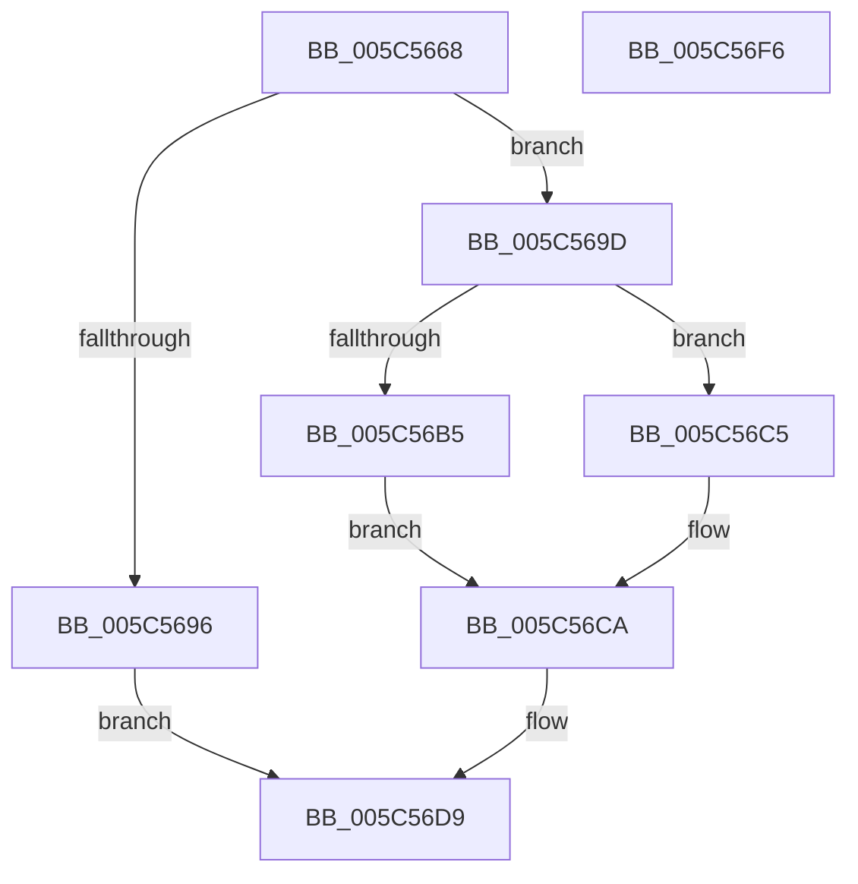

# KeIntSteerAssignCpuSet

- RVA: `0x005C5668`–`0x005C56F7` (길이 `143` bytes)
- VA: `0x00000001405C5668`
- 실행 섹션: `.text`
- PDB 이름 있음: `예`; PDB Function 태그: `아니요`
- unwind 정보 RVA: `0x0005E6B4`
- 디코드: `39`개 명령, `143/143` bytes 표시
- 미해석 바이트: `0` (있으면 어셈블리에 `.byte`로 보존)

> 이 문서는 커널 이미지의 기계어와 PDB 기호를 분석해 생성했습니다. 4번과 5번은 함수 원형과 자료형을 바이너리 사용 방식에서 추정한 C 해석이며 원본 소스 복구 결과는 아닙니다.

## 1. Dependencies

- 직접 호출 지점: **4**; 고유 호출 대상: **4**
- 직접 호출자로 확인된 함수: **1**
- RIP 상대 이미지 참조: **1**

### Outgoing calls
- `0x005C56A4` → [KeAcquireSpinLockRaiseToDpc](../20/KeAcquireSpinLockRaiseToDpc_function_00208470.md) (function, `0x00208470`)
- `0x005C56BC` → [KiIntSteerAssignCpuSet](KiIntSteerAssignCpuSet_function_005C57B0.md) (function, `0x005C57B0`)
- `0x005C56C5` → [KiIntSteerClearCpuSetAssignment](KiIntSteerClearCpuSetAssignment_function_005C59AC.md) (function, `0x005C59AC`)
- `0x005C56D4` → [KeReleaseSpinLock](../39/KeReleaseSpinLock_function_00392BA0.md) (function, `0x00392BA0`)

### Direct callers
- [IoSteerInterrupt](../../page/72/IoSteerInterrupt_function_007270F0.md) at `0x0072720A`

### Static image references
- `0x005C569D` → RVA `0x00F10CF0` (`.data`; read)

## 2. Other-region calls and transfers

- 다른 실행 섹션으로 향하는 call: **0**
- 별도 외부 분기/꼬리 이동을 확인하지 못했습니다.

## 3. Assembly (complete function range)

```asm
005C5668  48 8B C4                        mov rax, rsp
005C566B  48 89 58 08                     mov qword ptr [rax + 8], rbx
005C566F  48 89 68 10                     mov qword ptr [rax + 0x10], rbp
005C5673  48 89 70 18                     mov qword ptr [rax + 0x18], rsi
005C5677  48 89 78 20                     mov qword ptr [rax + 0x20], rdi
005C567B  41 56                           push r14
005C567D  48 83 EC 20                     sub rsp, 0x20
005C5681  48 8B B9 A8 00 00 00            mov rdi, qword ptr [rcx + 0xa8]
005C5688  33 DB                           xor ebx, ebx
005C568A  49 8B F0                        mov rsi, r8
005C568D  44 0F B7 F2                     movzx r14d, dx
005C5691  48 85 FF                        test rdi, rdi
005C5694  75 07                           jne 0x1405c569d
005C5696  BB BB 00 00 C0                  mov ebx, 0xc00000bb
005C569B  EB 3C                           jmp 0x1405c56d9
005C569D  48 8D 0D 4C B6 94 00            lea rcx, [rip + 0x94b64c]
005C56A4  E8 C7 2D C4 FF                  call 0x140208470
005C56A9  48 8B 4F 10                     mov rcx, qword ptr [rdi + 0x10]
005C56AD  40 8A E8                        mov bpl, al
005C56B0  48 85 F6                        test rsi, rsi
005C56B3  74 10                           je 0x1405c56c5
005C56B5  4C 8B C6                        mov r8, rsi
005C56B8  41 0F B7 D6                     movzx edx, r14w
005C56BC  E8 EF 00 00 00                  call 0x1405c57b0
005C56C1  8B D8                           mov ebx, eax
005C56C3  EB 05                           jmp 0x1405c56ca
005C56C5  E8 E2 02 00 00                  call 0x1405c59ac
005C56CA  40 8A D5                        mov dl, bpl
005C56CD  48 8D 0D 1C B6 94 00            lea rcx, [rip + 0x94b61c]
005C56D4  E8 C7 D4 DC FF                  call 0x140392ba0
005C56D9  48 8B 6C 24 38                  mov rbp, qword ptr [rsp + 0x38]
005C56DE  8B C3                           mov eax, ebx
005C56E0  48 8B 5C 24 30                  mov rbx, qword ptr [rsp + 0x30]
005C56E5  48 8B 74 24 40                  mov rsi, qword ptr [rsp + 0x40]
005C56EA  48 8B 7C 24 48                  mov rdi, qword ptr [rsp + 0x48]
005C56EF  48 83 C4 20                     add rsp, 0x20
005C56F3  41 5E                           pop r14
005C56F5  C3                              ret
005C56F6  CC                              int3
```

## 4. C-style interpretation (structured pseudocode)

```c
__int64 __fastcall KeIntSteerAssignCpuSet(__int64 a1, unsigned __int16 a2, __int64 a3)
{
    __int64 result;
    __int64 v_rbx;
    __int64 v_rsp;
    unsigned __int64 v_stack_p10;
    unsigned __int64 v_stack_p18;
    unsigned __int64 v_stack_p20;
    unsigned __int64 v_stack_p8;

    *(unsigned __int64 *)(v_rsp + 8) = v_rbx;
    *(unsigned __int64 *)(v_rsp + 16) = v_rbp;
    *(unsigned __int64 *)(v_rsp + 24) = v_rsi;
    *(unsigned __int64 *)(v_rsp + 32) = v_rdi;
    v_rsp = (v_rsp) - (32);
    v_rbx = 0;
    if (*(unsigned __int64 *)(a1 + 168) != 0) goto loc_005C569D;
    goto loc_005C56D9;
loc_005C569D:
    result = KeAcquireSpinLockRaiseToDpc(v_rip + 9745996, a2, a3, a4);
    if (a3 == 0) goto loc_005C56C5;
    result = KiIntSteerAssignCpuSet(*(unsigned __int64 *)(*(unsigned __int64 *)(a1 + 168) + 16), a2, a3, a4);
    goto loc_005C56CA;
loc_005C56C5:
    result = KiIntSteerClearCpuSetAssignment(*(unsigned __int64 *)(*(unsigned __int64 *)(a1 + 168) + 16), a2, a3, a4);
loc_005C56CA:
    result = KeReleaseSpinLock(v_rip + 9745948, (unsigned __int8)((unsigned __int8)(result)), a3, a4);
loc_005C56D9:
    v_rsp = (v_rsp) + (32);
    return (unsigned int)((unsigned int)((unsigned int)((unsigned int)(result))));
}
```

## 5. (Beta) C Style

```c
int64_t KeIntSteerAssignCpuSet(void *Arg1, uint16_t Arg2, int64_t Arg3)
{
    uint8_t *arg1 = (uint8_t *)Arg1;

    int64_t result;
    int64_t local_rbx;
    int64_t local_rsp;
    uint64_t v_stack_p10;
    uint64_t v_stack_p18;
    uint64_t v_stack_p20;
    uint64_t v_stack_p8;

    *(uint64_t *)(local_rsp + 0x8) = local_rbx;
    *(uint64_t *)(local_rsp + 0x10) = local_rbp;
    *(uint64_t *)(local_rsp + 0x18) = local_rsi;
    *(uint64_t *)(local_rsp + 0x20) = local_rdi;
    local_rsp = (local_rsp) - (32);
    local_rbx = 0;
    if (*(uint64_t *)(arg1 + 0xA8) != 0) goto loc_005C569D;
    goto loc_005C56D9;
loc_005C569D:
    result = KeAcquireSpinLockRaiseToDpc(v_rip + 9745996, Arg2, Arg3, a4);
    if (Arg3 == 0) goto loc_005C56C5;
    result = KiIntSteerAssignCpuSet(*(uint64_t *)(*(uint64_t *)(arg1 + 0xA8) + 0x10), Arg2, Arg3, a4);
    goto loc_005C56CA;
loc_005C56C5:
    result = KiIntSteerClearCpuSetAssignment(*(uint64_t *)(*(uint64_t *)(arg1 + 0xA8) + 0x10), Arg2, Arg3, a4);
loc_005C56CA:
    result = KeReleaseSpinLock(v_rip + 9745948, (uint8_t)((uint8_t)(result)), Arg3, a4);
loc_005C56D9:
    local_rsp = (local_rsp) + (32);
    return (uint32_t)((uint32_t)((uint32_t)((uint32_t)(result))));
}
```

### 관측된 메모리 오프셋

구조체 형식이 확인되지 않은 접근은 인자 기준의 오프셋으로만 기록했습니다.

| 기준 인자 | 오프셋 표현 | 폭 (bit) | 접근 |
|---|---:|---:|---|
| `Arg1` | `+ 0xA8` | `64` | `R` |

## 6. Execution-region graph

[열기: 2D/3D 그래프와 함수 탐색 컨트롤 패널](../../../control-panel.html?section=text&rva=0x005C5668&view=graph)

- 2D 그래프는 위에서 아래로 흐르고, 3D 그래프는 빈 공간을 드래그해 회전합니다. Shift+드래그는 이동, 휠은 확대·축소, 함수 노드 선택은 대상 보고서 이동입니다.

### Static fallback


