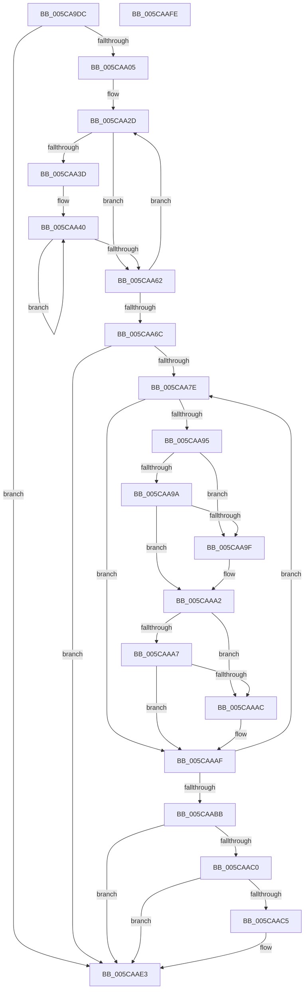

# KeMarkDynamicTracingHiberPhase

- RVA: `0x005CA9DC`–`0x005CAAFF` (길이 `291` bytes)
- VA: `0x00000001405CA9DC`
- 실행 섹션: `.text`
- PDB 이름 있음: `예`; PDB Function 태그: `아니요`
- unwind 정보 RVA: `0x0005D7BC`
- 디코드: `79`개 명령, `291/291` bytes 표시
- 미해석 바이트: `0` (있으면 어셈블리에 `.byte`로 보존)

> 이 문서는 커널 이미지의 기계어와 PDB 기호를 분석해 생성했습니다. 4번과 5번은 함수 원형과 자료형을 바이너리 사용 방식에서 추정한 C 해석이며 원본 소스 복구 결과는 아닙니다.

## 1. Dependencies

- 직접 호출 지점: **4**; 고유 호출 대상: **2**
- 직접 호출자로 확인된 함수: **1**
- RIP 상대 이미지 참조: **3**

### Outgoing calls
- `0x005CAA19` → [PoSetHiberRange](../47/PoSetHiberRange_function_0047C580.md) (function, `0x0047C580`)
- `0x005CAA1E` → [KiTpCompletionContextSize](../../page/74/KiTpCompletionContextSize_function_0074899C.md) (function, `0x0074899C`)
- `0x005CAA55` → [PoSetHiberRange](../47/PoSetHiberRange_function_0047C580.md) (function, `0x0047C580`)
- `0x005CAADE` → [PoSetHiberRange](../47/PoSetHiberRange_function_0047C580.md) (function, `0x0047C580`)

### Direct callers
- [PopMarkComponentsBootPhase](../../pagelk/B6/PopMarkComponentsBootPhase_function_00B6E0E4.md) at `0x00B6E346`

### Static image references
- `0x005CA9F5` → RVA `0x00F107A0` (`.data`; read)
- `0x005CAA6C` → RVA `0x00FC6A80` (`ALMOSTRO`; read)
- `0x005CAA7E` → RVA `0x00FC8C40` (`ALMOSTRO`; read)

## 2. Other-region calls and transfers

- 다른 실행 섹션으로 향하는 call: **1**
  - `0x005CAA1E` → [KiTpCompletionContextSize](../../page/74/KiTpCompletionContextSize_function_0074899C.md) (`.text` → `PAGE`)
- 별도 외부 분기/꼬리 이동을 확인하지 못했습니다.

## 3. Assembly (complete function range)

```asm
005CA9DC  48 8B C4                        mov rax, rsp
005CA9DF  48 89 58 08                     mov qword ptr [rax + 8], rbx
005CA9E3  48 89 68 10                     mov qword ptr [rax + 0x10], rbp
005CA9E7  48 89 70 18                     mov qword ptr [rax + 0x18], rsi
005CA9EB  48 89 78 20                     mov qword ptr [rax + 0x20], rdi
005CA9EF  41 56                           push r14
005CA9F1  48 83 EC 30                     sub rsp, 0x30
005CA9F5  4C 8B 05 A4 5D 94 00            mov r8, qword ptr [rip + 0x945da4]
005CA9FC  4D 85 C0                        test r8, r8
005CA9FF  0F 84 DE 00 00 00               je 0x1405caae3
005CAA05  BA 00 00 01 00                  mov edx, 0x10000
005CAA0A  C7 40 E8 46 74 72 70            mov dword ptr [rax - 0x18], 0x70727446
005CAA11  33 C9                           xor ecx, ecx
005CAA13  41 B9 00 00 02 00               mov r9d, 0x20000
005CAA19  E8 62 1B EB FF                  call 0x14047c580
005CAA1E  E8 79 DF 17 00                  call 0x14074899c
005CAA23  33 FF                           xor edi, edi
005CAA25  BE 00 40 00 00                  mov esi, 0x4000
005CAA2A  8D 68 34                        lea ebp, [rax + 0x34]
005CAA2D  48 8B 0D 6C 5D 94 00            mov rcx, qword ptr [rip + 0x945d6c]
005CAA34  48 8B 1C 0F                     mov rbx, qword ptr [rdi + rcx]
005CAA38  48 85 DB                        test rbx, rbx
005CAA3B  74 25                           je 0x1405caa62
005CAA3D  44 8B F5                        mov r14d, ebp
005CAA40  4D 8B CE                        mov r9, r14
005CAA43  C7 44 24 20 46 74 72 70         mov dword ptr [rsp + 0x20], 0x70727446
005CAA4B  4C 8B C3                        mov r8, rbx
005CAA4E  BA 00 00 01 00                  mov edx, 0x10000
005CAA53  33 C9                           xor ecx, ecx
005CAA55  E8 26 1B EB FF                  call 0x14047c580
005CAA5A  48 8B 1B                        mov rbx, qword ptr [rbx]
005CAA5D  48 85 DB                        test rbx, rbx
005CAA60  75 DE                           jne 0x1405caa40
005CAA62  48 83 C7 08                     add rdi, 8
005CAA66  48 83 EE 01                     sub rsi, 1
005CAA6A  75 C1                           jne 0x1405caa2d
005CAA6C  8B 05 0E C0 9F 00               mov eax, dword ptr [rip + 0x9fc00e]
005CAA72  45 33 C0                        xor r8d, r8d
005CAA75  45 33 C9                        xor r9d, r9d
005CAA78  33 D2                           xor edx, edx
005CAA7A  85 C0                           test eax, eax
005CAA7C  74 65                           je 0x1405caae3
005CAA7E  48 8D 0D BB E1 9F 00            lea rcx, [rip + 0x9fe1bb]
005CAA85  48 8B 04 D1                     mov rax, qword ptr [rcx + rdx*8]
005CAA89  48 8B 88 98 00 00 00            mov rcx, qword ptr [rax + 0x98]
005CAA90  48 85 C9                        test rcx, rcx
005CAA93  74 1A                           je 0x1405caaaf
005CAA95  4D 85 C0                        test r8, r8
005CAA98  74 05                           je 0x1405caa9f
005CAA9A  49 3B C8                        cmp rcx, r8
005CAA9D  73 03                           jae 0x1405caaa2
005CAA9F  4C 8B C1                        mov r8, rcx
005CAAA2  4D 85 C9                        test r9, r9
005CAAA5  74 05                           je 0x1405caaac
005CAAA7  49 3B C9                        cmp rcx, r9
005CAAAA  76 03                           jbe 0x1405caaaf
005CAAAC  4C 8B C9                        mov r9, rcx
005CAAAF  8B 05 CB BF 9F 00               mov eax, dword ptr [rip + 0x9fbfcb]
005CAAB5  FF C2                           inc edx
005CAAB7  3B D0                           cmp edx, eax
005CAAB9  72 C3                           jb 0x1405caa7e
005CAABB  4D 85 C0                        test r8, r8
005CAABE  74 23                           je 0x1405caae3
005CAAC0  4D 85 C9                        test r9, r9
005CAAC3  74 1E                           je 0x1405caae3
005CAAC5  4D 2B C8                        sub r9, r8
005CAAC8  C7 44 24 20 46 74 72 70         mov dword ptr [rsp + 0x20], 0x70727446
005CAAD0  49 81 C1 08 20 00 00            add r9, 0x2008
005CAAD7  BA 00 00 01 00                  mov edx, 0x10000
005CAADC  33 C9                           xor ecx, ecx
005CAADE  E8 9D 1A EB FF                  call 0x14047c580
005CAAE3  48 8B 5C 24 40                  mov rbx, qword ptr [rsp + 0x40]
005CAAE8  48 8B 6C 24 48                  mov rbp, qword ptr [rsp + 0x48]
005CAAED  48 8B 74 24 50                  mov rsi, qword ptr [rsp + 0x50]
005CAAF2  48 8B 7C 24 58                  mov rdi, qword ptr [rsp + 0x58]
005CAAF7  48 83 C4 30                     add rsp, 0x30
005CAAFB  41 5E                           pop r14
005CAAFD  C3                              ret
005CAAFE  CC                              int3
```

## 4. C-style interpretation (structured pseudocode)

```c
__int64 __fastcall KeMarkDynamicTracingHiberPhase(int a1)
{
    __int64 result;
    __int64 v_rdi;
    __int64 v_rsi;
    __int64 v_rsp;
    unsigned int v_stack_m18;
    unsigned __int64 v_stack_p10;
    unsigned __int64 v_stack_p18;
    unsigned __int64 v_stack_p20;
    unsigned __int64 v_stack_p8;

    *(unsigned __int64 *)(v_rsp + 8) = v_rbx;
    *(unsigned __int64 *)(v_rsp + 16) = v_rbp;
    *(unsigned __int64 *)(v_rsp + 24) = v_rsi;
    *(unsigned __int64 *)(v_rsp + 32) = v_rdi;
    v_rsp = (v_rsp) - (48);
    if (*(unsigned __int64 *)(v_rip + 9723300) == 0) goto loc_005CAAE3;
    *(unsigned int *)(v_rsp - 24) = 0x70727446ULL;
    a1 = 0;
    result = PoSetHiberRange(a1, (unsigned int)(0x10000ULL), *(unsigned __int64 *)(v_rip + 9723300), (unsigned int)(0x20000ULL));
    result = KiTpCompletionContextSize(a1, (unsigned int)(0x10000ULL), *(unsigned __int64 *)(v_rip + 9723300), (unsigned int)(0x20000ULL));
    v_rdi = 0;
loc_005CAA2D:
    if (*(unsigned __int64 *)(v_rdi + *(unsigned __int64 *)(v_rip + 9723244) * 1) == 0) goto loc_005CAA62;
loc_005CAA40:
    v_stack_m18 = 0x70727446ULL;
    a1 = 0;
    result = PoSetHiberRange(a1, (unsigned int)(0x10000ULL), *(unsigned __int64 *)(v_rdi + *(unsigned __int64 *)(v_rip + 9723244) * 1), (unsigned int)((unsigned int)(result + 52)));
    if (*(unsigned __int64 *)(*(unsigned __int64 *)(v_rdi + *(unsigned __int64 *)(v_rip + 9723244) * 1)) != 0) goto loc_005CAA40;
loc_005CAA62:
    v_rdi = (v_rdi) + (8);
    v_rsi = ((unsigned int)(0x4000ULL)) - (1);
    if (condition_is_not_equal) goto loc_005CAA2D;
    a3 = 0;
    a4 = 0;
    a2 = 0;
    if ((unsigned int)((unsigned int)(*(unsigned int *)(v_rip + 10469390))) == 0) goto loc_005CAAE3;
loc_005CAA7E:
    if (*(unsigned __int64 *)(*(unsigned __int64 *)(v_rip + 10478011 + a2 * 8) + 152) == 0) goto loc_005CAAAF;
    if (0 == 0) goto loc_005CAA9F;
    if ((*(unsigned __int64 *)(*(unsigned __int64 *)(v_rip + 10478011 + a2 * 8) + 152)) < 0) {
        a3 = *(unsigned __int64 *)(*(unsigned __int64 *)(v_rip + 10478011 + a2 * 8) + 152);
    }
    if (0 == 0) goto loc_005CAAAC;
    if ((*(unsigned __int64 *)(*(unsigned __int64 *)(v_rip + 10478011 + a2 * 8) + 152)) >= = 0) {
        a4 = *(unsigned __int64 *)(*(unsigned __int64 *)(v_rip + 10478011 + a2 * 8) + 152);
    }
    a2 = (unsigned int)((a2) + 1);
    if (((unsigned int)(a2)) < ((unsigned int)((unsigned int)(*(unsigned int *)(v_rip + 10469323))))) goto loc_005CAA7E;
    if (a3 == 0) goto loc_005CAAE3;
    result = (unsigned int)(*(unsigned int *)(v_rip + 10469323));
    if (a4 != 0) {
        a4 = (a4) - (a3);
        v_stack_m18 = 0x70727446ULL;
        a4 = (a4) + (0x2008ULL);
        a2 = 0x10000ULL;
        a1 = 0;
        result = PoSetHiberRange(a1, a2, a3, a4);
    }
    v_rsp = (v_rsp) + (48);
    return result;
}
```

## 5. (Beta) C Style

```c
int64_t KeMarkDynamicTracingHiberPhase(int32_t Arg1)
{
    int64_t result;
    int64_t local_rdi;
    int64_t local_rsi;
    int64_t local_rsp;
    uint32_t v_stack_m18;
    uint64_t v_stack_p10;
    uint64_t v_stack_p18;
    uint64_t v_stack_p20;
    uint64_t v_stack_p8;

    *(uint64_t *)(local_rsp + 0x8) = local_rbx;
    *(uint64_t *)(local_rsp + 0x10) = local_rbp;
    *(uint64_t *)(local_rsp + 0x18) = local_rsi;
    *(uint64_t *)(local_rsp + 0x20) = local_rdi;
    local_rsp = (local_rsp) - (48);
    if (*(uint64_t *)(v_rip + 0x945DA4) == 0) goto loc_005CAAE3;
    *(uint32_t *)(local_rsp - 0x18) = 0x70727446ULL;
    Arg1 = 0;
    result = PoSetHiberRange(Arg1, (uint32_t)(0x10000ULL), *(uint64_t *)(v_rip + 0x945DA4), (uint32_t)(0x20000ULL));
    result = KiTpCompletionContextSize(Arg1, (uint32_t)(0x10000ULL), *(uint64_t *)(v_rip + 0x945DA4), (uint32_t)(0x20000ULL));
    local_rdi = 0;
loc_005CAA2D:
    if (*(uint64_t *)(local_rdi + *(uint64_t *)(v_rip + 0x945D6C) * 1) == 0) goto loc_005CAA62;
loc_005CAA40:
    v_stack_m18 = 0x70727446ULL;
    Arg1 = 0;
    result = PoSetHiberRange(Arg1, (uint32_t)(0x10000ULL), *(uint64_t *)(local_rdi + *(uint64_t *)(v_rip + 0x945D6C) * 1), (uint32_t)((uint32_t)(result + 52)));
    if (*(uint64_t *)(*(uint64_t *)(local_rdi + *(uint64_t *)(v_rip + 0x945D6C) * 1)) != 0) goto loc_005CAA40;
loc_005CAA62:
    local_rdi = (local_rdi) + (8);
    local_rsi = ((uint32_t)(0x4000ULL)) - (1);
    if (condition_is_not_equal) goto loc_005CAA2D;
    a3 = 0;
    a4 = 0;
    a2 = 0;
    if ((uint32_t)((uint32_t)(*(uint32_t *)(v_rip + 0x9FC00E))) == 0) goto loc_005CAAE3;
loc_005CAA7E:
    if (*(uint64_t *)(*(uint64_t *)(v_rip + 0x9FE1BB + a2 * 8) + 0x98) == 0) goto loc_005CAAAF;
    if (0 == 0) goto loc_005CAA9F;
    if ((*(uint64_t *)(*(uint64_t *)(v_rip + 0x9FE1BB + a2 * 8) + 0x98)) < 0) {
        a3 = *(uint64_t *)(*(uint64_t *)(v_rip + 0x9FE1BB + a2 * 8) + 0x98);
    }
    if (0 == 0) goto loc_005CAAAC;
    if ((*(uint64_t *)(*(uint64_t *)(v_rip + 0x9FE1BB + a2 * 8) + 0x98)) >= = 0) {
        a4 = *(uint64_t *)(*(uint64_t *)(v_rip + 0x9FE1BB + a2 * 8) + 0x98);
    }
    a2 = (uint32_t)((a2) + 1);
    if (((uint32_t)(a2)) < ((uint32_t)((uint32_t)(*(uint32_t *)(v_rip + 0x9FBFCB))))) goto loc_005CAA7E;
    if (a3 == 0) goto loc_005CAAE3;
    result = (uint32_t)(*(uint32_t *)(v_rip + 0x9FBFCB));
    if (a4 != 0) {
        a4 = (a4) - (a3);
        v_stack_m18 = 0x70727446ULL;
        a4 = (a4) + (0x2008ULL);
        a2 = 0x10000ULL;
        Arg1 = 0;
        result = PoSetHiberRange(Arg1, a2, a3, a4);
    }
    local_rsp = (local_rsp) + (48);
    return result;
}
```

## 6. Execution-region graph

[열기: 2D/3D 그래프와 함수 탐색 컨트롤 패널](../../../control-panel.html?section=text&rva=0x005CA9DC&view=graph)

- 2D 그래프는 위에서 아래로 흐르고, 3D 그래프는 빈 공간을 드래그해 회전합니다. Shift+드래그는 이동, 휠은 확대·축소, 함수 노드 선택은 대상 보고서 이동입니다.

### Static fallback


