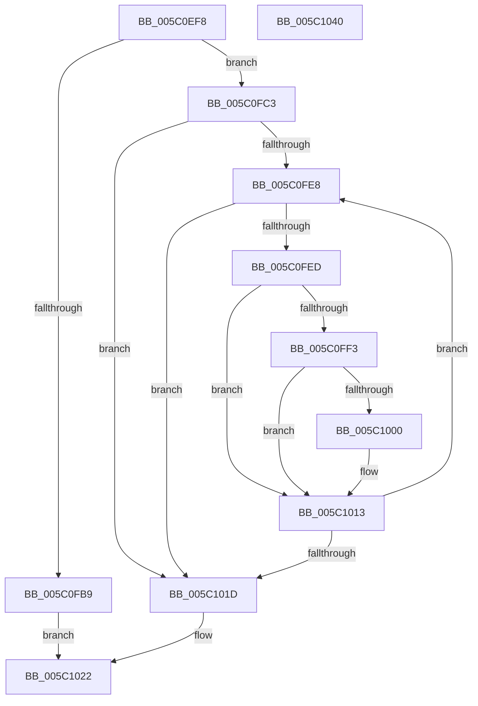

# KeQueryCpuPartitionAffinity

- RVA: `0x005C0EF8`–`0x005C1041` (길이 `329` bytes)
- VA: `0x00000001405C0EF8`
- 실행 섹션: `.text`
- PDB 이름 있음: `예`; PDB Function 태그: `아니요`
- unwind 정보 RVA: `0x000CA6CC`
- 디코드: `92`개 명령, `329/329` bytes 표시
- 미해석 바이트: `0` (있으면 어셈블리에 `.byte`로 보존)

> 이 문서는 커널 이미지의 기계어와 PDB 기호를 분석해 생성했습니다. 4번과 5번은 함수 원형과 자료형을 바이너리 사용 방식에서 추정한 C 해석이며 원본 소스 복구 결과는 아닙니다.

## 1. Dependencies

- 직접 호출 지점: **9**; 고유 호출 대상: **7**
- 직접 호출자로 확인된 함수: **3**
- RIP 상대 이미지 참조: **1**

### Outgoing calls
- `0x005C0F37` → [memset](../6C/memset_function_006C6C40.md) (function, `0x006C6C40`)
- `0x005C0F67` → [memset](../6C/memset_function_006C6C40.md) (function, `0x006C6C40`)
- `0x005C0F74` → [KiAcquireCpuPartitionLock](../30/KiAcquireCpuPartitionLock_function_00303374.md) (function, `0x00303374`)
- `0x005C0F86` → [KiCopyAffinityEx](../2C/KiCopyAffinityEx_function_002CE860.md) (function, `0x002CE860`)
- `0x005C0F92` → [KiReleaseCpuPartitionLock](../4F/KiReleaseCpuPartitionLock_function_004F54FC.md) (function, `0x004F54FC`)
- `0x005C0FA1` → [KeComputeGroupMask](../4A/KeComputeGroupMask_function_004A2ECC.md) (function, `0x004A2ECC`)
- `0x005C0FAB` → [KeCountSetBitsGroupMask](../41/KeCountSetBitsGroupMask_function_00418AD4.md) (function, `0x00418AD4`)
- `0x005C0FCF` → [memset](../6C/memset_function_006C6C40.md) (function, `0x006C6C40`)
- `0x005C1029` → [_security_check_cookie](../6A/_security_check_cookie_function_006AC640.md) (function, `0x006AC640`)

### Direct callers
- [KeQuerySystemCpuPartitionAffinity](KeQuerySystemCpuPartitionAffinity_function_005C1050.md) at `0x005C1065`
- [KiAdjustProcessCpuSetsAfterCpuPartitionChange](KiAdjustProcessCpuSetsAfterCpuPartitionChange_function_005C12DC.md) at `0x005C1352`
- [NtQueryInformationCpuPartition](../../page/78/NtQueryInformationCpuPartition_function_00783320.md) at `0x00783445`

### Static image references
- `0x005C0F0F` → RVA `0x00E0A740` (`.data`; read)

## 2. Other-region calls and transfers

- 다른 실행 섹션으로 향하는 call: **0**
- 별도 외부 분기/꼬리 이동을 확인하지 못했습니다.

## 3. Assembly (complete function range)

```asm
005C0EF8  40 55                           push rbp
005C0EFA  53                              push rbx
005C0EFB  56                              push rsi
005C0EFC  57                              push rdi
005C0EFD  41 54                           push r12
005C0EFF  41 55                           push r13
005C0F01  41 56                           push r14
005C0F03  48 8D 6C 24 A0                  lea rbp, [rsp - 0x60]
005C0F08  48 81 EC 60 01 00 00            sub rsp, 0x160
005C0F0F  48 8B 05 2A 98 84 00            mov rax, qword ptr [rip + 0x84982a]
005C0F16  48 33 C4                        xor rax, rsp
005C0F19  48 89 45 50                     mov qword ptr [rbp + 0x50], rax
005C0F1D  45 0F B7 F0                     movzx r14d, r8w
005C0F21  48 8B FA                        mov rdi, rdx
005C0F24  48 8B D9                        mov rbx, rcx
005C0F27  33 D2                           xor edx, edx
005C0F29  41 B8 00 01 00 00               mov r8d, 0x100
005C0F2F  48 8D 4C 24 48                  lea rcx, [rsp + 0x48]
005C0F34  49 8B F1                        mov rsi, r9
005C0F37  E8 04 5D 10 00                  call 0x1406c6c40
005C0F3C  45 33 E4                        xor r12d, r12d
005C0F3F  48 C7 44 24 40 01 00 20 00      mov qword ptr [rsp + 0x40], 0x200001
005C0F48  0F 57 C0                        xorps xmm0, xmm0
005C0F4B  44 88 64 24 20                  mov byte ptr [rsp + 0x20], r12b
005C0F50  33 D2                           xor edx, edx
005C0F52  48 8D 4C 24 48                  lea rcx, [rsp + 0x48]
005C0F57  41 B8 00 01 00 00               mov r8d, 0x100
005C0F5D  45 8D 6C 24 01                  lea r13d, [r12 + 1]
005C0F62  0F 11 44 24 28                  movups xmmword ptr [rsp + 0x28], xmm0
005C0F67  E8 D4 5C 10 00                  call 0x1406c6c40
005C0F6C  48 8D 54 24 20                  lea rdx, [rsp + 0x20]
005C0F71  48 8B CB                        mov rcx, rbx
005C0F74  E8 FB 23 D4 FF                  call 0x140303374
005C0F79  4C 8B 03                        mov r8, qword ptr [rbx]
005C0F7C  48 8D 4C 24 40                  lea rcx, [rsp + 0x40]
005C0F81  0F B7 54 24 42                  movzx edx, word ptr [rsp + 0x42]
005C0F86  E8 D5 D8 D0 FF                  call 0x1402ce860
005C0F8B  8A 54 24 20                     mov dl, byte ptr [rsp + 0x20]
005C0F8F  48 8B CB                        mov rcx, rbx
005C0F92  E8 65 45 F3 FF                  call 0x1404f54fc
005C0F97  48 8D 54 24 28                  lea rdx, [rsp + 0x28]
005C0F9C  48 8D 4C 24 40                  lea rcx, [rsp + 0x40]
005C0FA1  E8 26 1F EE FF                  call 0x1404a2ecc
005C0FA6  48 8D 4C 24 28                  lea rcx, [rsp + 0x28]
005C0FAB  E8 24 7B E5 FF                  call 0x140418ad4
005C0FB0  0F B7 D8                        movzx ebx, ax
005C0FB3  66 44 3B F0                     cmp r14w, ax
005C0FB7  73 0A                           jae 0x1405c0fc3
005C0FB9  66 89 06                        mov word ptr [rsi], ax
005C0FBC  B8 23 00 00 C0                  mov eax, 0xc0000023
005C0FC1  EB 5F                           jmp 0x1405c1022
005C0FC3  4D 8B C6                        mov r8, r14
005C0FC6  33 D2                           xor edx, edx
005C0FC8  49 C1 E0 04                     shl r8, 4
005C0FCC  48 8B CF                        mov rcx, rdi
005C0FCF  E8 6C 5C 10 00                  call 0x1406c6c40
005C0FD4  44 0F B7 44 24 40               movzx r8d, word ptr [rsp + 0x40]
005C0FDA  41 0F B7 CC                     movzx ecx, r12w
005C0FDE  41 0F B7 D4                     movzx edx, r12w
005C0FE2  66 45 3B E0                     cmp r12w, r8w
005C0FE6  73 35                           jae 0x1405c101d
005C0FE8  66 3B D3                        cmp dx, bx
005C0FEB  73 30                           jae 0x1405c101d
005C0FED  66 41 3B C8                     cmp cx, r8w
005C0FF1  73 20                           jae 0x1405c1013
005C0FF3  0F B7 C1                        movzx eax, cx
005C0FF6  4C 8B 4C C4 48                  mov r9, qword ptr [rsp + rax*8 + 0x48]
005C0FFB  4D 85 C9                        test r9, r9
005C0FFE  74 13                           je 0x1405c1013
005C1000  0F B7 C2                        movzx eax, dx
005C1003  48 03 C0                        add rax, rax
005C1006  66 41 03 D5                     add dx, r13w
005C100A  66 89 4C C7 08                  mov word ptr [rdi + rax*8 + 8], cx
005C100F  4C 89 0C C7                     mov qword ptr [rdi + rax*8], r9
005C1013  66 41 03 CD                     add cx, r13w
005C1017  66 41 3B C8                     cmp cx, r8w
005C101B  72 CB                           jb 0x1405c0fe8
005C101D  66 89 16                        mov word ptr [rsi], dx
005C1020  33 C0                           xor eax, eax
005C1022  48 8B 4D 50                     mov rcx, qword ptr [rbp + 0x50]
005C1026  48 33 CC                        xor rcx, rsp
005C1029  E8 12 B6 0E 00                  call 0x1406ac640
005C102E  48 81 C4 60 01 00 00            add rsp, 0x160
005C1035  41 5E                           pop r14
005C1037  41 5D                           pop r13
005C1039  41 5C                           pop r12
005C103B  5F                              pop rdi
005C103C  5E                              pop rsi
005C103D  5B                              pop rbx
005C103E  5D                              pop rbp
005C103F  C3                              ret
005C1040  CC                              int3
```

## 4. C-style interpretation (structured pseudocode)

```c
__int64 __fastcall KeQueryCpuPartitionAffinity(__int64 a1, __int64 a2, unsigned __int16 a3, __int64 a4)
{
    __int64 result;
    __int64 v_r12;
    __int64 v_rsp;
    unsigned __int64 v_stack_m150;
    unsigned __int16 v_stack_m156;
    unsigned __int64 v_stack_m158;
    unsigned __int64 v_stack_m170;
    unsigned __int8 v_stack_m178;
    unsigned __int64 v_stack_m48;
    unsigned __int64 v_stack_m98;

    v_rsp = (v_rsp) - (352);
    result = (*(unsigned __int64 *)(v_rip + 8689706)) ^ (v_rsp);
    v_stack_m48 = result;
    a2 = 0;
    result = memset(v_stack_m150, a2, 256, a4);
    v_r12 = 0;
    v_stack_m158 = 0x200001ULL;
    v_stack_m178 = 0;
    a2 = 0;
    v_stack_m170 = v_xmm0;
    result = memset(v_stack_m150, a2, 256, a4);
    result = KiAcquireCpuPartitionLock(a1, v_stack_m178, 256, a4);
    result = KiCopyAffinityEx(v_stack_m158, v_stack_m156, *(unsigned __int64 *)(a1), a4);
    result = KiReleaseCpuPartitionLock(a1, v_stack_m178, *(unsigned __int64 *)(a1), a4);
    result = KeComputeGroupMask(v_stack_m158, v_stack_m170, *(unsigned __int64 *)(a1), a4);
    result = KeCountSetBitsGroupMask(v_stack_m170, v_stack_m170, *(unsigned __int64 *)(a1), a4);
    if (a3 >= ((unsigned __int16)(result))) goto loc_005C0FC3;
    *(unsigned __int16 *)(a4) = (unsigned __int16)(result);
    goto loc_005C1022;
loc_005C0FC3:
    a2 = 0;
    a3 = (a3) << (4);
    result = memset(0, a2, a3, a4);
    if (0 >= ((unsigned __int16)(v_stack_m158))) goto loc_005C101D;
loc_005C0FE8:
    if (0 >= ((unsigned __int16)((unsigned __int16)(result)))) goto loc_005C101D;
    if (0 >= ((unsigned __int16)(v_stack_m158))) goto loc_005C1013;
    result = 0;
    if (*(unsigned __int64 *)(v_rsp + 0 * 8 + 72) != 0) {
        result = 0;
        result = (result) + (result);
        a2 = (unsigned __int16)((0) + ((unsigned __int16)(v_r12 + 1)));
        *(unsigned __int16 *)(a2 + result * 8 + 8) = 0;
        *(unsigned __int64 *)(a2 + result * 8) = *(unsigned __int64 *)(v_rsp + 0 * 8 + 72);
    }
    a1 = (unsigned __int16)((0) + ((unsigned __int16)(v_r12 + 1)));
    if (((unsigned __int16)(a1)) < ((unsigned __int16)(v_stack_m158))) goto loc_005C0FE8;
loc_005C101D:
    *(unsigned __int16 *)(a4) = (unsigned __int16)(a2);
    result = 0;
loc_005C1022:
    a1 = (v_stack_m48) ^ (v_rsp);
    result = _security_check_cookie(a1, a2, v_stack_m158, *(unsigned __int64 *)(v_rsp + 0 * 8 + 72));
    v_rsp = (v_rsp) + (352);
    return result;
}
```

## 5. (Beta) C Style

```c
int64_t KeQueryCpuPartitionAffinity(void *Arg1, void *Arg2, uint16_t Arg3, void *Arg4)
{
    uint8_t *arg1 = (uint8_t *)Arg1;
    uint8_t *arg2 = (uint8_t *)Arg2;
    uint8_t *arg4 = (uint8_t *)Arg4;

    int64_t result;
    int64_t local_r12;
    int64_t local_rsp;
    uint64_t v_stack_m150;
    uint16_t v_stack_m156;
    uint64_t v_stack_m158;
    uint64_t v_stack_m170;
    uint8_t v_stack_m178;
    uint64_t v_stack_m48;
    uint64_t v_stack_m98;

    local_rsp = (local_rsp) - (352);
    result = (*(uint64_t *)(v_rip + 0x84982A)) ^ (local_rsp);
    v_stack_m48 = result;
    Arg2 = 0;
    result = memset(v_stack_m150, Arg2, 256, Arg4);
    local_r12 = 0;
    v_stack_m158 = 0x200001ULL;
    v_stack_m178 = 0;
    Arg2 = 0;
    v_stack_m170 = v_xmm0;
    result = memset(v_stack_m150, Arg2, 256, Arg4);
    result = KiAcquireCpuPartitionLock(Arg1, v_stack_m178, 256, Arg4);
    result = KiCopyAffinityEx(v_stack_m158, v_stack_m156, *(uint64_t *)(arg1), Arg4);
    result = KiReleaseCpuPartitionLock(Arg1, v_stack_m178, *(uint64_t *)(arg1), Arg4);
    result = KeComputeGroupMask(v_stack_m158, v_stack_m170, *(uint64_t *)(arg1), Arg4);
    result = KeCountSetBitsGroupMask(v_stack_m170, v_stack_m170, *(uint64_t *)(arg1), Arg4);
    if (Arg3 >= ((uint16_t)(result))) goto loc_005C0FC3;
    *(uint16_t *)(arg4) = (uint16_t)(result);
    goto loc_005C1022;
loc_005C0FC3:
    Arg2 = 0;
    Arg3 = (Arg3) << (4);
    result = memset(0, Arg2, Arg3, Arg4);
    if (0 >= ((uint16_t)(v_stack_m158))) goto loc_005C101D;
loc_005C0FE8:
    if (0 >= ((uint16_t)((uint16_t)(result)))) goto loc_005C101D;
    if (0 >= ((uint16_t)(v_stack_m158))) goto loc_005C1013;
    result = 0;
    if (*(uint64_t *)(local_rsp + 0x0 * 8 + 0x48) != 0) {
        result = 0;
        result = (result) + (result);
        Arg2 = (uint16_t)((0) + ((uint16_t)(local_r12 + 1)));
        *(uint16_t *)(arg2 + result * 8 + 0x8) = 0;
        *(uint64_t *)(arg2 + result * 8) = *(uint64_t *)(local_rsp + 0x0 * 8 + 0x48);
    }
    Arg1 = (uint16_t)((0) + ((uint16_t)(local_r12 + 1)));
    if (((uint16_t)(Arg1)) < ((uint16_t)(v_stack_m158))) goto loc_005C0FE8;
loc_005C101D:
    *(uint16_t *)(arg4) = (uint16_t)(Arg2);
    result = 0;
loc_005C1022:
    Arg1 = (v_stack_m48) ^ (local_rsp);
    result = _security_check_cookie(Arg1, Arg2, v_stack_m158, *(uint64_t *)(local_rsp + 0x0 * 8 + 0x48));
    local_rsp = (local_rsp) + (352);
    return result;
}
```

### 관측된 메모리 오프셋

구조체 형식이 확인되지 않은 접근은 인자 기준의 오프셋으로만 기록했습니다.

| 기준 인자 | 오프셋 표현 | 폭 (bit) | 접근 |
|---|---:|---:|---|
| `Arg1` | `+ 0x0` | `64` | `R` |
| `Arg2` | `+ 0x0 + rax*8` | `64` | `W` |
| `Arg2` | `+ 0x8 + rax*8` | `16` | `W` |
| `Arg4` | `+ 0x0` | `16` | `W` |

## 6. Execution-region graph

[열기: 2D/3D 그래프와 함수 탐색 컨트롤 패널](../../../control-panel.html?section=text&rva=0x005C0EF8&view=graph)

- 2D 그래프는 위에서 아래로 흐르고, 3D 그래프는 빈 공간을 드래그해 회전합니다. Shift+드래그는 이동, 휠은 확대·축소, 함수 노드 선택은 대상 보고서 이동입니다.

### Static fallback


