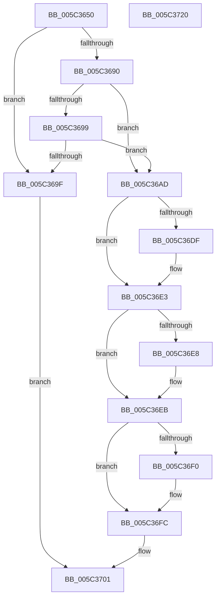

# KeQueryCurrentWaitInformationThread

- RVA: `0x005C3650`–`0x005C3721` (길이 `209` bytes)
- VA: `0x00000001405C3650`
- 실행 섹션: `.text`
- PDB 이름 있음: `예`; PDB Function 태그: `아니요`
- unwind 정보 RVA: `0x0005D79C`
- 디코드: `64`개 명령, `209/209` bytes 표시
- 미해석 바이트: `0` (있으면 어셈블리에 `.byte`로 보존)

> 이 문서는 커널 이미지의 기계어와 PDB 기호를 분석해 생성했습니다. 4번과 5번은 함수 원형과 자료형을 바이너리 사용 방식에서 추정한 C 해석이며 원본 소스 복구 결과는 아닙니다.

## 1. Dependencies

- 직접 호출 지점: **3**; 고유 호출 대상: **2**
- 직접 호출자로 확인된 함수: **0**
- RIP 상대 이미지 참조: **1**

### Outgoing calls
- `0x005C3681` → [KiAcquireThreadLockRaiseToDpc](../39/KiAcquireThreadLockRaiseToDpc_function_00396280.md) (function, `0x00396280`)
- `0x005C36A6` → [KiReleaseThreadLockLowerIrql](../3C/KiReleaseThreadLockLowerIrql_function_003C65D0.md) (function, `0x003C65D0`)
- `0x005C36D5` → [KiReleaseThreadLockLowerIrql](../3C/KiReleaseThreadLockLowerIrql_function_003C65D0.md) (function, `0x003C65D0`)

### Direct callers
- 이 함수 시작 RVA로 연결되는 직접 call은 확인되지 않았습니다. 간접 호출은 완전히 역산할 수 없습니다.

### Static image references
- `0x005C36F0` → RVA `0x00FC6AA0` (`ALMOSTRO`; read)

## 2. Other-region calls and transfers

- 다른 실행 섹션으로 향하는 call: **0**
- 별도 외부 분기/꼬리 이동을 확인하지 못했습니다.

## 3. Assembly (complete function range)

```asm
005C3650  48 8B C4                        mov rax, rsp
005C3653  48 89 58 10                     mov qword ptr [rax + 0x10], rbx
005C3657  48 89 68 18                     mov qword ptr [rax + 0x18], rbp
005C365B  48 89 70 20                     mov qword ptr [rax + 0x20], rsi
005C365F  57                              push rdi
005C3660  41 54                           push r12
005C3662  41 55                           push r13
005C3664  41 56                           push r14
005C3666  41 57                           push r15
005C3668  48 83 EC 20                     sub rsp, 0x20
005C366C  48 8B EA                        mov rbp, rdx
005C366F  33 DB                           xor ebx, ebx
005C3671  48 8D 50 08                     lea rdx, [rax + 8]
005C3675  88 58 08                        mov byte ptr [rax + 8], bl
005C3678  4D 8B F1                        mov r14, r9
005C367B  4D 8B F8                        mov r15, r8
005C367E  48 8B F9                        mov rdi, rcx
005C3681  E8 FA 2B DD FF                  call 0x140396280
005C3686  8A 87 84 01 00 00               mov al, byte ptr [rdi + 0x184]
005C368C  3C 05                           cmp al, 5
005C368E  75 0F                           jne 0x1405c369f
005C3690  8A 47 70                        mov al, byte ptr [rdi + 0x70]
005C3693  24 07                           and al, 7
005C3695  3C 01                           cmp al, 1
005C3697  74 14                           je 0x1405c36ad
005C3699  2C 03                           sub al, 3
005C369B  3C 03                           cmp al, 3
005C369D  76 0E                           jbe 0x1405c36ad
005C369F  8A 54 24 50                     mov dl, byte ptr [rsp + 0x50]
005C36A3  48 8B CF                        mov rcx, rdi
005C36A6  E8 25 2F E0 FF                  call 0x1403c65d0
005C36AB  EB 54                           jmp 0x1405c3701
005C36AD  44 8A AF 87 01 00 00            mov r13b, byte ptr [rdi + 0x187]
005C36B4  48 BE 20 03 00 00 80 F7 FF FF   movabs rsi, 0xfffff78000000320
005C36BE  44 0F B6 A7 83 02 00 00         movzx r12d, byte ptr [rdi + 0x283]
005C36C6  48 8B CF                        mov rcx, rdi
005C36C9  8B 36                           mov esi, dword ptr [rsi]
005C36CB  8A 54 24 50                     mov dl, byte ptr [rsp + 0x50]
005C36CF  2B B7 B4 01 00 00               sub esi, dword ptr [rdi + 0x1b4]
005C36D5  E8 F6 2E E0 FF                  call 0x1403c65d0
005C36DA  48 85 ED                        test rbp, rbp
005C36DD  74 04                           je 0x1405c36e3
005C36DF  44 88 6D 00                     mov byte ptr [rbp], r13b
005C36E3  4D 85 FF                        test r15, r15
005C36E6  74 03                           je 0x1405c36eb
005C36E8  45 89 27                        mov dword ptr [r15], r12d
005C36EB  4D 85 F6                        test r14, r14
005C36EE  74 0C                           je 0x1405c36fc
005C36F0  0F AF 35 A9 33 A0 00            imul esi, dword ptr [rip + 0xa033a9]
005C36F7  8B C6                           mov eax, esi
005C36F9  49 89 06                        mov qword ptr [r14], rax
005C36FC  BB 01 00 00 00                  mov ebx, 1
005C3701  48 8B 6C 24 60                  mov rbp, qword ptr [rsp + 0x60]
005C3706  8B C3                           mov eax, ebx
005C3708  48 8B 5C 24 58                  mov rbx, qword ptr [rsp + 0x58]
005C370D  48 8B 74 24 68                  mov rsi, qword ptr [rsp + 0x68]
005C3712  48 83 C4 20                     add rsp, 0x20
005C3716  41 5F                           pop r15
005C3718  41 5E                           pop r14
005C371A  41 5D                           pop r13
005C371C  41 5C                           pop r12
005C371E  5F                              pop rdi
005C371F  C3                              ret
005C3720  CC                              int3
```

## 4. C-style interpretation (structured pseudocode)

```c
__int64 __fastcall KeQueryCurrentWaitInformationThread(__int64 a1, __int64 a2, __int64 a3, __int64 a4)
{
    __int64 result;
    __int64 v_rbx;
    __int64 v_rsi;
    __int64 v_rsp;
    unsigned __int64 v_stack_p10;
    unsigned __int64 v_stack_p18;
    unsigned __int64 v_stack_p20;
    unsigned __int8 v_stack_p8;

    *(unsigned __int64 *)(v_rsp + 16) = v_rbx;
    *(unsigned __int64 *)(v_rsp + 24) = v_rbp;
    *(unsigned __int64 *)(v_rsp + 32) = v_rsi;
    v_rsp = (v_rsp) - (32);
    v_rbx = 0;
    *(unsigned __int8 *)(v_rsp + 8) = 0;
    result = KiAcquireThreadLockRaiseToDpc(a1, v_rsp + 8, a3, a4);
    if (((unsigned __int8)(*(unsigned __int8 *)(a1 + 388))) != 5) goto loc_005C369F;
    result = (unsigned __int8)((*(unsigned __int8 *)(a1 + 112)) & (7));
    if (((unsigned __int8)(result)) == 1) goto loc_005C36AD;
    result = (unsigned __int8)((result) - (3));
    if (((unsigned __int8)(result)) <= 3) goto loc_005C36AD;
loc_005C369F:
    result = KiReleaseThreadLockLowerIrql(a1, v_stack_p8, a3, a4);
    goto loc_005C3701;
loc_005C36AD:
    v_rsi = (unsigned int)(((unsigned int)(*(unsigned int *)(v_rsi))) - (*(unsigned int *)(a1 + 436)));
    result = KiReleaseThreadLockLowerIrql(a1, v_stack_p8, a3, a4);
    if (a2 != 0) {
        *(unsigned __int8 *)(a2) = (unsigned __int8)(*(unsigned __int8 *)(a1 + 391));
    }
    if (a3 != 0) {
        *(unsigned int *)(a3) = (unsigned int)(*(unsigned __int8 *)(a1 + 643));
    }
    if (a4 != 0) {
        v_rsi = (unsigned int)((v_rsi) * (*(unsigned int *)(v_rip + 10498985)));
        result = (unsigned int)(v_rsi);
        *(unsigned __int64 *)(a4) = result;
    }
loc_005C3701:
    v_rsp = (v_rsp) + (32);
    return 1;
}
```

## 5. (Beta) C Style

```c
int64_t KeQueryCurrentWaitInformationThread(void *Arg1, int64_t Arg2, int64_t Arg3, int64_t Arg4)
{
    uint8_t *arg1 = (uint8_t *)Arg1;

    int64_t result;
    int64_t local_rbx;
    int64_t local_rsi;
    int64_t local_rsp;
    uint64_t v_stack_p10;
    uint64_t v_stack_p18;
    uint64_t v_stack_p20;
    uint8_t v_stack_p8;

    *(uint64_t *)(local_rsp + 0x10) = local_rbx;
    *(uint64_t *)(local_rsp + 0x18) = local_rbp;
    *(uint64_t *)(local_rsp + 0x20) = local_rsi;
    local_rsp = (local_rsp) - (32);
    local_rbx = 0;
    *(uint8_t *)(local_rsp + 0x8) = 0;
    result = KiAcquireThreadLockRaiseToDpc(Arg1, local_rsp + 8, Arg3, Arg4);
    if (((uint8_t)(*(uint8_t *)(arg1 + 0x184))) != 5) goto loc_005C369F;
    result = (uint8_t)((*(uint8_t *)(arg1 + 0x70)) & (7));
    if (((uint8_t)(result)) == 1) goto loc_005C36AD;
    result = (uint8_t)((result) - (3));
    if (((uint8_t)(result)) <= 3) goto loc_005C36AD;
loc_005C369F:
    result = KiReleaseThreadLockLowerIrql(Arg1, v_stack_p8, Arg3, Arg4);
    goto loc_005C3701;
loc_005C36AD:
    local_rsi = (uint32_t)(((uint32_t)(*(uint32_t *)(local_rsi))) - (*(uint32_t *)(arg1 + 0x1B4)));
    result = KiReleaseThreadLockLowerIrql(Arg1, v_stack_p8, Arg3, Arg4);
    if (Arg2 != 0) {
        *(uint8_t *)(Arg2) = (uint8_t)(*(uint8_t *)(arg1 + 0x187));
    }
    if (Arg3 != 0) {
        *(uint32_t *)(Arg3) = (uint32_t)(*(uint8_t *)(arg1 + 0x283));
    }
    if (Arg4 != 0) {
        local_rsi = (uint32_t)((local_rsi) * (*(uint32_t *)(v_rip + 0xA033A9)));
        result = (uint32_t)(local_rsi);
        *(uint64_t *)(Arg4) = result;
    }
loc_005C3701:
    local_rsp = (local_rsp) + (32);
    return 1;
}
```

### 관측된 메모리 오프셋

구조체 형식이 확인되지 않은 접근은 인자 기준의 오프셋으로만 기록했습니다.

| 기준 인자 | 오프셋 표현 | 폭 (bit) | 접근 |
|---|---:|---:|---|
| `Arg1` | `+ 0x70` | `8` | `R` |
| `Arg1` | `+ 0x184` | `8` | `R` |
| `Arg1` | `+ 0x187` | `8` | `R` |
| `Arg1` | `+ 0x1B4` | `32` | `R` |
| `Arg1` | `+ 0x283` | `8` | `R` |

## 6. Execution-region graph

[열기: 2D/3D 그래프와 함수 탐색 컨트롤 패널](../../../control-panel.html?section=text&rva=0x005C3650&view=graph)

- 2D 그래프는 위에서 아래로 흐르고, 3D 그래프는 빈 공간을 드래그해 회전합니다. Shift+드래그는 이동, 휠은 확대·축소, 함수 노드 선택은 대상 보고서 이동입니다.

### Static fallback


