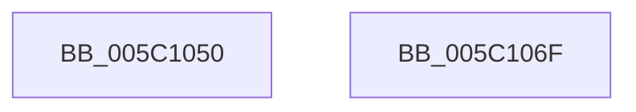

# KeQuerySystemCpuPartitionAffinity

- RVA: `0x005C1050`–`0x005C1070` (길이 `32` bytes)
- VA: `0x00000001405C1050`
- 실행 섹션: `.text`
- PDB 이름 있음: `예`; PDB Function 태그: `아니요`
- unwind 정보 RVA: `0x0005C788`
- 디코드: `9`개 명령, `32/32` bytes 표시
- 미해석 바이트: `0` (있으면 어셈블리에 `.byte`로 보존)

> 이 문서는 커널 이미지의 기계어와 PDB 기호를 분석해 생성했습니다. 4번과 5번은 함수 원형과 자료형을 바이너리 사용 방식에서 추정한 C 해석이며 원본 소스 복구 결과는 아닙니다.

## 1. Dependencies

- 직접 호출 지점: **1**; 고유 호출 대상: **1**
- 직접 호출자로 확인된 함수: **0**
- RIP 상대 이미지 참조: **1**

### Outgoing calls
- `0x005C1065` → [KeQueryCpuPartitionAffinity](KeQueryCpuPartitionAffinity_function_005C0EF8.md) (function, `0x005C0EF8`)

### Direct callers
- 이 함수 시작 RVA로 연결되는 직접 call은 확인되지 않았습니다. 간접 호출은 완전히 역산할 수 없습니다.

### Static image references
- `0x005C105E` → RVA `0x00FC6C20` (`ALMOSTRO`; read)

## 2. Other-region calls and transfers

- 다른 실행 섹션으로 향하는 call: **0**
- 별도 외부 분기/꼬리 이동을 확인하지 못했습니다.

## 3. Assembly (complete function range)

```asm
005C1050  48 83 EC 28                     sub rsp, 0x28
005C1054  4D 8B C8                        mov r9, r8
005C1057  44 0F B7 C2                     movzx r8d, dx
005C105B  48 8B D1                        mov rdx, rcx
005C105E  48 8B 0D BB 5B A0 00            mov rcx, qword ptr [rip + 0xa05bbb]
005C1065  E8 8E FE FF FF                  call 0x1405c0ef8
005C106A  48 83 C4 28                     add rsp, 0x28
005C106E  C3                              ret
005C106F  CC                              int3
```

## 4. C-style interpretation (structured pseudocode)

```c
__int64 __fastcall KeQuerySystemCpuPartitionAffinity(__int64 a1, unsigned __int16 a2, __int64 a3)
{
    __int64 result;
    __int64 v_rsp;

    v_rsp = (v_rsp) - (40);
    result = KeQueryCpuPartitionAffinity(*(unsigned __int64 *)(v_rip + 10509243), a1, a2, a3);
    v_rsp = (v_rsp) + (40);
    return result;
}
```

## 5. (Beta) C Style

```c
int64_t KeQuerySystemCpuPartitionAffinity(int64_t Arg1, uint16_t Arg2, int64_t Arg3)
{
    int64_t result;
    int64_t local_rsp;

    local_rsp = (local_rsp) - (40);
    result = KeQueryCpuPartitionAffinity(*(uint64_t *)(v_rip + 0xA05BBB), Arg1, Arg2, Arg3);
    local_rsp = (local_rsp) + (40);
    return result;
}
```

## 6. Execution-region graph

[열기: 2D/3D 그래프와 함수 탐색 컨트롤 패널](../../../control-panel.html?section=text&rva=0x005C1050&view=graph)

- 2D 그래프는 위에서 아래로 흐르고, 3D 그래프는 빈 공간을 드래그해 회전합니다. Shift+드래그는 이동, 휠은 확대·축소, 함수 노드 선택은 대상 보고서 이동입니다.

### Static fallback


