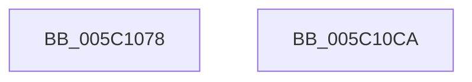

# KeRecomputeCpuSetAffinityProcess

- RVA: `0x005C1078`–`0x005C10CB` (길이 `83` bytes)
- VA: `0x00000001405C1078`
- 실행 섹션: `.text`
- PDB 이름 있음: `예`; PDB Function 태그: `아니요`
- unwind 정보 RVA: `0x0005CF00`
- 디코드: `20`개 명령, `83/83` bytes 표시
- 미해석 바이트: `0` (있으면 어셈블리에 `.byte`로 보존)

> 이 문서는 커널 이미지의 기계어와 PDB 기호를 분석해 생성했습니다. 4번과 5번은 함수 원형과 자료형을 바이너리 사용 방식에서 추정한 C 해석이며 원본 소스 복구 결과는 아닙니다.

## 1. Dependencies

- 직접 호출 지점: **4**; 고유 호출 대상: **4**
- 직접 호출자로 확인된 함수: **2**
- RIP 상대 이미지 참조: **0**

### Outgoing calls
- `0x005C1091` → [KiAcquireProcessLockExclusive](../3C/KiAcquireProcessLockExclusive_function_003C26B8.md) (function, `0x003C26B8`)
- `0x005C109E` → [KiUpdateThreadCpuSetAffinitiesProcess](KiUpdateThreadCpuSetAffinitiesProcess_function_005C1660.md) (function, `0x005C1660`)
- `0x005C10A7` → [ExReleaseSpinLockExclusiveFromDpcLevel](../24/ExReleaseSpinLockExclusiveFromDpcLevel_function_002497E0.md) (function, `0x002497E0`)
- `0x005C10BF` → [KiProcessDeferredReadyList](../25/KiProcessDeferredReadyList_function_00250800.md) (function, `0x00250800`)

### Direct callers
- [PspAssignCpuPartitionsToProcess](../../page/78/PspAssignCpuPartitionsToProcess_function_00783FB4.md) at `0x00784094`
- [NtSetInformationProcess](../../page/AE/NtSetInformationProcess_function_00AE5370.md) at `0x00AE9022`
- [NtSetInformationProcess](../../page/AE/NtSetInformationProcess_function_00AE5370.md) at `0x00AE903C`

### Static image references
- 디코드된 RIP-relative 메모리 참조가 없습니다.

## 2. Other-region calls and transfers

- 다른 실행 섹션으로 향하는 call: **0**
- 별도 외부 분기/꼬리 이동을 확인하지 못했습니다.

## 3. Assembly (complete function range)

```asm
005C1078  40 53                           push rbx
005C107A  48 83 EC 20                     sub rsp, 0x20
005C107E  48 83 64 24 38 00               and qword ptr [rsp + 0x38], 0
005C1084  48 8D 54 24 30                  lea rdx, [rsp + 0x30]
005C1089  48 8B D9                        mov rbx, rcx
005C108C  C6 44 24 30 00                  mov byte ptr [rsp + 0x30], 0
005C1091  E8 22 16 E0 FF                  call 0x1403c26b8
005C1096  48 8D 54 24 38                  lea rdx, [rsp + 0x38]
005C109B  48 8B CB                        mov rcx, rbx
005C109E  E8 BD 05 00 00                  call 0x1405c1660
005C10A3  48 8D 4B 40                     lea rcx, [rbx + 0x40]
005C10A7  E8 34 87 C8 FF                  call 0x1402497e0
005C10AC  65 48 8B 0C 25 20 00 00 00      mov rcx, qword ptr gs:[0x20]
005C10B5  48 8D 54 24 38                  lea rdx, [rsp + 0x38]
005C10BA  44 8A 44 24 30                  mov r8b, byte ptr [rsp + 0x30]
005C10BF  E8 3C F7 C8 FF                  call 0x140250800
005C10C4  48 83 C4 20                     add rsp, 0x20
005C10C8  5B                              pop rbx
005C10C9  C3                              ret
005C10CA  CC                              int3
```

## 4. C-style interpretation (structured pseudocode)

```c
__int64 __fastcall KeRecomputeCpuSetAffinityProcess(__int64 a1)
{
    __int64 result;
    __int64 v_rsp;
    unsigned __int64 v_stack_p10;
    unsigned __int64 v_stack_p8;

    v_rsp = (v_rsp) - (32);
    v_stack_p8 = 0;
    result = KiAcquireProcessLockExclusive(a1, v_stack_p8, a3, a4);
    result = KiUpdateThreadCpuSetAffinitiesProcess(a1, v_stack_p10, a3, a4);
    result = ExReleaseSpinLockExclusiveFromDpcLevel(a1 + 64, v_stack_p10, a3, a4);
    result = KiProcessDeferredReadyList(*(unsigned __int64 *)(gs_base + (0 + 32)), v_stack_p10, v_stack_p8, a4);
    v_rsp = (v_rsp) + (32);
    return result;
}
```

## 5. (Beta) C Style

```c
int64_t KeRecomputeCpuSetAffinityProcess(void *Arg1)
{
    uint8_t *arg1 = (uint8_t *)Arg1;

    int64_t result;
    int64_t local_rsp;
    uint64_t v_stack_p10;
    uint64_t v_stack_p8;

    local_rsp = (local_rsp) - (32);
    v_stack_p8 = 0;
    result = KiAcquireProcessLockExclusive(Arg1, v_stack_p8, a3, a4);
    result = KiUpdateThreadCpuSetAffinitiesProcess(Arg1, v_stack_p10, a3, a4);
    result = ExReleaseSpinLockExclusiveFromDpcLevel(Arg1 + 64, v_stack_p10, a3, a4);
    result = KiProcessDeferredReadyList(*(uint64_t *)(gs_base + (0 + 0x20)), v_stack_p10, v_stack_p8, a4);
    local_rsp = (local_rsp) + (32);
    return result;
}
```

### 관측된 메모리 오프셋

구조체 형식이 확인되지 않은 접근은 인자 기준의 오프셋으로만 기록했습니다.

| 기준 인자 | 오프셋 표현 | 폭 (bit) | 접근 |
|---|---:|---:|---|
| `Arg1` | `+ 0x40` | `64` | `R` |

## 6. Execution-region graph

[열기: 2D/3D 그래프와 함수 탐색 컨트롤 패널](../../../control-panel.html?section=text&rva=0x005C1078&view=graph)

- 2D 그래프는 위에서 아래로 흐르고, 3D 그래프는 빈 공간을 드래그해 회전합니다. Shift+드래그는 이동, 휠은 확대·축소, 함수 노드 선택은 대상 보고서 이동입니다.

### Static fallback


