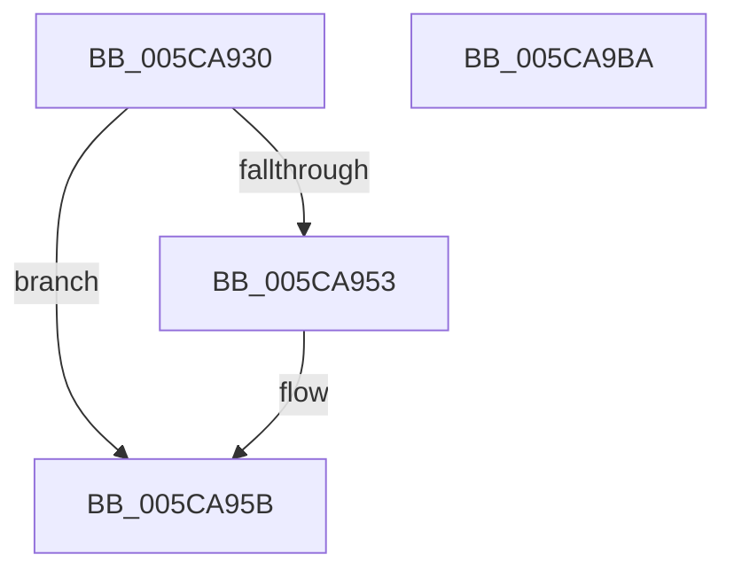

# KeRundownPriQueue

- RVA: `0x005CA930`–`0x005CA9BB` (길이 `139` bytes)
- VA: `0x00000001405CA930`
- 실행 섹션: `.text`
- PDB 이름 있음: `예`; PDB Function 태그: `아니요`
- unwind 정보 RVA: `0x0006E5F8`
- 디코드: `33`개 명령, `139/139` bytes 표시
- 미해석 바이트: `0` (있으면 어셈블리에 `.byte`로 보존)

> 이 문서는 커널 이미지의 기계어와 PDB 기호를 분석해 생성했습니다. 4번과 5번은 함수 원형과 자료형을 바이너리 사용 방식에서 추정한 C 해석이며 원본 소스 복구 결과는 아닙니다.

## 1. Dependencies

- 직접 호출 지점: **5**; 고유 호출 대상: **5**
- 직접 호출자로 확인된 함수: **1**
- RIP 상대 이미지 참조: **1**

### Outgoing calls
- `0x005CA956` → [KiRaiseIrqlProcessIrqlFlags](../4F/KiRaiseIrqlProcessIrqlFlags_function_004F56FC.md) (function, `0x004F56FC`)
- `0x005CA95E` → [KiAcquireKobjectLockSafe](../25/KiAcquireKobjectLockSafe_function_00251C90.md) (function, `0x00251C90`)
- `0x005CA97F` → [KeRundownQueueCommon](../35/KeRundownQueueCommon_function_003515F4.md) (function, `0x003515F4`)
- `0x005CA98E` → [KiAcquireReleaseObjectRundownLockExclusive](../35/KiAcquireReleaseObjectRundownLockExclusive_function_00351A0C.md) (function, `0x00351A0C`)
- `0x005CA9AA` → [KiExitDispatcher](../25/KiExitDispatcher_function_00251CF0.md) (function, `0x00251CF0`)

### Direct callers
- [ExpWorkQueueDestroy](../../page/7C/ExpWorkQueueDestroy_function_007CFE70.md) at `0x007CFEC9`

### Static image references
- `0x005CA94A` → RVA `0x00FC6D20` (`ALMOSTRO`; read)

## 2. Other-region calls and transfers

- 다른 실행 섹션으로 향하는 call: **0**
- 별도 외부 분기/꼬리 이동을 확인하지 못했습니다.

## 3. Assembly (complete function range)

```asm
005CA930  48 89 5C 24 08                  mov qword ptr [rsp + 8], rbx
005CA935  57                              push rdi
005CA936  48 83 EC 30                     sub rsp, 0x30
005CA93A  48 8B D9                        mov rbx, rcx
005CA93D  44 0F 20 C7                     mov rdi, cr8
005CA941  BA 02 00 00 00                  mov edx, 2
005CA946  44 0F 22 C2                     mov cr8, rdx
005CA94A  83 3D CF C3 9F 00 00            cmp dword ptr [rip + 0x9fc3cf], 0
005CA951  74 08                           je 0x1405ca95b
005CA953  40 8A CF                        mov cl, dil
005CA956  E8 A1 AD F2 FF                  call 0x1404f56fc
005CA95B  48 8B CB                        mov rcx, rbx
005CA95E  E8 2D 73 C8 FF                  call 0x140251c90
005CA963  4C 8D 83 18 02 00 00            lea r8, [rbx + 0x218]
005CA96A  C6 44 24 20 01                  mov byte ptr [rsp + 0x20], 1
005CA96F  48 8D 93 A0 02 00 00            lea rdx, [rbx + 0x2a0]
005CA976  41 B9 20 00 00 00               mov r9d, 0x20
005CA97C  48 8B CB                        mov rcx, rbx
005CA97F  E8 70 6C D8 FF                  call 0x1403515f4
005CA984  F0 81 23 7F FF FF FF            lock and dword ptr [rbx], 0xffffff7f
005CA98B  48 8B CB                        mov rcx, rbx
005CA98E  E8 79 70 D8 FF                  call 0x140351a0c
005CA993  65 48 8B 0C 25 20 00 00 00      mov rcx, qword ptr gs:[0x20]
005CA99C  45 33 C9                        xor r9d, r9d
005CA99F  33 D2                           xor edx, edx
005CA9A1  40 88 7C 24 20                  mov byte ptr [rsp + 0x20], dil
005CA9A6  45 8D 41 01                     lea r8d, [r9 + 1]
005CA9AA  E8 41 73 C8 FF                  call 0x140251cf0
005CA9AF  48 8B 5C 24 40                  mov rbx, qword ptr [rsp + 0x40]
005CA9B4  48 83 C4 30                     add rsp, 0x30
005CA9B8  5F                              pop rdi
005CA9B9  C3                              ret
005CA9BA  CC                              int3
```

## 4. C-style interpretation (structured pseudocode)

```c
__int64 __fastcall KeRundownPriQueue(__int64 a1)
{
    __int64 result;
    __int64 v_rsp;
    unsigned __int8 v_stack_m18;
    unsigned __int64 v_stack_p8;

    v_stack_p8 = v_rbx;
    v_rsp = (v_rsp) - (48);
    if ((*(unsigned int *)(v_rip + 10470351)) != 0) {
        a1 = (unsigned __int8)(v_cr8);
        result = KiRaiseIrqlProcessIrqlFlags(a1, 2, a3, a4);
    }
    result = KiAcquireKobjectLockSafe(a1, 2, a3, a4);
    v_stack_m18 = 1;
    result = KeRundownQueueCommon(a1, a1 + 672, a1 + 536, 32);
    result = KiAcquireReleaseObjectRundownLockExclusive(a1, a1 + 672, a1 + 536, 32);
    a4 = 0;
    a2 = 0;
    v_stack_m18 = (unsigned __int8)(v_cr8);
    result = KiExitDispatcher(*(unsigned __int64 *)(gs_base + (0 + 32)), a2, a4 + 1, a4);
    v_rsp = (v_rsp) + (48);
    return result;
}
```

## 5. (Beta) C Style

```c
int64_t KeRundownPriQueue(void *Arg1)
{
    uint8_t *arg1 = (uint8_t *)Arg1;

    int64_t result;
    int64_t local_rsp;
    uint8_t v_stack_m18;
    uint64_t v_stack_p8;

    v_stack_p8 = local_rbx;
    local_rsp = (local_rsp) - (48);
    if ((*(uint32_t *)(v_rip + 0x9FC3CF)) != 0) {
        Arg1 = (uint8_t)(v_cr8);
        result = KiRaiseIrqlProcessIrqlFlags(Arg1, 2, a3, a4);
    }
    result = KiAcquireKobjectLockSafe(Arg1, 2, a3, a4);
    v_stack_m18 = 1;
    result = KeRundownQueueCommon(Arg1, Arg1 + 672, Arg1 + 536, 32);
    result = KiAcquireReleaseObjectRundownLockExclusive(Arg1, Arg1 + 672, Arg1 + 536, 32);
    a4 = 0;
    a2 = 0;
    v_stack_m18 = (uint8_t)(v_cr8);
    result = KiExitDispatcher(*(uint64_t *)(gs_base + (0 + 0x20)), a2, a4 + 1, a4);
    local_rsp = (local_rsp) + (48);
    return result;
}
```

### 관측된 메모리 오프셋

구조체 형식이 확인되지 않은 접근은 인자 기준의 오프셋으로만 기록했습니다.

| 기준 인자 | 오프셋 표현 | 폭 (bit) | 접근 |
|---|---:|---:|---|
| `Arg1` | `+ 0x0` | `32` | `R/W` |
| `Arg1` | `+ 0x218` | `64` | `R` |
| `Arg1` | `+ 0x2A0` | `64` | `R` |

## 6. Execution-region graph

[열기: 2D/3D 그래프와 함수 탐색 컨트롤 패널](../../../control-panel.html?section=text&rva=0x005CA930&view=graph)

- 2D 그래프는 위에서 아래로 흐르고, 3D 그래프는 빈 공간을 드래그해 회전합니다. Shift+드래그는 이동, 휠은 확대·축소, 함수 노드 선택은 대상 보고서 이동입니다.

### Static fallback


