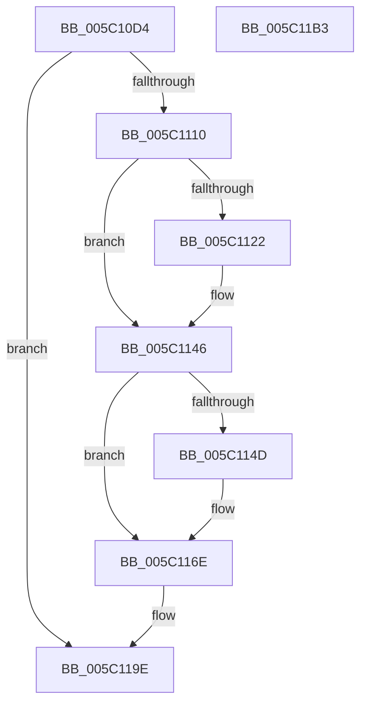

# KeSetCpuSetsProcess

- RVA: `0x005C10D4`–`0x005C11B4` (길이 `224` bytes)
- VA: `0x00000001405C10D4`
- 실행 섹션: `.text`
- PDB 이름 있음: `예`; PDB Function 태그: `아니요`
- unwind 정보 RVA: `0x00066400`
- 디코드: `59`개 명령, `224/224` bytes 표시
- 미해석 바이트: `0` (있으면 어셈블리에 `.byte`로 보존)

> 이 문서는 커널 이미지의 기계어와 PDB 기호를 분석해 생성했습니다. 4번과 5번은 함수 원형과 자료형을 바이너리 사용 방식에서 추정한 C 해석이며 원본 소스 복구 결과는 아닙니다.

## 1. Dependencies

- 직접 호출 지점: **9**; 고유 호출 대상: **7**
- 직접 호출자로 확인된 함수: **3**
- RIP 상대 이미지 참조: **0**

### Outgoing calls
- `0x005C1103` → [KiValidateCpuSetMasks](../30/KiValidateCpuSetMasks_function_00304238.md) (function, `0x00304238`)
- `0x005C1118` → [KiAcquireProcessLockExclusive](../3C/KiAcquireProcessLockExclusive_function_003C26B8.md) (function, `0x003C26B8`)
- `0x005C112F` → [KiGetProcessCpuSetMaskPointer](../4E/KiGetProcessCpuSetMaskPointer_function_004E41DC.md) (function, `0x004E41DC`)
- `0x005C1141` → [KiWriteCpuSetMasks](../4F/KiWriteCpuSetMasks_function_004FA664.md) (function, `0x004FA664`)
- `0x005C1157` → [KiGetProcessCpuSetMaskPointer](../4E/KiGetProcessCpuSetMaskPointer_function_004E41DC.md) (function, `0x004E41DC`)
- `0x005C1169` → [KiWriteCpuSetMasks](../4F/KiWriteCpuSetMasks_function_004FA664.md) (function, `0x004FA664`)
- `0x005C1176` → [KiUpdateThreadCpuSetAffinitiesProcess](KiUpdateThreadCpuSetAffinitiesProcess_function_005C1660.md) (function, `0x005C1660`)
- `0x005C117F` → [ExReleaseSpinLockExclusiveFromDpcLevel](../24/ExReleaseSpinLockExclusiveFromDpcLevel_function_002497E0.md) (function, `0x002497E0`)
- `0x005C1197` → [KiProcessDeferredReadyList](../25/KiProcessDeferredReadyList_function_00250800.md) (function, `0x00250800`)

### Direct callers
- [KiAdjustProcessCpuSetsAfterCpuPartitionChange](KiAdjustProcessCpuSetsAfterCpuPartitionChange_function_005C12DC.md) at `0x005C13F7`
- [PspAllocateProcess](../../page/A1/PspAllocateProcess_function_00A13B3C.md) at `0x00A15547`
- [NtSetInformationProcess](../../page/AE/NtSetInformationProcess_function_00AE5370.md) at `0x00AE8F9A`

### Static image references
- 디코드된 RIP-relative 메모리 참조가 없습니다.

## 2. Other-region calls and transfers

- 다른 실행 섹션으로 향하는 call: **0**
- 별도 외부 분기/꼬리 이동을 확인하지 못했습니다.

## 3. Assembly (complete function range)

```asm
005C10D4  48 8B C4                        mov rax, rsp
005C10D7  48 89 58 08                     mov qword ptr [rax + 8], rbx
005C10DB  48 89 68 10                     mov qword ptr [rax + 0x10], rbp
005C10DF  48 89 70 18                     mov qword ptr [rax + 0x18], rsi
005C10E3  57                              push rdi
005C10E4  48 83 EC 30                     sub rsp, 0x30
005C10E8  83 60 EC 00                     and dword ptr [rax - 0x14], 0
005C10EC  48 8B D9                        mov rbx, rcx
005C10EF  48 83 60 F0 00                  and qword ptr [rax - 0x10], 0
005C10F4  49 8B C8                        mov rcx, r8
005C10F7  41 8A E9                        mov bpl, r9b
005C10FA  C6 40 E8 00                     mov byte ptr [rax - 0x18], 0
005C10FE  49 8B F8                        mov rdi, r8
005C1101  8B F2                           mov esi, edx
005C1103  E8 30 31 D4 FF                  call 0x140304238
005C1108  85 C0                           test eax, eax
005C110A  0F 88 8E 00 00 00               js 0x1405c119e
005C1110  48 8D 54 24 20                  lea rdx, [rsp + 0x20]
005C1115  48 8B CB                        mov rcx, rbx
005C1118  E8 9B 15 E0 FF                  call 0x1403c26b8
005C111D  40 84 ED                        test bpl, bpl
005C1120  74 24                           je 0x1405c1146
005C1122  4C 8D 44 24 24                  lea r8, [rsp + 0x24]
005C1127  BA 01 00 00 00                  mov edx, 1
005C112C  48 8B CB                        mov rcx, rbx
005C112F  E8 A8 30 F2 FF                  call 0x1404e41dc
005C1134  8B 54 24 24                     mov edx, dword ptr [rsp + 0x24]
005C1138  48 8B C8                        mov rcx, rax
005C113B  44 8B CE                        mov r9d, esi
005C113E  4C 8B C7                        mov r8, rdi
005C1141  E8 1E 95 F3 FF                  call 0x1404fa664
005C1146  80 7C 24 60 00                  cmp byte ptr [rsp + 0x60], 0
005C114B  74 21                           je 0x1405c116e
005C114D  4C 8D 44 24 24                  lea r8, [rsp + 0x24]
005C1152  33 D2                           xor edx, edx
005C1154  48 8B CB                        mov rcx, rbx
005C1157  E8 80 30 F2 FF                  call 0x1404e41dc
005C115C  8B 54 24 24                     mov edx, dword ptr [rsp + 0x24]
005C1160  48 8B C8                        mov rcx, rax
005C1163  44 8B CE                        mov r9d, esi
005C1166  4C 8B C7                        mov r8, rdi
005C1169  E8 F6 94 F3 FF                  call 0x1404fa664
005C116E  48 8D 54 24 28                  lea rdx, [rsp + 0x28]
005C1173  48 8B CB                        mov rcx, rbx
005C1176  E8 E5 04 00 00                  call 0x1405c1660
005C117B  48 8D 4B 40                     lea rcx, [rbx + 0x40]
005C117F  E8 5C 86 C8 FF                  call 0x1402497e0
005C1184  65 48 8B 0C 25 20 00 00 00      mov rcx, qword ptr gs:[0x20]
005C118D  48 8D 54 24 28                  lea rdx, [rsp + 0x28]
005C1192  44 8A 44 24 20                  mov r8b, byte ptr [rsp + 0x20]
005C1197  E8 64 F6 C8 FF                  call 0x140250800
005C119C  33 C0                           xor eax, eax
005C119E  48 8B 5C 24 40                  mov rbx, qword ptr [rsp + 0x40]
005C11A3  48 8B 6C 24 48                  mov rbp, qword ptr [rsp + 0x48]
005C11A8  48 8B 74 24 50                  mov rsi, qword ptr [rsp + 0x50]
005C11AD  48 83 C4 30                     add rsp, 0x30
005C11B1  5F                              pop rdi
005C11B2  C3                              ret
005C11B3  CC                              int3
```

## 4. C-style interpretation (structured pseudocode)

```c
__int64 __fastcall KeSetCpuSetsProcess(__int64 a1, int a2, __int64 a3, unsigned __int8 a4, unsigned __int8 a5)
{
    __int64 result;
    __int64 v_rsp;
    unsigned __int64 v_stack_m10;
    unsigned __int64 v_stack_m14;
    unsigned __int64 v_stack_m18;
    unsigned __int64 v_stack_p10;
    unsigned __int64 v_stack_p18;
    unsigned __int64 v_stack_p8;

    *(unsigned __int64 *)(v_rsp + 8) = v_rbx;
    *(unsigned __int64 *)(v_rsp + 16) = v_rbp;
    *(unsigned __int64 *)(v_rsp + 24) = v_rsi;
    v_rsp = (v_rsp) - (48);
    *(unsigned __int8 *)(v_rsp - 24) = 0;
    result = KiValidateCpuSetMasks(a3, a2, a3, a4);
    if (sign_flag) goto loc_005C119E;
    result = KiAcquireProcessLockExclusive(a1, v_stack_m18, a3, a4);
    if (a4 != 0) {
        a3 = v_stack_m14;
        a2 = 1;
        a1 = a1;
        result = KiGetProcessCpuSetMaskPointer(a1, a2, a3, a4);
        a2 = v_stack_m14;
        a1 = result;
        a4 = (unsigned int)((unsigned int)(a2));
        a3 = a3;
        result = KiWriteCpuSetMasks(a1, a2, a3, a4);
    }
    if (a5 != 0) {
        a3 = v_stack_m14;
        a2 = 0;
        a1 = a1;
        result = KiGetProcessCpuSetMaskPointer(a1, a2, a3, a4);
        a2 = v_stack_m14;
        a1 = result;
        a4 = (unsigned int)((unsigned int)(a2));
        a3 = a3;
        result = KiWriteCpuSetMasks(a1, a2, a3, a4);
    }
    result = KiUpdateThreadCpuSetAffinitiesProcess(a1, v_stack_m10, a3, a4);
    result = ExReleaseSpinLockExclusiveFromDpcLevel(a1 + 64, v_stack_m10, a3, a4);
    result = KiProcessDeferredReadyList(*(unsigned __int64 *)(gs_base + (0 + 32)), v_stack_m10, v_stack_m18, a4);
    result = 0;
loc_005C119E:
    v_rsp = (v_rsp) + (48);
    return result;
}
```

## 5. (Beta) C Style

```c
int64_t KeSetCpuSetsProcess(void *Arg1, int32_t Arg2, int64_t Arg3, uint8_t Arg4, uint8_t Arg5)
{
    uint8_t *arg1 = (uint8_t *)Arg1;

    int64_t result;
    int64_t local_rsp;
    uint64_t v_stack_m10;
    uint64_t v_stack_m14;
    uint64_t v_stack_m18;
    uint64_t v_stack_p10;
    uint64_t v_stack_p18;
    uint64_t v_stack_p8;

    *(uint64_t *)(local_rsp + 0x8) = local_rbx;
    *(uint64_t *)(local_rsp + 0x10) = local_rbp;
    *(uint64_t *)(local_rsp + 0x18) = local_rsi;
    local_rsp = (local_rsp) - (48);
    *(uint8_t *)(local_rsp - 0x18) = 0;
    result = KiValidateCpuSetMasks(Arg3, Arg2, Arg3, Arg4);
    if (sign_flag) goto loc_005C119E;
    result = KiAcquireProcessLockExclusive(Arg1, v_stack_m18, Arg3, Arg4);
    if (Arg4 != 0) {
        Arg3 = v_stack_m14;
        Arg2 = 1;
        Arg1 = Arg1;
        result = KiGetProcessCpuSetMaskPointer(Arg1, Arg2, Arg3, Arg4);
        Arg2 = v_stack_m14;
        Arg1 = result;
        Arg4 = (uint32_t)((uint32_t)(Arg2));
        Arg3 = Arg3;
        result = KiWriteCpuSetMasks(Arg1, Arg2, Arg3, Arg4);
    }
    if (Arg5 != 0) {
        Arg3 = v_stack_m14;
        Arg2 = 0;
        Arg1 = Arg1;
        result = KiGetProcessCpuSetMaskPointer(Arg1, Arg2, Arg3, Arg4);
        Arg2 = v_stack_m14;
        Arg1 = result;
        Arg4 = (uint32_t)((uint32_t)(Arg2));
        Arg3 = Arg3;
        result = KiWriteCpuSetMasks(Arg1, Arg2, Arg3, Arg4);
    }
    result = KiUpdateThreadCpuSetAffinitiesProcess(Arg1, v_stack_m10, Arg3, Arg4);
    result = ExReleaseSpinLockExclusiveFromDpcLevel(Arg1 + 64, v_stack_m10, Arg3, Arg4);
    result = KiProcessDeferredReadyList(*(uint64_t *)(gs_base + (0 + 0x20)), v_stack_m10, v_stack_m18, Arg4);
    result = 0;
loc_005C119E:
    local_rsp = (local_rsp) + (48);
    return result;
}
```

### 관측된 메모리 오프셋

구조체 형식이 확인되지 않은 접근은 인자 기준의 오프셋으로만 기록했습니다.

| 기준 인자 | 오프셋 표현 | 폭 (bit) | 접근 |
|---|---:|---:|---|
| `Arg1` | `+ 0x40` | `64` | `R` |

## 6. Execution-region graph

[열기: 2D/3D 그래프와 함수 탐색 컨트롤 패널](../../../control-panel.html?section=text&rva=0x005C10D4&view=graph)

- 2D 그래프는 위에서 아래로 흐르고, 3D 그래프는 빈 공간을 드래그해 회전합니다. Shift+드래그는 이동, 휠은 확대·축소, 함수 노드 선택은 대상 보고서 이동입니다.

### Static fallback


