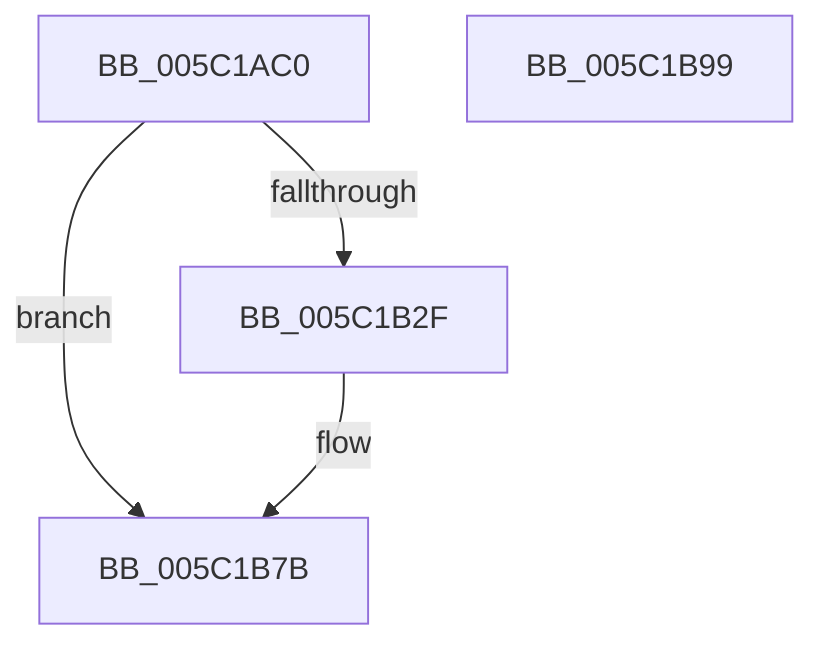

# KeSetExpectedConcurrencyCountProcess

- RVA: `0x005C1AC0`–`0x005C1B9A` (길이 `218` bytes)
- VA: `0x00000001405C1AC0`
- 실행 섹션: `.text`
- PDB 이름 있음: `예`; PDB Function 태그: `아니요`
- unwind 정보 RVA: `0x000BF160`
- 디코드: `58`개 명령, `218/218` bytes 표시
- 미해석 바이트: `0` (있으면 어셈블리에 `.byte`로 보존)

> 이 문서는 커널 이미지의 기계어와 PDB 기호를 분석해 생성했습니다. 4번과 5번은 함수 원형과 자료형을 바이너리 사용 방식에서 추정한 C 해석이며 원본 소스 복구 결과는 아닙니다.

## 1. Dependencies

- 직접 호출 지점: **8**; 고유 호출 대상: **8**
- 직접 호출자로 확인된 함수: **1**
- RIP 상대 이미지 참조: **1**

### Outgoing calls
- `0x005C1AF3` → [KiInitializeProcessConcurrencyCount](../47/KiInitializeProcessConcurrencyCount_function_0047E2DC.md) (function, `0x0047E2DC`)
- `0x005C1B06` → [KiAcquireProcessLockExclusive](../3C/KiAcquireProcessLockExclusive_function_003C26B8.md) (function, `0x003C26B8`)
- `0x005C1B15` → [KiSetProcessConcurrencyCount](../24/KiSetProcessConcurrencyCount_function_00249F2C.md) (function, `0x00249F2C`)
- `0x005C1B24` → [KiReleaseProcessLockExclusive](../3C/KiReleaseProcessLockExclusive_function_003C2660.md) (function, `0x003C2660`)
- `0x005C1B47` → [KiStackAttachProcess](../21/KiStackAttachProcess_function_00216820.md) (function, `0x00216820`)
- `0x005C1B6B` → [MmAdjustWorkingSetSizeEx](../47/MmAdjustWorkingSetSizeEx_function_0047D8D4.md) (function, `0x0047D8D4`)
- `0x005C1B76` → [KiUnstackDetachProcess](../21/KiUnstackDetachProcess_function_00217D30.md) (function, `0x00217D30`)
- `0x005C1B82` → [_security_check_cookie](../6A/_security_check_cookie_function_006AC640.md) (function, `0x006AC640`)

### Direct callers
- [PspAllocateProcess](../../page/A1/PspAllocateProcess_function_00A13B3C.md) at `0x00A15560`

### Static image references
- `0x005C1AD2` → RVA `0x00E0A740` (`.data`; read)

## 2. Other-region calls and transfers

- 다른 실행 섹션으로 향하는 call: **0**
- 별도 외부 분기/꼬리 이동을 확인하지 못했습니다.

## 3. Assembly (complete function range)

```asm
005C1AC0  48 89 5C 24 10                  mov qword ptr [rsp + 0x10], rbx
005C1AC5  48 89 7C 24 18                  mov qword ptr [rsp + 0x18], rdi
005C1ACA  55                              push rbp
005C1ACB  48 8B EC                        mov rbp, rsp
005C1ACE  48 83 EC 70                     sub rsp, 0x70
005C1AD2  48 8B 05 67 8C 84 00            mov rax, qword ptr [rip + 0x848c67]
005C1AD9  48 33 C4                        xor rax, rsp
005C1ADC  48 89 45 F8                     mov qword ptr [rbp - 8], rax
005C1AE0  83 65 C4 00                     and dword ptr [rbp - 0x3c], 0
005C1AE4  48 8B F9                        mov rdi, rcx
005C1AE7  48 8D 4D C4                     lea rcx, [rbp - 0x3c]
005C1AEB  C6 45 C1 00                     mov byte ptr [rbp - 0x3f], 0
005C1AEF  C6 45 C0 00                     mov byte ptr [rbp - 0x40], 0
005C1AF3  E8 E4 C7 EB FF                  call 0x14047e2dc
005C1AF8  48 8B 9F B8 00 00 00            mov rbx, qword ptr [rdi + 0xb8]
005C1AFF  48 8D 55 C1                     lea rdx, [rbp - 0x3f]
005C1B03  48 8B CF                        mov rcx, rdi
005C1B06  E8 AD 0B E0 FF                  call 0x1403c26b8
005C1B0B  8B 55 C4                        mov edx, dword ptr [rbp - 0x3c]
005C1B0E  4C 8D 45 C0                     lea r8, [rbp - 0x40]
005C1B12  48 8B CF                        mov rcx, rdi
005C1B15  E8 12 84 C8 FF                  call 0x140249f2c
005C1B1A  8A 55 C1                        mov dl, byte ptr [rbp - 0x3f]
005C1B1D  48 8B CF                        mov rcx, rdi
005C1B20  83 4B 0C 01                     or dword ptr [rbx + 0xc], 1
005C1B24  E8 37 0B E0 FF                  call 0x1403c2660
005C1B29  80 7D C0 00                     cmp byte ptr [rbp - 0x40], 0
005C1B2D  74 4C                           je 0x1405c1b7b
005C1B2F  0F 57 C0                        xorps xmm0, xmm0
005C1B32  4C 8D 45 C8                     lea r8, [rbp - 0x38]
005C1B36  33 D2                           xor edx, edx
005C1B38  48 8B CF                        mov rcx, rdi
005C1B3B  0F 11 45 C8                     movups xmmword ptr [rbp - 0x38], xmm0
005C1B3F  0F 11 45 D8                     movups xmmword ptr [rbp - 0x28], xmm0
005C1B43  0F 11 45 E8                     movups xmmword ptr [rbp - 0x18], xmm0
005C1B47  E8 D4 4C C5 FF                  call 0x140216820
005C1B4C  48 8D 45 C0                     lea rax, [rbp - 0x40]
005C1B50  C6 45 C0 00                     mov byte ptr [rbp - 0x40], 0
005C1B54  48 83 C9 FF                     or rcx, 0xffffffffffffffff
005C1B58  48 89 44 24 28                  mov qword ptr [rsp + 0x28], rax
005C1B5D  83 64 24 20 00                  and dword ptr [rsp + 0x20], 0
005C1B62  48 8B D1                        mov rdx, rcx
005C1B65  45 33 C9                        xor r9d, r9d
005C1B68  45 33 C0                        xor r8d, r8d
005C1B6B  E8 64 BD EB FF                  call 0x14047d8d4
005C1B70  33 D2                           xor edx, edx
005C1B72  48 8D 4D C8                     lea rcx, [rbp - 0x38]
005C1B76  E8 B5 61 C5 FF                  call 0x140217d30
005C1B7B  48 8B 4D F8                     mov rcx, qword ptr [rbp - 8]
005C1B7F  48 33 CC                        xor rcx, rsp
005C1B82  E8 B9 AA 0E 00                  call 0x1406ac640
005C1B87  4C 8D 5C 24 70                  lea r11, [rsp + 0x70]
005C1B8C  49 8B 5B 18                     mov rbx, qword ptr [r11 + 0x18]
005C1B90  49 8B 7B 20                     mov rdi, qword ptr [r11 + 0x20]
005C1B94  49 8B E3                        mov rsp, r11
005C1B97  5D                              pop rbp
005C1B98  C3                              ret
005C1B99  CC                              int3
```

## 4. C-style interpretation (structured pseudocode)

```c
__int64 __fastcall KeSetExpectedConcurrencyCountProcess(__int64 a1, __int64 a2, __int64 a3, int a4)
{
    __int64 result;
    __int64 v_rsp;
    unsigned __int64 v_stack_m10;
    unsigned __int64 v_stack_m20;
    unsigned __int64 v_stack_m30;
    unsigned __int64 v_stack_m40;
    unsigned int v_stack_m44;
    unsigned __int8 v_stack_m47;
    unsigned __int8 v_stack_m48;
    unsigned __int64 v_stack_m50;
    unsigned int v_stack_m58;
    unsigned __int64 v_stack_m8;
    unsigned __int64 v_stack_p10;
    unsigned __int64 v_stack_p18;

    v_stack_p10 = v_rbx;
    v_stack_p18 = v_rdi;
    v_rsp = (v_rsp) - (112);
    result = (*(unsigned __int64 *)(v_rip + 8686695)) ^ (v_rsp);
    v_stack_m10 = result;
    v_stack_m47 = 0;
    v_stack_m48 = 0;
    result = KiInitializeProcessConcurrencyCount(v_stack_m44, a2, a3, a4);
    result = KiAcquireProcessLockExclusive(a1, v_stack_m47, a3, a4);
    result = KiSetProcessConcurrencyCount(a1, (unsigned int)(v_stack_m44), v_stack_m48, a4);
    result = KiReleaseProcessLockExclusive(a1, v_stack_m47, v_stack_m48, a4);
    if (v_stack_m48 != 0) {
        a3 = v_stack_m40;
        a2 = 0;
        a1 = a1;
        v_stack_m40 = v_xmm0;
        v_stack_m30 = v_xmm0;
        v_stack_m20 = v_xmm0;
        result = KiStackAttachProcess(a1, a2, a3, a4);
        result = v_stack_m48;
        v_stack_m48 = 0;
        a1 = (a1) | (-1);
        v_stack_m50 = result;
        a2 = a1;
        a4 = 0;
        a3 = 0;
        result = MmAdjustWorkingSetSizeEx(a1, a2, a3, a4);
        a2 = 0;
        a1 = v_stack_m40;
        result = KiUnstackDetachProcess(a1, a2, a3, a4);
    }
    a1 = (v_stack_m10) ^ (v_rsp);
    result = _security_check_cookie(a1, a2, a3, a4);
    return result;
}
```

## 5. (Beta) C Style

```c
int64_t KeSetExpectedConcurrencyCountProcess(void *Arg1, int64_t Arg2, int64_t Arg3, int32_t Arg4)
{
    uint8_t *arg1 = (uint8_t *)Arg1;

    int64_t result;
    int64_t local_rsp;
    uint64_t v_stack_m10;
    uint64_t v_stack_m20;
    uint64_t v_stack_m30;
    uint64_t v_stack_m40;
    uint32_t v_stack_m44;
    uint8_t v_stack_m47;
    uint8_t v_stack_m48;
    uint64_t v_stack_m50;
    uint32_t v_stack_m58;
    uint64_t v_stack_m8;
    uint64_t v_stack_p10;
    uint64_t v_stack_p18;

    v_stack_p10 = local_rbx;
    v_stack_p18 = local_rdi;
    local_rsp = (local_rsp) - (112);
    result = (*(uint64_t *)(v_rip + 0x848C67)) ^ (local_rsp);
    v_stack_m10 = result;
    v_stack_m47 = 0;
    v_stack_m48 = 0;
    result = KiInitializeProcessConcurrencyCount(v_stack_m44, Arg2, Arg3, Arg4);
    result = KiAcquireProcessLockExclusive(Arg1, v_stack_m47, Arg3, Arg4);
    result = KiSetProcessConcurrencyCount(Arg1, (uint32_t)(v_stack_m44), v_stack_m48, Arg4);
    result = KiReleaseProcessLockExclusive(Arg1, v_stack_m47, v_stack_m48, Arg4);
    if (v_stack_m48 != 0) {
        Arg3 = v_stack_m40;
        Arg2 = 0;
        Arg1 = Arg1;
        v_stack_m40 = v_xmm0;
        v_stack_m30 = v_xmm0;
        v_stack_m20 = v_xmm0;
        result = KiStackAttachProcess(Arg1, Arg2, Arg3, Arg4);
        result = v_stack_m48;
        v_stack_m48 = 0;
        Arg1 = (Arg1) | (-1);
        v_stack_m50 = result;
        Arg2 = Arg1;
        Arg4 = 0;
        Arg3 = 0;
        result = MmAdjustWorkingSetSizeEx(Arg1, Arg2, Arg3, Arg4);
        Arg2 = 0;
        Arg1 = v_stack_m40;
        result = KiUnstackDetachProcess(Arg1, Arg2, Arg3, Arg4);
    }
    Arg1 = (v_stack_m10) ^ (local_rsp);
    result = _security_check_cookie(Arg1, Arg2, Arg3, Arg4);
    return result;
}
```

### 관측된 메모리 오프셋

구조체 형식이 확인되지 않은 접근은 인자 기준의 오프셋으로만 기록했습니다.

| 기준 인자 | 오프셋 표현 | 폭 (bit) | 접근 |
|---|---:|---:|---|
| `Arg1` | `+ 0xB8` | `64` | `R` |

## 6. Execution-region graph

[열기: 2D/3D 그래프와 함수 탐색 컨트롤 패널](../../../control-panel.html?section=text&rva=0x005C1AC0&view=graph)

- 2D 그래프는 위에서 아래로 흐르고, 3D 그래프는 빈 공간을 드래그해 회전합니다. Shift+드래그는 이동, 휠은 확대·축소, 함수 노드 선택은 대상 보고서 이동입니다.

### Static fallback


