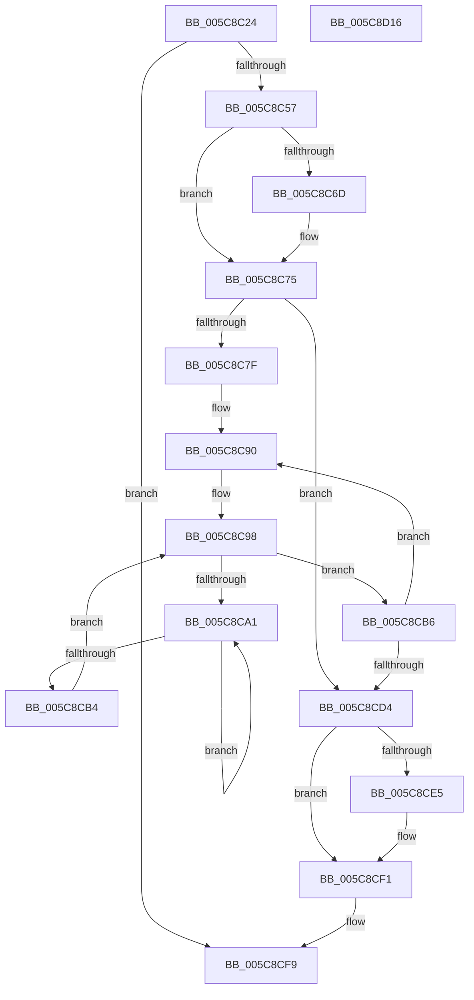

# KeSetSchedulingGroupCycleNotification

- RVA: `0x005C8C24`–`0x005C8D17` (길이 `243` bytes)
- VA: `0x00000001405C8C24`
- 실행 섹션: `.text`
- PDB 이름 있음: `예`; PDB Function 태그: `아니요`
- unwind 정보 RVA: `0x0005D79C`
- 디코드: `65`개 명령, `243/243` bytes 표시
- 미해석 바이트: `0` (있으면 어셈블리에 `.byte`로 보존)

> 이 문서는 커널 이미지의 기계어와 PDB 기호를 분석해 생성했습니다. 4번과 5번은 함수 원형과 자료형을 바이너리 사용 방식에서 추정한 C 해석이며 원본 소스 복구 결과는 아닙니다.

## 1. Dependencies

- 직접 호출 지점: **3**; 고유 호출 대상: **3**
- 직접 호출자로 확인된 함수: **1**
- RIP 상대 이미지 참조: **3**

### Outgoing calls
- `0x005C8C70` → [KiRaiseIrqlProcessIrqlFlags](../4F/KiRaiseIrqlProcessIrqlFlags_function_004F56FC.md) (function, `0x004F56FC`)
- `0x005C8CA6` → [KeYieldProcessorEx](../3F/KeYieldProcessorEx_function_003FBD00.md) (function, `0x003FBD00`)
- `0x005C8CEC` → [KiLowerIrqlProcessIrqlFlags](../4F/KiLowerIrqlProcessIrqlFlags_function_004F5698.md) (function, `0x004F5698`)

### Direct callers
- [NtSetInformationJobObject](../../page/9F/NtSetInformationJobObject_function_009F84C0.md) at `0x009F9AFC`

### Static image references
- `0x005C8C64` → RVA `0x00FC6D20` (`ALMOSTRO`; read)
- `0x005C8C75` → RVA `0x00FC6A80` (`ALMOSTRO`; read)
- `0x005C8C7F` → RVA `0x00FC8C40` (`ALMOSTRO`; read)

## 2. Other-region calls and transfers

- 다른 실행 섹션으로 향하는 call: **0**
- 별도 외부 분기/꼬리 이동을 확인하지 못했습니다.

## 3. Assembly (complete function range)

```asm
005C8C24  48 89 5C 24 10                  mov qword ptr [rsp + 0x10], rbx
005C8C29  48 89 6C 24 18                  mov qword ptr [rsp + 0x18], rbp
005C8C2E  48 89 74 24 20                  mov qword ptr [rsp + 0x20], rsi
005C8C33  57                              push rdi
005C8C34  41 54                           push r12
005C8C36  41 55                           push r13
005C8C38  41 56                           push r14
005C8C3A  41 57                           push r15
005C8C3C  48 83 EC 20                     sub rsp, 0x20
005C8C40  48 83 61 20 00                  and qword ptr [rcx + 0x20], 0
005C8C45  49 8B F0                        mov rsi, r8
005C8C48  4C 8B EA                        mov r13, rdx
005C8C4B  48 8B D9                        mov rbx, rcx
005C8C4E  4D 85 C0                        test r8, r8
005C8C51  0F 84 A2 00 00 00               je 0x1405c8cf9
005C8C57  44 0F 20 C7                     mov rdi, cr8
005C8C5B  BA 02 00 00 00                  mov edx, 2
005C8C60  44 0F 22 C2                     mov cr8, rdx
005C8C64  83 3D B5 E0 9F 00 00            cmp dword ptr [rip + 0x9fe0b5], 0
005C8C6B  74 08                           je 0x1405c8c75
005C8C6D  40 8A CF                        mov cl, dil
005C8C70  E8 87 CA F2 FF                  call 0x1404f56fc
005C8C75  8B 05 05 DE 9F 00               mov eax, dword ptr [rip + 0x9fde05]
005C8C7B  85 C0                           test eax, eax
005C8C7D  74 55                           je 0x1405c8cd4
005C8C7F  4C 8D 3D BA FF 9F 00            lea r15, [rip + 0x9fffba]
005C8C86  44 8B E0                        mov r12d, eax
005C8C89  4C 8D B3 80 00 00 00            lea r14, [rbx + 0x80]
005C8C90  49 8B 2F                        mov rbp, qword ptr [r15]
005C8C93  83 64 24 50 00                  and dword ptr [rsp + 0x50], 0
005C8C98  F0 48 0F BA 6D 30 00            lock bts qword ptr [rbp + 0x30], 0
005C8C9F  73 15                           jae 0x1405c8cb6
005C8CA1  48 8D 4C 24 50                  lea rcx, [rsp + 0x50]
005C8CA6  E8 55 30 E3 FF                  call 0x1403fbd00
005C8CAB  48 8B 45 30                     mov rax, qword ptr [rbp + 0x30]
005C8CAF  48 85 C0                        test rax, rax
005C8CB2  75 ED                           jne 0x1405c8ca1
005C8CB4  EB E2                           jmp 0x1405c8c98
005C8CB6  49 8B 06                        mov rax, qword ptr [r14]
005C8CB9  49 89 46 28                     mov qword ptr [r14 + 0x28], rax
005C8CBD  F0 48 83 65 30 00               lock and qword ptr [rbp + 0x30], 0
005C8CC3  49 83 C7 08                     add r15, 8
005C8CC7  49 81 C6 B8 01 00 00            add r14, 0x1b8
005C8CCE  49 83 EC 01                     sub r12, 1
005C8CD2  75 BC                           jne 0x1405c8c90
005C8CD4  4C 89 6B 48                     mov qword ptr [rbx + 0x48], r13
005C8CD8  48 87 73 20                     xchg qword ptr [rbx + 0x20], rsi
005C8CDC  83 3D 3D E0 9F 00 00            cmp dword ptr [rip + 0x9fe03d], 0
005C8CE3  74 0C                           je 0x1405c8cf1
005C8CE5  44 0F 20 C1                     mov rcx, cr8
005C8CE9  40 8A D7                        mov dl, dil
005C8CEC  E8 A7 C9 F2 FF                  call 0x1404f5698
005C8CF1  40 0F B6 C7                     movzx eax, dil
005C8CF5  44 0F 22 C0                     mov cr8, rax
005C8CF9  48 8B 5C 24 58                  mov rbx, qword ptr [rsp + 0x58]
005C8CFE  48 8B 6C 24 60                  mov rbp, qword ptr [rsp + 0x60]
005C8D03  48 8B 74 24 68                  mov rsi, qword ptr [rsp + 0x68]
005C8D08  48 83 C4 20                     add rsp, 0x20
005C8D0C  41 5F                           pop r15
005C8D0E  41 5E                           pop r14
005C8D10  41 5D                           pop r13
005C8D12  41 5C                           pop r12
005C8D14  5F                              pop rdi
005C8D15  C3                              ret
005C8D16  CC                              int3
```

## 4. C-style interpretation (structured pseudocode)

```c
__int64 __fastcall KeSetSchedulingGroupCycleNotification(__int64 a1, __int64 a2, __int64 a3)
{
    __int64 result;
    __int64 v_r12;
    __int64 v_r14;
    __int64 v_r15;
    __int64 v_rsp;
    unsigned __int64 v_stack_p10;
    unsigned __int64 v_stack_p18;
    unsigned __int64 v_stack_p20;
    unsigned int v_stack_p8;

    v_stack_p10 = v_rbx;
    v_stack_p18 = v_rbp;
    v_stack_p20 = v_rsi;
    v_rsp = (v_rsp) - (32);
    if (a3 == 0) goto loc_005C8CF9;
    if ((*(unsigned int *)(v_rip + 10477749)) != 0) {
        a1 = (unsigned __int8)(v_cr8);
        result = KiRaiseIrqlProcessIrqlFlags(a1, 2, a3, a4);
    }
    if ((unsigned int)((unsigned int)(*(unsigned int *)(v_rip + 10477061))) == 0) goto loc_005C8CD4;
loc_005C8C90:
loc_005C8C98:
    if (condition_is_above_or_equal) goto loc_005C8CB6;
loc_005C8CA1:
    result = KeYieldProcessorEx(v_stack_p8, 2, a3, a4);
    if (*(unsigned __int64 *)(*(unsigned __int64 *)(v_rip + 10485690) + 48) != 0) goto loc_005C8CA1;
    goto loc_005C8C98;
loc_005C8CB6:
    *(unsigned __int64 *)(a1 + 128 + 40) = *(unsigned __int64 *)(a1 + 128);
    v_r15 = (v_rip + 10485690) + (8);
    v_r14 = (a1 + 128) + (440);
    v_r12 = ((unsigned int)((unsigned int)((unsigned int)(*(unsigned int *)(v_rip + 10477061))))) - (1);
    if (condition_is_not_equal) goto loc_005C8C90;
loc_005C8CD4:
    *(unsigned __int64 *)(a1 + 72) = a2;
    result = *(unsigned __int64 *)(a1 + 128);
    if ((*(unsigned int *)(v_rip + 10477629)) != 0) {
        a1 = 2;
        a2 = (unsigned __int8)(v_cr8);
        result = KiLowerIrqlProcessIrqlFlags(a1, a2, a3, a4);
    }
loc_005C8CF9:
    v_rsp = (v_rsp) + (32);
    return (unsigned __int8)(v_cr8);
}
```

## 5. (Beta) C Style

```c
int64_t KeSetSchedulingGroupCycleNotification(void *Arg1, int64_t Arg2, int64_t Arg3)
{
    uint8_t *arg1 = (uint8_t *)Arg1;

    int64_t result;
    int64_t local_r12;
    int64_t local_r14;
    int64_t local_r15;
    int64_t local_rsp;
    uint64_t v_stack_p10;
    uint64_t v_stack_p18;
    uint64_t v_stack_p20;
    uint32_t v_stack_p8;

    v_stack_p10 = local_rbx;
    v_stack_p18 = local_rbp;
    v_stack_p20 = local_rsi;
    local_rsp = (local_rsp) - (32);
    if (Arg3 == 0) goto loc_005C8CF9;
    if ((*(uint32_t *)(v_rip + 0x9FE0B5)) != 0) {
        Arg1 = (uint8_t)(v_cr8);
        result = KiRaiseIrqlProcessIrqlFlags(Arg1, 2, Arg3, a4);
    }
    if ((uint32_t)((uint32_t)(*(uint32_t *)(v_rip + 0x9FDE05))) == 0) goto loc_005C8CD4;
loc_005C8C90:
loc_005C8C98:
    if (condition_is_above_or_equal) goto loc_005C8CB6;
loc_005C8CA1:
    result = KeYieldProcessorEx(v_stack_p8, 2, Arg3, a4);
    if (*(uint64_t *)(*(uint64_t *)(v_rip + 0x9FFFBA) + 0x30) != 0) goto loc_005C8CA1;
    goto loc_005C8C98;
loc_005C8CB6:
    *(uint64_t *)(arg1 + 0x80 + 0x28) = *(uint64_t *)(arg1 + 0x80);
    local_r15 = (v_rip + 10485690) + (8);
    local_r14 = (Arg1 + 128) + (440);
    local_r12 = ((uint32_t)((uint32_t)((uint32_t)(*(uint32_t *)(v_rip + 0x9FDE05))))) - (1);
    if (condition_is_not_equal) goto loc_005C8C90;
loc_005C8CD4:
    *(uint64_t *)(arg1 + 0x48) = Arg2;
    result = *(uint64_t *)(arg1 + 0x80);
    if ((*(uint32_t *)(v_rip + 0x9FE03D)) != 0) {
        Arg1 = 2;
        Arg2 = (uint8_t)(v_cr8);
        result = KiLowerIrqlProcessIrqlFlags(Arg1, Arg2, Arg3, a4);
    }
loc_005C8CF9:
    local_rsp = (local_rsp) + (32);
    return (uint8_t)(v_cr8);
}
```

### 관측된 메모리 오프셋

구조체 형식이 확인되지 않은 접근은 인자 기준의 오프셋으로만 기록했습니다.

| 기준 인자 | 오프셋 표현 | 폭 (bit) | 접근 |
|---|---:|---:|---|
| `Arg1` | `+ 0x0` | `64` | `R` |
| `Arg1` | `+ 0x20` | `64` | `R/W` |
| `Arg1` | `+ 0x28` | `64` | `W` |
| `Arg1` | `+ 0x48` | `64` | `W` |
| `Arg1` | `+ 0x80` | `64` | `R` |

## 6. Execution-region graph

[열기: 2D/3D 그래프와 함수 탐색 컨트롤 패널](../../../control-panel.html?section=text&rva=0x005C8C24&view=graph)

- 2D 그래프는 위에서 아래로 흐르고, 3D 그래프는 빈 공간을 드래그해 회전합니다. Shift+드래그는 이동, 휠은 확대·축소, 함수 노드 선택은 대상 보고서 이동입니다.

### Static fallback


