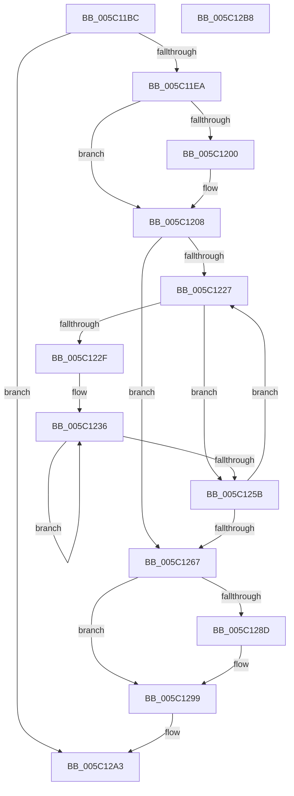

# KeSetTagCpuSets

- RVA: `0x005C11BC`–`0x005C12B9` (길이 `253` bytes)
- VA: `0x00000001405C11BC`
- 실행 섹션: `.text`
- PDB 이름 있음: `예`; PDB Function 태그: `아니요`
- unwind 정보 RVA: `0x0005C954`
- 디코드: `66`개 명령, `253/253` bytes 표시
- 미해석 바이트: `0` (있으면 어셈블리에 `.byte`로 보존)

> 이 문서는 커널 이미지의 기계어와 PDB 기호를 분석해 생성했습니다. 4번과 5번은 함수 원형과 자료형을 바이너리 사용 방식에서 추정한 C 해석이며 원본 소스 복구 결과는 아닙니다.

## 1. Dependencies

- 직접 호출 지점: **6**; 고유 호출 대상: **6**
- 직접 호출자로 확인된 함수: **1**
- RIP 상대 이미지 참조: **5**

### Outgoing calls
- `0x005C11DD` → [KiValidateCpuSetMasks](../30/KiValidateCpuSetMasks_function_00304238.md) (function, `0x00304238`)
- `0x005C1203` → [KiRaiseIrqlProcessIrqlFlags](../4F/KiRaiseIrqlProcessIrqlFlags_function_004F56FC.md) (function, `0x004F56FC`)
- `0x005C120F` → [KeAcquireSpinLockAtDpcLevel](../20/KeAcquireSpinLockAtDpcLevel_function_00208430.md) (function, `0x00208430`)
- `0x005C121B` → [RtlWriteAcquireTickLock](../39/RtlWriteAcquireTickLock_function_0039D3B4.md) (function, `0x0039D3B4`)
- `0x005C127F` → [KxReleaseSpinLock](../20/KxReleaseSpinLock_function_00206670.md) (function, `0x00206670`)
- `0x005C1294` → [KiLowerIrqlProcessIrqlFlags](../4F/KiLowerIrqlProcessIrqlFlags_function_004F5698.md) (function, `0x004F5698`)

### Direct callers
- [NtSetSystemInformation](../../page/AF/NtSetSystemInformation_function_00AF4A60.md) at `0x00AF61A9`

### Static image references
- `0x005C11F7` → RVA `0x00FC6D20` (`ALMOSTRO`; read)
- `0x005C1208` → RVA `0x00F23440` (`.data`; read)
- `0x005C1214` → RVA `0x00FC6BF8` (`ALMOSTRO`; read)
- `0x005C1244` → RVA `0x00FC72F8` (`ALMOSTRO`; read)
- `0x005C1278` → RVA `0x00FC6BF8` (`ALMOSTRO`; write)

## 2. Other-region calls and transfers

- 다른 실행 섹션으로 향하는 call: **0**
- 별도 외부 분기/꼬리 이동을 확인하지 못했습니다.

## 3. Assembly (complete function range)

```asm
005C11BC  48 89 5C 24 08                  mov qword ptr [rsp + 8], rbx
005C11C1  48 89 6C 24 10                  mov qword ptr [rsp + 0x10], rbp
005C11C6  48 89 74 24 18                  mov qword ptr [rsp + 0x18], rsi
005C11CB  57                              push rdi
005C11CC  48 83 EC 20                     sub rsp, 0x20
005C11D0  48 8B DA                        mov rbx, rdx
005C11D3  8B F1                           mov esi, ecx
005C11D5  8B D1                           mov edx, ecx
005C11D7  49 8B E8                        mov rbp, r8
005C11DA  48 8B CB                        mov rcx, rbx
005C11DD  E8 56 30 D4 FF                  call 0x140304238
005C11E2  85 C0                           test eax, eax
005C11E4  0F 88 B9 00 00 00               js 0x1405c12a3
005C11EA  44 0F 20 C7                     mov rdi, cr8
005C11EE  BA 02 00 00 00                  mov edx, 2
005C11F3  44 0F 22 C2                     mov cr8, rdx
005C11F7  83 3D 22 5B A0 00 00            cmp dword ptr [rip + 0xa05b22], 0
005C11FE  74 08                           je 0x1405c1208
005C1200  40 8A CF                        mov cl, dil
005C1203  E8 F4 44 F3 FF                  call 0x1404f56fc
005C1208  48 8D 0D 31 22 96 00            lea rcx, [rip + 0x962231]
005C120F  E8 1C 72 C4 FF                  call 0x140208430
005C1214  48 8D 0D DD 59 A0 00            lea rcx, [rip + 0xa059dd]
005C121B  E8 94 C1 DD FF                  call 0x14039d3b4
005C1220  45 33 C0                        xor r8d, r8d
005C1223  85 F6                           test esi, esi
005C1225  74 40                           je 0x1405c1267
005C1227  48 8B 13                        mov rdx, qword ptr [rbx]
005C122A  48 85 D2                        test rdx, rdx
005C122D  74 2C                           je 0x1405c125b
005C122F  45 8B C8                        mov r9d, r8d
005C1232  41 C1 E1 06                     shl r9d, 6
005C1236  48 0F BC CA                     bsf rcx, rdx
005C123A  8B C1                           mov eax, ecx
005C123C  89 4C 24 48                     mov dword ptr [rsp + 0x48], ecx
005C1240  48 0F B3 C2                     btr rdx, rax
005C1244  48 8B 05 AD 60 A0 00            mov rax, qword ptr [rip + 0xa060ad]
005C124B  41 03 C9                        add ecx, r9d
005C124E  48 03 C9                        add rcx, rcx
005C1251  48 89 6C C8 08                  mov qword ptr [rax + rcx*8 + 8], rbp
005C1256  48 85 D2                        test rdx, rdx
005C1259  75 DB                           jne 0x1405c1236
005C125B  41 FF C0                        inc r8d
005C125E  48 83 C3 08                     add rbx, 8
005C1262  44 3B C6                        cmp r8d, esi
005C1265  72 C0                           jb 0x1405c1227
005C1267  48 8B 05 8A 59 A0 00            mov rax, qword ptr [rip + 0xa0598a]
005C126E  48 8D 0D CB 21 96 00            lea rcx, [rip + 0x9621cb]
005C1275  48 FF C0                        inc rax
005C1278  48 89 05 79 59 A0 00            mov qword ptr [rip + 0xa05979], rax
005C127F  E8 EC 53 C4 FF                  call 0x140206670
005C1284  83 3D 95 5A A0 00 00            cmp dword ptr [rip + 0xa05a95], 0
005C128B  74 0C                           je 0x1405c1299
005C128D  44 0F 20 C1                     mov rcx, cr8
005C1291  40 8A D7                        mov dl, dil
005C1294  E8 FF 43 F3 FF                  call 0x1404f5698
005C1299  40 0F B6 C7                     movzx eax, dil
005C129D  44 0F 22 C0                     mov cr8, rax
005C12A1  33 C0                           xor eax, eax
005C12A3  48 8B 5C 24 30                  mov rbx, qword ptr [rsp + 0x30]
005C12A8  48 8B 6C 24 38                  mov rbp, qword ptr [rsp + 0x38]
005C12AD  48 8B 74 24 40                  mov rsi, qword ptr [rsp + 0x40]
005C12B2  48 83 C4 20                     add rsp, 0x20
005C12B6  5F                              pop rdi
005C12B7  C3                              ret
005C12B8  CC                              int3
```

## 4. C-style interpretation (structured pseudocode)

```c
__int64 __fastcall KeSetTagCpuSets(int a1, __int64 a2, __int64 a3)
{
    __int64 result;
    __int64 v_rbx;
    __int64 v_rsp;
    unsigned __int64 v_stack_p10;
    unsigned __int64 v_stack_p18;
    unsigned int v_stack_p20;
    unsigned __int64 v_stack_p8;

    v_stack_p8 = v_rbx;
    v_stack_p10 = v_rbp;
    v_stack_p18 = v_rsi;
    v_rsp = (v_rsp) - (32);
    result = KiValidateCpuSetMasks(a2, (unsigned int)(a1), a3, a4);
    if (sign_flag) goto loc_005C12A3;
    if ((*(unsigned int *)(v_rip + 10509090)) != 0) {
        a1 = (unsigned __int8)(v_cr8);
        result = KiRaiseIrqlProcessIrqlFlags(a1, 2, a3, a4);
    }
    result = KeAcquireSpinLockAtDpcLevel(v_rip + 9839153, 2, a3, a4);
    result = RtlWriteAcquireTickLock(v_rip + 10508765, 2, a3, a4);
    a3 = 0;
    if ((unsigned int)((unsigned int)(a1)) == 0) goto loc_005C1267;
loc_005C1227:
    if (*(unsigned __int64 *)(a2) == 0) goto loc_005C125B;
    a4 = (unsigned int)((0) << (6));
loc_005C1236:
    v_stack_p20 = (unsigned int)(v_rip + 10508765);
    a1 = (unsigned int)((v_rip + 10508765) + ((unsigned int)(a4)));
    a1 = (a1) + (a1);
    *(unsigned __int64 *)(*(unsigned __int64 *)(v_rip + 10510509) + a1 * 8 + 8) = 0;
    if (*(unsigned __int64 *)(a2) != 0) goto loc_005C1236;
loc_005C125B:
    a3 = (unsigned int)((a3) + 1);
    v_rbx = (a2) + (8);
    if (((unsigned int)(a3)) < ((unsigned int)((unsigned int)(a1)))) goto loc_005C1227;
loc_005C1267:
    result = (*(unsigned __int64 *)(v_rip + 10508682)) + 1;
    *(unsigned __int64 *)(v_rip + 10508665) = result;
    result = KxReleaseSpinLock(v_rip + 9839051, *(unsigned __int64 *)(a2), a3, a4);
    if ((*(unsigned int *)(v_rip + 10508949)) != 0) {
        a1 = 2;
        a2 = (unsigned __int8)(v_cr8);
        result = KiLowerIrqlProcessIrqlFlags(a1, a2, a3, a4);
    }
    result = 0;
loc_005C12A3:
    v_rsp = (v_rsp) + (32);
    return result;
}
```

## 5. (Beta) C Style

```c
int64_t KeSetTagCpuSets(int32_t Arg1, void *Arg2, int64_t Arg3)
{
    uint8_t *arg2 = (uint8_t *)Arg2;

    int64_t result;
    int64_t local_rbx;
    int64_t local_rsp;
    uint64_t v_stack_p10;
    uint64_t v_stack_p18;
    uint32_t v_stack_p20;
    uint64_t v_stack_p8;

    v_stack_p8 = local_rbx;
    v_stack_p10 = local_rbp;
    v_stack_p18 = local_rsi;
    local_rsp = (local_rsp) - (32);
    result = KiValidateCpuSetMasks(Arg2, (uint32_t)(Arg1), Arg3, a4);
    if (sign_flag) goto loc_005C12A3;
    if ((*(uint32_t *)(v_rip + 0xA05B22)) != 0) {
        Arg1 = (uint8_t)(v_cr8);
        result = KiRaiseIrqlProcessIrqlFlags(Arg1, 2, Arg3, a4);
    }
    result = KeAcquireSpinLockAtDpcLevel(v_rip + 9839153, 2, Arg3, a4);
    result = RtlWriteAcquireTickLock(v_rip + 10508765, 2, Arg3, a4);
    Arg3 = 0;
    if ((uint32_t)((uint32_t)(Arg1)) == 0) goto loc_005C1267;
loc_005C1227:
    if (*(uint64_t *)(arg2) == 0) goto loc_005C125B;
    a4 = (uint32_t)((0) << (6));
loc_005C1236:
    v_stack_p20 = (uint32_t)(v_rip + 10508765);
    Arg1 = (uint32_t)((v_rip + 10508765) + ((uint32_t)(a4)));
    Arg1 = (Arg1) + (Arg1);
    *(uint64_t *)(*(uint64_t *)(v_rip + 0xA060AD) + Arg1 * 8 + 0x8) = 0;
    if (*(uint64_t *)(arg2) != 0) goto loc_005C1236;
loc_005C125B:
    Arg3 = (uint32_t)((Arg3) + 1);
    local_rbx = (Arg2) + (8);
    if (((uint32_t)(Arg3)) < ((uint32_t)((uint32_t)(Arg1)))) goto loc_005C1227;
loc_005C1267:
    result = (*(uint64_t *)(v_rip + 0xA0598A)) + 1;
    *(uint64_t *)(v_rip + 0xA05979) = result;
    result = KxReleaseSpinLock(v_rip + 9839051, *(uint64_t *)(arg2), Arg3, a4);
    if ((*(uint32_t *)(v_rip + 0xA05A95)) != 0) {
        Arg1 = 2;
        Arg2 = (uint8_t)(v_cr8);
        result = KiLowerIrqlProcessIrqlFlags(Arg1, Arg2, Arg3, a4);
    }
    result = 0;
loc_005C12A3:
    local_rsp = (local_rsp) + (32);
    return result;
}
```

### 관측된 메모리 오프셋

구조체 형식이 확인되지 않은 접근은 인자 기준의 오프셋으로만 기록했습니다.

| 기준 인자 | 오프셋 표현 | 폭 (bit) | 접근 |
|---|---:|---:|---|
| `Arg2` | `+ 0x0` | `64` | `R` |

## 6. Execution-region graph

[열기: 2D/3D 그래프와 함수 탐색 컨트롤 패널](../../../control-panel.html?section=text&rva=0x005C11BC&view=graph)

- 2D 그래프는 위에서 아래로 흐르고, 3D 그래프는 빈 공간을 드래그해 회전합니다. Shift+드래그는 이동, 휠은 확대·축소, 함수 노드 선택은 대상 보고서 이동입니다.

### Static fallback


