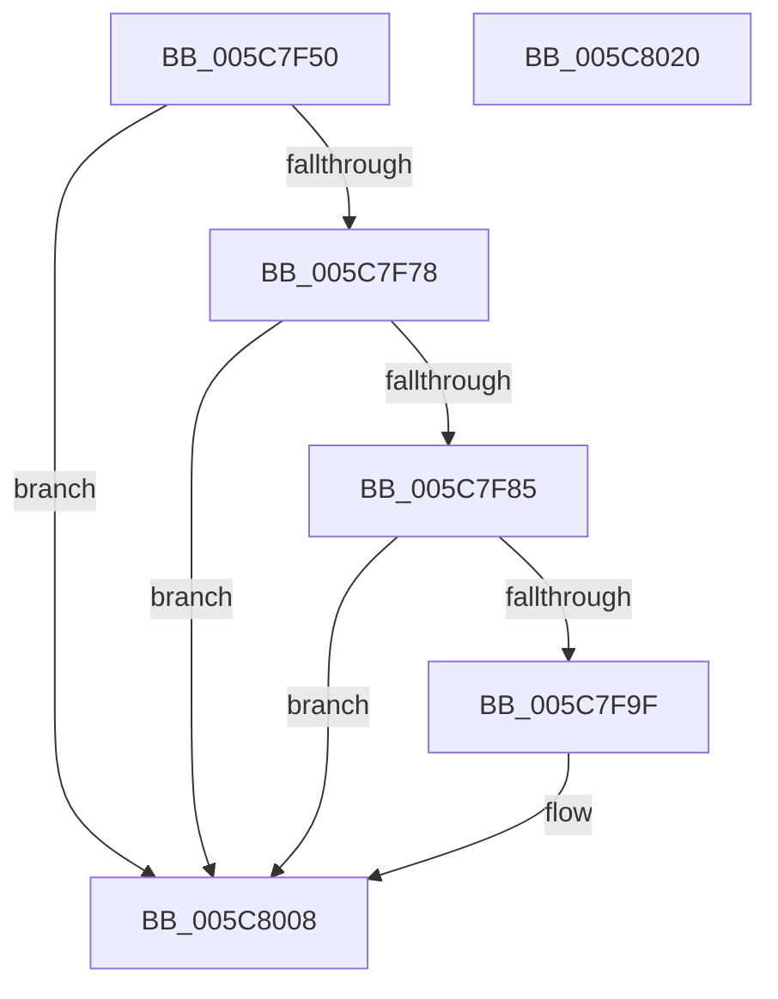

# KeSetUserCetAppcompatOptions

- RVA: `0x005C7F50`–`0x005C8021` (길이 `209` bytes)
- VA: `0x00000001405C7F50`
- 실행 섹션: `.text`
- PDB 이름 있음: `예`; PDB Function 태그: `아니요`
- unwind 정보 RVA: `0x000B9BCC`
- 디코드: `39`개 명령, `209/209` bytes 표시
- 미해석 바이트: `0` (있으면 어셈블리에 `.byte`로 보존)

> 이 문서는 커널 이미지의 기계어와 PDB 기호를 분석해 생성했습니다. 4번과 5번은 함수 원형과 자료형을 바이너리 사용 방식에서 추정한 C 해석이며 원본 소스 복구 결과는 아닙니다.

## 1. Dependencies

- 직접 호출 지점: **3**; 고유 호출 대상: **3**
- 직접 호출자로 확인된 함수: **1**
- RIP 상대 이미지 참조: **5**

### Outgoing calls
- `0x005C7F96` → [tlgKeywordOn](../42/tlgKeywordOn_function_0042EAA0.md) (function, `0x0042EAA0`)
- `0x005C8003` → [tlgWriteTransfer_EtwWriteTransfer](../42/tlgWriteTransfer_EtwWriteTransfer_function_004260E0.md) (function, `0x004260E0`)
- `0x005C8013` → [_security_check_cookie](../6A/_security_check_cookie_function_006AC640.md) (function, `0x006AC640`)

### Direct callers
- [KseUserCetBasicModeAllowRetTargetNotCetCompatHookDriverTargeted](KseUserCetBasicModeAllowRetTargetNotCetCompatHookDriverTargeted_function_005CD800.md) at `0x005CD804`

### Static image references
- `0x005C7F57` → RVA `0x00E0A740` (`.data`; read)
- `0x005C7F69` → RVA `0x00FC6E80` (`ALMOSTRO`; read/write)
- `0x005C7F78` → RVA `0x00E070A0` (`.data`; read)
- `0x005C7F9F` → RVA `0x00FC6E80` (`ALMOSTRO`; read)
- `0x005C7FEB` → RVA `0x00048822` (`.rdata`; read)

## 2. Other-region calls and transfers

- 다른 실행 섹션으로 향하는 call: **0**
- 별도 외부 분기/꼬리 이동을 확인하지 못했습니다.

## 3. Assembly (complete function range)

```asm
005C7F50  48 81 EC 98 00 00 00            sub rsp, 0x98
005C7F57  48 8B 05 E2 27 84 00            mov rax, qword ptr [rip + 0x8427e2]
005C7F5E  48 33 C4                        xor rax, rsp
005C7F61  48 89 84 24 80 00 00 00         mov qword ptr [rsp + 0x80], rax
005C7F69  F0 0F BA 2D 0E EF 9F 00 00      lock bts dword ptr [rip + 0x9fef0e], 0
005C7F72  0F 82 90 00 00 00               jb 0x1405c8008
005C7F78  83 3D 21 F1 83 00 05            cmp dword ptr [rip + 0x83f121], 5
005C7F7F  0F 86 83 00 00 00               jbe 0x1405c8008
005C7F85  48 BA 00 00 00 00 00 40 00 00   movabs rdx, 0x400000000000
005C7F8F  48 8D 0D 0A F1 83 00            lea rcx, [rip + 0x83f10a]
005C7F96  E8 05 6B E6 FF                  call 0x14042eaa0
005C7F9B  84 C0                           test al, al
005C7F9D  74 69                           je 0x1405c8008
005C7F9F  8B 05 DB EE 9F 00               mov eax, dword ptr [rip + 0x9feedb]
005C7FA5  48 8D 0D F4 F0 83 00            lea rcx, [rip + 0x83f0f4]
005C7FAC  83 64 24 6C 00                  and dword ptr [rsp + 0x6c], 0
005C7FB1  BA 04 00 00 00                  mov edx, 4
005C7FB6  83 64 24 7C 00                  and dword ptr [rsp + 0x7c], 0
005C7FBB  45 33 C9                        xor r9d, r9d
005C7FBE  89 44 24 30                     mov dword ptr [rsp + 0x30], eax
005C7FC2  45 33 C0                        xor r8d, r8d
005C7FC5  48 8D 44 24 30                  lea rax, [rsp + 0x30]
005C7FCA  89 54 24 68                     mov dword ptr [rsp + 0x68], edx
005C7FCE  48 89 44 24 60                  mov qword ptr [rsp + 0x60], rax
005C7FD3  48 8D 44 24 38                  lea rax, [rsp + 0x38]
005C7FD8  48 89 44 24 70                  mov qword ptr [rsp + 0x70], rax
005C7FDD  48 8D 44 24 40                  lea rax, [rsp + 0x40]
005C7FE2  48 89 44 24 28                  mov qword ptr [rsp + 0x28], rax
005C7FE7  89 54 24 20                     mov dword ptr [rsp + 0x20], edx
005C7FEB  48 8D 15 30 08 A8 FF            lea rdx, [rip - 0x57f7d0]
005C7FF2  48 C7 44 24 38 00 00 00 01      mov qword ptr [rsp + 0x38], 0x1000000
005C7FFB  C7 44 24 78 08 00 00 00         mov dword ptr [rsp + 0x78], 8
005C8003  E8 D8 E0 E5 FF                  call 0x1404260e0
005C8008  48 8B 8C 24 80 00 00 00         mov rcx, qword ptr [rsp + 0x80]
005C8010  48 33 CC                        xor rcx, rsp
005C8013  E8 28 46 0E 00                  call 0x1406ac640
005C8018  48 81 C4 98 00 00 00            add rsp, 0x98
005C801F  C3                              ret
005C8020  CC                              int3
```

## 4. C-style interpretation (structured pseudocode)

```c
__int64 __fastcall KeSetUserCetAppcompatOptions(__int64 a1, __int64 a2, int a3, int a4)
{
    __int64 result;
    __int64 v_rsp;
    unsigned __int64 v_stack_m18;
    unsigned int v_stack_m1C;
    unsigned int v_stack_m20;
    unsigned __int64 v_stack_m28;
    unsigned int v_stack_m2C;
    unsigned int v_stack_m30;
    unsigned __int64 v_stack_m38;
    unsigned __int64 v_stack_m58;
    unsigned __int64 v_stack_m60;
    unsigned int v_stack_m68;
    unsigned __int64 v_stack_m70;
    unsigned int v_stack_m78;

    v_rsp = (v_rsp) - (152);
    result = (*(unsigned __int64 *)(v_rip + 8660962)) ^ (v_rsp);
    v_stack_m18 = result;
    if (condition_is_below) goto loc_005C8008;
    if ((*(unsigned int *)(v_rip + 8646945)) <= 5) goto loc_005C8008;
    result = tlgKeywordOn(v_rip + 8646922, a2, a3, a4);
    if ((unsigned __int8)(result) != 0) {
        result = *(unsigned int *)(v_rip + 10481371);
        a1 = v_rip + 8646900;
        a2 = 4;
        a4 = 0;
        v_stack_m68 = (unsigned int)(result);
        a3 = 0;
        result = v_stack_m68;
        v_stack_m30 = (unsigned int)(a2);
        v_stack_m38 = result;
        result = v_stack_m60;
        v_stack_m28 = result;
        result = v_stack_m58;
        v_stack_m70 = result;
        v_stack_m78 = (unsigned int)(a2);
        a2 = v_rip - 5765072;
        v_stack_m60 = 0x1000000ULL;
        v_stack_m20 = 8;
        result = tlgWriteTransfer_EtwWriteTransfer(a1, a2, a3, a4);
    }
    a1 = (v_stack_m18) ^ (v_rsp);
    result = _security_check_cookie(a1, a2, a3, a4);
    v_rsp = (v_rsp) + (152);
    return result;
}
```

## 5. (Beta) C Style

```c
int64_t KeSetUserCetAppcompatOptions(int64_t Arg1, int64_t Arg2, int32_t Arg3, int32_t Arg4)
{
    int64_t result;
    int64_t local_rsp;
    uint64_t v_stack_m18;
    uint32_t v_stack_m1C;
    uint32_t v_stack_m20;
    uint64_t v_stack_m28;
    uint32_t v_stack_m2C;
    uint32_t v_stack_m30;
    uint64_t v_stack_m38;
    uint64_t v_stack_m58;
    uint64_t v_stack_m60;
    uint32_t v_stack_m68;
    uint64_t v_stack_m70;
    uint32_t v_stack_m78;

    local_rsp = (local_rsp) - (152);
    result = (*(uint64_t *)(v_rip + 0x8427E2)) ^ (local_rsp);
    v_stack_m18 = result;
    if (condition_is_below) goto loc_005C8008;
    if ((*(uint32_t *)(v_rip + 0x83F121)) <= 5) goto loc_005C8008;
    result = tlgKeywordOn(v_rip + 8646922, Arg2, Arg3, Arg4);
    if ((uint8_t)(result) != 0) {
        result = *(uint32_t *)(v_rip + 0x9FEEDB);
        Arg1 = v_rip + 8646900;
        Arg2 = 4;
        Arg4 = 0;
        v_stack_m68 = (uint32_t)(result);
        Arg3 = 0;
        result = v_stack_m68;
        v_stack_m30 = (uint32_t)(Arg2);
        v_stack_m38 = result;
        result = v_stack_m60;
        v_stack_m28 = result;
        result = v_stack_m58;
        v_stack_m70 = result;
        v_stack_m78 = (uint32_t)(Arg2);
        Arg2 = v_rip - 5765072;
        v_stack_m60 = 0x1000000ULL;
        v_stack_m20 = 8;
        result = tlgWriteTransfer_EtwWriteTransfer(Arg1, Arg2, Arg3, Arg4);
    }
    Arg1 = (v_stack_m18) ^ (local_rsp);
    result = _security_check_cookie(Arg1, Arg2, Arg3, Arg4);
    local_rsp = (local_rsp) + (152);
    return result;
}
```

## 6. Execution-region graph

[열기: 2D/3D 그래프와 함수 탐색 컨트롤 패널](../../../control-panel.html?section=text&rva=0x005C7F50&view=graph)

- 2D 그래프는 위에서 아래로 흐르고, 3D 그래프는 빈 공간을 드래그해 회전합니다. Shift+드래그는 이동, 휠은 확대·축소, 함수 노드 선택은 대상 보고서 이동입니다.

### Static fallback


