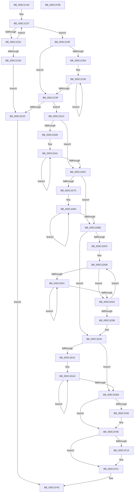

# KeSrcuAllocate

- RVA: `0x005C1C40`–`0x005C1F59` (길이 `793` bytes)
- VA: `0x00000001405C1C40`
- 실행 섹션: `.text`
- PDB 이름 있음: `예`; PDB Function 태그: `아니요`
- unwind 정보 RVA: `0x000AA2A0`
- 디코드: `206`개 명령, `793/793` bytes 표시
- 미해석 바이트: `0` (있으면 어셈블리에 `.byte`로 보존)

> 이 문서는 커널 이미지의 기계어와 PDB 기호를 분석해 생성했습니다. 4번과 5번은 함수 원형과 자료형을 바이너리 사용 방식에서 추정한 C 해석이며 원본 소스 복구 결과는 아닙니다.

## 1. Dependencies

- 직접 호출 지점: **4**; 고유 호출 대상: **4**
- 직접 호출자로 확인된 함수: **0**
- RIP 상대 이미지 참조: **13**

### Outgoing calls
- `0x005C1C61` → [KiSrcuInitializeTopology](KiSrcuInitializeTopology_function_005C2408.md) (function, `0x005C2408`)
- `0x005C1D08` → [ExAllocatePool2](../../poolcode/B8/ExAllocatePool2_function_00B820F0.md) (function, `0x00B820F0`)
- `0x005C1EF2` → [KeAcquireSpinLockRaiseToDpc](../20/KeAcquireSpinLockRaiseToDpc_function_00208470.md) (function, `0x00208470`)
- `0x005C1F3B` → [KeReleaseSpinLock](../39/KeReleaseSpinLock_function_00392BA0.md) (function, `0x00392BA0`)

### Direct callers
- 이 함수 시작 RVA로 연결되는 직접 call은 확인되지 않았습니다. 간접 호출은 완전히 역산할 수 없습니다.

### Static image references
- `0x005C1C57` → RVA `0x00F10E40` (`.data`; read)
- `0x005C1C6F` → RVA `0x00F10E41` (`.data`; read)
- `0x005C1C76` → RVA `0x00F10E44` (`.data`; read)
- `0x005C1C9F` → RVA `0x00FC6AE8` (`ALMOSTRO`; read)
- `0x005C1CA6` → RVA `0x00F10E20` (`.data`; read)
- `0x005C1D93` → RVA `0x00F10E48` (`.data`; read)
- `0x005C1DC4` → RVA `0x00F10E50` (`.data`; read)
- `0x005C1E57` → RVA `0x005C23F0` (`KiSrcuFlushCompletedDpcRoutine`; read)
- `0x005C1EB1` → RVA `0x005C28D0` (`KiSrcuNotifyWorkerDpcRoutine`; read)
- `0x005C1EEB` → RVA `0x00F10E30` (`.data`; read)
- `0x005C1F00` → RVA `0x00F10E28` (`.data`; write)
- `0x005C1F07` → RVA `0x00F10E20` (`.data`; write)
- `0x005C1F0E` → RVA `0x00F10E28` (`.data`; read)

## 2. Other-region calls and transfers

- 다른 실행 섹션으로 향하는 call: **1**
  - `0x005C1D08` → [ExAllocatePool2](../../poolcode/B8/ExAllocatePool2_function_00B820F0.md) (`.text` → `POOLCODE`)
- 별도 외부 분기/꼬리 이동을 확인하지 못했습니다.

## 3. Assembly (complete function range)

```asm
005C1C40  48 89 5C 24 08                  mov qword ptr [rsp + 8], rbx
005C1C45  55                              push rbp
005C1C46  56                              push rsi
005C1C47  57                              push rdi
005C1C48  41 54                           push r12
005C1C4A  41 55                           push r13
005C1C4C  41 56                           push r14
005C1C4E  41 57                           push r15
005C1C50  48 83 EC 20                     sub rsp, 0x20
005C1C54  44 8B E9                        mov r13d, ecx
005C1C57  8A 05 E3 F1 94 00               mov al, byte ptr [rip + 0x94f1e3]
005C1C5D  84 C0                           test al, al
005C1C5F  75 0E                           jne 0x1405c1c6f
005C1C61  E8 A2 07 00 00                  call 0x1405c2408
005C1C66  85 C0                           test eax, eax
005C1C68  75 ED                           jne 0x1405c1c57
005C1C6A  E9 A6 00 00 00                  jmp 0x1405c1d15
005C1C6F  0F B6 3D CB F1 94 00            movzx edi, byte ptr [rip + 0x94f1cb]
005C1C76  48 8D 2D C7 F1 94 00            lea rbp, [rip + 0x94f1c7]
005C1C7D  45 33 C0                        xor r8d, r8d
005C1C80  8B F7                           mov esi, edi
005C1C82  8D 57 FF                        lea edx, [rdi - 1]
005C1C85  40 84 FF                        test dil, dil
005C1C88  74 15                           je 0x1405c1c9f
005C1C8A  48 8B CD                        mov rcx, rbp
005C1C8D  44 8B CF                        mov r9d, edi
005C1C90  0F B6 01                        movzx eax, byte ptr [rcx]
005C1C93  48 FF C1                        inc rcx
005C1C96  44 03 C0                        add r8d, eax
005C1C99  49 83 E9 01                     sub r9, 1
005C1C9D  75 F1                           jne 0x1405c1c90
005C1C9F  44 8B 25 42 4E A0 00            mov r12d, dword ptr [rip + 0xa04e42]
005C1CA6  48 8D 05 73 F1 94 00            lea rax, [rip + 0x94f173]
005C1CAD  44 0F B6 F2                     movzx r14d, dl
005C1CB1  41 0F B6 4C 06 22               movzx ecx, byte ptr [r14 + rax + 0x22]
005C1CB7  B8 20 00 00 00                  mov eax, 0x20
005C1CBC  3B C8                           cmp ecx, eax
005C1CBE  0F 47 C8                        cmova ecx, eax
005C1CC1  33 D2                           xor edx, edx
005C1CC3  89 4C 24 70                     mov dword ptr [rsp + 0x70], ecx
005C1CC7  41 8D 44 24 FF                  lea eax, [r12 - 1]
005C1CCC  03 C1                           add eax, ecx
005C1CCE  F7 F1                           div ecx
005C1CD0  41 8B C8                        mov ecx, r8d
005C1CD3  41 B8 53 52 63 75               mov r8d, 0x75635253
005C1CD9  44 8B F8                        mov r15d, eax
005C1CDC  48 83 C1 03                     add rcx, 3
005C1CE0  48 6B C9 38                     imul rcx, rcx, 0x38
005C1CE4  41 8B C4                        mov eax, r12d
005C1CE7  44 89 7C 24 68                  mov dword ptr [rsp + 0x68], r15d
005C1CEC  48 C1 E0 06                     shl rax, 6
005C1CF0  4B 8D 14 BF                     lea rdx, [r15 + r15*4]
005C1CF4  48 03 C8                        add rcx, rax
005C1CF7  48 C1 E2 04                     shl rdx, 4
005C1CFB  48 03 D1                        add rdx, rcx
005C1CFE  48 89 44 24 78                  mov qword ptr [rsp + 0x78], rax
005C1D03  B9 40 00 00 00                  mov ecx, 0x40
005C1D08  E8 E3 03 5C 00                  call 0x140b820f0
005C1D0D  48 8B D8                        mov rbx, rax
005C1D10  48 85 C0                        test rax, rax
005C1D13  75 07                           jne 0x1405c1d1c
005C1D15  33 C0                           xor eax, eax
005C1D17  E9 27 02 00 00                  jmp 0x1405c1f43
005C1D1C  4C 8B 44 24 78                  mov r8, qword ptr [rsp + 0x78]
005C1D21  44 89 A8 A0 00 00 00            mov dword ptr [rax + 0xa0], r13d
005C1D28  48 05 A8 00 00 00               add rax, 0xa8
005C1D2E  4C 03 C0                        add r8, rax
005C1D31  48 89 43 20                     mov qword ptr [rbx + 0x20], rax
005C1D35  45 33 ED                        xor r13d, r13d
005C1D38  40 84 FF                        test dil, dil
005C1D3B  74 1F                           je 0x1405c1d5c
005C1D3D  48 8D 53 10                     lea rdx, [rbx + 0x10]
005C1D41  4C 89 02                        mov qword ptr [rdx], r8
005C1D44  48 8D 52 08                     lea rdx, [rdx + 8]
005C1D48  0F B6 45 00                     movzx eax, byte ptr [rbp]
005C1D4C  48 FF C5                        inc rbp
005C1D4F  48 6B C8 38                     imul rcx, rax, 0x38
005C1D53  4C 03 C1                        add r8, rcx
005C1D56  48 83 EE 01                     sub rsi, 1
005C1D5A  75 E5                           jne 0x1405c1d41
005C1D5C  48 8B 53 20                     mov rdx, qword ptr [rbx + 0x20]
005C1D60  48 8D 05 B9 F0 94 00            lea rax, [rip + 0x94f0b9]
005C1D67  41 0F B6 74 06 22               movzx esi, byte ptr [r14 + rax + 0x22]
005C1D6D  45 8B CD                        mov r9d, r13d
005C1D70  4E 8B 44 F3 10                  mov r8, qword ptr [rbx + r14*8 + 0x10]
005C1D75  45 85 E4                        test r12d, r12d
005C1D78  74 44                           je 0x1405c1dbe
005C1D7A  48 83 C2 28                     add rdx, 0x28
005C1D7E  4D 8B D5                        mov r10, r13
005C1D81  4D 8B DC                        mov r11, r12
005C1D84  4C 89 02                        mov qword ptr [rdx], r8
005C1D87  49 8D 40 38                     lea rax, [r8 + 0x38]
005C1D8B  48 89 5A 10                     mov qword ptr [rdx + 0x10], rbx
005C1D8F  48 8D 52 40                     lea rdx, [rdx + 0x40]
005C1D93  48 8B 0D AE F0 94 00            mov rcx, qword ptr [rip + 0x94f0ae]
005C1D9A  49 03 CA                        add rcx, r10
005C1D9D  49 83 C2 08                     add r10, 8
005C1DA1  48 89 4A C8                     mov qword ptr [rdx - 0x38], rcx
005C1DA5  41 8D 49 01                     lea ecx, [r9 + 1]
005C1DA9  3B CE                           cmp ecx, esi
005C1DAB  49 0F 42 C0                     cmovb rax, r8
005C1DAF  45 1B C9                        sbb r9d, r9d
005C1DB2  44 23 C9                        and r9d, ecx
005C1DB5  4C 8B C0                        mov r8, rax
005C1DB8  49 83 EB 01                     sub r11, 1
005C1DBC  75 C6                           jne 0x1405c1d84
005C1DBE  48 8B 4B 10                     mov rcx, qword ptr [rbx + 0x10]
005C1DC2  B2 01                           mov dl, 1
005C1DC4  48 8B 05 85 F0 94 00            mov rax, qword ptr [rip + 0x94f085]
005C1DCB  48 89 41 08                     mov qword ptr [rcx + 8], rax
005C1DCF  40 3A FA                        cmp dil, dl
005C1DD2  76 6C                           jbe 0x1405c1e40
005C1DD4  4C 8D 3D 45 F0 94 00            lea r15, [rip + 0x94f045]
005C1DDB  44 0F B6 C2                     movzx r8d, dl
005C1DDF  45 8B DD                        mov r11d, r13d
005C1DE2  41 8B ED                        mov ebp, r13d
005C1DE5  4E 8B 4C C3 10                  mov r9, qword ptr [rbx + r8*8 + 0x10]
005C1DEA  4B 8B 74 C7 30                  mov rsi, qword ptr [r15 + r8*8 + 0x30]
005C1DEF  47 0F B6 64 38 21               movzx r12d, byte ptr [r8 + r15 + 0x21]
005C1DF5  4E 8B 54 C3 08                  mov r10, qword ptr [rbx + r8*8 + 8]
005C1DFA  47 38 6C 38 24                  cmp byte ptr [r8 + r15 + 0x24], r13b
005C1DFF  76 33                           jbe 0x1405c1e34
005C1E01  49 89 71 08                     mov qword ptr [r9 + 8], rsi
005C1E05  41 8D 4B 01                     lea ecx, [r11 + 1]
005C1E09  4D 89 11                        mov qword ptr [r9], r10
005C1E0C  49 8D 42 38                     lea rax, [r10 + 0x38]
005C1E10  48 83 C6 10                     add rsi, 0x10
005C1E14  4D 8D 49 38                     lea r9, [r9 + 0x38]
005C1E18  FF C5                           inc ebp
005C1E1A  41 3B CC                        cmp ecx, r12d
005C1E1D  49 0F 42 C2                     cmovb rax, r10
005C1E21  45 1B DB                        sbb r11d, r11d
005C1E24  4C 8B D0                        mov r10, rax
005C1E27  44 23 D9                        and r11d, ecx
005C1E2A  43 0F B6 44 38 24               movzx eax, byte ptr [r8 + r15 + 0x24]
005C1E30  3B E8                           cmp ebp, eax
005C1E32  72 CD                           jb 0x1405c1e01
005C1E34  FE C2                           inc dl
005C1E36  40 3A D7                        cmp dl, dil
005C1E39  72 A0                           jb 0x1405c1ddb
005C1E3B  44 8B 7C 24 68                  mov r15d, dword ptr [rsp + 0x68]
005C1E40  44 8B 4C 24 70                  mov r9d, dword ptr [rsp + 0x70]
005C1E45  48 8D 43 40                     lea rax, [rbx + 0x40]
005C1E49  48 89 40 08                     mov qword ptr [rax + 8], rax
005C1E4D  48 8D 3D CC EF 94 00            lea rdi, [rip + 0x94efcc]
005C1E54  48 89 00                        mov qword ptr [rax], rax
005C1E57  48 8D 05 92 05 00 00            lea rax, [rip + 0x592]
005C1E5E  48 89 43 68                     mov qword ptr [rbx + 0x68], rax
005C1E62  C7 43 50 1A 01 00 00            mov dword ptr [rbx + 0x50], 0x11a
005C1E69  48 89 5B 70                     mov qword ptr [rbx + 0x70], rbx
005C1E6D  4C 89 AB 88 00 00 00            mov qword ptr [rbx + 0x88], r13
005C1E74  4C 89 6B 60                     mov qword ptr [rbx + 0x60], r13
005C1E78  44 89 BB 90 00 00 00            mov dword ptr [rbx + 0x90], r15d
005C1E7F  44 89 8B 94 00 00 00            mov dword ptr [rbx + 0x94], r9d
005C1E86  41 0F B6 44 3E 24               movzx eax, byte ptr [r14 + rdi + 0x24]
005C1E8C  48 6B C8 38                     imul rcx, rax, 0x38
005C1E90  4A 03 4C F3 10                  add rcx, qword ptr [rbx + r14*8 + 0x10]
005C1E95  48 89 8B 98 00 00 00            mov qword ptr [rbx + 0x98], rcx
005C1E9C  45 85 FF                        test r15d, r15d
005C1E9F  74 4A                           je 0x1405c1eeb
005C1EA1  49 8B CD                        mov rcx, r13
005C1EA4  45 8B C7                        mov r8d, r15d
005C1EA7  41 8B D5                        mov edx, r13d
005C1EAA  48 8B 83 98 00 00 00            mov rax, qword ptr [rbx + 0x98]
005C1EB1  4C 8D 15 18 0A 00 00            lea r10, [rip + 0xa18]
005C1EB8  89 54 08 40                     mov dword ptr [rax + rcx + 0x40], edx
005C1EBC  41 03 D1                        add edx, r9d
005C1EBF  48 8B 83 98 00 00 00            mov rax, qword ptr [rbx + 0x98]
005C1EC6  C7 04 01 13 01 00 00            mov dword ptr [rcx + rax], 0x113
005C1ECD  4C 89 54 01 18                  mov qword ptr [rcx + rax + 0x18], r10
005C1ED2  48 89 5C 01 20                  mov qword ptr [rcx + rax + 0x20], rbx
005C1ED7  4C 89 6C 01 38                  mov qword ptr [rcx + rax + 0x38], r13
005C1EDC  4C 89 6C 01 10                  mov qword ptr [rcx + rax + 0x10], r13
005C1EE1  48 8D 49 50                     lea rcx, [rcx + 0x50]
005C1EE5  49 83 E8 01                     sub r8, 1
005C1EE9  75 BF                           jne 0x1405c1eaa
005C1EEB  48 8D 0D 3E EF 94 00            lea rcx, [rip + 0x94ef3e]
005C1EF2  E8 79 65 C4 FF                  call 0x140208470
005C1EF7  4C 39 2D 22 EF 94 00            cmp qword ptr [rip + 0x94ef22], r13
005C1EFE  75 0E                           jne 0x1405c1f0e
005C1F00  48 89 3D 21 EF 94 00            mov qword ptr [rip + 0x94ef21], rdi
005C1F07  48 89 3D 12 EF 94 00            mov qword ptr [rip + 0x94ef12], rdi
005C1F0E  48 8B 15 13 EF 94 00            mov rdx, qword ptr [rip + 0x94ef13]
005C1F15  48 39 3A                        cmp qword ptr [rdx], rdi
005C1F18  74 07                           je 0x1405c1f21
005C1F1A  B9 03 00 00 00                  mov ecx, 3
005C1F1F  CD 29                           int 0x29
005C1F21  48 89 53 08                     mov qword ptr [rbx + 8], rdx
005C1F25  48 8D 0D 04 EF 94 00            lea rcx, [rip + 0x94ef04]
005C1F2C  48 89 3B                        mov qword ptr [rbx], rdi
005C1F2F  48 89 1A                        mov qword ptr [rdx], rbx
005C1F32  8A D0                           mov dl, al
005C1F34  48 89 1D ED EE 94 00            mov qword ptr [rip + 0x94eeed], rbx
005C1F3B  E8 60 0C DD FF                  call 0x140392ba0
005C1F40  48 8B C3                        mov rax, rbx
005C1F43  48 8B 5C 24 60                  mov rbx, qword ptr [rsp + 0x60]
005C1F48  48 83 C4 20                     add rsp, 0x20
005C1F4C  41 5F                           pop r15
005C1F4E  41 5E                           pop r14
005C1F50  41 5D                           pop r13
005C1F52  41 5C                           pop r12
005C1F54  5F                              pop rdi
005C1F55  5E                              pop rsi
005C1F56  5D                              pop rbp
005C1F57  C3                              ret
005C1F58  CC                              int3
```

## 4. C-style interpretation (structured pseudocode)

```c
__int64 __fastcall KeSrcuAllocate(int a1, __int64 a2, int a3)
{
    __int64 result;
    __int64 v_r10;
    __int64 v_r11;
    __int64 v_r13;
    __int64 v_rbp;
    __int64 v_rsi;
    __int64 v_rsp;
    unsigned int v_stack_p10;
    unsigned int v_stack_p18;
    unsigned __int64 v_stack_p20;
    unsigned __int64 v_stack_p8;

    v_stack_p8 = v_rbx;
    v_rsp = (v_rsp) - (32);
loc_005C1C57:
    if ((unsigned __int8)(*(unsigned __int8 *)(v_rip + 9761251)) != 0) goto loc_005C1C6F;
    result = KiSrcuInitializeTopology(a1, a2, a3, a4);
    if ((unsigned int)(result) != 0) goto loc_005C1C57;
    goto loc_005C1D15;
loc_005C1C6F:
    a3 = 0;
    if ((unsigned __int8)(*(unsigned __int8 *)(v_rip + 9761227)) == 0) goto loc_005C1C9F;
loc_005C1C90:
    a1 = (v_rip + 9761223) + 1;
    a3 = (unsigned int)((a3) + ((unsigned int)(*(unsigned __int8 *)(v_rip + 9761223))));
    a4 = ((unsigned int)((unsigned int)(*(unsigned __int8 *)(v_rip + 9761227)))) - (1);
    if (condition_is_not_equal) goto loc_005C1C90;
loc_005C1C9F:
    a1 = *(unsigned __int8 *)((unsigned __int8)(*(unsigned __int8 *)(v_rip + 9761227) - 1) + v_rip + 9761139 * 1 + 34);
    if (((unsigned int)(*(unsigned __int8 *)((unsigned __int8)(*(unsigned __int8 *)(v_rip + 9761227) - 1) + v_rip + 9761139 * 1 + 34))) > 32) { a1 = 32; }
    a2 = 0;
    v_stack_p18 = a1;
    result = (unsigned int)(((unsigned int)(*(unsigned int *)(v_rip + 10505794)) - 1) + (a1));
    a1 = ((unsigned int)(a3)) + (3);
    a1 = (a1) * (a1);
    v_stack_p10 = (unsigned int)((unsigned int)((unsigned int)(result)));
    result = ((unsigned int)((unsigned int)((unsigned int)(*(unsigned int *)(v_rip + 10505794))))) << (6);
    a1 = (a1) + (result);
    a2 = ((unsigned int)((unsigned int)(result)) + (unsigned int)((unsigned int)(result)) * 4) << (4);
    a2 = (a2) + (a1);
    v_stack_p20 = result;
    result = ExAllocatePool2(64, a2, (unsigned int)(0x75635253ULL), a4);
    if (result != 0) goto loc_005C1D1C;
loc_005C1D15:
    result = 0;
    goto loc_005C1F43;
loc_005C1D1C:
    *(unsigned int *)(result + 160) = (unsigned int)((unsigned int)(a1));
    result = (result) + (168);
    a3 = (v_stack_p20) + (result);
    *(unsigned __int64 *)(result + 32) = result;
    v_r13 = 0;
    if ((unsigned __int8)(*(unsigned __int8 *)(v_rip + 9761227)) == 0) goto loc_005C1D5C;
loc_005C1D41:
    *(unsigned __int64 *)(result + 16) = a3;
    v_rbp = (v_rip + 9761223) + 1;
    a1 = (64) * (*(unsigned __int8 *)(v_rip + 9761223));
    a3 = (a3) + (a1);
    v_rsi = ((unsigned int)((unsigned int)(*(unsigned __int8 *)(v_rip + 9761227)))) - (1);
    if (condition_is_not_equal) goto loc_005C1D41;
loc_005C1D5C:
    if ((unsigned int)((unsigned int)(*(unsigned int *)(v_rip + 10505794))) == 0) goto loc_005C1DBE;
    a2 = (*(unsigned __int64 *)(result + 32)) + (40);
loc_005C1D84:
    *(unsigned __int64 *)(a2) = *(unsigned __int64 *)(result + (unsigned __int8)(*(unsigned __int8 *)(v_rip + 9761227) - 1) * 8 + 16);
    *(unsigned __int64 *)(a2 + 16) = result;
    a1 = (*(unsigned __int64 *)(v_rip + 9760942)) + (0);
    v_r10 = (0) + (8);
    *(unsigned __int64 *)(a2 + 64 - 56) = a1;
    result = *(unsigned __int64 *)(result + (unsigned __int8)(*(unsigned __int8 *)(v_rip + 9761227) - 1) * 8 + 16) + 56;
    if (((unsigned int)(0 + 1)) < ((unsigned int)(*(unsigned __int8 *)((unsigned __int8)(*(unsigned __int8 *)(v_rip + 9761227) - 1) + v_rip + 9760953 * 1 + 34)))) { result = *(unsigned __int64 *)(result + (unsigned __int8)(*(unsigned __int8 *)(v_rip + 9761227) - 1) * 8 + 16); }
    a4 = (unsigned int)((0) & ((unsigned int)(0 + 1)));
    v_r11 = ((unsigned int)(*(unsigned int *)(v_rip + 10505794))) - (1);
    if (condition_is_not_equal) goto loc_005C1D84;
loc_005C1DBE:
    *(unsigned __int64 *)(*(unsigned __int64 *)(result + 16) + 8) = *(unsigned __int64 *)(v_rip + 9760901);
    if (((unsigned __int8)(*(unsigned __int8 *)(v_rip + 9761227))) <= 1) goto loc_005C1E40;
loc_005C1DDB:
    if ((*(unsigned __int8 *)(1 + v_rip + 9760837 * 1 + 36)) <= 0) goto loc_005C1E34;
loc_005C1E01:
    *(unsigned __int64 *)(*(unsigned __int64 *)(result + 1 * 8 + 16) + 8) = *(unsigned __int64 *)(v_rip + 9760837 + 1 * 8 + 48);
    *(unsigned __int64 *)(*(unsigned __int64 *)(result + 1 * 8 + 16)) = *(unsigned __int64 *)(result + 1 * 8 + 8);
    v_rsi = (*(unsigned __int64 *)(v_rip + 9760837 + 1 * 8 + 48)) + (16);
    v_rbp = (unsigned int)((0) + 1);
    result = *(unsigned __int64 *)(result + 1 * 8 + 8) + 56;
    if (((unsigned int)(0 + 1)) < ((unsigned int)(*(unsigned __int8 *)(1 + v_rip + 9760837 * 1 + 33)))) { result = *(unsigned __int64 *)(result + 1 * 8 + 8); }
    v_r11 = (unsigned int)((0) & ((unsigned int)(0 + 1)));
    if (((unsigned int)(v_rbp)) < ((unsigned int)(*(unsigned __int8 *)(1 + v_rip + 9760837 * 1 + 36)))) goto loc_005C1E01;
loc_005C1E34:
    a2 = (unsigned __int8)((1) + 1);
    if (((unsigned __int8)(a2)) < ((unsigned __int8)(*(unsigned __int8 *)(v_rip + 9761227)))) goto loc_005C1DDB;
loc_005C1E40:
    *(unsigned __int64 *)(result + 64 + 8) = result + 64;
    *(unsigned __int64 *)(result + 64) = result + 64;
    *(unsigned __int64 *)(result + 104) = v_rip + 1426;
    *(unsigned int *)(result + 80) = 282;
    *(unsigned __int64 *)(result + 112) = result;
    *(unsigned __int64 *)(result + 136) = 0;
    *(unsigned __int64 *)(result + 96) = 0;
    *(unsigned int *)(result + 144) = (unsigned int)((unsigned int)(v_stack_p10));
    *(unsigned int *)(result + 148) = (unsigned int)((unsigned int)(v_stack_p18));
    a1 = (0 + 1) * (*(unsigned __int8 *)((unsigned __int8)(*(unsigned __int8 *)(v_rip + 9761227) - 1) + v_rip + 9760716 * 1 + 36));
    a1 = (a1) + (*(unsigned __int64 *)(result + (unsigned __int8)(*(unsigned __int8 *)(v_rip + 9761227) - 1) * 8 + 16));
    *(unsigned __int64 *)(result + 152) = a1;
    if ((unsigned int)((unsigned int)(v_stack_p10)) == 0) goto loc_005C1EEB;
loc_005C1EAA:
    *(unsigned int *)(*(unsigned __int64 *)(result + 152) + 0 * 1 + 64) = 0;
    a2 = (unsigned int)((0) + ((unsigned int)((unsigned int)(v_stack_p18))));
    *(unsigned int *)(0 + *(unsigned __int64 *)(result + 152) * 1) = 275;
    *(unsigned __int64 *)(0 + *(unsigned __int64 *)(result + 152) * 1 + 24) = v_rip + 2584;
    *(unsigned __int64 *)(0 + *(unsigned __int64 *)(result + 152) * 1 + 32) = result;
    *(unsigned __int64 *)(0 + *(unsigned __int64 *)(result + 152) * 1 + 56) = 0;
    *(unsigned __int64 *)(0 + *(unsigned __int64 *)(result + 152) * 1 + 16) = 0;
    a3 = ((unsigned int)((unsigned int)((unsigned int)(v_stack_p10)))) - (1);
    if (condition_is_not_equal) goto loc_005C1EAA;
loc_005C1EEB:
    result = KeAcquireSpinLockRaiseToDpc(v_rip + 9760574, a2, a3, (unsigned int)(v_stack_p18));
    if ((*(unsigned __int64 *)(v_rip + 9760546)) == 0) {
        *(unsigned __int64 *)(v_rip + 9760545) = v_rip + 9760716;
        *(unsigned __int64 *)(v_rip + 9760530) = v_rip + 9760716;
    }
    if ((*(unsigned __int64 *)(*(unsigned __int64 *)(v_rip + 9760531))) != (v_rip + 9760716)) {
        a1 = 3;
    }
    *(unsigned __int64 *)(result + 8) = *(unsigned __int64 *)(v_rip + 9760531);
    *(unsigned __int64 *)(result) = v_rip + 9760716;
    *(unsigned __int64 *)(*(unsigned __int64 *)(v_rip + 9760531)) = result;
    *(unsigned __int64 *)(v_rip + 9760493) = result;
    result = KeReleaseSpinLock(v_rip + 9760516, (unsigned __int8)(result), a3, (unsigned int)(v_stack_p18));
loc_005C1F43:
    v_rsp = (v_rsp) + (32);
    return result;
}
```

## 5. (Beta) C Style

```c
int64_t KeSrcuAllocate(int32_t Arg1, int64_t Arg2, int32_t Arg3)
{
    int64_t result;
    int64_t local_r10;
    int64_t local_r11;
    int64_t local_r13;
    int64_t local_rbp;
    int64_t local_rsi;
    int64_t local_rsp;
    uint32_t v_stack_p10;
    uint32_t v_stack_p18;
    uint64_t v_stack_p20;
    uint64_t v_stack_p8;

    v_stack_p8 = local_rbx;
    local_rsp = (local_rsp) - (32);
loc_005C1C57:
    if ((uint8_t)(*(uint8_t *)(v_rip + 0x94F1E3)) != 0) goto loc_005C1C6F;
    result = KiSrcuInitializeTopology(Arg1, Arg2, Arg3, a4);
    if ((uint32_t)(result) != 0) goto loc_005C1C57;
    goto loc_005C1D15;
loc_005C1C6F:
    Arg3 = 0;
    if ((uint8_t)(*(uint8_t *)(v_rip + 0x94F1CB)) == 0) goto loc_005C1C9F;
loc_005C1C90:
    Arg1 = (v_rip + 9761223) + 1;
    Arg3 = (uint32_t)((Arg3) + ((uint32_t)(*(uint8_t *)(v_rip + 0x94F1C7))));
    a4 = ((uint32_t)((uint32_t)(*(uint8_t *)(v_rip + 0x94F1CB)))) - (1);
    if (condition_is_not_equal) goto loc_005C1C90;
loc_005C1C9F:
    Arg1 = *(uint8_t *)((uint8_t)(*(uint8_t *)(v_rip + 0x94F1CB) - 0x1) + v_rip + 0x94F173 * 1 + 0x22);
    if (((uint32_t)(*(uint8_t *)((uint8_t)(*(uint8_t *)(v_rip + 0x94F1CB) - 0x1) + v_rip + 0x94F173 * 1 + 0x22))) > 32) { Arg1 = 32; }
    Arg2 = 0;
    v_stack_p18 = Arg1;
    result = (uint32_t)(((uint32_t)(*(uint32_t *)(v_rip + 0xA04E42)) - 1) + (Arg1));
    Arg1 = ((uint32_t)(Arg3)) + (3);
    Arg1 = (Arg1) * (Arg1);
    v_stack_p10 = (uint32_t)((uint32_t)((uint32_t)(result)));
    result = ((uint32_t)((uint32_t)((uint32_t)(*(uint32_t *)(v_rip + 0xA04E42))))) << (6);
    Arg1 = (Arg1) + (result);
    Arg2 = ((uint32_t)((uint32_t)(result)) + (uint32_t)((uint32_t)(result)) * 4) << (4);
    Arg2 = (Arg2) + (Arg1);
    v_stack_p20 = result;
    result = ExAllocatePool2(64, Arg2, (uint32_t)(0x75635253ULL), a4);
    if (result != 0) goto loc_005C1D1C;
loc_005C1D15:
    result = 0;
    goto loc_005C1F43;
loc_005C1D1C:
    *(uint32_t *)(result + 0xA0) = (uint32_t)((uint32_t)(Arg1));
    result = (result) + (168);
    Arg3 = (v_stack_p20) + (result);
    *(uint64_t *)(result + 0x20) = result;
    local_r13 = 0;
    if ((uint8_t)(*(uint8_t *)(v_rip + 0x94F1CB)) == 0) goto loc_005C1D5C;
loc_005C1D41:
    *(uint64_t *)(result + 0x10) = Arg3;
    local_rbp = (v_rip + 9761223) + 1;
    Arg1 = (64) * (*(uint8_t *)(v_rip + 0x94F1C7));
    Arg3 = (Arg3) + (Arg1);
    local_rsi = ((uint32_t)((uint32_t)(*(uint8_t *)(v_rip + 0x94F1CB)))) - (1);
    if (condition_is_not_equal) goto loc_005C1D41;
loc_005C1D5C:
    if ((uint32_t)((uint32_t)(*(uint32_t *)(v_rip + 0xA04E42))) == 0) goto loc_005C1DBE;
    Arg2 = (*(uint64_t *)(result + 0x20)) + (40);
loc_005C1D84:
    *(uint64_t *)(Arg2) = *(uint64_t *)(result + (uint8_t)(*(uint8_t *)(v_rip + 0x94F1CB) - 0x1) * 8 + 0x10);
    *(uint64_t *)(Arg2 + 0x10) = result;
    Arg1 = (*(uint64_t *)(v_rip + 0x94F0AE)) + (0);
    local_r10 = (0) + (8);
    *(uint64_t *)(Arg2 + 0x40 - 0x38) = Arg1;
    result = *(uint64_t *)(result + (uint8_t)(*(uint8_t *)(v_rip + 0x94F1CB) - 0x1) * 8 + 0x10) + 56;
    if (((uint32_t)(0 + 1)) < ((uint32_t)(*(uint8_t *)((uint8_t)(*(uint8_t *)(v_rip + 0x94F1CB) - 0x1) + v_rip + 0x94F0B9 * 1 + 0x22)))) { result = *(uint64_t *)(result + (uint8_t)(*(uint8_t *)(v_rip + 0x94F1CB) - 0x1) * 8 + 0x10); }
    a4 = (uint32_t)((0) & ((uint32_t)(0 + 1)));
    local_r11 = ((uint32_t)(*(uint32_t *)(v_rip + 0xA04E42))) - (1);
    if (condition_is_not_equal) goto loc_005C1D84;
loc_005C1DBE:
    *(uint64_t *)(*(uint64_t *)(result + 0x10) + 0x8) = *(uint64_t *)(v_rip + 0x94F085);
    if (((uint8_t)(*(uint8_t *)(v_rip + 0x94F1CB))) <= 1) goto loc_005C1E40;
loc_005C1DDB:
    if ((*(uint8_t *)(1 + v_rip + 0x94F045 * 1 + 0x24)) <= 0) goto loc_005C1E34;
loc_005C1E01:
    *(uint64_t *)(*(uint64_t *)(result + 0x1 * 8 + 0x10) + 0x8) = *(uint64_t *)(v_rip + 0x94F045 + 0x1 * 8 + 0x30);
    *(uint64_t *)(*(uint64_t *)(result + 0x1 * 8 + 0x10)) = *(uint64_t *)(result + 0x1 * 8 + 0x8);
    local_rsi = (*(uint64_t *)(v_rip + 0x94F045 + 0x1 * 8 + 0x30)) + (16);
    local_rbp = (uint32_t)((0) + 1);
    result = *(uint64_t *)(result + 0x1 * 8 + 0x8) + 56;
    if (((uint32_t)(0 + 1)) < ((uint32_t)(*(uint8_t *)(1 + v_rip + 0x94F045 * 1 + 0x21)))) { result = *(uint64_t *)(result + 0x1 * 8 + 0x8); }
    local_r11 = (uint32_t)((0) & ((uint32_t)(0 + 1)));
    if (((uint32_t)(local_rbp)) < ((uint32_t)(*(uint8_t *)(1 + v_rip + 0x94F045 * 1 + 0x24)))) goto loc_005C1E01;
loc_005C1E34:
    Arg2 = (uint8_t)((1) + 1);
    if (((uint8_t)(Arg2)) < ((uint8_t)(*(uint8_t *)(v_rip + 0x94F1CB)))) goto loc_005C1DDB;
loc_005C1E40:
    *(uint64_t *)(result + 0x40 + 0x8) = result + 64;
    *(uint64_t *)(result + 0x40) = result + 64;
    *(uint64_t *)(result + 0x68) = v_rip + 1426;
    *(uint32_t *)(result + 0x50) = 282;
    *(uint64_t *)(result + 0x70) = result;
    *(uint64_t *)(result + 0x88) = 0;
    *(uint64_t *)(result + 0x60) = 0;
    *(uint32_t *)(result + 0x90) = (uint32_t)((uint32_t)(v_stack_p10));
    *(uint32_t *)(result + 0x94) = (uint32_t)((uint32_t)(v_stack_p18));
    Arg1 = (0 + 1) * (*(uint8_t *)((uint8_t)(*(uint8_t *)(v_rip + 0x94F1CB) - 0x1) + v_rip + 0x94EFCC * 1 + 0x24));
    Arg1 = (Arg1) + (*(uint64_t *)(result + (uint8_t)(*(uint8_t *)(v_rip + 0x94F1CB) - 0x1) * 8 + 0x10));
    *(uint64_t *)(result + 0x98) = Arg1;
    if ((uint32_t)((uint32_t)(v_stack_p10)) == 0) goto loc_005C1EEB;
loc_005C1EAA:
    *(uint32_t *)(*(uint64_t *)(result + 0x98) + 0x0 * 1 + 0x40) = 0;
    Arg2 = (uint32_t)((0) + ((uint32_t)((uint32_t)(v_stack_p18))));
    *(uint32_t *)(0 + *(uint64_t *)(result + 0x98) * 1) = 275;
    *(uint64_t *)(0 + *(uint64_t *)(result + 0x98) * 1 + 0x18) = v_rip + 2584;
    *(uint64_t *)(0 + *(uint64_t *)(result + 0x98) * 1 + 0x20) = result;
    *(uint64_t *)(0 + *(uint64_t *)(result + 0x98) * 1 + 0x38) = 0;
    *(uint64_t *)(0 + *(uint64_t *)(result + 0x98) * 1 + 0x10) = 0;
    Arg3 = ((uint32_t)((uint32_t)((uint32_t)(v_stack_p10)))) - (1);
    if (condition_is_not_equal) goto loc_005C1EAA;
loc_005C1EEB:
    result = KeAcquireSpinLockRaiseToDpc(v_rip + 9760574, Arg2, Arg3, (uint32_t)(v_stack_p18));
    if ((*(uint64_t *)(v_rip + 0x94EF22)) == 0) {
        *(uint64_t *)(v_rip + 0x94EF21) = v_rip + 9760716;
        *(uint64_t *)(v_rip + 0x94EF12) = v_rip + 9760716;
    }
    if ((*(uint64_t *)(*(uint64_t *)(v_rip + 0x94EF13))) != (v_rip + 9760716)) {
        Arg1 = 3;
    }
    *(uint64_t *)(result + 0x8) = *(uint64_t *)(v_rip + 0x94EF13);
    *(uint64_t *)(result) = v_rip + 9760716;
    *(uint64_t *)(*(uint64_t *)(v_rip + 0x94EF13)) = result;
    *(uint64_t *)(v_rip + 0x94EEED) = result;
    result = KeReleaseSpinLock(v_rip + 9760516, (uint8_t)(result), Arg3, (uint32_t)(v_stack_p18));
loc_005C1F43:
    local_rsp = (local_rsp) + (32);
    return result;
}
```

## 6. Execution-region graph

[열기: 2D/3D 그래프와 함수 탐색 컨트롤 패널](../../../control-panel.html?section=text&rva=0x005C1C40&view=graph)

- 2D 그래프는 위에서 아래로 흐르고, 3D 그래프는 빈 공간을 드래그해 회전합니다. Shift+드래그는 이동, 휠은 확대·축소, 함수 노드 선택은 대상 보고서 이동입니다.

### Static fallback


