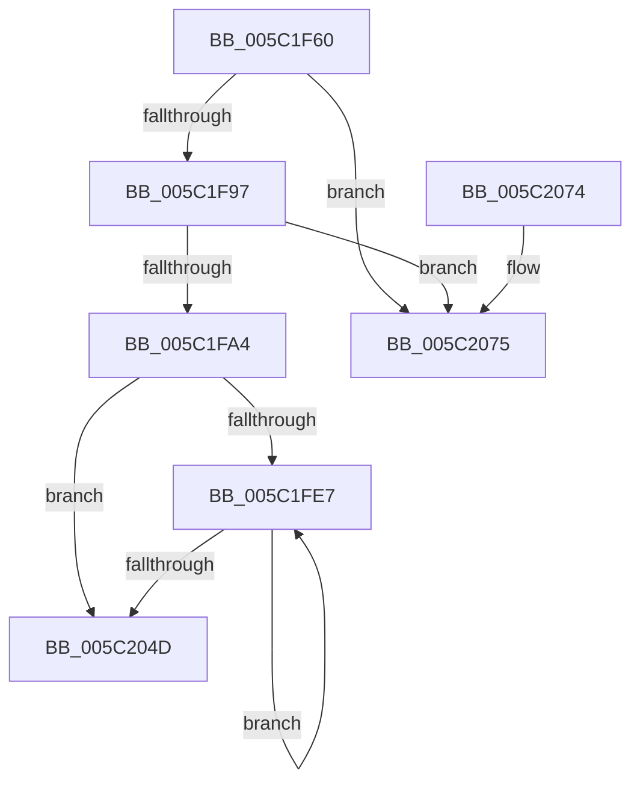

# KeSrcuFree

- RVA: `0x005C1F60`–`0x005C207C` (길이 `284` bytes)
- VA: `0x00000001405C1F60`
- 실행 섹션: `.text`
- PDB 이름 있음: `예`; PDB Function 태그: `아니요`
- unwind 정보 RVA: `0x000CA8E4`
- 디코드: `72`개 명령, `284/284` bytes 표시
- 미해석 바이트: `0` (있으면 어셈블리에 `.byte`로 보존)

> 이 문서는 커널 이미지의 기계어와 PDB 기호를 분석해 생성했습니다. 4번과 5번은 함수 원형과 자료형을 바이너리 사용 방식에서 추정한 C 해석이며 원본 소스 복구 결과는 아닙니다.

## 1. Dependencies

- 직접 호출 지점: **7**; 고유 호출 대상: **7**
- 직접 호출자로 확인된 함수: **0**
- RIP 상대 이미지 참조: **1**

### Outgoing calls
- `0x005C1F85` → [KeAcquireSpinLockRaiseToDpc](../20/KeAcquireSpinLockRaiseToDpc_function_00208470.md) (function, `0x00208470`)
- `0x005C1FB4` → [KeReleaseSpinLock](../39/KeReleaseSpinLock_function_00392BA0.md) (function, `0x00392BA0`)
- `0x005C1FBF` → [KeRemoveQueueDpcEx](../46/KeRemoveQueueDpcEx_function_0046CDC0.md) (function, `0x0046CDC0`)
- `0x005C2002` → [KiSrcuNotifyWorkerAcquire](KiSrcuNotifyWorkerAcquire_function_005C2860.md) (function, `0x005C2860`)
- `0x005C202C` → [KiSrcuNotifyWorkerSelectAndQueue](KiSrcuNotifyWorkerSelectAndQueue_function_005C29D4.md) (function, `0x005C29D4`)
- `0x005C203C` → [KeWaitForGate](../2C/KeWaitForGate_function_002CA794.md) (function, `0x002CA794`)
- `0x005C2055` → [ExFreePoolWithTag](../../poolcode/B8/ExFreePoolWithTag_function_00B82870.md) (function, `0x00B82870`)

### Direct callers
- 이 함수 시작 RVA로 연결되는 직접 call은 확인되지 않았습니다. 간접 호출은 완전히 역산할 수 없습니다.

### Static image references
- `0x005C1F7E` → RVA `0x00F10E30` (`.data`; read)

## 2. Other-region calls and transfers

- 다른 실행 섹션으로 향하는 call: **1**
  - `0x005C2055` → [ExFreePoolWithTag](../../poolcode/B8/ExFreePoolWithTag_function_00B82870.md) (`.text` → `POOLCODE`)
- 별도 외부 분기/꼬리 이동을 확인하지 못했습니다.

## 3. Assembly (complete function range)

```asm
005C1F60  48 8B C4                        mov rax, rsp
005C1F63  48 89 58 08                     mov qword ptr [rax + 8], rbx
005C1F67  48 89 70 10                     mov qword ptr [rax + 0x10], rsi
005C1F6B  48 89 78 18                     mov qword ptr [rax + 0x18], rdi
005C1F6F  4C 89 70 20                     mov qword ptr [rax + 0x20], r14
005C1F73  55                              push rbp
005C1F74  48 8B EC                        mov rbp, rsp
005C1F77  48 83 EC 40                     sub rsp, 0x40
005C1F7B  48 8B F9                        mov rdi, rcx
005C1F7E  48 8D 0D AB EE 94 00            lea rcx, [rip + 0x94eeab]
005C1F85  E8 E6 64 C4 FF                  call 0x140208470
005C1F8A  4C 8B 07                        mov r8, qword ptr [rdi]
005C1F8D  49 39 78 08                     cmp qword ptr [r8 + 8], rdi
005C1F91  0F 85 DE 00 00 00               jne 0x1405c2075
005C1F97  48 8B 57 08                     mov rdx, qword ptr [rdi + 8]
005C1F9B  48 39 3A                        cmp qword ptr [rdx], rdi
005C1F9E  0F 85 D1 00 00 00               jne 0x1405c2075
005C1FA4  4C 89 02                        mov qword ptr [rdx], r8
005C1FA7  48 8D 0D 82 EE 94 00            lea rcx, [rip + 0x94ee82]
005C1FAE  49 89 50 08                     mov qword ptr [r8 + 8], rdx
005C1FB2  8A D0                           mov dl, al
005C1FB4  E8 E7 0B DD FF                  call 0x140392ba0
005C1FB9  48 8D 4F 50                     lea rcx, [rdi + 0x50]
005C1FBD  B2 01                           mov dl, 1
005C1FBF  E8 FC AD EA FF                  call 0x14046cdc0
005C1FC4  8B 8F 94 00 00 00               mov ecx, dword ptr [rdi + 0x94]
005C1FCA  33 C0                           xor eax, eax
005C1FCC  45 33 F6                        xor r14d, r14d
005C1FCF  48 89 45 F0                     mov qword ptr [rbp - 0x10], rax
005C1FD3  0F 57 C0                        xorps xmm0, xmm0
005C1FD6  0F 11 45 E0                     movups xmmword ptr [rbp - 0x20], xmm0
005C1FDA  8D 70 01                        lea esi, [rax + 1]
005C1FDD  D3 E6                           shl esi, cl
005C1FDF  39 87 90 00 00 00               cmp dword ptr [rdi + 0x90], eax
005C1FE5  76 66                           jbe 0x1405c204d
005C1FE7  4B 8D 1C B6                     lea rbx, [r14 + r14*4]
005C1FEB  BA 02 00 00 00                  mov edx, 2
005C1FF0  48 C1 E3 04                     shl rbx, 4
005C1FF4  44 8D 46 FF                     lea r8d, [rsi - 1]
005C1FF8  48 03 9F 98 00 00 00            add rbx, qword ptr [rdi + 0x98]
005C1FFF  48 8B CB                        mov rcx, rbx
005C2002  E8 59 08 00 00                  call 0x1405c2860
005C2007  83 65 E4 00                     and dword ptr [rbp - 0x1c], 0
005C200B  48 8D 45 E8                     lea rax, [rbp - 0x18]
005C200F  48 89 45 F0                     mov qword ptr [rbp - 0x10], rax
005C2013  48 8D 55 E0                     lea rdx, [rbp - 0x20]
005C2017  48 8D 45 E8                     lea rax, [rbp - 0x18]
005C201B  66 C7 45 E0 07 01               mov word ptr [rbp - 0x20], 0x107
005C2021  48 8B CB                        mov rcx, rbx
005C2024  48 89 45 E8                     mov qword ptr [rbp - 0x18], rax
005C2028  C6 45 E2 06                     mov byte ptr [rbp - 0x1e], 6
005C202C  E8 A3 09 00 00                  call 0x1405c29d4
005C2031  45 33 C0                        xor r8d, r8d
005C2034  48 8D 4D E0                     lea rcx, [rbp - 0x20]
005C2038  41 8D 50 2A                     lea edx, [r8 + 0x2a]
005C203C  E8 53 87 D0 FF                  call 0x1402ca794
005C2041  41 FF C6                        inc r14d
005C2044  44 3B B7 90 00 00 00            cmp r14d, dword ptr [rdi + 0x90]
005C204B  72 9A                           jb 0x1405c1fe7
005C204D  BA 53 52 63 75                  mov edx, 0x75635253
005C2052  48 8B CF                        mov rcx, rdi
005C2055  E8 16 08 5C 00                  call 0x140b82870
005C205A  48 8B 5C 24 50                  mov rbx, qword ptr [rsp + 0x50]
005C205F  48 8B 74 24 58                  mov rsi, qword ptr [rsp + 0x58]
005C2064  48 8B 7C 24 60                  mov rdi, qword ptr [rsp + 0x60]
005C2069  4C 8B 74 24 68                  mov r14, qword ptr [rsp + 0x68]
005C206E  48 83 C4 40                     add rsp, 0x40
005C2072  5D                              pop rbp
005C2073  C3                              ret
005C2074  CC                              int3
005C2075  B9 03 00 00 00                  mov ecx, 3
005C207A  CD 29                           int 0x29
```

## 4. C-style interpretation (structured pseudocode)

```c
__int64 __fastcall KeSrcuFree(__int64 a1)
{
    __int64 result;
    __int64 v_r14;
    __int64 v_rbx;
    __int64 v_rsi;
    __int64 v_rsp;
    unsigned __int64 v_stack_m18;
    unsigned __int64 v_stack_m20;
    unsigned int v_stack_m24;
    unsigned __int8 v_stack_m26;
    unsigned __int64 v_stack_m28;
    unsigned __int64 v_stack_p10;
    unsigned __int64 v_stack_p18;
    unsigned __int64 v_stack_p20;
    unsigned __int64 v_stack_p8;

    *(unsigned __int64 *)(v_rsp + 8) = v_rbx;
    *(unsigned __int64 *)(v_rsp + 16) = v_rsi;
    *(unsigned __int64 *)(v_rsp + 24) = v_rdi;
    *(unsigned __int64 *)(v_rsp + 32) = v_r14;
    v_rsp = (v_rsp) - (64);
    result = KeAcquireSpinLockRaiseToDpc(v_rip + 9760427, a2, a3, a4);
    if ((*(unsigned __int64 *)(*(unsigned __int64 *)(a1) + 8)) != a1) goto loc_005C2075;
    if ((*(unsigned __int64 *)(*(unsigned __int64 *)(a1 + 8))) != a1) goto loc_005C2075;
    *(unsigned __int64 *)(*(unsigned __int64 *)(a1 + 8)) = *(unsigned __int64 *)(a1);
    *(unsigned __int64 *)(*(unsigned __int64 *)(a1) + 8) = *(unsigned __int64 *)(a1 + 8);
    result = KeReleaseSpinLock(v_rip + 9760386, (unsigned __int8)(result), *(unsigned __int64 *)(a1), a4);
    result = KeRemoveQueueDpcEx(a1 + 80, 1, *(unsigned __int64 *)(a1), a4);
    result = 0;
    v_r14 = 0;
    v_stack_m18 = 0;
    v_stack_m28 = v_xmm0;
    v_rsi = (unsigned int)((result + 1) << ((unsigned __int8)((unsigned int)(*(unsigned int *)(a1 + 148)))));
    if ((*(unsigned int *)(a1 + 144)) <= 0) goto loc_005C204D;
loc_005C1FE7:
    v_rbx = (v_r14 + v_r14 * 4) << (4);
    v_rbx = (v_rbx) + (*(unsigned __int64 *)(a1 + 152));
    result = KiSrcuNotifyWorkerAcquire(v_rbx, 2, v_rsi - 1, a4);
    v_stack_m18 = v_stack_m20;
    v_stack_m28 = 263;
    v_stack_m20 = v_stack_m20;
    v_stack_m26 = 6;
    result = KiSrcuNotifyWorkerSelectAndQueue(v_rbx, v_stack_m28, v_rsi - 1, a4);
    a3 = 0;
    result = KeWaitForGate(v_stack_m28, a3 + 42, a3, a4);
    v_r14 = (unsigned int)((v_r14) + 1);
    if (((unsigned int)(v_r14)) < (*(unsigned int *)(a1 + 144))) goto loc_005C1FE7;
loc_005C204D:
    result = ExFreePoolWithTag(a1, (unsigned int)(0x75635253ULL), a3, a4);
    v_rsp = (v_rsp) + (64);
    return result;
loc_005C2075:
    return result;
}
```

## 5. (Beta) C Style

```c
int64_t KeSrcuFree(void *Arg1)
{
    uint8_t *arg1 = (uint8_t *)Arg1;

    int64_t result;
    int64_t local_r14;
    int64_t local_rbx;
    int64_t local_rsi;
    int64_t local_rsp;
    uint64_t v_stack_m18;
    uint64_t v_stack_m20;
    uint32_t v_stack_m24;
    uint8_t v_stack_m26;
    uint64_t v_stack_m28;
    uint64_t v_stack_p10;
    uint64_t v_stack_p18;
    uint64_t v_stack_p20;
    uint64_t v_stack_p8;

    *(uint64_t *)(local_rsp + 0x8) = local_rbx;
    *(uint64_t *)(local_rsp + 0x10) = local_rsi;
    *(uint64_t *)(local_rsp + 0x18) = local_rdi;
    *(uint64_t *)(local_rsp + 0x20) = local_r14;
    local_rsp = (local_rsp) - (64);
    result = KeAcquireSpinLockRaiseToDpc(v_rip + 9760427, a2, a3, a4);
    if ((*(uint64_t *)(*(uint64_t *)(arg1) + 0x8)) != Arg1) goto loc_005C2075;
    if ((*(uint64_t *)(*(uint64_t *)(arg1 + 0x8))) != Arg1) goto loc_005C2075;
    *(uint64_t *)(*(uint64_t *)(arg1 + 0x8)) = *(uint64_t *)(arg1);
    *(uint64_t *)(*(uint64_t *)(arg1) + 0x8) = *(uint64_t *)(arg1 + 0x8);
    result = KeReleaseSpinLock(v_rip + 9760386, (uint8_t)(result), *(uint64_t *)(arg1), a4);
    result = KeRemoveQueueDpcEx(Arg1 + 80, 1, *(uint64_t *)(arg1), a4);
    result = 0;
    local_r14 = 0;
    v_stack_m18 = 0;
    v_stack_m28 = v_xmm0;
    local_rsi = (uint32_t)((result + 1) << ((uint8_t)((uint32_t)(*(uint32_t *)(arg1 + 0x94)))));
    if ((*(uint32_t *)(arg1 + 0x90)) <= 0) goto loc_005C204D;
loc_005C1FE7:
    local_rbx = (local_r14 + local_r14 * 4) << (4);
    local_rbx = (local_rbx) + (*(uint64_t *)(arg1 + 0x98));
    result = KiSrcuNotifyWorkerAcquire(local_rbx, 2, local_rsi - 1, a4);
    v_stack_m18 = v_stack_m20;
    v_stack_m28 = 263;
    v_stack_m20 = v_stack_m20;
    v_stack_m26 = 6;
    result = KiSrcuNotifyWorkerSelectAndQueue(local_rbx, v_stack_m28, local_rsi - 1, a4);
    a3 = 0;
    result = KeWaitForGate(v_stack_m28, a3 + 42, a3, a4);
    local_r14 = (uint32_t)((local_r14) + 1);
    if (((uint32_t)(local_r14)) < (*(uint32_t *)(arg1 + 0x90))) goto loc_005C1FE7;
loc_005C204D:
    result = ExFreePoolWithTag(Arg1, (uint32_t)(0x75635253ULL), a3, a4);
    local_rsp = (local_rsp) + (64);
    return result;
loc_005C2075:
    return result;
}
```

### 관측된 메모리 오프셋

구조체 형식이 확인되지 않은 접근은 인자 기준의 오프셋으로만 기록했습니다.

| 기준 인자 | 오프셋 표현 | 폭 (bit) | 접근 |
|---|---:|---:|---|
| `Arg1` | `+ 0x0` | `64` | `R` |
| `Arg1` | `+ 0x8` | `64` | `R` |
| `Arg1` | `+ 0x50` | `64` | `R` |
| `Arg1` | `+ 0x90` | `32` | `R` |
| `Arg1` | `+ 0x94` | `32` | `R` |
| `Arg1` | `+ 0x98` | `64` | `R` |

## 6. Execution-region graph

[열기: 2D/3D 그래프와 함수 탐색 컨트롤 패널](../../../control-panel.html?section=text&rva=0x005C1F60&view=graph)

- 2D 그래프는 위에서 아래로 흐르고, 3D 그래프는 빈 공간을 드래그해 회전합니다. Shift+드래그는 이동, 휠은 확대·축소, 함수 노드 선택은 대상 보고서 이동입니다.

### Static fallback


