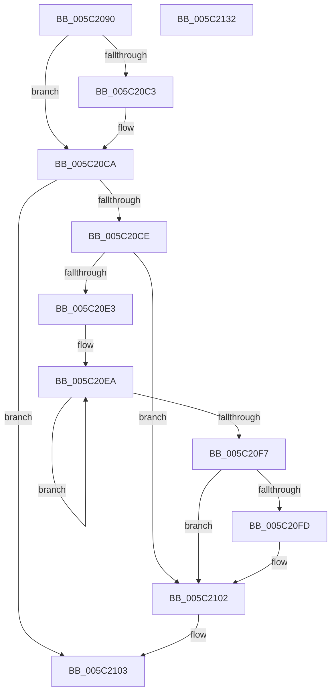

# KeSrcuReadLock

- RVA: `0x005C2090`–`0x005C2133` (길이 `163` bytes)
- VA: `0x00000001405C2090`
- 실행 섹션: `.text`
- PDB 이름 있음: `예`; PDB Function 태그: `아니요`
- unwind 정보 RVA: `0x00060BC4`
- 디코드: `45`개 명령, `163/163` bytes 표시
- 미해석 바이트: `0` (있으면 어셈블리에 `.byte`로 보존)

> 이 문서는 커널 이미지의 기계어와 PDB 기호를 분석해 생성했습니다. 4번과 5번은 함수 원형과 자료형을 바이너리 사용 방식에서 추정한 C 해석이며 원본 소스 복구 결과는 아닙니다.

## 1. Dependencies

- 직접 호출 지점: **2**; 고유 호출 대상: **2**
- 직접 호출자로 확인된 함수: **0**
- RIP 상대 이미지 참조: **0**

### Outgoing calls
- `0x005C20A5` → [KeDisableInterrupts](../21/KeDisableInterrupts_function_00217BE0.md) (function, `0x00217BE0`)
- `0x005C20FD` → [KiRemoveSystemWorkPriorityKick](../26/KiRemoveSystemWorkPriorityKick_function_002631D0.md) (function, `0x002631D0`)

### Direct callers
- 이 함수 시작 RVA로 연결되는 직접 call은 확인되지 않았습니다. 간접 호출은 완전히 역산할 수 없습니다.

### Static image references
- 디코드된 RIP-relative 메모리 참조가 없습니다.

## 2. Other-region calls and transfers

- 다른 실행 섹션으로 향하는 call: **0**
- 별도 외부 분기/꼬리 이동을 확인하지 못했습니다.

## 3. Assembly (complete function range)

```asm
005C2090  48 89 5C 24 08                  mov qword ptr [rsp + 8], rbx
005C2095  48 89 74 24 10                  mov qword ptr [rsp + 0x10], rsi
005C209A  57                              push rdi
005C209B  48 83 EC 20                     sub rsp, 0x20
005C209F  48 8B DA                        mov rbx, rdx
005C20A2  48 8B F9                        mov rdi, rcx
005C20A5  E8 36 5B C5 FF                  call 0x140217be0
005C20AA  65 8B 34 25 A4 01 00 00         mov esi, dword ptr gs:[0x1a4]
005C20B2  44 8B C6                        mov r8d, esi
005C20B5  49 C1 E0 06                     shl r8, 6
005C20B9  4C 03 47 20                     add r8, qword ptr [rdi + 0x20]
005C20BD  49 83 00 01                     add qword ptr [r8], 1
005C20C1  75 07                           jne 0x1405c20ca
005C20C3  B9 0E 00 00 00                  mov ecx, 0xe
005C20C8  CD 29                           int 0x29
005C20CA  84 C0                           test al, al
005C20CC  74 35                           je 0x1405c2103
005C20CE  65 48 8B 0C 25 20 00 00 00      mov rcx, qword ptr gs:[0x20]
005C20D7  4C 8B 81 B8 8E 00 00            mov r8, qword ptr [rcx + 0x8eb8]
005C20DE  4D 85 C0                        test r8, r8
005C20E1  74 1F                           je 0x1405c2102
005C20E3  41 0F 0D 08                     prefetchw byte ptr [r8]
005C20E7  41 8B 00                        mov eax, dword ptr [r8]
005C20EA  8B D0                           mov edx, eax
005C20EC  0F BA F2 15                     btr edx, 0x15
005C20F0  F0 41 0F B1 10                  lock cmpxchg dword ptr [r8], edx
005C20F5  75 F3                           jne 0x1405c20ea
005C20F7  0F BA E0 15                     bt eax, 0x15
005C20FB  73 05                           jae 0x1405c2102
005C20FD  E8 CE 10 CA FF                  call 0x1402631d0
005C2102  FB                              sti
005C2103  66 89 33                        mov word ptr [rbx], si
005C2106  8B 03                           mov eax, dword ptr [rbx]
005C2108  48 8B 74 24 38                  mov rsi, qword ptr [rsp + 0x38]
005C210D  0F B7 C8                        movzx ecx, ax
005C2110  48 C1 E7 10                     shl rdi, 0x10
005C2114  48 0B CF                        or rcx, rdi
005C2117  48 89 0B                        mov qword ptr [rbx], rcx
005C211A  65 48 8B 04 25 88 01 00 00      mov rax, qword ptr gs:[0x188]
005C2123  48 89 43 08                     mov qword ptr [rbx + 8], rax
005C2127  48 8B 5C 24 30                  mov rbx, qword ptr [rsp + 0x30]
005C212C  48 83 C4 20                     add rsp, 0x20
005C2130  5F                              pop rdi
005C2131  C3                              ret
005C2132  CC                              int3
```

## 4. C-style interpretation (structured pseudocode)

```c
__int64 __fastcall KeSrcuReadLock(__int64 a1, __int64 a2)
{
    __int64 result;
    __int64 v_rdi;
    __int64 v_rsp;
    unsigned __int64 v_stack_p10;
    unsigned __int64 v_stack_p8;

    v_stack_p8 = v_rbx;
    v_stack_p10 = v_rsi;
    v_rsp = (v_rsp) - (32);
    result = KeDisableInterrupts(a1, a2, a3, a4);
    a3 = ((unsigned int)((unsigned int)((unsigned int)(*(unsigned int *)(gs_base + (0 + 420)))))) << (6);
    a3 = (a3) + (*(unsigned __int64 *)(a1 + 32));
    if (!(condition_is_not_equal)) {
        a1 = 14;
    }
    if ((unsigned __int8)(result) == 0) goto loc_005C2103;
    if (*(unsigned __int64 *)(*(unsigned __int64 *)(gs_base + (0 + 32)) + 36536) == 0) goto loc_005C2102;
loc_005C20EA:
    if (*(unsigned __int64 *)(*(unsigned __int64 *)(gs_base + (0 + 32)) + 36536) != 0) goto loc_005C20EA;
    result = (unsigned int)(*(unsigned int *)(*(unsigned __int64 *)(*(unsigned __int64 *)(gs_base + (0 + 32)) + 36536)));
    if (!(condition_is_above_or_equal)) {
        result = KiRemoveSystemWorkPriorityKick(*(unsigned __int64 *)(gs_base + (0 + 32)), (unsigned int)((unsigned int)((unsigned int)(*(unsigned int *)(*(unsigned __int64 *)(*(unsigned __int64 *)(gs_base + (0 + 32)) + 36536))))), *(unsigned __int64 *)(*(unsigned __int64 *)(gs_base + (0 + 32)) + 36536), a4);
    }
loc_005C2103:
    *(unsigned __int16 *)(a2) = (unsigned __int16)((unsigned int)(*(unsigned int *)(gs_base + (0 + 420))));
    v_rdi = (a1) << (16);
    a1 = ((unsigned __int16)((unsigned int)(*(unsigned int *)(a2)))) | (v_rdi);
    *(unsigned __int64 *)(a2) = a1;
    *(unsigned __int64 *)(a2 + 8) = *(unsigned __int64 *)(gs_base + (0 + 392));
    v_rsp = (v_rsp) + (32);
    return *(unsigned __int64 *)(gs_base + (0 + 392));
}
```

## 5. (Beta) C Style

```c
int64_t KeSrcuReadLock(void *Arg1, void *Arg2)
{
    uint8_t *arg1 = (uint8_t *)Arg1;
    uint8_t *arg2 = (uint8_t *)Arg2;

    int64_t result;
    int64_t local_rdi;
    int64_t local_rsp;
    uint64_t v_stack_p10;
    uint64_t v_stack_p8;

    v_stack_p8 = local_rbx;
    v_stack_p10 = local_rsi;
    local_rsp = (local_rsp) - (32);
    result = KeDisableInterrupts(Arg1, Arg2, a3, a4);
    a3 = ((uint32_t)((uint32_t)((uint32_t)(*(uint32_t *)(gs_base + (0 + 0x1A4)))))) << (6);
    a3 = (a3) + (*(uint64_t *)(arg1 + 0x20));
    if (!(condition_is_not_equal)) {
        Arg1 = 14;
    }
    if ((uint8_t)(result) == 0) goto loc_005C2103;
    if (*(uint64_t *)(*(uint64_t *)(gs_base + (0 + 0x20)) + 0x8EB8) == 0) goto loc_005C2102;
loc_005C20EA:
    if (*(uint64_t *)(*(uint64_t *)(gs_base + (0 + 0x20)) + 0x8EB8) != 0) goto loc_005C20EA;
    result = (uint32_t)(*(uint32_t *)(*(uint64_t *)(*(uint64_t *)(gs_base + (0 + 0x20)) + 0x8EB8)));
    if (!(condition_is_above_or_equal)) {
        result = KiRemoveSystemWorkPriorityKick(*(uint64_t *)(gs_base + (0 + 0x20)), (uint32_t)((uint32_t)((uint32_t)(*(uint32_t *)(*(uint64_t *)(*(uint64_t *)(gs_base + (0 + 0x20)) + 0x8EB8))))), *(uint64_t *)(*(uint64_t *)(gs_base + (0 + 0x20)) + 0x8EB8), a4);
    }
loc_005C2103:
    *(uint16_t *)(arg2) = (uint16_t)((uint32_t)(*(uint32_t *)(gs_base + (0 + 0x1A4))));
    local_rdi = (Arg1) << (16);
    Arg1 = ((uint16_t)((uint32_t)(*(uint32_t *)(arg2)))) | (local_rdi);
    *(void **)(arg2) = Arg1;
    *(uint64_t *)(arg2 + 0x8) = *(uint64_t *)(gs_base + (0 + 0x188));
    local_rsp = (local_rsp) + (32);
    return *(uint64_t *)(gs_base + (0 + 0x188));
}
```

### 관측된 메모리 오프셋

구조체 형식이 확인되지 않은 접근은 인자 기준의 오프셋으로만 기록했습니다.

| 기준 인자 | 오프셋 표현 | 폭 (bit) | 접근 |
|---|---:|---:|---|
| `Arg1` | `+ 0x20` | `64` | `R` |
| `Arg2` | `+ 0x0` | `16` | `W` |
| `Arg2` | `+ 0x0` | `32` | `R` |
| `Arg2` | `+ 0x0` | `64` | `W` |
| `Arg2` | `+ 0x8` | `64` | `W` |

## 6. Execution-region graph

[열기: 2D/3D 그래프와 함수 탐색 컨트롤 패널](../../../control-panel.html?section=text&rva=0x005C2090&view=graph)

- 2D 그래프는 위에서 아래로 흐르고, 3D 그래프는 빈 공간을 드래그해 회전합니다. Shift+드래그는 이동, 휠은 확대·축소, 함수 노드 선택은 대상 보고서 이동입니다.

### Static fallback


