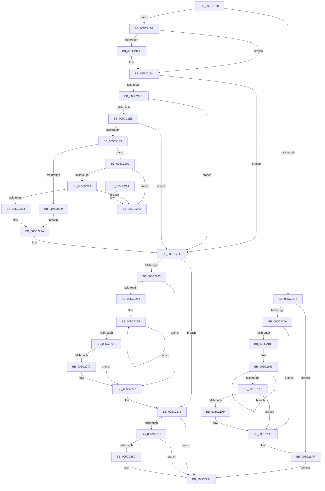

# KeSrcuReadUnlock

- RVA: `0x005C2140`–`0x005C22AC` (길이 `364` bytes)
- VA: `0x00000001405C2140`
- 실행 섹션: `.text`
- PDB 이름 있음: `예`; PDB Function 태그: `아니요`
- unwind 정보 RVA: `0x0006383C`
- 디코드: `102`개 명령, `364/364` bytes 표시
- 미해석 바이트: `0` (있으면 어셈블리에 `.byte`로 보존)

> 이 문서는 커널 이미지의 기계어와 PDB 기호를 분석해 생성했습니다. 4번과 5번은 함수 원형과 자료형을 바이너리 사용 방식에서 추정한 C 해석이며 원본 소스 복구 결과는 아닙니다.

## 1. Dependencies

- 직접 호출 지점: **6**; 고유 호출 대상: **5**
- 직접 호출자로 확인된 함수: **2**
- RIP 상대 이미지 참조: **0**

### Outgoing calls
- `0x005C2155` → [KeDisableInterrupts](../21/KeDisableInterrupts_function_00217BE0.md) (function, `0x00217BE0`)
- `0x005C21A9` → [KiRemoveSystemWorkPriorityKick](../26/KiRemoveSystemWorkPriorityKick_function_002631D0.md) (function, `0x002631D0`)
- `0x005C21B5` → [KiSrcuReadUnlockRemote](KiSrcuReadUnlockRemote_function_005C2B1C.md) (function, `0x005C2B1C`)
- `0x005C2272` → [KiRemoveSystemWorkPriorityKick](../26/KiRemoveSystemWorkPriorityKick_function_002631D0.md) (function, `0x002631D0`)
- `0x005C2283` → [KiSrcuReportQuiescent](KiSrcuReportQuiescent_function_005C2C08.md) (function, `0x005C2C08`)
- `0x005C228F` → [KiSrcuFlushCompleted](KiSrcuFlushCompleted_function_005C22B4.md) (function, `0x005C22B4`)

### Direct callers
- [KiSrcuReadUnlockIpi](KiSrcuReadUnlockIpi_function_005C2B00.md) at `0x005C2B0A`
- [KiSrcuReadUnlockRemote](KiSrcuReadUnlockRemote_function_005C2B1C.md) at `0x005C2B72`

### Static image references
- 디코드된 RIP-relative 메모리 참조가 없습니다.

## 2. Other-region calls and transfers

- 다른 실행 섹션으로 향하는 call: **0**
- 별도 외부 분기/꼬리 이동을 확인하지 못했습니다.

## 3. Assembly (complete function range)

```asm
005C2140  48 89 5C 24 08                  mov qword ptr [rsp + 8], rbx
005C2145  48 89 74 24 10                  mov qword ptr [rsp + 0x10], rsi
005C214A  57                              push rdi
005C214B  48 83 EC 20                     sub rsp, 0x20
005C214F  48 8B FA                        mov rdi, rdx
005C2152  48 8B F1                        mov rsi, rcx
005C2155  E8 86 5A C5 FF                  call 0x140217be0
005C215A  65 4C 8B 14 25 20 00 00 00      mov r10, qword ptr gs:[0x20]
005C2163  44 8A D8                        mov r11b, al
005C2166  44 8B 07                        mov r8d, dword ptr [rdi]
005C2169  45 0F B7 C8                     movzx r9d, r8w
005C216D  41 8B 5A 24                     mov ebx, dword ptr [r10 + 0x24]
005C2171  49 3B D9                        cmp rbx, r9
005C2174  74 49                           je 0x1405c21bf
005C2176  84 C0                           test al, al
005C2178  74 35                           je 0x1405c21af
005C217A  65 48 8B 0C 25 20 00 00 00      mov rcx, qword ptr gs:[0x20]
005C2183  4C 8B 81 B8 8E 00 00            mov r8, qword ptr [rcx + 0x8eb8]
005C218A  4D 85 C0                        test r8, r8
005C218D  74 1F                           je 0x1405c21ae
005C218F  41 0F 0D 08                     prefetchw byte ptr [r8]
005C2193  41 8B 00                        mov eax, dword ptr [r8]
005C2196  8B D0                           mov edx, eax
005C2198  0F BA F2 15                     btr edx, 0x15
005C219C  F0 41 0F B1 10                  lock cmpxchg dword ptr [r8], edx
005C21A1  75 F3                           jne 0x1405c2196
005C21A3  0F BA E0 15                     bt eax, 0x15
005C21A7  73 05                           jae 0x1405c21ae
005C21A9  E8 22 10 CA FF                  call 0x1402631d0
005C21AE  FB                              sti
005C21AF  48 8B D7                        mov rdx, rdi
005C21B2  48 8B CE                        mov rcx, rsi
005C21B5  E8 62 09 00 00                  call 0x1405c2b1c
005C21BA  E9 D5 00 00 00                  jmp 0x1405c2294
005C21BF  48 C1 E3 06                     shl rbx, 6
005C21C3  48 03 5E 20                     add rbx, qword ptr [rsi + 0x20]
005C21C7  48 8B 03                        mov rax, qword ptr [rbx]
005C21CA  48 85 C0                        test rax, rax
005C21CD  75 05                           jne 0x1405c21d4
005C21CF  8D 48 0E                        lea ecx, [rax + 0xe]
005C21D2  CD 29                           int 0x29
005C21D4  33 FF                           xor edi, edi
005C21D6  48 83 E8 01                     sub rax, 1
005C21DA  48 89 03                        mov qword ptr [rbx], rax
005C21DD  75 5F                           jne 0x1405c223e
005C21DF  48 8D 43 08                     lea rax, [rbx + 8]
005C21E3  48 8B 08                        mov rcx, qword ptr [rax]
005C21E6  48 85 C9                        test rcx, rcx
005C21E9  74 53                           je 0x1405c223e
005C21EB  41 38 BA E7 38 00 00            cmp byte ptr [r10 + 0x38e7], dil
005C21F2  74 4A                           je 0x1405c223e
005C21F4  48 3B C8                        cmp rcx, rax
005C21F7  75 09                           jne 0x1405c2202
005C21F9  49 21 BA F8 38 00 00            and qword ptr [r10 + 0x38f8], rdi
005C2200  EB 28                           jmp 0x1405c222a
005C2202  49 89 8A F8 38 00 00            mov qword ptr [r10 + 0x38f8], rcx
005C2209  48 8B 10                        mov rdx, qword ptr [rax]
005C220C  48 8B 48 08                     mov rcx, qword ptr [rax + 8]
005C2210  48 39 42 08                     cmp qword ptr [rdx + 8], rax
005C2214  0F 85 8B 00 00 00               jne 0x1405c22a5
005C221A  48 39 01                        cmp qword ptr [rcx], rax
005C221D  0F 85 82 00 00 00               jne 0x1405c22a5
005C2223  48 89 11                        mov qword ptr [rcx], rdx
005C2226  48 89 4A 08                     mov qword ptr [rdx + 8], rcx
005C222A  48 21 38                        and qword ptr [rax], rdi
005C222D  BF 01 00 00 00                  mov edi, 1
005C2232  48 8B 43 38                     mov rax, qword ptr [rbx + 0x38]
005C2236  48 8B 40 38                     mov rax, qword ptr [rax + 0x38]
005C223A  48 89 43 18                     mov qword ptr [rbx + 0x18], rax
005C223E  45 84 DB                        test r11b, r11b
005C2241  74 35                           je 0x1405c2278
005C2243  65 48 8B 0C 25 20 00 00 00      mov rcx, qword ptr gs:[0x20]
005C224C  4C 8B 81 B8 8E 00 00            mov r8, qword ptr [rcx + 0x8eb8]
005C2253  4D 85 C0                        test r8, r8
005C2256  74 1F                           je 0x1405c2277
005C2258  41 0F 0D 08                     prefetchw byte ptr [r8]
005C225C  41 8B 00                        mov eax, dword ptr [r8]
005C225F  8B D0                           mov edx, eax
005C2261  0F BA F2 15                     btr edx, 0x15
005C2265  F0 41 0F B1 10                  lock cmpxchg dword ptr [r8], edx
005C226A  75 F3                           jne 0x1405c225f
005C226C  0F BA E0 15                     bt eax, 0x15
005C2270  73 05                           jae 0x1405c2277
005C2272  E8 59 0F CA FF                  call 0x1402631d0
005C2277  FB                              sti
005C2278  85 FF                           test edi, edi
005C227A  74 18                           je 0x1405c2294
005C227C  48 8B 53 18                     mov rdx, qword ptr [rbx + 0x18]
005C2280  48 8B CB                        mov rcx, rbx
005C2283  E8 80 09 00 00                  call 0x1405c2c08
005C2288  85 C0                           test eax, eax
005C228A  74 08                           je 0x1405c2294
005C228C  48 8B CE                        mov rcx, rsi
005C228F  E8 20 00 00 00                  call 0x1405c22b4
005C2294  48 8B 5C 24 30                  mov rbx, qword ptr [rsp + 0x30]
005C2299  48 8B 74 24 38                  mov rsi, qword ptr [rsp + 0x38]
005C229E  48 83 C4 20                     add rsp, 0x20
005C22A2  5F                              pop rdi
005C22A3  C3                              ret
005C22A4  CC                              int3
005C22A5  B9 03 00 00 00                  mov ecx, 3
005C22AA  CD 29                           int 0x29
```

## 4. C-style interpretation (structured pseudocode)

```c
__int64 __fastcall KeSrcuReadUnlock(__int64 a1, __int64 a2)
{
    __int64 result;
    __int64 v_rbx;
    __int64 v_rdi;
    __int64 v_rsp;
    unsigned __int64 v_stack_p10;
    unsigned __int64 v_stack_p8;

    v_stack_p8 = v_rbx;
    v_stack_p10 = v_rsi;
    v_rsp = (v_rsp) - (32);
    result = KeDisableInterrupts(a1, a2, a3, a4);
    if (((unsigned int)(*(unsigned int *)(*(unsigned __int64 *)(gs_base + (0 + 32)) + 36))) == ((unsigned __int16)((unsigned int)(*(unsigned int *)(a2))))) goto loc_005C21BF;
    if ((unsigned __int8)(result) == 0) goto loc_005C21AF;
    if (*(unsigned __int64 *)(*(unsigned __int64 *)(gs_base + (0 + 32)) + 36536) == 0) goto loc_005C21AE;
loc_005C2196:
    if (*(unsigned __int64 *)(*(unsigned __int64 *)(gs_base + (0 + 32)) + 36536) != 0) goto loc_005C2196;
    result = (unsigned int)(*(unsigned int *)(*(unsigned __int64 *)(*(unsigned __int64 *)(gs_base + (0 + 32)) + 36536)));
    if (!(condition_is_above_or_equal)) {
        result = KiRemoveSystemWorkPriorityKick(*(unsigned __int64 *)(gs_base + (0 + 32)), (unsigned int)((unsigned int)((unsigned int)(*(unsigned int *)(*(unsigned __int64 *)(*(unsigned __int64 *)(gs_base + (0 + 32)) + 36536))))), *(unsigned __int64 *)(*(unsigned __int64 *)(gs_base + (0 + 32)) + 36536), (unsigned __int16)((unsigned int)(*(unsigned int *)(a2))));
    }
loc_005C21AF:
    result = KiSrcuReadUnlockRemote(a1, a2, *(unsigned __int64 *)(*(unsigned __int64 *)(gs_base + (0 + 32)) + 36536), (unsigned __int16)((unsigned int)(*(unsigned int *)(a2))));
    goto loc_005C2294;
loc_005C21BF:
    v_rbx = ((unsigned int)(*(unsigned int *)(*(unsigned __int64 *)(gs_base + (0 + 32)) + 36))) << (6);
    v_rbx = (v_rbx) + (*(unsigned __int64 *)(a1 + 32));
    if (*(unsigned __int64 *)(v_rbx) == 0) {
        a1 = *(unsigned __int64 *)(v_rbx) + 14;
    }
    v_rdi = 0;
    result = (*(unsigned __int64 *)(v_rbx)) - (1);
    *(unsigned __int64 *)(v_rbx) = result;
    if (condition_is_not_equal) goto loc_005C223E;
    if (*(unsigned __int64 *)(v_rbx + 8) == 0) goto loc_005C223E;
    if ((*(unsigned __int8 *)(*(unsigned __int64 *)(gs_base + (0 + 32)) + 14567)) == 0) goto loc_005C223E;
    if ((*(unsigned __int64 *)(v_rbx + 8)) != (v_rbx + 8)) goto loc_005C2202;
    goto loc_005C222A;
loc_005C2202:
    *(unsigned __int64 *)(*(unsigned __int64 *)(gs_base + (0 + 32)) + 14584) = *(unsigned __int64 *)(v_rbx + 8);
    if ((*(unsigned __int64 *)(*(unsigned __int64 *)(v_rbx + 8) + 8)) != (v_rbx + 8)) goto loc_005C22A5;
    if ((*(unsigned __int64 *)(*(unsigned __int64 *)(v_rbx + 8 + 8))) != (v_rbx + 8)) goto loc_005C22A5;
    *(unsigned __int64 *)(*(unsigned __int64 *)(v_rbx + 8 + 8)) = *(unsigned __int64 *)(v_rbx + 8);
    *(unsigned __int64 *)(*(unsigned __int64 *)(v_rbx + 8) + 8) = *(unsigned __int64 *)(v_rbx + 8 + 8);
loc_005C222A:
    *(unsigned __int64 *)(v_rbx + 24) = *(unsigned __int64 *)(*(unsigned __int64 *)(v_rbx + 56) + 56);
loc_005C223E:
    if ((unsigned __int8)((unsigned __int8)(result)) == 0) goto loc_005C2278;
    if (*(unsigned __int64 *)(*(unsigned __int64 *)(gs_base + (0 + 32)) + 36536) == 0) goto loc_005C2277;
loc_005C225F:
    if (*(unsigned __int64 *)(*(unsigned __int64 *)(gs_base + (0 + 32)) + 36536) != 0) goto loc_005C225F;
    result = (unsigned int)(*(unsigned int *)(*(unsigned __int64 *)(*(unsigned __int64 *)(gs_base + (0 + 32)) + 36536)));
    if (!(condition_is_above_or_equal)) {
        result = KiRemoveSystemWorkPriorityKick(*(unsigned __int64 *)(gs_base + (0 + 32)), (unsigned int)((unsigned int)((unsigned int)(*(unsigned int *)(*(unsigned __int64 *)(*(unsigned __int64 *)(gs_base + (0 + 32)) + 36536))))), *(unsigned __int64 *)(*(unsigned __int64 *)(gs_base + (0 + 32)) + 36536), (unsigned __int16)((unsigned int)(*(unsigned int *)(a2))));
    }
loc_005C2278:
    if (1 == 0) goto loc_005C2294;
    result = KiSrcuReportQuiescent(v_rbx, *(unsigned __int64 *)(v_rbx + 24), *(unsigned __int64 *)(*(unsigned __int64 *)(gs_base + (0 + 32)) + 36536), (unsigned __int16)((unsigned int)(*(unsigned int *)(a2))));
    if ((unsigned int)(result) != 0) {
        a1 = a1;
        result = KiSrcuFlushCompleted(a1, *(unsigned __int64 *)(v_rbx + 24), *(unsigned __int64 *)(*(unsigned __int64 *)(gs_base + (0 + 32)) + 36536), (unsigned __int16)((unsigned int)(*(unsigned int *)(a2))));
    }
    v_rsp = (v_rsp) + (32);
    return result;
loc_005C22A5:
    return result;
}
```

## 5. (Beta) C Style

```c
int64_t KeSrcuReadUnlock(void *Arg1, void *Arg2)
{
    uint8_t *arg1 = (uint8_t *)Arg1;
    uint8_t *arg2 = (uint8_t *)Arg2;

    int64_t result;
    int64_t local_rbx;
    int64_t local_rdi;
    int64_t local_rsp;
    uint64_t v_stack_p10;
    uint64_t v_stack_p8;

    v_stack_p8 = local_rbx;
    v_stack_p10 = local_rsi;
    local_rsp = (local_rsp) - (32);
    result = KeDisableInterrupts(Arg1, Arg2, a3, a4);
    if (((uint32_t)(*(uint32_t *)(*(uint64_t *)(gs_base + (0 + 0x20)) + 0x24))) == ((uint16_t)((uint32_t)(*(uint32_t *)(arg2))))) goto loc_005C21BF;
    if ((uint8_t)(result) == 0) goto loc_005C21AF;
    if (*(uint64_t *)(*(uint64_t *)(gs_base + (0 + 0x20)) + 0x8EB8) == 0) goto loc_005C21AE;
loc_005C2196:
    if (*(uint64_t *)(*(uint64_t *)(gs_base + (0 + 0x20)) + 0x8EB8) != 0) goto loc_005C2196;
    result = (uint32_t)(*(uint32_t *)(*(uint64_t *)(*(uint64_t *)(gs_base + (0 + 0x20)) + 0x8EB8)));
    if (!(condition_is_above_or_equal)) {
        result = KiRemoveSystemWorkPriorityKick(*(uint64_t *)(gs_base + (0 + 0x20)), (uint32_t)((uint32_t)((uint32_t)(*(uint32_t *)(*(uint64_t *)(*(uint64_t *)(gs_base + (0 + 0x20)) + 0x8EB8))))), *(uint64_t *)(*(uint64_t *)(gs_base + (0 + 0x20)) + 0x8EB8), (uint16_t)((uint32_t)(*(uint32_t *)(arg2))));
    }
loc_005C21AF:
    result = KiSrcuReadUnlockRemote(Arg1, Arg2, *(uint64_t *)(*(uint64_t *)(gs_base + (0 + 0x20)) + 0x8EB8), (uint16_t)((uint32_t)(*(uint32_t *)(arg2))));
    goto loc_005C2294;
loc_005C21BF:
    local_rbx = ((uint32_t)(*(uint32_t *)(*(uint64_t *)(gs_base + (0 + 0x20)) + 0x24))) << (6);
    local_rbx = (local_rbx) + (*(uint64_t *)(arg1 + 0x20));
    if (*(uint64_t *)(local_rbx) == 0) {
        Arg1 = *(uint64_t *)(local_rbx) + 14;
    }
    local_rdi = 0;
    result = (*(uint64_t *)(local_rbx)) - (1);
    *(uint64_t *)(local_rbx) = result;
    if (condition_is_not_equal) goto loc_005C223E;
    if (*(uint64_t *)(local_rbx + 0x8) == 0) goto loc_005C223E;
    if ((*(uint8_t *)(*(uint64_t *)(gs_base + (0 + 0x20)) + 0x38E7)) == 0) goto loc_005C223E;
    if ((*(uint64_t *)(local_rbx + 0x8)) != (local_rbx + 8)) goto loc_005C2202;
    goto loc_005C222A;
loc_005C2202:
    *(uint64_t *)(*(uint64_t *)(gs_base + (0 + 0x20)) + 0x38F8) = *(uint64_t *)(local_rbx + 0x8);
    if ((*(uint64_t *)(*(uint64_t *)(local_rbx + 0x8) + 0x8)) != (local_rbx + 8)) goto loc_005C22A5;
    if ((*(uint64_t *)(*(uint64_t *)(local_rbx + 0x8 + 0x8))) != (local_rbx + 8)) goto loc_005C22A5;
    *(uint64_t *)(*(uint64_t *)(local_rbx + 0x8 + 0x8)) = *(uint64_t *)(local_rbx + 0x8);
    *(uint64_t *)(*(uint64_t *)(local_rbx + 0x8) + 0x8) = *(uint64_t *)(local_rbx + 0x8 + 0x8);
loc_005C222A:
    *(uint64_t *)(local_rbx + 0x18) = *(uint64_t *)(*(uint64_t *)(local_rbx + 0x38) + 0x38);
loc_005C223E:
    if ((uint8_t)((uint8_t)(result)) == 0) goto loc_005C2278;
    if (*(uint64_t *)(*(uint64_t *)(gs_base + (0 + 0x20)) + 0x8EB8) == 0) goto loc_005C2277;
loc_005C225F:
    if (*(uint64_t *)(*(uint64_t *)(gs_base + (0 + 0x20)) + 0x8EB8) != 0) goto loc_005C225F;
    result = (uint32_t)(*(uint32_t *)(*(uint64_t *)(*(uint64_t *)(gs_base + (0 + 0x20)) + 0x8EB8)));
    if (!(condition_is_above_or_equal)) {
        result = KiRemoveSystemWorkPriorityKick(*(uint64_t *)(gs_base + (0 + 0x20)), (uint32_t)((uint32_t)((uint32_t)(*(uint32_t *)(*(uint64_t *)(*(uint64_t *)(gs_base + (0 + 0x20)) + 0x8EB8))))), *(uint64_t *)(*(uint64_t *)(gs_base + (0 + 0x20)) + 0x8EB8), (uint16_t)((uint32_t)(*(uint32_t *)(arg2))));
    }
loc_005C2278:
    if (1 == 0) goto loc_005C2294;
    result = KiSrcuReportQuiescent(local_rbx, *(uint64_t *)(local_rbx + 0x18), *(uint64_t *)(*(uint64_t *)(gs_base + (0 + 0x20)) + 0x8EB8), (uint16_t)((uint32_t)(*(uint32_t *)(arg2))));
    if ((uint32_t)(result) != 0) {
        Arg1 = Arg1;
        result = KiSrcuFlushCompleted(Arg1, *(uint64_t *)(local_rbx + 0x18), *(uint64_t *)(*(uint64_t *)(gs_base + (0 + 0x20)) + 0x8EB8), (uint16_t)((uint32_t)(*(uint32_t *)(arg2))));
    }
    local_rsp = (local_rsp) + (32);
    return result;
loc_005C22A5:
    return result;
}
```

### 관측된 메모리 오프셋

구조체 형식이 확인되지 않은 접근은 인자 기준의 오프셋으로만 기록했습니다.

| 기준 인자 | 오프셋 표현 | 폭 (bit) | 접근 |
|---|---:|---:|---|
| `Arg1` | `+ 0x20` | `64` | `R` |
| `Arg2` | `+ 0x0` | `32` | `R` |

## 6. Execution-region graph

[열기: 2D/3D 그래프와 함수 탐색 컨트롤 패널](../../../control-panel.html?section=text&rva=0x005C2140&view=graph)

- 2D 그래프는 위에서 아래로 흐르고, 3D 그래프는 빈 공간을 드래그해 회전합니다. Shift+드래그는 이동, 휠은 확대·축소, 함수 노드 선택은 대상 보고서 이동입니다.

### Static fallback


