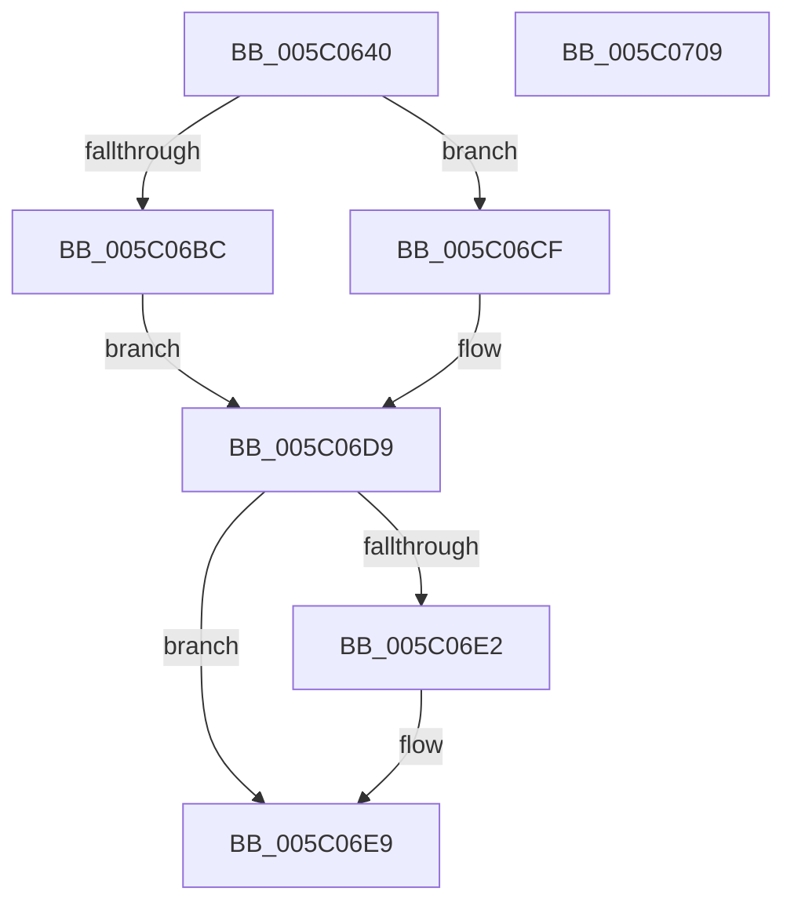

# KeStopProfile

- RVA: `0x005C0640`–`0x005C070A` (길이 `202` bytes)
- VA: `0x00000001405C0640`
- 실행 섹션: `.text`
- PDB 이름 있음: `예`; PDB Function 태그: `아니요`
- unwind 정보 RVA: `0x000CA678`
- 디코드: `47`개 명령, `202/202` bytes 표시
- 미해석 바이트: `0` (있으면 어셈블리에 `.byte`로 보존)

> 이 문서는 커널 이미지의 기계어와 PDB 기호를 분석해 생성했습니다. 4번과 5번은 함수 원형과 자료형을 바이너리 사용 방식에서 추정한 C 해석이며 원본 소스 복구 결과는 아닙니다.

## 1. Dependencies

- 직접 호출 지점: **6**; 고유 호출 대상: **5**
- 직접 호출자로 확인된 함수: **7**
- RIP 상대 이미지 참조: **3**

### Outgoing calls
- `0x005C0670` → [memset](../6C/memset_function_006C6C40.md) (function, `0x006C6C40`)
- `0x005C06AD` → [memset](../6C/memset_function_006C6C40.md) (function, `0x006C6C40`)
- `0x005C06C8` → [KeIpiGenericCall](../47/KeIpiGenericCall_function_00471720.md) (function, `0x00471720`)
- `0x005C06D4` → [KiStopProfileTarget](../30/KiStopProfileTarget_function_00304510.md) (function, `0x00304510`)
- `0x005C06E4` → [ExFreePoolWithTag](../../poolcode/B8/ExFreePoolWithTag_function_00B82870.md) (function, `0x00B82870`)
- `0x005C06F3` → [_security_check_cookie](../6A/_security_check_cookie_function_006AC640.md) (function, `0x006AC640`)

### Direct callers
- [KeStartProfile](../4E/KeStartProfile_function_004E1120.md) at `0x004E1245`
- [EtwTimeProfileReset](../../page/7B/EtwTimeProfileReset_function_007B7E8C.md) at `0x007B7EA1`
- [EtwpCoverageSamplerStop](../../page/7C/EtwpCoverageSamplerStop_function_007C2564.md) at `0x007C26C3`
- [ExpProfileDelete](../../page/7D/ExpProfileDelete_function_007D1FE0.md) at `0x007D1FF4`
- [NtStopProfile](../../page/7D/NtStopProfile_function_007D25C0.md) at `0x007D2649`
- [EtwpDisableKernelTrace](../../page/A4/EtwpDisableKernelTrace_function_00A4F7D8.md) at `0x00A4FB42`
- [sub_00B3C582](../../page/B3/Unknown_function_00B3C582.md) at `0x00B3C592`

### Static image references
- `0x005C0652` → RVA `0x00E0A740` (`.data`; read)
- `0x005C0675` → RVA `0x00FC6A80` (`ALMOSTRO`; read)
- `0x005C06C1` → RVA `0x00304510` (`KiStopProfileTarget`; read)

## 2. Other-region calls and transfers

- 다른 실행 섹션으로 향하는 call: **1**
  - `0x005C06E4` → [ExFreePoolWithTag](../../poolcode/B8/ExFreePoolWithTag_function_00B82870.md) (`.text` → `POOLCODE`)
- 별도 외부 분기/꼬리 이동을 확인하지 못했습니다.

## 3. Assembly (complete function range)

```asm
005C0640  48 89 5C 24 10                  mov qword ptr [rsp + 0x10], rbx
005C0645  55                              push rbp
005C0646  48 8D 6C 24 A0                  lea rbp, [rsp - 0x60]
005C064B  48 81 EC 60 01 00 00            sub rsp, 0x160
005C0652  48 8B 05 E7 A0 84 00            mov rax, qword ptr [rip + 0x84a0e7]
005C0659  48 33 C4                        xor rax, rsp
005C065C  48 89 45 50                     mov qword ptr [rbp + 0x50], rax
005C0660  48 8B D9                        mov rbx, rcx
005C0663  33 D2                           xor edx, edx
005C0665  48 8D 4C 24 38                  lea rcx, [rsp + 0x38]
005C066A  41 B8 10 01 00 00               mov r8d, 0x110
005C0670  E8 CB 65 10 00                  call 0x1406c6c40
005C0675  8B 05 05 64 A0 00               mov eax, dword ptr [rip + 0xa06405]
005C067B  48 8D 4C 24 38                  lea rcx, [rsp + 0x38]
005C0680  89 44 24 2C                     mov dword ptr [rsp + 0x2c], eax
005C0684  33 D2                           xor edx, edx
005C0686  8B 05 F4 63 A0 00               mov eax, dword ptr [rip + 0xa063f4]
005C068C  41 B8 00 01 00 00               mov r8d, 0x100
005C0692  83 64 24 34 00                  and dword ptr [rsp + 0x34], 0
005C0697  48 89 5C 24 20                  mov qword ptr [rsp + 0x20], rbx
005C069C  BB 01 00 00 00                  mov ebx, 1
005C06A1  89 44 24 28                     mov dword ptr [rsp + 0x28], eax
005C06A5  C7 44 24 30 01 00 20 00         mov dword ptr [rsp + 0x30], 0x200001
005C06AD  E8 8E 65 10 00                  call 0x1406c6c40
005C06B2  8B 05 C8 63 A0 00               mov eax, dword ptr [rip + 0xa063c8]
005C06B8  3B C3                           cmp eax, ebx
005C06BA  76 13                           jbe 0x1405c06cf
005C06BC  48 8D 54 24 20                  lea rdx, [rsp + 0x20]
005C06C1  48 8D 0D 48 3E D4 FF            lea rcx, [rip - 0x2bc1b8]
005C06C8  E8 53 10 EB FF                  call 0x140471720
005C06CD  EB 0A                           jmp 0x1405c06d9
005C06CF  48 8D 4C 24 20                  lea rcx, [rsp + 0x20]
005C06D4  E8 37 3E D4 FF                  call 0x140304510
005C06D9  48 8B 4D 38                     mov rcx, qword ptr [rbp + 0x38]
005C06DD  48 85 C9                        test rcx, rcx
005C06E0  74 07                           je 0x1405c06e9
005C06E2  33 D2                           xor edx, edx
005C06E4  E8 87 21 5C 00                  call 0x140b82870
005C06E9  8A 45 40                        mov al, byte ptr [rbp + 0x40]
005C06EC  48 8B 4D 50                     mov rcx, qword ptr [rbp + 0x50]
005C06F0  48 33 CC                        xor rcx, rsp
005C06F3  E8 48 BF 0E 00                  call 0x1406ac640
005C06F8  48 8B 9C 24 78 01 00 00         mov rbx, qword ptr [rsp + 0x178]
005C0700  48 81 C4 60 01 00 00            add rsp, 0x160
005C0707  5D                              pop rbp
005C0708  C3                              ret
005C0709  CC                              int3
```

## 4. C-style interpretation (structured pseudocode)

```c
__int64 __fastcall KeStopProfile(__int64 a1, int a2)
{
    __int64 result;
    __int64 v_rsp;
    unsigned __int64 v_stack_m130;
    unsigned int v_stack_m134;
    unsigned int v_stack_m138;
    unsigned int v_stack_m13C;
    unsigned int v_stack_m140;
    unsigned __int64 v_stack_m148;
    unsigned __int64 v_stack_m18;
    unsigned __int8 v_stack_m28;
    unsigned __int64 v_stack_m30;
    unsigned __int64 v_stack_m68;
    unsigned __int64 v_stack_p10;

    v_stack_p10 = v_rbx;
    v_rsp = (v_rsp) - (352);
    result = (*(unsigned __int64 *)(v_rip + 8691943)) ^ (v_rsp);
    v_stack_m18 = result;
    a2 = 0;
    result = memset(v_stack_m130, a2, 272, a4);
    v_stack_m13C = (unsigned int)((unsigned int)(*(unsigned int *)(v_rip + 10511365)));
    a2 = 0;
    v_stack_m148 = a1;
    v_stack_m140 = (unsigned int)((unsigned int)(*(unsigned int *)(v_rip + 10511348)));
    v_stack_m138 = 0x200001ULL;
    result = memset(v_stack_m130, a2, 256, a4);
    if (((unsigned int)((unsigned int)(*(unsigned int *)(v_rip + 10511304)))) <= 1) goto loc_005C06CF;
    result = KeIpiGenericCall(v_rip - 2867640, v_stack_m148, 256, a4);
    goto loc_005C06D9;
loc_005C06CF:
    result = KiStopProfileTarget(v_stack_m148, v_stack_m148, 256, a4);
loc_005C06D9:
    if (v_stack_m30 != 0) {
        a2 = 0;
        result = ExFreePoolWithTag(v_stack_m30, a2, 256, a4);
    }
    a1 = (v_stack_m18) ^ (v_rsp);
    result = _security_check_cookie(a1, a2, 256, a4);
    v_rsp = (v_rsp) + (352);
    return result;
}
```

## 5. (Beta) C Style

```c
int64_t KeStopProfile(int64_t Arg1, int32_t Arg2)
{
    int64_t result;
    int64_t local_rsp;
    uint64_t v_stack_m130;
    uint32_t v_stack_m134;
    uint32_t v_stack_m138;
    uint32_t v_stack_m13C;
    uint32_t v_stack_m140;
    uint64_t v_stack_m148;
    uint64_t v_stack_m18;
    uint8_t v_stack_m28;
    uint64_t v_stack_m30;
    uint64_t v_stack_m68;
    uint64_t v_stack_p10;

    v_stack_p10 = local_rbx;
    local_rsp = (local_rsp) - (352);
    result = (*(uint64_t *)(v_rip + 0x84A0E7)) ^ (local_rsp);
    v_stack_m18 = result;
    Arg2 = 0;
    result = memset(v_stack_m130, Arg2, 272, a4);
    v_stack_m13C = (uint32_t)((uint32_t)(*(uint32_t *)(v_rip + 0xA06405)));
    Arg2 = 0;
    v_stack_m148 = Arg1;
    v_stack_m140 = (uint32_t)((uint32_t)(*(uint32_t *)(v_rip + 0xA063F4)));
    v_stack_m138 = 0x200001ULL;
    result = memset(v_stack_m130, Arg2, 256, a4);
    if (((uint32_t)((uint32_t)(*(uint32_t *)(v_rip + 0xA063C8)))) <= 1) goto loc_005C06CF;
    result = KeIpiGenericCall(v_rip - 2867640, v_stack_m148, 256, a4);
    goto loc_005C06D9;
loc_005C06CF:
    result = KiStopProfileTarget(v_stack_m148, v_stack_m148, 256, a4);
loc_005C06D9:
    if (v_stack_m30 != 0) {
        Arg2 = 0;
        result = ExFreePoolWithTag(v_stack_m30, Arg2, 256, a4);
    }
    Arg1 = (v_stack_m18) ^ (local_rsp);
    result = _security_check_cookie(Arg1, Arg2, 256, a4);
    local_rsp = (local_rsp) + (352);
    return result;
}
```

## 6. Execution-region graph

[열기: 2D/3D 그래프와 함수 탐색 컨트롤 패널](../../../control-panel.html?section=text&rva=0x005C0640&view=graph)

- 2D 그래프는 위에서 아래로 흐르고, 3D 그래프는 빈 공간을 드래그해 회전합니다. Shift+드래그는 이동, 휠은 확대·축소, 함수 노드 선택은 대상 보고서 이동입니다.

### Static fallback


