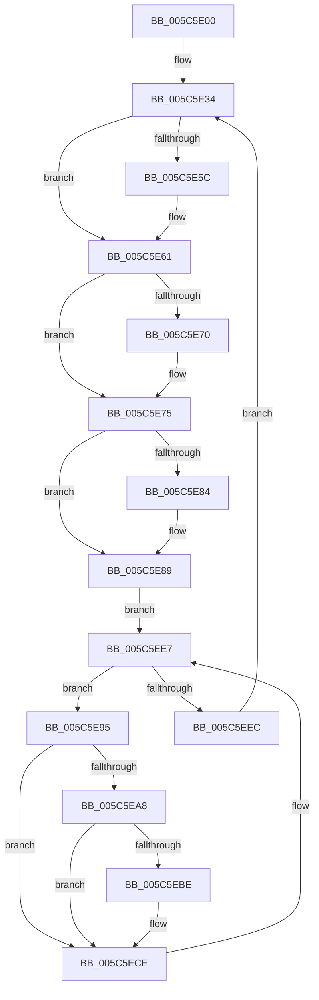

# KeSwapProcessOrStack

- RVA: `0x005C5E00`–`0x005C5EF1` (길이 `241` bytes)
- VA: `0x00000001405C5E00`
- 실행 섹션: `.text`
- PDB 이름 있음: `예`; PDB Function 태그: `아니요`
- unwind 정보 RVA: `0x000CAAA4`
- 디코드: `54`개 명령, `241/241` bytes 표시
- 미해석 바이트: `0` (있으면 어셈블리에 `.byte`로 보존)

> 이 문서는 커널 이미지의 기계어와 PDB 기호를 분석해 생성했습니다. 4번과 5번은 함수 원형과 자료형을 바이너리 사용 방식에서 추정한 C 해석이며 원본 소스 복구 결과는 아닙니다.

## 1. Dependencies

- 직접 호출 지점: **9**; 고유 호출 대상: **9**
- 직접 호출자로 확인된 함수: **0**
- RIP 상대 이미지 참조: **6**

### Outgoing calls
- `0x005C5E1D` → [KeSetPriorityThread](../2C/KeSetPriorityThread_function_002C76E0.md) (function, `0x002C76E0`)
- `0x005C5E48` → [KeWaitForSingleObject](../20/KeWaitForSingleObject_function_0020E6B0.md) (function, `0x0020E6B0`)
- `0x005C5E5C` → [KiOutSwapKernelStacks](../29/KiOutSwapKernelStacks_function_0029F628.md) (function, `0x0029F628`)
- `0x005C5E70` → [KiOutSwapProcesses](../3C/KiOutSwapProcesses_function_003C8038.md) (function, `0x003C8038`)
- `0x005C5E84` → [KiInSwapProcesses](../46/KiInSwapProcesses_function_00463218.md) (function, `0x00463218`)
- `0x005C5EA8` → [KeSwappablePageReference](../36/KeSwappablePageReference_function_0036A864.md) (function, `0x0036A864`)
- `0x005C5EB4` → [KeSwappablePageGetLockedAddress](../36/KeSwappablePageGetLockedAddress_function_0036A84C.md) (function, `0x0036A84C`)
- `0x005C5ED4` → [MmInPageKernelStack](../36/MmInPageKernelStack_function_0036A2E4.md) (function, `0x0036A2E4`)
- `0x005C5EE2` → [KiFastReadyThread](../39/KiFastReadyThread_function_00398548.md) (function, `0x00398548`)

### Direct callers
- 이 함수 시작 RVA로 연결되는 직접 call은 확인되지 않았습니다. 간접 호출은 완전히 역산할 수 없습니다.

### Static image references
- `0x005C5E2D` → RVA `0x00FC6ED0` (`ALMOSTRO`; write)
- `0x005C5E3F` → RVA `0x00F22D80` (`.data`; read)
- `0x005C5E52` → RVA `0x00E6695C` (`.data`; read)
- `0x005C5E64` → RVA `0x00F22D40` (`.data`; read/write)
- `0x005C5E78` → RVA `0x00F22D98` (`.data`; read/write)
- `0x005C5E8C` → RVA `0x00F22D48` (`.data`; read/write)

## 2. Other-region calls and transfers

- 다른 실행 섹션으로 향하는 call: **0**
- 별도 외부 분기/꼬리 이동을 확인하지 못했습니다.

## 3. Assembly (complete function range)

```asm
005C5E00  48 89 5C 24 08                  mov qword ptr [rsp + 8], rbx
005C5E05  48 89 74 24 10                  mov qword ptr [rsp + 0x10], rsi
005C5E0A  57                              push rdi
005C5E0B  48 83 EC 30                     sub rsp, 0x30
005C5E0F  65 48 8B 0C 25 88 01 00 00      mov rcx, qword ptr gs:[0x188]
005C5E18  BA 17 00 00 00                  mov edx, 0x17
005C5E1D  E8 BE 18 D0 FF                  call 0x1402c76e0
005C5E22  65 48 8B 04 25 88 01 00 00      mov rax, qword ptr gs:[0x188]
005C5E2B  33 F6                           xor esi, esi
005C5E2D  48 89 05 9C 10 A0 00            mov qword ptr [rip + 0xa0109c], rax
005C5E34  45 33 C9                        xor r9d, r9d
005C5E37  48 89 74 24 20                  mov qword ptr [rsp + 0x20], rsi
005C5E3C  45 33 C0                        xor r8d, r8d
005C5E3F  48 8D 0D 3A CF 95 00            lea rcx, [rip + 0x95cf3a]
005C5E46  33 D2                           xor edx, edx
005C5E48  E8 63 88 C4 FF                  call 0x14020e6b0
005C5E4D  B8 01 00 00 00                  mov eax, 1
005C5E52  F0 0F B1 35 02 0B 8A 00         lock cmpxchg dword ptr [rip + 0x8a0b02], esi
005C5E5A  75 05                           jne 0x1405c5e61
005C5E5C  E8 C7 97 CD FF                  call 0x14029f628
005C5E61  48 8B CE                        mov rcx, rsi
005C5E64  48 87 0D D5 CE 95 00            xchg qword ptr [rip + 0x95ced5], rcx
005C5E6B  48 85 C9                        test rcx, rcx
005C5E6E  74 05                           je 0x1405c5e75
005C5E70  E8 C3 21 E0 FF                  call 0x1403c8038
005C5E75  48 8B CE                        mov rcx, rsi
005C5E78  48 87 0D 19 CF 95 00            xchg qword ptr [rip + 0x95cf19], rcx
005C5E7F  48 85 C9                        test rcx, rcx
005C5E82  74 05                           je 0x1405c5e89
005C5E84  E8 8F D3 E9 FF                  call 0x140463218
005C5E89  48 8B DE                        mov rbx, rsi
005C5E8C  48 87 1D B5 CE 95 00            xchg qword ptr [rip + 0x95ceb5], rbx
005C5E93  EB 52                           jmp 0x1405c5ee7
005C5E95  48 8D BB 28 FF FF FF            lea rdi, [rbx - 0xd8]
005C5E9C  48 8B 8F 68 04 00 00            mov rcx, qword ptr [rdi + 0x468]
005C5EA3  48 85 C9                        test rcx, rcx
005C5EA6  74 26                           je 0x1405c5ece
005C5EA8  E8 B7 49 DA FF                  call 0x14036a864
005C5EAD  48 8B 8F 68 04 00 00            mov rcx, qword ptr [rdi + 0x468]
005C5EB4  E8 93 49 DA FF                  call 0x14036a84c
005C5EB9  48 85 C0                        test rax, rax
005C5EBC  74 10                           je 0x1405c5ece
005C5EBE  8B 97 64 04 00 00               mov edx, dword ptr [rdi + 0x464]
005C5EC4  48 03 D0                        add rdx, rax
005C5EC7  48 89 97 20 03 00 00            mov qword ptr [rdi + 0x320], rdx
005C5ECE  48 8B 1B                        mov rbx, qword ptr [rbx]
005C5ED1  48 8B CF                        mov rcx, rdi
005C5ED4  E8 0B 44 DA FF                  call 0x14036a2e4
005C5ED9  F0 0F BA 6F 78 11               lock bts dword ptr [rdi + 0x78], 0x11
005C5EDF  48 8B CF                        mov rcx, rdi
005C5EE2  E8 61 26 DD FF                  call 0x140398548
005C5EE7  48 85 DB                        test rbx, rbx
005C5EEA  75 A9                           jne 0x1405c5e95
005C5EEC  E9 43 FF FF FF                  jmp 0x1405c5e34
```

## 4. C-style interpretation (structured pseudocode)

```c
__int64 __fastcall KeSwapProcessOrStack(__int64 a1, __int64 a2, int a3, int a4)
{
    __int64 result;
    __int64 v_rsi;
    __int64 v_rsp;
    unsigned __int64 v_stack_m18;
    unsigned __int64 v_stack_p10;
    unsigned __int64 v_stack_p8;

    v_stack_p8 = v_rbx;
    v_stack_p10 = v_rsi;
    v_rsp = (v_rsp) - (48);
    result = KeSetPriorityThread(*(unsigned __int64 *)(gs_base + (0 + 392)), 23, a3, a4);
    v_rsi = 0;
    *(unsigned __int64 *)(v_rip + 10490012) = *(unsigned __int64 *)(gs_base + (0 + 392));
loc_005C5E34:
    a4 = 0;
    v_stack_m18 = 0;
    a3 = 0;
    a2 = 0;
    result = KeWaitForSingleObject(v_rip + 9817914, a2, a3, a4);
    result = 1;
    if (!(condition_is_not_equal)) {
        result = KiOutSwapKernelStacks(v_rip + 9817914, a2, a3, a4);
    }
    if (0 != 0) {
        result = KiOutSwapProcesses(0, a2, a3, a4);
    }
    if (0 != 0) {
        result = KiInSwapProcesses(0, a2, a3, a4);
    }
    goto loc_005C5EE7;
loc_005C5E95:
    if (*(unsigned __int64 *)(0 - 216 + 1128) == 0) goto loc_005C5ECE;
    result = KeSwappablePageReference(*(unsigned __int64 *)(0 - 216 + 1128), a2, a3, a4);
    result = KeSwappablePageGetLockedAddress(*(unsigned __int64 *)(0 - 216 + 1128), a2, a3, a4);
    if (result != 0) {
        a2 = *(unsigned int *)(0 - 216 + 1124);
        a2 = (a2) + (result);
        *(unsigned __int64 *)(0 - 216 + 800) = a2;
    }
    result = MmInPageKernelStack(0 - 216, a2, a3, a4);
    result = KiFastReadyThread(0 - 216, a2, a3, a4);
loc_005C5EE7:
    if (*(unsigned __int64 *)(0) != 0) goto loc_005C5E95;
    goto loc_005C5E34;
}
```

## 5. (Beta) C Style

```c
int64_t KeSwapProcessOrStack(int64_t Arg1, int64_t Arg2, int32_t Arg3, int32_t Arg4)
{
    int64_t result;
    int64_t local_rsi;
    int64_t local_rsp;
    uint64_t v_stack_m18;
    uint64_t v_stack_p10;
    uint64_t v_stack_p8;

    v_stack_p8 = local_rbx;
    v_stack_p10 = local_rsi;
    local_rsp = (local_rsp) - (48);
    result = KeSetPriorityThread(*(uint64_t *)(gs_base + (0 + 0x188)), 23, Arg3, Arg4);
    local_rsi = 0;
    *(uint64_t *)(v_rip + 0xA0109C) = *(uint64_t *)(gs_base + (0 + 0x188));
loc_005C5E34:
    Arg4 = 0;
    v_stack_m18 = 0;
    Arg3 = 0;
    Arg2 = 0;
    result = KeWaitForSingleObject(v_rip + 9817914, Arg2, Arg3, Arg4);
    result = 1;
    if (!(condition_is_not_equal)) {
        result = KiOutSwapKernelStacks(v_rip + 9817914, Arg2, Arg3, Arg4);
    }
    if (0 != 0) {
        result = KiOutSwapProcesses(0, Arg2, Arg3, Arg4);
    }
    if (0 != 0) {
        result = KiInSwapProcesses(0, Arg2, Arg3, Arg4);
    }
    goto loc_005C5EE7;
loc_005C5E95:
    if (*(uint64_t *)(0 - 0xD8 + 0x468) == 0) goto loc_005C5ECE;
    result = KeSwappablePageReference(*(uint64_t *)(0 - 0xD8 + 0x468), Arg2, Arg3, Arg4);
    result = KeSwappablePageGetLockedAddress(*(uint64_t *)(0 - 0xD8 + 0x468), Arg2, Arg3, Arg4);
    if (result != 0) {
        Arg2 = *(uint32_t *)(0 - 0xD8 + 0x464);
        Arg2 = (Arg2) + (result);
        *(uint64_t *)(0 - 0xD8 + 0x320) = Arg2;
    }
    result = MmInPageKernelStack(0 - 216, Arg2, Arg3, Arg4);
    result = KiFastReadyThread(0 - 216, Arg2, Arg3, Arg4);
loc_005C5EE7:
    if (*(uint64_t *)(0) != 0) goto loc_005C5E95;
    goto loc_005C5E34;
}
```

## 6. Execution-region graph

[열기: 2D/3D 그래프와 함수 탐색 컨트롤 패널](../../../control-panel.html?section=text&rva=0x005C5E00&view=graph)

- 2D 그래프는 위에서 아래로 흐르고, 3D 그래프는 빈 공간을 드래그해 회전합니다. Shift+드래그는 이동, 휠은 확대·축소, 함수 노드 선택은 대상 보고서 이동입니다.

### Static fallback


