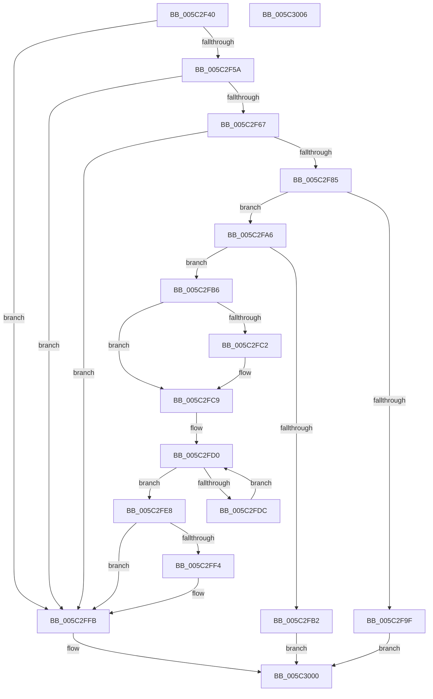

# KeSwitchFrozenProcessor

- RVA: `0x005C2F40`–`0x005C3007` (길이 `199` bytes)
- VA: `0x00000001405C2F40`
- 실행 섹션: `.text`
- PDB 이름 있음: `예`; PDB Function 태그: `아니요`
- unwind 정보 RVA: `0x0005CF00`
- 디코드: `52`개 명령, `199/199` bytes 표시
- 미해석 바이트: `0` (있으면 어셈블리에 `.byte`로 보존)

> 이 문서는 커널 이미지의 기계어와 PDB 기호를 분석해 생성했습니다. 4번과 5번은 함수 원형과 자료형을 바이너리 사용 방식에서 추정한 C 해석이며 원본 소스 복구 결과는 아닙니다.

## 1. Dependencies

- 직접 호출 지점: **4**; 고유 호출 대상: **4**
- 직접 호출자로 확인된 함수: **1**
- RIP 상대 이미지 참조: **3**

### Outgoing calls
- `0x005C2F4D` → [KeQueryActiveProcessorCountEx](../24/KeQueryActiveProcessorCountEx_function_00249EF0.md) (function, `0x00249EF0`)
- `0x005C2F8E` → [KiSetDebuggerOwner](../4F/KiSetDebuggerOwner_function_004FCE94.md) (function, `0x004FCE94`)
- `0x005C2FCB` → [KeQueryPerformanceCounter](../37/KeQueryPerformanceCounter_function_0037E7E0.md) (function, `0x0037E7E0`)
- `0x005C2FE1` → [KiCheckStall](KiCheckStall_function_005C3010.md) (function, `0x005C3010`)

### Direct callers
- [KdpSendWaitContinue](../../pagekd/B8/KdpSendWaitContinue_function_00B8A32C.md) at `0x00B8A6FE`

### Static image references
- `0x005C2F5A` → RVA `0x00F0BD23` (`.data`; read)
- `0x005C2F6A` → RVA `0x00FC8C40` (`ALMOSTRO`; read)
- `0x005C2FD0` → RVA `0x00F10E00` (`.data`; read)

## 2. Other-region calls and transfers

- 다른 실행 섹션으로 향하는 call: **0**
- 별도 외부 분기/꼬리 이동을 확인하지 못했습니다.

## 3. Assembly (complete function range)

```asm
005C2F40  40 53                           push rbx
005C2F42  48 83 EC 20                     sub rsp, 0x20
005C2F46  8B D9                           mov ebx, ecx
005C2F48  B9 FF FF 00 00                  mov ecx, 0xffff
005C2F4D  E8 9E 6F C8 FF                  call 0x140249ef0
005C2F52  3B D8                           cmp ebx, eax
005C2F54  0F 83 A1 00 00 00               jae 0x1405c2ffb
005C2F5A  80 3D C2 8D 94 00 00            cmp byte ptr [rip + 0x948dc2], 0
005C2F61  0F 85 94 00 00 00               jne 0x1405c2ffb
005C2F67  0F AE E8                        lfence
005C2F6A  48 8D 0D CF 5C A0 00            lea rcx, [rip + 0xa05ccf]
005C2F71  48 8B 0C D9                     mov rcx, qword ptr [rcx + rbx*8]
005C2F75  8B 81 88 2D 00 00               mov eax, dword ptr [rcx + 0x2d88]
005C2F7B  83 C0 FE                        add eax, -2
005C2F7E  A9 FD FF FF FF                  test eax, 0xfffffffd
005C2F83  75 76                           jne 0x1405c2ffb
005C2F85  65 48 8B 1C 25 20 00 00 00      mov rbx, qword ptr gs:[0x20]
005C2F8E  E8 01 9F F3 FF                  call 0x1404fce94
005C2F93  8B 83 88 2D 00 00               mov eax, dword ptr [rbx + 0x2d88]
005C2F99  24 0F                           and al, 0xf
005C2F9B  3C 02                           cmp al, 2
005C2F9D  75 07                           jne 0x1405c2fa6
005C2F9F  B8 03 00 00 00                  mov eax, 3
005C2FA4  EB 5A                           jmp 0x1405c3000
005C2FA6  8B 83 88 2D 00 00               mov eax, dword ptr [rbx + 0x2d88]
005C2FAC  24 0F                           and al, 0xf
005C2FAE  3C 04                           cmp al, 4
005C2FB0  74 04                           je 0x1405c2fb6
005C2FB2  33 C0                           xor eax, eax
005C2FB4  EB 4A                           jmp 0x1405c3000
005C2FB6  48 8B 83 B8 8E 00 00            mov rax, qword ptr [rbx + 0x8eb8]
005C2FBD  48 85 C0                        test rax, rax
005C2FC0  74 07                           je 0x1405c2fc9
005C2FC2  F0 81 08 00 00 02 00            lock or dword ptr [rax], 0x20000
005C2FC9  33 C9                           xor ecx, ecx
005C2FCB  E8 10 B8 DB FF                  call 0x14037e7e0
005C2FD0  48 8B 05 29 DE 94 00            mov rax, qword ptr [rip + 0x94de29]
005C2FD7  48 3B D8                        cmp rbx, rax
005C2FDA  74 0C                           je 0x1405c2fe8
005C2FDC  B2 01                           mov dl, 1
005C2FDE  48 8B CB                        mov rcx, rbx
005C2FE1  E8 2A 00 00 00                  call 0x1405c3010
005C2FE6  EB E8                           jmp 0x1405c2fd0
005C2FE8  48 8B 8B B8 8E 00 00            mov rcx, qword ptr [rbx + 0x8eb8]
005C2FEF  48 85 C9                        test rcx, rcx
005C2FF2  74 07                           je 0x1405c2ffb
005C2FF4  F0 81 21 FF FF FD FF            lock and dword ptr [rcx], 0xfffdffff
005C2FFB  B8 02 00 00 00                  mov eax, 2
005C3000  48 83 C4 20                     add rsp, 0x20
005C3004  5B                              pop rbx
005C3005  C3                              ret
005C3006  CC                              int3
```

## 4. C-style interpretation (structured pseudocode)

```c
__int64 __fastcall KeSwitchFrozenProcessor(int a1)
{
    __int64 result;
    __int64 v_rsp;

    v_rsp = (v_rsp) - (32);
    result = KeQueryActiveProcessorCountEx((unsigned int)(0xFFFFULL), a2, a3, a4);
    if (((unsigned int)((unsigned int)(a1))) >= ((unsigned int)(result))) goto loc_005C2FFB;
    if ((*(unsigned __int8 *)(v_rip + 9735618)) != 0) goto loc_005C2FFB;
    result = (unsigned int)(((unsigned int)(*(unsigned int *)(*(unsigned __int64 *)(v_rip + 10509519 + (unsigned int)(a1) * 8) + 11656))) + (-2));
    if ((((unsigned int)(result)) & (0xFFFFFFFDULL)) != 0) goto loc_005C2FFB;
    result = KiSetDebuggerOwner(*(unsigned __int64 *)(v_rip + 10509519 + (unsigned int)(a1) * 8), a2, a3, a4);
    result = (unsigned __int8)(((unsigned int)(*(unsigned int *)(*(unsigned __int64 *)(gs_base + (0 + 32)) + 11656))) & (15));
    if (((unsigned __int8)(result)) != 2) goto loc_005C2FA6;
    goto loc_005C3000;
loc_005C2FA6:
    result = (unsigned __int8)(((unsigned int)(*(unsigned int *)(*(unsigned __int64 *)(gs_base + (0 + 32)) + 11656))) & (15));
    if (((unsigned __int8)(result)) == 4) goto loc_005C2FB6;
    result = 0;
    goto loc_005C3000;
loc_005C2FB6:
    if (*(unsigned __int64 *)(*(unsigned __int64 *)(gs_base + (0 + 32)) + 36536) != 0) {
    }
    a1 = 0;
    result = KeQueryPerformanceCounter(a1, a2, a3, a4);
loc_005C2FD0:
    if ((*(unsigned __int64 *)(gs_base + (0 + 32))) == (*(unsigned __int64 *)(v_rip + 9756201))) goto loc_005C2FE8;
    result = KiCheckStall(*(unsigned __int64 *)(gs_base + (0 + 32)), 1, a3, a4);
    goto loc_005C2FD0;
loc_005C2FE8:
    if (*(unsigned __int64 *)(*(unsigned __int64 *)(gs_base + (0 + 32)) + 36536) != 0) {
    }
loc_005C3000:
    v_rsp = (v_rsp) + (32);
    return 2;
}
```

## 5. (Beta) C Style

```c
int64_t KeSwitchFrozenProcessor(int32_t Arg1)
{
    int64_t result;
    int64_t local_rsp;

    local_rsp = (local_rsp) - (32);
    result = KeQueryActiveProcessorCountEx((uint32_t)(0xFFFFULL), a2, a3, a4);
    if (((uint32_t)((uint32_t)(Arg1))) >= ((uint32_t)(result))) goto loc_005C2FFB;
    if ((*(uint8_t *)(v_rip + 0x948DC2)) != 0) goto loc_005C2FFB;
    result = (uint32_t)(((uint32_t)(*(uint32_t *)(*(uint64_t *)(v_rip + 0xA05CCF + (uint32_t)(Arg1) * 8) + 0x2D88))) + (-2));
    if ((((uint32_t)(result)) & (0xFFFFFFFDULL)) != 0) goto loc_005C2FFB;
    result = KiSetDebuggerOwner(*(uint64_t *)(v_rip + 0xA05CCF + (uint32_t)(Arg1) * 8), a2, a3, a4);
    result = (uint8_t)(((uint32_t)(*(uint32_t *)(*(uint64_t *)(gs_base + (0 + 0x20)) + 0x2D88))) & (15));
    if (((uint8_t)(result)) != 2) goto loc_005C2FA6;
    goto loc_005C3000;
loc_005C2FA6:
    result = (uint8_t)(((uint32_t)(*(uint32_t *)(*(uint64_t *)(gs_base + (0 + 0x20)) + 0x2D88))) & (15));
    if (((uint8_t)(result)) == 4) goto loc_005C2FB6;
    result = 0;
    goto loc_005C3000;
loc_005C2FB6:
    if (*(uint64_t *)(*(uint64_t *)(gs_base + (0 + 0x20)) + 0x8EB8) != 0) {
    }
    Arg1 = 0;
    result = KeQueryPerformanceCounter(Arg1, a2, a3, a4);
loc_005C2FD0:
    if ((*(uint64_t *)(gs_base + (0 + 0x20))) == (*(uint64_t *)(v_rip + 0x94DE29))) goto loc_005C2FE8;
    result = KiCheckStall(*(uint64_t *)(gs_base + (0 + 0x20)), 1, a3, a4);
    goto loc_005C2FD0;
loc_005C2FE8:
    if (*(uint64_t *)(*(uint64_t *)(gs_base + (0 + 0x20)) + 0x8EB8) != 0) {
    }
loc_005C3000:
    local_rsp = (local_rsp) + (32);
    return 2;
}
```

## 6. Execution-region graph

[열기: 2D/3D 그래프와 함수 탐색 컨트롤 패널](../../../control-panel.html?section=text&rva=0x005C2F40&view=graph)

- 2D 그래프는 위에서 아래로 흐르고, 3D 그래프는 빈 공간을 드래그해 회전합니다. Shift+드래그는 이동, 휠은 확대·축소, 함수 노드 선택은 대상 보고서 이동입니다.

### Static fallback


