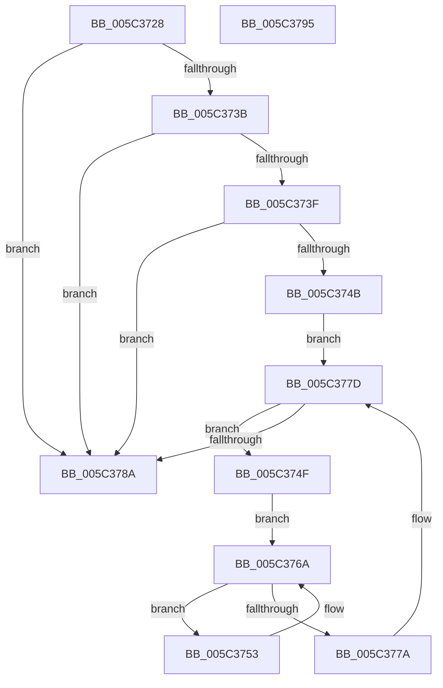

# KeTraceHgsPlusRundown

- RVA: `0x005C3728`–`0x005C3796` (길이 `110` bytes)
- VA: `0x00000001405C3728`
- 실행 섹션: `.text`
- PDB 이름 있음: `예`; PDB Function 태그: `아니요`
- unwind 정보 RVA: `0x0005CAAC`
- 디코드: `33`개 명령, `110/110` bytes 표시
- 미해석 바이트: `0` (있으면 어셈블리에 `.byte`로 보존)

> 이 문서는 커널 이미지의 기계어와 PDB 기호를 분석해 생성했습니다. 4번과 5번은 함수 원형과 자료형을 바이너리 사용 방식에서 추정한 C 해석이며 원본 소스 복구 결과는 아닙니다.

## 1. Dependencies

- 직접 호출 지점: **3**; 고유 호출 대상: **3**
- 직접 호출자로 확인된 함수: **1**
- RIP 상대 이미지 참조: **2**

### Outgoing calls
- `0x005C3762` → [EtwTraceWorkloadClassUpdate](../65/EtwTraceWorkloadClassUpdate_function_00650714.md) (function, `0x00650714`)
- `0x005C376D` → [PsGetNextProcessThread](../../page/8C/PsGetNextProcessThread_function_008C9CF0.md) (function, `0x008C9CF0`)
- `0x005C377D` → [PsGetNextProcess](../../page/91/PsGetNextProcess_function_0091C900.md) (function, `0x0091C900`)

### Direct callers
- [EtwpKernelTraceRundown](../../page/9E/EtwpKernelTraceRundown_function_009E4080.md) at `0x009E426B`

### Static image references
- `0x005C3732` → RVA `0x00FC6ADE` (`ALMOSTRO`; read)
- `0x005C373F` → RVA `0x00FC6B14` (`ALMOSTRO`; read)

## 2. Other-region calls and transfers

- 다른 실행 섹션으로 향하는 call: **2**
  - `0x005C376D` → [PsGetNextProcessThread](../../page/8C/PsGetNextProcessThread_function_008C9CF0.md) (`.text` → `PAGE`)
  - `0x005C377D` → [PsGetNextProcess](../../page/91/PsGetNextProcess_function_0091C900.md) (`.text` → `PAGE`)
- 별도 외부 분기/꼬리 이동을 확인하지 못했습니다.

## 3. Assembly (complete function range)

```asm
005C3728  48 89 5C 24 08                  mov qword ptr [rsp + 8], rbx
005C372D  57                              push rdi
005C372E  48 83 EC 20                     sub rsp, 0x20
005C3732  80 3D A5 33 A0 00 00            cmp byte ptr [rip + 0xa033a5], 0
005C3739  74 4F                           je 0x1405c378a
005C373B  84 C9                           test cl, cl
005C373D  74 4B                           je 0x1405c378a
005C373F  F7 05 CB 33 A0 00 00 01 00 00   test dword ptr [rip + 0xa033cb], 0x100
005C3749  74 3F                           je 0x1405c378a
005C374B  33 C9                           xor ecx, ecx
005C374D  EB 2E                           jmp 0x1405c377d
005C374F  33 D2                           xor edx, edx
005C3751  EB 17                           jmp 0x1405c376a
005C3753  8A 97 05 02 00 00               mov dl, byte ptr [rdi + 0x205]
005C3759  41 B8 01 00 00 00               mov r8d, 1
005C375F  48 8B CF                        mov rcx, rdi
005C3762  E8 AD CF 08 00                  call 0x140650714
005C3767  48 8B D7                        mov rdx, rdi
005C376A  48 8B CB                        mov rcx, rbx
005C376D  E8 7E 65 30 00                  call 0x1408c9cf0
005C3772  48 8B F8                        mov rdi, rax
005C3775  48 85 C0                        test rax, rax
005C3778  75 D9                           jne 0x1405c3753
005C377A  48 8B CB                        mov rcx, rbx
005C377D  E8 7E 91 35 00                  call 0x14091c900
005C3782  48 8B D8                        mov rbx, rax
005C3785  48 85 C0                        test rax, rax
005C3788  75 C5                           jne 0x1405c374f
005C378A  48 8B 5C 24 30                  mov rbx, qword ptr [rsp + 0x30]
005C378F  48 83 C4 20                     add rsp, 0x20
005C3793  5F                              pop rdi
005C3794  C3                              ret
005C3795  CC                              int3
```

## 4. C-style interpretation (structured pseudocode)

```c
__int64 __fastcall KeTraceHgsPlusRundown(int a1, int a2)
{
    __int64 result;
    __int64 v_rsp;
    unsigned __int64 v_stack_p8;

    v_stack_p8 = v_rbx;
    v_rsp = (v_rsp) - (32);
    if ((*(unsigned __int8 *)(v_rip + 10498981)) == 0) goto loc_005C378A;
    if ((unsigned __int8)(a1) == 0) goto loc_005C378A;
    if (((*(unsigned int *)(v_rip + 10499019)) & (256)) == 0) goto loc_005C378A;
    a1 = 0;
    goto loc_005C377D;
loc_005C374F:
    a2 = 0;
    goto loc_005C376A;
loc_005C3753:
    result = EtwTraceWorkloadClassUpdate(v_rdi, *(unsigned __int8 *)(v_rdi + 517), 1, a4);
loc_005C376A:
    result = PsGetNextProcessThread(v_rbx, v_rdi, 1, a4);
    if (result != 0) goto loc_005C3753;
loc_005C377D:
    result = PsGetNextProcess(v_rbx, v_rdi, 1, a4);
    if (result != 0) goto loc_005C374F;
loc_005C378A:
    v_rsp = (v_rsp) + (32);
    return result;
}
```

## 5. (Beta) C Style

```c
int64_t KeTraceHgsPlusRundown(int32_t Arg1, int32_t Arg2)
{
    int64_t result;
    int64_t local_rsp;
    uint64_t v_stack_p8;

    v_stack_p8 = local_rbx;
    local_rsp = (local_rsp) - (32);
    if ((*(uint8_t *)(v_rip + 0xA033A5)) == 0) goto loc_005C378A;
    if ((uint8_t)(Arg1) == 0) goto loc_005C378A;
    if (((*(uint32_t *)(v_rip + 0xA033CB)) & (256)) == 0) goto loc_005C378A;
    Arg1 = 0;
    goto loc_005C377D;
loc_005C374F:
    Arg2 = 0;
    goto loc_005C376A;
loc_005C3753:
    result = EtwTraceWorkloadClassUpdate(local_rdi, *(uint8_t *)(local_rdi + 0x205), 1, a4);
loc_005C376A:
    result = PsGetNextProcessThread(local_rbx, local_rdi, 1, a4);
    if (result != 0) goto loc_005C3753;
loc_005C377D:
    result = PsGetNextProcess(local_rbx, local_rdi, 1, a4);
    if (result != 0) goto loc_005C374F;
loc_005C378A:
    local_rsp = (local_rsp) + (32);
    return result;
}
```

## 6. Execution-region graph

[열기: 2D/3D 그래프와 함수 탐색 컨트롤 패널](../../../control-panel.html?section=text&rva=0x005C3728&view=graph)

- 2D 그래프는 위에서 아래로 흐르고, 3D 그래프는 빈 공간을 드래그해 회전합니다. Shift+드래그는 이동, 휠은 확대·축소, 함수 노드 선택은 대상 보고서 이동입니다.

### Static fallback


