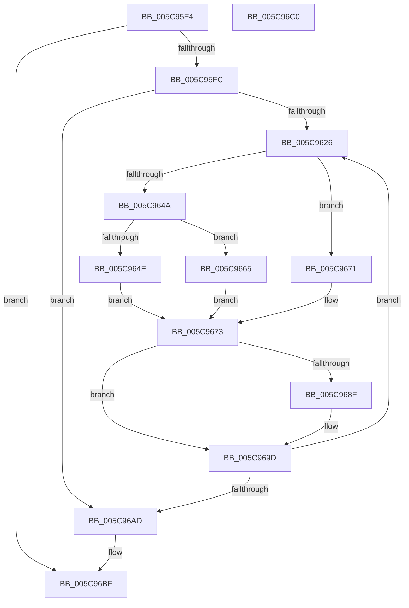

# KeTraceParkingRundown

- RVA: `0x005C95F4`–`0x005C96C1` (길이 `205` bytes)
- VA: `0x00000001405C95F4`
- 실행 섹션: `.text`
- PDB 이름 있음: `예`; PDB Function 태그: `아니요`
- unwind 정보 RVA: `0x000CB1F8`
- 디코드: `62`개 명령, `205/205` bytes 표시
- 미해석 바이트: `0` (있으면 어셈블리에 `.byte`로 보존)

> 이 문서는 커널 이미지의 기계어와 PDB 기호를 분석해 생성했습니다. 4번과 5번은 함수 원형과 자료형을 바이너리 사용 방식에서 추정한 C 해석이며 원본 소스 복구 결과는 아닙니다.

## 1. Dependencies

- 직접 호출 지점: **4**; 고유 호출 대상: **4**
- 직접 호출자로 확인된 함수: **1**
- RIP 상대 이미지 참조: **2**

### Outgoing calls
- `0x005C963E` → [KiAcquirePrcbLocksForIsolationUnit](../30/KiAcquirePrcbLocksForIsolationUnit_function_0030ED60.md) (function, `0x0030ED60`)
- `0x005C9678` → [KiReleasePrcbLocksForIsolationUnit](../39/KiReleasePrcbLocksForIsolationUnit_function_00399C50.md) (function, `0x00399C50`)
- `0x005C9685` → [EtwTraceParkTransition](../64/EtwTraceParkTransition_function_0064FE38.md) (function, `0x0064FE38`)
- `0x005C9698` → [EtwTraceForceParkTransition](../64/EtwTraceForceParkTransition_function_0064F9FC.md) (function, `0x0064F9FC`)

### Direct callers
- [EtwpKernelTraceRundown](../../page/9E/EtwpKernelTraceRundown_function_009E4080.md) at `0x009E4286`

### Static image references
- `0x005C9616` → RVA `0x00FC6A80` (`ALMOSTRO`; read)
- `0x005C9626` → RVA `0x00FC8C40` (`ALMOSTRO`; read)

## 2. Other-region calls and transfers

- 다른 실행 섹션으로 향하는 call: **0**
- 별도 외부 분기/꼬리 이동을 확인하지 못했습니다.

## 3. Assembly (complete function range)

```asm
005C95F4  84 C9                           test cl, cl
005C95F6  0F 84 C3 00 00 00               je 0x1405c96bf
005C95FC  48 89 5C 24 08                  mov qword ptr [rsp + 8], rbx
005C9601  48 89 6C 24 18                  mov qword ptr [rsp + 0x18], rbp
005C9606  56                              push rsi
005C9607  57                              push rdi
005C9608  41 56                           push r14
005C960A  48 83 EC 20                     sub rsp, 0x20
005C960E  48 83 64 24 48 00               and qword ptr [rsp + 0x48], 0
005C9614  33 ED                           xor ebp, ebp
005C9616  8B 05 64 D4 9F 00               mov eax, dword ptr [rip + 0x9fd464]
005C961C  33 FF                           xor edi, edi
005C961E  85 C0                           test eax, eax
005C9620  0F 84 87 00 00 00               je 0x1405c96ad
005C9626  48 8D 35 13 F6 9F 00            lea rsi, [rip + 0x9ff613]
005C962D  33 D2                           xor edx, edx
005C962F  48 8B 34 FE                     mov rsi, qword ptr [rsi + rdi*8]
005C9633  4C 8D 44 24 48                  lea r8, [rsp + 0x48]
005C9638  48 8B CE                        mov rcx, rsi
005C963B  45 32 F6                        xor r14b, r14b
005C963E  E8 1D 57 D4 FF                  call 0x14030ed60
005C9643  8A 46 23                        mov al, byte ptr [rsi + 0x23]
005C9646  A8 10                           test al, 0x10
005C9648  74 27                           je 0x1405c9671
005C964A  A8 08                           test al, 8
005C964C  74 17                           je 0x1405c9665
005C964E  48 8B 86 F0 86 00 00            mov rax, qword ptr [rsi + 0x86f0]
005C9655  BB 03 00 00 00                  mov ebx, 3
005C965A  41 B6 01                        mov r14b, 1
005C965D  8B A8 50 01 00 00               mov ebp, dword ptr [rax + 0x150]
005C9663  EB 0E                           jmp 0x1405c9673
005C9665  24 04                           and al, 4
005C9667  F6 D8                           neg al
005C9669  1B DB                           sbb ebx, ebx
005C966B  F7 DB                           neg ebx
005C966D  FF C3                           inc ebx
005C966F  EB 02                           jmp 0x1405c9673
005C9671  33 DB                           xor ebx, ebx
005C9673  48 8D 4C 24 48                  lea rcx, [rsp + 0x48]
005C9678  E8 D3 05 DD FF                  call 0x140399c50
005C967D  44 8B C3                        mov r8d, ebx
005C9680  8B D3                           mov edx, ebx
005C9682  48 8B CE                        mov rcx, rsi
005C9685  E8 AE 67 08 00                  call 0x14064fe38
005C968A  45 84 F6                        test r14b, r14b
005C968D  74 0E                           je 0x1405c969d
005C968F  45 33 C0                        xor r8d, r8d
005C9692  40 8A D5                        mov dl, bpl
005C9695  48 8B CE                        mov rcx, rsi
005C9698  E8 5F 63 08 00                  call 0x14064f9fc
005C969D  8B 05 DD D3 9F 00               mov eax, dword ptr [rip + 0x9fd3dd]
005C96A3  FF C7                           inc edi
005C96A5  3B F8                           cmp edi, eax
005C96A7  0F 82 79 FF FF FF               jb 0x1405c9626
005C96AD  48 8B 5C 24 40                  mov rbx, qword ptr [rsp + 0x40]
005C96B2  48 8B 6C 24 50                  mov rbp, qword ptr [rsp + 0x50]
005C96B7  48 83 C4 20                     add rsp, 0x20
005C96BB  41 5E                           pop r14
005C96BD  5F                              pop rdi
005C96BE  5E                              pop rsi
005C96BF  C3                              ret
005C96C0  CC                              int3
```

## 4. C-style interpretation (structured pseudocode)

```c
__int64 __fastcall KeTraceParkingRundown(unsigned __int8 a1, int a2)
{
    __int64 result;
    __int64 v_r14;
    __int64 v_rbp;
    __int64 v_rbx;
    __int64 v_rdi;
    __int64 v_rsp;
    unsigned __int64 v_stack_p10;
    unsigned __int64 v_stack_p18;
    unsigned __int64 v_stack_p8;

    if (a1 == 0) goto loc_005C96BF;
    v_stack_p8 = v_rbx;
    v_stack_p18 = v_rbp;
    v_rsp = (v_rsp) - (32);
    v_rbp = 0;
    v_rdi = 0;
    if ((unsigned int)((unsigned int)(*(unsigned int *)(v_rip + 10474596))) == 0) goto loc_005C96AD;
loc_005C9626:
    a2 = 0;
    v_r14 = 0;
    result = KiAcquirePrcbLocksForIsolationUnit(*(unsigned __int64 *)(v_rip + 10483219 + v_rdi * 8), a2, v_stack_p10, a4);
    if ((((unsigned __int8)(*(unsigned __int8 *)(*(unsigned __int64 *)(v_rip + 10483219 + v_rdi * 8) + 35))) & (16)) == 0) goto loc_005C9671;
    if ((((unsigned __int8)(*(unsigned __int8 *)(*(unsigned __int64 *)(v_rip + 10483219 + v_rdi * 8) + 35))) & (8)) == 0) goto loc_005C9665;
    goto loc_005C9673;
loc_005C9665:
    result = (unsigned __int8)((*(unsigned __int64 *)(*(unsigned __int64 *)(v_rip + 10483219 + v_rdi * 8) + 34544)) & (4));
    result = (unsigned __int8)(-(result));
    v_rbx = (unsigned int)(-(3));
    v_rbx = (unsigned int)((v_rbx) + 1);
    goto loc_005C9673;
loc_005C9671:
    v_rbx = 0;
loc_005C9673:
    result = KiReleasePrcbLocksForIsolationUnit(v_stack_p10, a2, v_stack_p10, a4);
    result = EtwTraceParkTransition(*(unsigned __int64 *)(v_rip + 10483219 + v_rdi * 8), 0, 0, a4);
    if (1 != 0) {
        a3 = 0;
        a2 = (unsigned __int8)((unsigned int)(*(unsigned int *)(*(unsigned __int64 *)(*(unsigned __int64 *)(v_rip + 10483219 + v_rdi * 8) + 34544) + 336)));
        a1 = *(unsigned __int64 *)(v_rip + 10483219 + v_rdi * 8);
        result = EtwTraceForceParkTransition(a1, a2, a3, a4);
    }
    v_rdi = (unsigned int)((v_rdi) + 1);
    if (((unsigned int)(v_rdi)) < ((unsigned int)((unsigned int)(*(unsigned int *)(v_rip + 10474461))))) goto loc_005C9626;
loc_005C96AD:
    v_rsp = (v_rsp) + (32);
loc_005C96BF:
    return (unsigned int)(*(unsigned int *)(v_rip + 10474461));
}
```

## 5. (Beta) C Style

```c
int64_t KeTraceParkingRundown(uint8_t Arg1, int32_t Arg2)
{
    int64_t result;
    int64_t local_r14;
    int64_t local_rbp;
    int64_t local_rbx;
    int64_t local_rdi;
    int64_t local_rsp;
    uint64_t v_stack_p10;
    uint64_t v_stack_p18;
    uint64_t v_stack_p8;

    if (Arg1 == 0) goto loc_005C96BF;
    v_stack_p8 = local_rbx;
    v_stack_p18 = local_rbp;
    local_rsp = (local_rsp) - (32);
    local_rbp = 0;
    local_rdi = 0;
    if ((uint32_t)((uint32_t)(*(uint32_t *)(v_rip + 0x9FD464))) == 0) goto loc_005C96AD;
loc_005C9626:
    Arg2 = 0;
    local_r14 = 0;
    result = KiAcquirePrcbLocksForIsolationUnit(*(uint64_t *)(v_rip + 0x9FF613 + local_rdi * 8), Arg2, v_stack_p10, a4);
    if ((((uint8_t)(*(uint8_t *)(*(uint64_t *)(v_rip + 0x9FF613 + local_rdi * 8) + 0x23))) & (16)) == 0) goto loc_005C9671;
    if ((((uint8_t)(*(uint8_t *)(*(uint64_t *)(v_rip + 0x9FF613 + local_rdi * 8) + 0x23))) & (8)) == 0) goto loc_005C9665;
    goto loc_005C9673;
loc_005C9665:
    result = (uint8_t)((*(uint64_t *)(*(uint64_t *)(v_rip + 0x9FF613 + local_rdi * 8) + 0x86F0)) & (4));
    result = (uint8_t)(-(result));
    local_rbx = (uint32_t)(-(3));
    local_rbx = (uint32_t)((local_rbx) + 1);
    goto loc_005C9673;
loc_005C9671:
    local_rbx = 0;
loc_005C9673:
    result = KiReleasePrcbLocksForIsolationUnit(v_stack_p10, Arg2, v_stack_p10, a4);
    result = EtwTraceParkTransition(*(uint64_t *)(v_rip + 0x9FF613 + local_rdi * 8), 0, 0, a4);
    if (1 != 0) {
        a3 = 0;
        Arg2 = (uint8_t)((uint32_t)(*(uint32_t *)(*(uint64_t *)(*(uint64_t *)(v_rip + 0x9FF613 + local_rdi * 8) + 0x86F0) + 0x150)));
        Arg1 = *(uint64_t *)(v_rip + 0x9FF613 + local_rdi * 8);
        result = EtwTraceForceParkTransition(Arg1, Arg2, a3, a4);
    }
    local_rdi = (uint32_t)((local_rdi) + 1);
    if (((uint32_t)(local_rdi)) < ((uint32_t)((uint32_t)(*(uint32_t *)(v_rip + 0x9FD3DD))))) goto loc_005C9626;
loc_005C96AD:
    local_rsp = (local_rsp) + (32);
loc_005C96BF:
    return (uint32_t)(*(uint32_t *)(v_rip + 0x9FD3DD));
}
```

## 6. Execution-region graph

[열기: 2D/3D 그래프와 함수 탐색 컨트롤 패널](../../../control-panel.html?section=text&rva=0x005C95F4&view=graph)

- 2D 그래프는 위에서 아래로 흐르고, 3D 그래프는 빈 공간을 드래그해 회전합니다. Shift+드래그는 이동, 휠은 확대·축소, 함수 노드 선택은 대상 보고서 이동입니다.

### Static fallback


