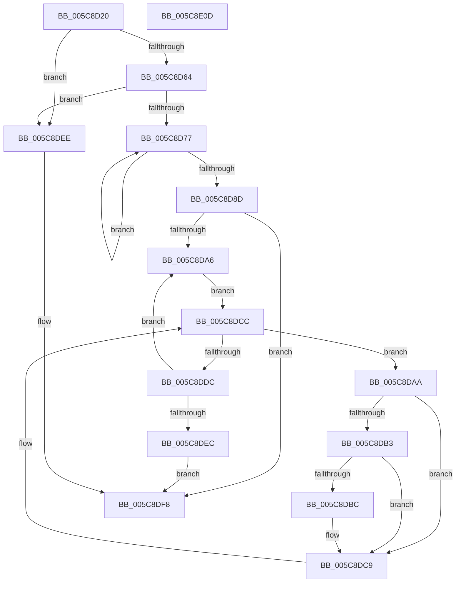

# KeTraceSchedulingGroupRundown

- RVA: `0x005C8D20`–`0x005C8E0E` (길이 `238` bytes)
- VA: `0x00000001405C8D20`
- 실행 섹션: `.text`
- PDB 이름 있음: `예`; PDB Function 태그: `아니요`
- unwind 정보 RVA: `0x0007D3C0`
- 디코드: `68`개 명령, `238/238` bytes 표시
- 미해석 바이트: `0` (있으면 어셈블리에 `.byte`로 보존)

> 이 문서는 커널 이미지의 기계어와 PDB 기호를 분석해 생성했습니다. 4번과 5번은 함수 원형과 자료형을 바이너리 사용 방식에서 추정한 C 해석이며 원본 소스 복구 결과는 아닙니다.

## 1. Dependencies

- 직접 호출 지점: **8**; 고유 호출 대상: **6**
- 직접 호출자로 확인된 함수: **1**
- RIP 상대 이미지 참조: **3**

### Outgoing calls
- `0x005C8D52` → [KeAcquireInStackQueuedSpinLock](../27/KeAcquireInStackQueuedSpinLock_function_002757A0.md) (function, `0x002757A0`)
- `0x005C8D80` → [KiLogSingleSchedulingGroupRundown](KiLogSingleSchedulingGroupRundown_function_005C8B44.md) (function, `0x005C8B44`)
- `0x005C8D92` → [KeReleaseInStackQueuedSpinLock](../34/KeReleaseInStackQueuedSpinLock_function_00342CE0.md) (function, `0x00342CE0`)
- `0x005C8D99` → [PsGetNextProcess](../../page/91/PsGetNextProcess_function_0091C900.md) (function, `0x0091C900`)
- `0x005C8DC4` → [EtwTraceThreadSchedulingGroupRundown](../65/EtwTraceThreadSchedulingGroupRundown_function_00650430.md) (function, `0x00650430`)
- `0x005C8DCF` → [PsGetNextProcessThread](../../page/8C/PsGetNextProcessThread_function_008C9CF0.md) (function, `0x008C9CF0`)
- `0x005C8DDF` → [PsGetNextProcess](../../page/91/PsGetNextProcess_function_0091C900.md) (function, `0x0091C900`)
- `0x005C8DF3` → [KeReleaseInStackQueuedSpinLock](../34/KeReleaseInStackQueuedSpinLock_function_00342CE0.md) (function, `0x00342CE0`)

### Direct callers
- [EtwpKernelTraceRundown](../../page/9E/EtwpKernelTraceRundown_function_009E4080.md) at `0x009E42BC`

### Static image references
- `0x005C8D42` → RVA `0x00FCF180` (`CACHEALI`; read)
- `0x005C8D57` → RVA `0x00FC6ABC` (`ALMOSTRO`; read)
- `0x005C8D64` → RVA `0x00F23420` (`.data`; read)

## 2. Other-region calls and transfers

- 다른 실행 섹션으로 향하는 call: **3**
  - `0x005C8D99` → [PsGetNextProcess](../../page/91/PsGetNextProcess_function_0091C900.md) (`.text` → `PAGE`)
  - `0x005C8DCF` → [PsGetNextProcessThread](../../page/8C/PsGetNextProcessThread_function_008C9CF0.md) (`.text` → `PAGE`)
  - `0x005C8DDF` → [PsGetNextProcess](../../page/91/PsGetNextProcess_function_0091C900.md) (`.text` → `PAGE`)
- 별도 외부 분기/꼬리 이동을 확인하지 못했습니다.

## 3. Assembly (complete function range)

```asm
005C8D20  4C 8B DC                        mov r11, rsp
005C8D23  49 89 5B 08                     mov qword ptr [r11 + 8], rbx
005C8D27  49 89 6B 10                     mov qword ptr [r11 + 0x10], rbp
005C8D2B  49 89 73 18                     mov qword ptr [r11 + 0x18], rsi
005C8D2F  57                              push rdi
005C8D30  48 83 EC 40                     sub rsp, 0x40
005C8D34  0F 57 C0                        xorps xmm0, xmm0
005C8D37  8B F2                           mov esi, edx
005C8D39  48 8B E9                        mov rbp, rcx
005C8D3C  49 8D 53 D8                     lea rdx, [r11 - 0x28]
005C8D40  33 C0                           xor eax, eax
005C8D42  48 8D 0D 37 64 A0 00            lea rcx, [rip + 0xa06437]
005C8D49  0F 11 44 24 20                  movups xmmword ptr [rsp + 0x20], xmm0
005C8D4E  49 89 43 E8                     mov qword ptr [r11 - 0x18], rax
005C8D52  E8 49 CA CA FF                  call 0x1402757a0
005C8D57  80 3D 5E DD 9F 00 00            cmp byte ptr [rip + 0x9fdd5e], 0
005C8D5E  0F 84 8A 00 00 00               je 0x1405c8dee
005C8D64  48 8B 1D B5 A6 95 00            mov rbx, qword ptr [rip + 0x95a6b5]
005C8D6B  48 8D 3D AE A6 95 00            lea rdi, [rip + 0x95a6ae]
005C8D72  48 3B DF                        cmp rbx, rdi
005C8D75  74 77                           je 0x1405c8dee
005C8D77  4C 8D 43 C8                     lea r8, [rbx - 0x38]
005C8D7B  8B D6                           mov edx, esi
005C8D7D  48 8B CD                        mov rcx, rbp
005C8D80  E8 BF FD FF FF                  call 0x1405c8b44
005C8D85  48 8B 1B                        mov rbx, qword ptr [rbx]
005C8D88  48 3B DF                        cmp rbx, rdi
005C8D8B  75 EA                           jne 0x1405c8d77
005C8D8D  48 8D 4C 24 20                  lea rcx, [rsp + 0x20]
005C8D92  E8 49 9F D7 FF                  call 0x140342ce0
005C8D97  33 C9                           xor ecx, ecx
005C8D99  E8 62 3B 35 00                  call 0x14091c900
005C8D9E  48 8B F8                        mov rdi, rax
005C8DA1  48 85 C0                        test rax, rax
005C8DA4  74 52                           je 0x1405c8df8
005C8DA6  33 D2                           xor edx, edx
005C8DA8  EB 22                           jmp 0x1405c8dcc
005C8DAA  8B 4B 78                        mov ecx, dword ptr [rbx + 0x78]
005C8DAD  0F BA E1 09                     bt ecx, 9
005C8DB1  72 16                           jb 0x1405c8dc9
005C8DB3  4C 8B 4B 68                     mov r9, qword ptr [rbx + 0x68]
005C8DB7  4D 85 C9                        test r9, r9
005C8DBA  74 0D                           je 0x1405c8dc9
005C8DBC  4C 8B C3                        mov r8, rbx
005C8DBF  8B D6                           mov edx, esi
005C8DC1  48 8B CD                        mov rcx, rbp
005C8DC4  E8 67 76 08 00                  call 0x140650430
005C8DC9  48 8B D3                        mov rdx, rbx
005C8DCC  48 8B CF                        mov rcx, rdi
005C8DCF  E8 1C 0F 30 00                  call 0x1408c9cf0
005C8DD4  48 8B D8                        mov rbx, rax
005C8DD7  48 85 C0                        test rax, rax
005C8DDA  75 CE                           jne 0x1405c8daa
005C8DDC  48 8B CF                        mov rcx, rdi
005C8DDF  E8 1C 3B 35 00                  call 0x14091c900
005C8DE4  48 8B F8                        mov rdi, rax
005C8DE7  48 85 C0                        test rax, rax
005C8DEA  75 BA                           jne 0x1405c8da6
005C8DEC  EB 0A                           jmp 0x1405c8df8
005C8DEE  48 8D 4C 24 20                  lea rcx, [rsp + 0x20]
005C8DF3  E8 E8 9E D7 FF                  call 0x140342ce0
005C8DF8  48 8B 5C 24 50                  mov rbx, qword ptr [rsp + 0x50]
005C8DFD  48 8B 6C 24 58                  mov rbp, qword ptr [rsp + 0x58]
005C8E02  48 8B 74 24 60                  mov rsi, qword ptr [rsp + 0x60]
005C8E07  48 83 C4 40                     add rsp, 0x40
005C8E0B  5F                              pop rdi
005C8E0C  C3                              ret
005C8E0D  CC                              int3
```

## 4. C-style interpretation (structured pseudocode)

```c
__int64 __fastcall KeTraceSchedulingGroupRundown(__int64 a1, int a2)
{
    __int64 result;
    __int64 v_rsp;
    unsigned __int64 v_stack_m28;
    unsigned __int64 v_stack_p10;
    unsigned __int64 v_stack_p18;
    unsigned __int64 v_stack_p8;

    *(unsigned __int64 *)(v_rsp + 8) = v_rbx;
    *(unsigned __int64 *)(v_rsp + 16) = v_rbp;
    *(unsigned __int64 *)(v_rsp + 24) = v_rsi;
    v_rsp = (v_rsp) - (64);
    result = 0;
    v_stack_m28 = v_xmm0;
    *(unsigned __int64 *)(v_rsp - 24) = 0;
    result = KeAcquireInStackQueuedSpinLock(v_rip + 10511415, v_rsp - 40, a3, a4);
    if ((*(unsigned __int8 *)(v_rip + 10476894)) == 0) goto loc_005C8DEE;
    if ((*(unsigned __int64 *)(v_rip + 9807541)) == (v_rip + 9807534)) goto loc_005C8DEE;
loc_005C8D77:
    result = KiLogSingleSchedulingGroupRundown(a1, (unsigned int)((unsigned int)((unsigned int)(a2))), *(unsigned __int64 *)(v_rip + 9807541) - 56, a4);
    if ((*(unsigned __int64 *)(*(unsigned __int64 *)(v_rip + 9807541))) != (v_rip + 9807534)) goto loc_005C8D77;
    result = KeReleaseInStackQueuedSpinLock(v_stack_m28, (unsigned int)((unsigned int)((unsigned int)(a2))), *(unsigned __int64 *)(v_rip + 9807541) - 56, a4);
    a1 = 0;
    result = PsGetNextProcess(a1, (unsigned int)((unsigned int)((unsigned int)(a2))), *(unsigned __int64 *)(v_rip + 9807541) - 56, a4);
    if (result == 0) goto loc_005C8DF8;
loc_005C8DA6:
    a2 = 0;
    goto loc_005C8DCC;
loc_005C8DAA:
    if (condition_is_below) goto loc_005C8DC9;
    if (*(unsigned __int64 *)(*(unsigned __int64 *)(*(unsigned __int64 *)(v_rip + 9807541)) + 104) != 0) {
        a3 = *(unsigned __int64 *)(*(unsigned __int64 *)(v_rip + 9807541));
        a2 = (unsigned int)((unsigned int)(a2));
        a1 = 0;
        result = EtwTraceThreadSchedulingGroupRundown(a1, a2, a3, *(unsigned __int64 *)(*(unsigned __int64 *)(*(unsigned __int64 *)(v_rip + 9807541)) + 104));
    }
loc_005C8DCC:
    result = PsGetNextProcessThread(result, *(unsigned __int64 *)(*(unsigned __int64 *)(v_rip + 9807541)), a3, *(unsigned __int64 *)(*(unsigned __int64 *)(*(unsigned __int64 *)(v_rip + 9807541)) + 104));
    if (result != 0) goto loc_005C8DAA;
    result = PsGetNextProcess(result, *(unsigned __int64 *)(*(unsigned __int64 *)(v_rip + 9807541)), a3, *(unsigned __int64 *)(*(unsigned __int64 *)(*(unsigned __int64 *)(v_rip + 9807541)) + 104));
    if (result != 0) goto loc_005C8DA6;
    goto loc_005C8DF8;
loc_005C8DEE:
    result = KeReleaseInStackQueuedSpinLock(v_stack_m28, *(unsigned __int64 *)(*(unsigned __int64 *)(v_rip + 9807541)), a3, *(unsigned __int64 *)(*(unsigned __int64 *)(*(unsigned __int64 *)(v_rip + 9807541)) + 104));
loc_005C8DF8:
    v_rsp = (v_rsp) + (64);
    return result;
}
```

## 5. (Beta) C Style

```c
int64_t KeTraceSchedulingGroupRundown(int64_t Arg1, int32_t Arg2)
{
    int64_t result;
    int64_t local_rsp;
    uint64_t v_stack_m28;
    uint64_t v_stack_p10;
    uint64_t v_stack_p18;
    uint64_t v_stack_p8;

    *(uint64_t *)(local_rsp + 0x8) = local_rbx;
    *(uint64_t *)(local_rsp + 0x10) = local_rbp;
    *(uint64_t *)(local_rsp + 0x18) = local_rsi;
    local_rsp = (local_rsp) - (64);
    result = 0;
    v_stack_m28 = v_xmm0;
    *(uint64_t *)(local_rsp - 0x18) = 0;
    result = KeAcquireInStackQueuedSpinLock(v_rip + 10511415, local_rsp - 40, a3, a4);
    if ((*(uint8_t *)(v_rip + 0x9FDD5E)) == 0) goto loc_005C8DEE;
    if ((*(uint64_t *)(v_rip + 0x95A6B5)) == (v_rip + 9807534)) goto loc_005C8DEE;
loc_005C8D77:
    result = KiLogSingleSchedulingGroupRundown(Arg1, (uint32_t)((uint32_t)((uint32_t)(Arg2))), *(uint64_t *)(v_rip + 0x95A6B5) - 56, a4);
    if ((*(uint64_t *)(*(uint64_t *)(v_rip + 0x95A6B5))) != (v_rip + 9807534)) goto loc_005C8D77;
    result = KeReleaseInStackQueuedSpinLock(v_stack_m28, (uint32_t)((uint32_t)((uint32_t)(Arg2))), *(uint64_t *)(v_rip + 0x95A6B5) - 56, a4);
    Arg1 = 0;
    result = PsGetNextProcess(Arg1, (uint32_t)((uint32_t)((uint32_t)(Arg2))), *(uint64_t *)(v_rip + 0x95A6B5) - 56, a4);
    if (result == 0) goto loc_005C8DF8;
loc_005C8DA6:
    Arg2 = 0;
    goto loc_005C8DCC;
loc_005C8DAA:
    if (condition_is_below) goto loc_005C8DC9;
    if (*(uint64_t *)(*(uint64_t *)(*(uint64_t *)(v_rip + 0x95A6B5)) + 0x68) != 0) {
        a3 = *(uint64_t *)(*(uint64_t *)(v_rip + 0x95A6B5));
        Arg2 = (uint32_t)((uint32_t)(Arg2));
        Arg1 = 0;
        result = EtwTraceThreadSchedulingGroupRundown(Arg1, Arg2, a3, *(uint64_t *)(*(uint64_t *)(*(uint64_t *)(v_rip + 0x95A6B5)) + 0x68));
    }
loc_005C8DCC:
    result = PsGetNextProcessThread(result, *(uint64_t *)(*(uint64_t *)(v_rip + 0x95A6B5)), a3, *(uint64_t *)(*(uint64_t *)(*(uint64_t *)(v_rip + 0x95A6B5)) + 0x68));
    if (result != 0) goto loc_005C8DAA;
    result = PsGetNextProcess(result, *(uint64_t *)(*(uint64_t *)(v_rip + 0x95A6B5)), a3, *(uint64_t *)(*(uint64_t *)(*(uint64_t *)(v_rip + 0x95A6B5)) + 0x68));
    if (result != 0) goto loc_005C8DA6;
    goto loc_005C8DF8;
loc_005C8DEE:
    result = KeReleaseInStackQueuedSpinLock(v_stack_m28, *(uint64_t *)(*(uint64_t *)(v_rip + 0x95A6B5)), a3, *(uint64_t *)(*(uint64_t *)(*(uint64_t *)(v_rip + 0x95A6B5)) + 0x68));
loc_005C8DF8:
    local_rsp = (local_rsp) + (64);
    return result;
}
```

## 6. Execution-region graph

[열기: 2D/3D 그래프와 함수 탐색 컨트롤 패널](../../../control-panel.html?section=text&rva=0x005C8D20&view=graph)

- 2D 그래프는 위에서 아래로 흐르고, 3D 그래프는 빈 공간을 드래그해 회전합니다. Shift+드래그는 이동, 휠은 확대·축소, 함수 노드 선택은 대상 보고서 이동입니다.

### Static fallback


