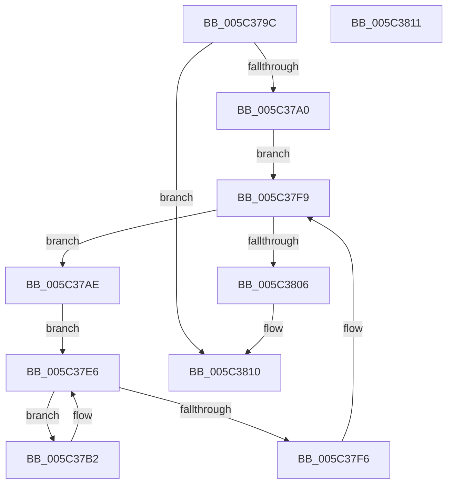

# KeTraceThreadAffinityRundown

- RVA: `0x005C379C`–`0x005C3812` (길이 `118` bytes)
- VA: `0x00000001405C379C`
- 실행 섹션: `.text`
- PDB 이름 있음: `예`; PDB Function 태그: `아니요`
- unwind 정보 RVA: `0x000CA9D0`
- 디코드: `35`개 명령, `118/118` bytes 표시
- 미해석 바이트: `0` (있으면 어셈블리에 `.byte`로 보존)

> 이 문서는 커널 이미지의 기계어와 PDB 기호를 분석해 생성했습니다. 4번과 5번은 함수 원형과 자료형을 바이너리 사용 방식에서 추정한 C 해석이며 원본 소스 복구 결과는 아닙니다.

## 1. Dependencies

- 직접 호출 지점: **3**; 고유 호출 대상: **3**
- 직접 호출자로 확인된 함수: **1**
- RIP 상대 이미지 참조: **0**

### Outgoing calls
- `0x005C37DE` → [EtwTraceThreadAffinity](../3C/EtwTraceThreadAffinity_function_003C29A0.md) (function, `0x003C29A0`)
- `0x005C37E9` → [PsGetNextProcessThread](../../page/8C/PsGetNextProcessThread_function_008C9CF0.md) (function, `0x008C9CF0`)
- `0x005C37F9` → [PsGetNextProcess](../../page/91/PsGetNextProcess_function_0091C900.md) (function, `0x0091C900`)

### Direct callers
- [EtwpKernelTraceRundown](../../page/9E/EtwpKernelTraceRundown_function_009E4080.md) at `0x009E42A2`

### Static image references
- 디코드된 RIP-relative 메모리 참조가 없습니다.

## 2. Other-region calls and transfers

- 다른 실행 섹션으로 향하는 call: **2**
  - `0x005C37E9` → [PsGetNextProcessThread](../../page/8C/PsGetNextProcessThread_function_008C9CF0.md) (`.text` → `PAGE`)
  - `0x005C37F9` → [PsGetNextProcess](../../page/91/PsGetNextProcess_function_0091C900.md) (`.text` → `PAGE`)
- 별도 외부 분기/꼬리 이동을 확인하지 못했습니다.

## 3. Assembly (complete function range)

```asm
005C379C  84 C9                           test cl, cl
005C379E  74 70                           je 0x1405c3810
005C37A0  48 89 5C 24 08                  mov qword ptr [rsp + 8], rbx
005C37A5  57                              push rdi
005C37A6  48 83 EC 30                     sub rsp, 0x30
005C37AA  33 C9                           xor ecx, ecx
005C37AC  EB 4B                           jmp 0x1405c37f9
005C37AE  33 D2                           xor edx, edx
005C37B0  EB 34                           jmp 0x1405c37e6
005C37B2  48 8B 8F 40 02 00 00            mov rcx, qword ptr [rdi + 0x240]
005C37B9  41 B1 01                        mov r9b, 1
005C37BC  44 8B 47 74                     mov r8d, dword ptr [rdi + 0x74]
005C37C0  0F B7 97 48 02 00 00            movzx edx, word ptr [rdi + 0x248]
005C37C7  41 C1 E8 03                     shr r8d, 3
005C37CB  66 C7 44 24 28 36 05            mov word ptr [rsp + 0x28], 0x536
005C37D2  41 80 E0 01                     and r8b, 1
005C37D6  48 89 4C 24 20                  mov qword ptr [rsp + 0x20], rcx
005C37DB  48 8B CF                        mov rcx, rdi
005C37DE  E8 BD F1 DF FF                  call 0x1403c29a0
005C37E3  48 8B D7                        mov rdx, rdi
005C37E6  48 8B CB                        mov rcx, rbx
005C37E9  E8 02 65 30 00                  call 0x1408c9cf0
005C37EE  48 8B F8                        mov rdi, rax
005C37F1  48 85 C0                        test rax, rax
005C37F4  75 BC                           jne 0x1405c37b2
005C37F6  48 8B CB                        mov rcx, rbx
005C37F9  E8 02 91 35 00                  call 0x14091c900
005C37FE  48 8B D8                        mov rbx, rax
005C3801  48 85 C0                        test rax, rax
005C3804  75 A8                           jne 0x1405c37ae
005C3806  48 8B 5C 24 40                  mov rbx, qword ptr [rsp + 0x40]
005C380B  48 83 C4 30                     add rsp, 0x30
005C380F  5F                              pop rdi
005C3810  C3                              ret
005C3811  CC                              int3
```

## 4. C-style interpretation (structured pseudocode)

```c
__int64 __fastcall KeTraceThreadAffinityRundown(int a1, int a2)
{
    __int64 result;
    __int64 v_rsp;
    unsigned __int16 v_stack_m10;
    unsigned __int64 v_stack_m18;
    unsigned __int64 v_stack_p8;

    if ((unsigned __int8)(a1) == 0) goto loc_005C3810;
    v_stack_p8 = v_rbx;
    v_rsp = (v_rsp) - (48);
    a1 = 0;
    goto loc_005C37F9;
loc_005C37AE:
    a2 = 0;
    goto loc_005C37E6;
loc_005C37B2:
    a3 = (unsigned int)(((unsigned int)(*(unsigned int *)(v_rdi + 116))) >> (3));
    v_stack_m10 = 0x536ULL;
    a3 = (unsigned __int8)((a3) & (1));
    v_stack_m18 = *(unsigned __int64 *)(v_rdi + 576);
    result = EtwTraceThreadAffinity(v_rdi, *(unsigned __int16 *)(v_rdi + 584), a3, 1);
loc_005C37E6:
    result = PsGetNextProcessThread(v_rbx, v_rdi, a3, 1);
    if (result != 0) goto loc_005C37B2;
loc_005C37F9:
    result = PsGetNextProcess(v_rbx, v_rdi, a3, 1);
    if (result != 0) goto loc_005C37AE;
    v_rsp = (v_rsp) + (48);
loc_005C3810:
    return result;
}
```

## 5. (Beta) C Style

```c
int64_t KeTraceThreadAffinityRundown(int32_t Arg1, int32_t Arg2)
{
    int64_t result;
    int64_t local_rsp;
    uint16_t v_stack_m10;
    uint64_t v_stack_m18;
    uint64_t v_stack_p8;

    if ((uint8_t)(Arg1) == 0) goto loc_005C3810;
    v_stack_p8 = local_rbx;
    local_rsp = (local_rsp) - (48);
    Arg1 = 0;
    goto loc_005C37F9;
loc_005C37AE:
    Arg2 = 0;
    goto loc_005C37E6;
loc_005C37B2:
    a3 = (uint32_t)(((uint32_t)(*(uint32_t *)(local_rdi + 0x74))) >> (3));
    v_stack_m10 = 0x536ULL;
    a3 = (uint8_t)((a3) & (1));
    v_stack_m18 = *(uint64_t *)(local_rdi + 0x240);
    result = EtwTraceThreadAffinity(local_rdi, *(uint16_t *)(local_rdi + 0x248), a3, 1);
loc_005C37E6:
    result = PsGetNextProcessThread(local_rbx, local_rdi, a3, 1);
    if (result != 0) goto loc_005C37B2;
loc_005C37F9:
    result = PsGetNextProcess(local_rbx, local_rdi, a3, 1);
    if (result != 0) goto loc_005C37AE;
    local_rsp = (local_rsp) + (48);
loc_005C3810:
    return result;
}
```

## 6. Execution-region graph

[열기: 2D/3D 그래프와 함수 탐색 컨트롤 패널](../../../control-panel.html?section=text&rva=0x005C379C&view=graph)

- 2D 그래프는 위에서 아래로 흐르고, 3D 그래프는 빈 공간을 드래그해 회전합니다. Shift+드래그는 이동, 휠은 확대·축소, 함수 노드 선택은 대상 보고서 이동입니다.

### Static fallback


