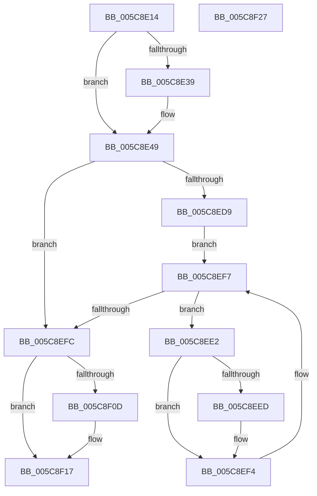

# KeUpdateGroupSchedulingConstants

- RVA: `0x005C8E14`–`0x005C8F28` (길이 `276` bytes)
- VA: `0x00000001405C8E14`
- 실행 섹션: `.text`
- PDB 이름 있음: `예`; PDB Function 태그: `아니요`
- unwind 정보 RVA: `0x000718AC`
- 디코드: `69`개 명령, `276/276` bytes 표시
- 미해석 바이트: `0` (있으면 어셈블리에 `.byte`로 보존)

> 이 문서는 커널 이미지의 기계어와 PDB 기호를 분석해 생성했습니다. 4번과 5번은 함수 원형과 자료형을 바이너리 사용 방식에서 추정한 C 해석이며 원본 소스 복구 결과는 아닙니다.

## 1. Dependencies

- 직접 호출 지점: **4**; 고유 호출 대상: **4**
- 직접 호출자로 확인된 함수: **2**
- RIP 상대 이미지 참조: **13**

### Outgoing calls
- `0x005C8E44` → [KeAcquireInStackQueuedSpinLock](../27/KeAcquireInStackQueuedSpinLock_function_002757A0.md) (function, `0x002757A0`)
- `0x005C8EEF` → [KiUpdateCpuTargetByRate](../46/KiUpdateCpuTargetByRate_function_0046D7E4.md) (function, `0x0046D7E4`)
- `0x005C8F03` → [KiAssignSchedulingGroupWeights](../46/KiAssignSchedulingGroupWeights_function_0046D260.md) (function, `0x0046D260`)
- `0x005C8F12` → [KeReleaseInStackQueuedSpinLock](../34/KeReleaseInStackQueuedSpinLock_function_00342CE0.md) (function, `0x00342CE0`)

### Direct callers
- [KiEnableGroupScheduling](KiEnableGroupScheduling_function_005C8914.md) at `0x005C895C`
- [PspReadDfssConfigurationValues](../5E/PspReadDfssConfigurationValues_function_005E2508.md) at `0x005E2624`

### Static image references
- `0x005C8E3D` → RVA `0x00FCF180` (`CACHEALI`; read)
- `0x005C8E49` → RVA `0x00FC8C40` (`ALMOSTRO`; read)
- `0x005C8E50` → RVA `0x00F23420` (`.data`; read)
- `0x005C8E6B` → RVA `0x00FC5170` (`ALMOSTRO`; read)
- `0x005C8E74` → RVA `0x00FC5310` (`ALMOSTRO`; read)
- `0x005C8E8D` → RVA `0x00FC52D0` (`ALMOSTRO`; write)
- `0x005C8E94` → RVA `0x00FC530C` (`ALMOSTRO`; read)
- `0x005C8E9E` → RVA `0x00FC54D0` (`ALMOSTRO`; write)
- `0x005C8EAB` → RVA `0x00FC5138` (`ALMOSTRO`; write)
- `0x005C8EB2` → RVA `0x00FC5308` (`ALMOSTRO`; read)
- `0x005C8EB8` → RVA `0x00FC529C` (`ALMOSTRO`; write)
- `0x005C8EC5` → RVA `0x00FC6AA0` (`ALMOSTRO`; read)
- `0x005C8ECE` → RVA `0x00FC6DB8` (`ALMOSTRO`; write)

## 2. Other-region calls and transfers

- 다른 실행 섹션으로 향하는 call: **0**
- 별도 외부 분기/꼬리 이동을 확인하지 못했습니다.

## 3. Assembly (complete function range)

```asm
005C8E14  4C 8B DC                        mov r11, rsp
005C8E17  49 89 5B 08                     mov qword ptr [r11 + 8], rbx
005C8E1B  49 89 73 10                     mov qword ptr [r11 + 0x10], rsi
005C8E1F  57                              push rdi
005C8E20  48 83 EC 40                     sub rsp, 0x40
005C8E24  33 C0                           xor eax, eax
005C8E26  0F 57 C0                        xorps xmm0, xmm0
005C8E29  40 8A F9                        mov dil, cl
005C8E2C  0F 11 44 24 20                  movups xmmword ptr [rsp + 0x20], xmm0
005C8E31  49 89 43 E8                     mov qword ptr [r11 - 0x18], rax
005C8E35  84 C9                           test cl, cl
005C8E37  75 10                           jne 0x1405c8e49
005C8E39  49 8D 53 D8                     lea rdx, [r11 - 0x28]
005C8E3D  48 8D 0D 3C 63 A0 00            lea rcx, [rip + 0xa0633c]
005C8E44  E8 57 C9 CA FF                  call 0x1402757a0
005C8E49  48 8B 05 F0 FD 9F 00            mov rax, qword ptr [rip + 0x9ffdf0]
005C8E50  48 8B 1D C9 A5 95 00            mov rbx, qword ptr [rip + 0x95a5c9]
005C8E57  8B 48 44                        mov ecx, dword ptr [rax + 0x44]
005C8E5A  48 B8 77 BE 9F 1A 2F DD 24 06   movabs rax, 0x624dd2f1a9fbe77
005C8E64  4C 69 C1 40 42 0F 00            imul r8, rcx, 0xf4240
005C8E6B  8B 0D FF C2 9F 00               mov ecx, dword ptr [rip + 0x9fc2ff]
005C8E71  49 F7 E0                        mul r8
005C8E74  8B 05 96 C4 9F 00               mov eax, dword ptr [rip + 0x9fc496]
005C8E7A  4C 2B C2                        sub r8, rdx
005C8E7D  49 D1 E8                        shr r8, 1
005C8E80  4C 03 C2                        add r8, rdx
005C8E83  33 D2                           xor edx, edx
005C8E85  49 C1 E8 09                     shr r8, 9
005C8E89  49 0F AF C0                     imul rax, r8
005C8E8D  48 89 05 3C C4 9F 00            mov qword ptr [rip + 0x9fc43c], rax
005C8E94  8B 05 72 C4 9F 00               mov eax, dword ptr [rip + 0x9fc472]
005C8E9A  49 0F AF C0                     imul rax, r8
005C8E9E  48 89 05 2B C6 9F 00            mov qword ptr [rip + 0x9fc62b], rax
005C8EA5  8B C1                           mov eax, ecx
005C8EA7  49 0F AF C0                     imul rax, r8
005C8EAB  48 89 05 86 C2 9F 00            mov qword ptr [rip + 0x9fc286], rax
005C8EB2  8B 05 50 C4 9F 00               mov eax, dword ptr [rip + 0x9fc450]
005C8EB8  89 05 DE C3 9F 00               mov dword ptr [rip + 0x9fc3de], eax
005C8EBE  48 69 C1 10 27 00 00            imul rax, rcx, 0x2710
005C8EC5  8B 0D D5 DB 9F 00               mov ecx, dword ptr [rip + 0x9fdbd5]
005C8ECB  48 F7 F1                        div rcx
005C8ECE  89 05 E4 DE 9F 00               mov dword ptr [rip + 0x9fdee4], eax
005C8ED4  48 85 DB                        test rbx, rbx
005C8ED7  74 23                           je 0x1405c8efc
005C8ED9  48 8D 35 40 A5 95 00            lea rsi, [rip + 0x95a540]
005C8EE0  EB 15                           jmp 0x1405c8ef7
005C8EE2  48 8D 4B C8                     lea rcx, [rbx - 0x38]
005C8EE6  8B 41 04                        mov eax, dword ptr [rcx + 4]
005C8EE9  A8 01                           test al, 1
005C8EEB  74 07                           je 0x1405c8ef4
005C8EED  B2 01                           mov dl, 1
005C8EEF  E8 F0 48 EA FF                  call 0x14046d7e4
005C8EF4  48 8B 1B                        mov rbx, qword ptr [rbx]
005C8EF7  48 3B DE                        cmp rbx, rsi
005C8EFA  75 E6                           jne 0x1405c8ee2
005C8EFC  45 33 C0                        xor r8d, r8d
005C8EFF  B2 01                           mov dl, 1
005C8F01  33 C9                           xor ecx, ecx
005C8F03  E8 58 43 EA FF                  call 0x14046d260
005C8F08  40 84 FF                        test dil, dil
005C8F0B  75 0A                           jne 0x1405c8f17
005C8F0D  48 8D 4C 24 20                  lea rcx, [rsp + 0x20]
005C8F12  E8 C9 9D D7 FF                  call 0x140342ce0
005C8F17  48 8B 5C 24 50                  mov rbx, qword ptr [rsp + 0x50]
005C8F1C  48 8B 74 24 58                  mov rsi, qword ptr [rsp + 0x58]
005C8F21  48 83 C4 40                     add rsp, 0x40
005C8F25  5F                              pop rdi
005C8F26  C3                              ret
005C8F27  CC                              int3
```

## 4. C-style interpretation (structured pseudocode)

```c
__int64 __fastcall KeUpdateGroupSchedulingConstants(unsigned __int8 a1)
{
    __int64 result;
    __int64 v_rsp;
    unsigned __int64 v_stack_m28;
    unsigned __int64 v_stack_p10;
    unsigned __int64 v_stack_p8;

    *(unsigned __int64 *)(v_rsp + 8) = v_rbx;
    *(unsigned __int64 *)(v_rsp + 16) = v_rsi;
    v_rsp = (v_rsp) - (64);
    result = 0;
    v_stack_m28 = v_xmm0;
    *(unsigned __int64 *)(v_rsp - 24) = 0;
    if (a1 == 0) {
        a2 = v_rsp - 40;
        a1 = v_rip + 10511164;
        result = KeAcquireInStackQueuedSpinLock(a1, a2, a3, a4);
    }
    a3 = (a3) * ((unsigned int)(*(unsigned int *)(*(unsigned __int64 *)(v_rip + 10485232) + 68)));
    a3 = (a3) - (a2);
    a3 = (a3) >> (1);
    a3 = (a3) + (a2);
    a2 = 0;
    a3 = (a3) >> (9);
    result = ((unsigned int)(*(unsigned int *)(v_rip + 10470550))) * (a3);
    *(unsigned __int64 *)(v_rip + 10470460) = result;
    result = ((unsigned int)(*(unsigned int *)(v_rip + 10470514))) * (a3);
    *(unsigned __int64 *)(v_rip + 10470955) = result;
    result = ((unsigned int)((unsigned int)((unsigned int)(*(unsigned int *)(v_rip + 10470143))))) * (a3);
    *(unsigned __int64 *)(v_rip + 10470022) = result;
    *(unsigned int *)(v_rip + 10470366) = (unsigned int)((unsigned int)(*(unsigned int *)(v_rip + 10470480)));
    result = ((unsigned int)(*(unsigned int *)(v_rip + 10470480))) * ((unsigned int)(*(unsigned int *)(v_rip + 10470143)));
    *(unsigned int *)(v_rip + 10477284) = (unsigned int)(result);
    if (*(unsigned __int64 *)(v_rip + 9807305) == 0) goto loc_005C8EFC;
    goto loc_005C8EF7;
loc_005C8EE2:
    result = (unsigned int)(*(unsigned int *)(*(unsigned __int64 *)(v_rip + 9807305) - 56 + 4));
    if ((((unsigned __int8)((unsigned int)(*(unsigned int *)(*(unsigned __int64 *)(v_rip + 9807305) - 56 + 4)))) & (1)) != 0) {
        a2 = 1;
        result = KiUpdateCpuTargetByRate(*(unsigned __int64 *)(v_rip + 9807305) - 56, a2, a3, a4);
    }
loc_005C8EF7:
    if ((*(unsigned __int64 *)(*(unsigned __int64 *)(v_rip + 9807305))) != (v_rip + 9807168)) goto loc_005C8EE2;
loc_005C8EFC:
    a3 = 0;
    a1 = 0;
    result = KiAssignSchedulingGroupWeights(a1, 1, a3, a4);
    if (0 == 0) {
        a1 = v_stack_m28;
        result = KeReleaseInStackQueuedSpinLock(a1, 1, a3, a4);
    }
    v_rsp = (v_rsp) + (64);
    return result;
}
```

## 5. (Beta) C Style

```c
int64_t KeUpdateGroupSchedulingConstants(uint8_t Arg1)
{
    int64_t result;
    int64_t local_rsp;
    uint64_t v_stack_m28;
    uint64_t v_stack_p10;
    uint64_t v_stack_p8;

    *(uint64_t *)(local_rsp + 0x8) = local_rbx;
    *(uint64_t *)(local_rsp + 0x10) = local_rsi;
    local_rsp = (local_rsp) - (64);
    result = 0;
    v_stack_m28 = v_xmm0;
    *(uint64_t *)(local_rsp - 0x18) = 0;
    if (Arg1 == 0) {
        a2 = local_rsp - 40;
        Arg1 = v_rip + 10511164;
        result = KeAcquireInStackQueuedSpinLock(Arg1, a2, a3, a4);
    }
    a3 = (a3) * ((uint32_t)(*(uint32_t *)(*(uint64_t *)(v_rip + 0x9FFDF0) + 0x44)));
    a3 = (a3) - (a2);
    a3 = (a3) >> (1);
    a3 = (a3) + (a2);
    a2 = 0;
    a3 = (a3) >> (9);
    result = ((uint32_t)(*(uint32_t *)(v_rip + 0x9FC496))) * (a3);
    *(uint64_t *)(v_rip + 0x9FC43C) = result;
    result = ((uint32_t)(*(uint32_t *)(v_rip + 0x9FC472))) * (a3);
    *(uint64_t *)(v_rip + 0x9FC62B) = result;
    result = ((uint32_t)((uint32_t)((uint32_t)(*(uint32_t *)(v_rip + 0x9FC2FF))))) * (a3);
    *(uint64_t *)(v_rip + 0x9FC286) = result;
    *(uint32_t *)(v_rip + 0x9FC3DE) = (uint32_t)((uint32_t)(*(uint32_t *)(v_rip + 0x9FC450)));
    result = ((uint32_t)(*(uint32_t *)(v_rip + 0x9FC450))) * ((uint32_t)(*(uint32_t *)(v_rip + 0x9FC2FF)));
    *(uint32_t *)(v_rip + 0x9FDEE4) = (uint32_t)(result);
    if (*(uint64_t *)(v_rip + 0x95A5C9) == 0) goto loc_005C8EFC;
    goto loc_005C8EF7;
loc_005C8EE2:
    result = (uint32_t)(*(uint32_t *)(*(uint64_t *)(v_rip + 0x95A5C9) - 0x38 + 0x4));
    if ((((uint8_t)((uint32_t)(*(uint32_t *)(*(uint64_t *)(v_rip + 0x95A5C9) - 0x38 + 0x4)))) & (1)) != 0) {
        a2 = 1;
        result = KiUpdateCpuTargetByRate(*(uint64_t *)(v_rip + 0x95A5C9) - 56, a2, a3, a4);
    }
loc_005C8EF7:
    if ((*(uint64_t *)(*(uint64_t *)(v_rip + 0x95A5C9))) != (v_rip + 9807168)) goto loc_005C8EE2;
loc_005C8EFC:
    a3 = 0;
    Arg1 = 0;
    result = KiAssignSchedulingGroupWeights(Arg1, 1, a3, a4);
    if (0 == 0) {
        Arg1 = v_stack_m28;
        result = KeReleaseInStackQueuedSpinLock(Arg1, 1, a3, a4);
    }
    local_rsp = (local_rsp) + (64);
    return result;
}
```

## 6. Execution-region graph

[열기: 2D/3D 그래프와 함수 탐색 컨트롤 패널](../../../control-panel.html?section=text&rva=0x005C8E14&view=graph)

- 2D 그래프는 위에서 아래로 흐르고, 3D 그래프는 빈 공간을 드래그해 회전합니다. Shift+드래그는 이동, 휠은 확대·축소, 함수 노드 선택은 대상 보고서 이동입니다.

### Static fallback


