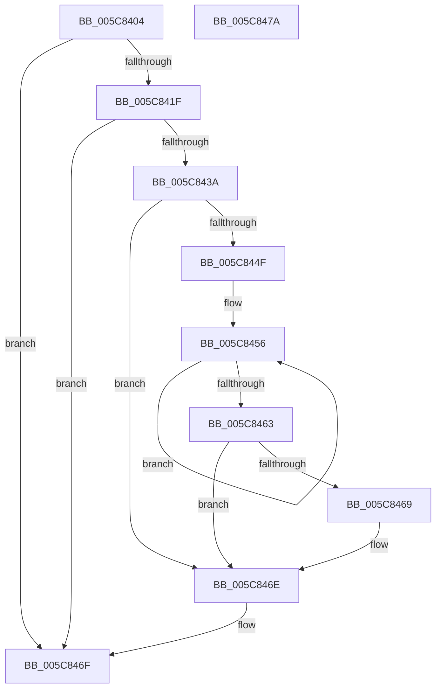

# KiAcquireReleaseDpcData

- RVA: `0x005C8404`–`0x005C847B` (길이 `119` bytes)
- VA: `0x00000001405C8404`
- 실행 섹션: `.text`
- PDB 이름 있음: `예`; PDB Function 태그: `아니요`
- unwind 정보 RVA: `0x0005CAAC`
- 디코드: `35`개 명령, `119/119` bytes 표시
- 미해석 바이트: `0` (있으면 어셈블리에 `.byte`로 보존)

> 이 문서는 커널 이미지의 기계어와 PDB 기호를 분석해 생성했습니다. 4번과 5번은 함수 원형과 자료형을 바이너리 사용 방식에서 추정한 C 해석이며 원본 소스 복구 결과는 아닙니다.

## 1. Dependencies

- 직접 호출 지점: **4**; 고유 호출 대상: **4**
- 직접 호출자로 확인된 함수: **1**
- RIP 상대 이미지 참조: **0**

### Outgoing calls
- `0x005C841F` → [KeDisableInterrupts](../21/KeDisableInterrupts_function_00217BE0.md) (function, `0x00217BE0`)
- `0x005C8429` → [KeAcquireSpinLockAtDpcLevel](../20/KeAcquireSpinLockAtDpcLevel_function_00208430.md) (function, `0x00208430`)
- `0x005C8431` → [KxReleaseSpinLock](../20/KxReleaseSpinLock_function_00206670.md) (function, `0x00206670`)
- `0x005C8469` → [KiRemoveSystemWorkPriorityKick](../26/KiRemoveSystemWorkPriorityKick_function_002631D0.md) (function, `0x002631D0`)

### Direct callers
- [sub_006F322E](../6F/Unknown_function_006F322E.md) at `0x006F33A0`

### Static image references
- 디코드된 RIP-relative 메모리 참조가 없습니다.

## 2. Other-region calls and transfers

- 다른 실행 섹션으로 향하는 call: **0**
- 별도 외부 분기/꼬리 이동을 확인하지 못했습니다.

## 3. Assembly (complete function range)

```asm
005C8404  48 89 5C 24 08                  mov qword ptr [rsp + 8], rbx
005C8409  57                              push rdi
005C840A  48 83 EC 20                     sub rsp, 0x20
005C840E  F0 83 0C 24 00                  lock or dword ptr [rsp], 0
005C8413  48 8D 79 10                     lea rdi, [rcx + 0x10]
005C8417  48 8B 07                        mov rax, qword ptr [rdi]
005C841A  48 85 C0                        test rax, rax
005C841D  74 50                           je 0x1405c846f
005C841F  E8 BC F7 C4 FF                  call 0x140217be0
005C8424  48 8B CF                        mov rcx, rdi
005C8427  8A D8                           mov bl, al
005C8429  E8 02 00 C4 FF                  call 0x140208430
005C842E  48 8B CF                        mov rcx, rdi
005C8431  E8 3A E2 C3 FF                  call 0x140206670
005C8436  84 DB                           test bl, bl
005C8438  74 35                           je 0x1405c846f
005C843A  65 48 8B 0C 25 20 00 00 00      mov rcx, qword ptr gs:[0x20]
005C8443  4C 8B 81 B8 8E 00 00            mov r8, qword ptr [rcx + 0x8eb8]
005C844A  4D 85 C0                        test r8, r8
005C844D  74 1F                           je 0x1405c846e
005C844F  41 0F 0D 08                     prefetchw byte ptr [r8]
005C8453  41 8B 00                        mov eax, dword ptr [r8]
005C8456  8B D0                           mov edx, eax
005C8458  0F BA F2 15                     btr edx, 0x15
005C845C  F0 41 0F B1 10                  lock cmpxchg dword ptr [r8], edx
005C8461  75 F3                           jne 0x1405c8456
005C8463  0F BA E0 15                     bt eax, 0x15
005C8467  73 05                           jae 0x1405c846e
005C8469  E8 62 AD C9 FF                  call 0x1402631d0
005C846E  FB                              sti
005C846F  48 8B 5C 24 30                  mov rbx, qword ptr [rsp + 0x30]
005C8474  48 83 C4 20                     add rsp, 0x20
005C8478  5F                              pop rdi
005C8479  C3                              ret
005C847A  CC                              int3
```

## 4. C-style interpretation (structured pseudocode)

```c
__int64 __fastcall KiAcquireReleaseDpcData(__int64 a1)
{
    __int64 result;
    __int64 v_rsp;
    unsigned int v_stack_m28;
    unsigned __int64 v_stack_p8;

    v_stack_p8 = v_rbx;
    v_rsp = (v_rsp) - (32);
    if (*(unsigned __int64 *)(a1 + 16) == 0) goto loc_005C846F;
    result = KeDisableInterrupts(a1, a2, a3, a4);
    result = KeAcquireSpinLockAtDpcLevel(a1 + 16, a2, a3, a4);
    result = KxReleaseSpinLock(a1 + 16, a2, a3, a4);
    if ((unsigned __int8)((unsigned __int8)(result)) == 0) goto loc_005C846F;
    if (*(unsigned __int64 *)(*(unsigned __int64 *)(gs_base + (0 + 32)) + 36536) == 0) goto loc_005C846E;
loc_005C8456:
    if (*(unsigned __int64 *)(*(unsigned __int64 *)(gs_base + (0 + 32)) + 36536) != 0) goto loc_005C8456;
    result = (unsigned int)(*(unsigned int *)(*(unsigned __int64 *)(*(unsigned __int64 *)(gs_base + (0 + 32)) + 36536)));
    if (!(condition_is_above_or_equal)) {
        result = KiRemoveSystemWorkPriorityKick(*(unsigned __int64 *)(gs_base + (0 + 32)), (unsigned int)((unsigned int)((unsigned int)(*(unsigned int *)(*(unsigned __int64 *)(*(unsigned __int64 *)(gs_base + (0 + 32)) + 36536))))), *(unsigned __int64 *)(*(unsigned __int64 *)(gs_base + (0 + 32)) + 36536), a4);
    }
loc_005C846F:
    v_rsp = (v_rsp) + (32);
    return result;
}
```

## 5. (Beta) C Style

```c
int64_t KiAcquireReleaseDpcData(void *Arg1)
{
    uint8_t *arg1 = (uint8_t *)Arg1;

    int64_t result;
    int64_t local_rsp;
    uint32_t v_stack_m28;
    uint64_t v_stack_p8;

    v_stack_p8 = local_rbx;
    local_rsp = (local_rsp) - (32);
    if (*(uint64_t *)(arg1 + 0x10) == 0) goto loc_005C846F;
    result = KeDisableInterrupts(Arg1, a2, a3, a4);
    result = KeAcquireSpinLockAtDpcLevel(Arg1 + 16, a2, a3, a4);
    result = KxReleaseSpinLock(Arg1 + 16, a2, a3, a4);
    if ((uint8_t)((uint8_t)(result)) == 0) goto loc_005C846F;
    if (*(uint64_t *)(*(uint64_t *)(gs_base + (0 + 0x20)) + 0x8EB8) == 0) goto loc_005C846E;
loc_005C8456:
    if (*(uint64_t *)(*(uint64_t *)(gs_base + (0 + 0x20)) + 0x8EB8) != 0) goto loc_005C8456;
    result = (uint32_t)(*(uint32_t *)(*(uint64_t *)(*(uint64_t *)(gs_base + (0 + 0x20)) + 0x8EB8)));
    if (!(condition_is_above_or_equal)) {
        result = KiRemoveSystemWorkPriorityKick(*(uint64_t *)(gs_base + (0 + 0x20)), (uint32_t)((uint32_t)((uint32_t)(*(uint32_t *)(*(uint64_t *)(*(uint64_t *)(gs_base + (0 + 0x20)) + 0x8EB8))))), *(uint64_t *)(*(uint64_t *)(gs_base + (0 + 0x20)) + 0x8EB8), a4);
    }
loc_005C846F:
    local_rsp = (local_rsp) + (32);
    return result;
}
```

### 관측된 메모리 오프셋

구조체 형식이 확인되지 않은 접근은 인자 기준의 오프셋으로만 기록했습니다.

| 기준 인자 | 오프셋 표현 | 폭 (bit) | 접근 |
|---|---:|---:|---|
| `Arg1` | `+ 0x0` | `64` | `R` |
| `Arg1` | `+ 0x10` | `64` | `R` |

## 6. Execution-region graph

[열기: 2D/3D 그래프와 함수 탐색 컨트롤 패널](../../../control-panel.html?section=text&rva=0x005C8404&view=graph)

- 2D 그래프는 위에서 아래로 흐르고, 3D 그래프는 빈 공간을 드래그해 회전합니다. Shift+드래그는 이동, 휠은 확대·축소, 함수 노드 선택은 대상 보고서 이동입니다.

### Static fallback


