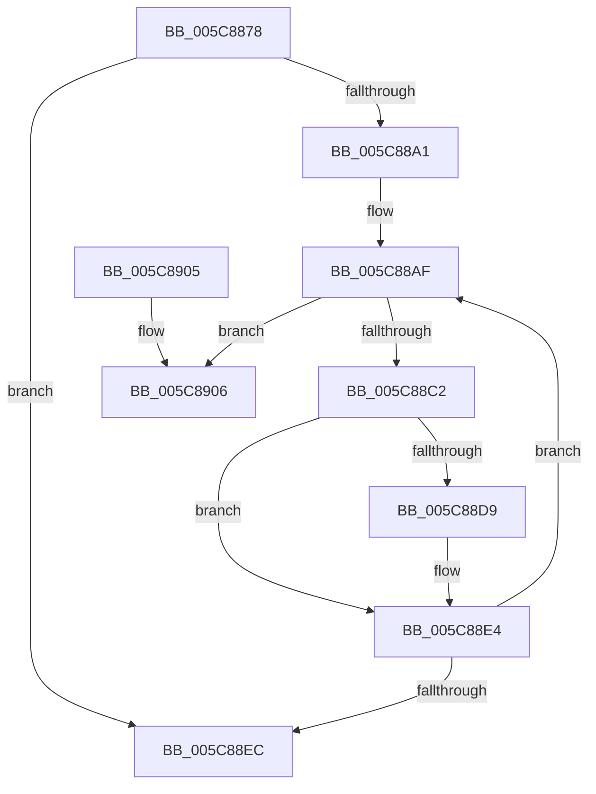

# KiAddProcessorToGroupSchedulingList

- RVA: `0x005C8878`–`0x005C890D` (길이 `149` bytes)
- VA: `0x00000001405C8878`
- 실행 섹션: `.text`
- PDB 이름 있음: `예`; PDB Function 태그: `아니요`
- unwind 정보 RVA: `0x00075210`
- 디코드: `44`개 명령, `149/149` bytes 표시
- 미해석 바이트: `0` (있으면 어셈블리에 `.byte`로 보존)

> 이 문서는 커널 이미지의 기계어와 PDB 기호를 분석해 생성했습니다. 4번과 5번은 함수 원형과 자료형을 바이너리 사용 방식에서 추정한 C 해석이며 원본 소스 복구 결과는 아닙니다.

## 1. Dependencies

- 직접 호출 지점: **1**; 고유 호출 대상: **1**
- 직접 호출자로 확인된 함수: **2**
- RIP 상대 이미지 참조: **0**

### Outgoing calls
- `0x005C88DF` → [KiAddProcessorToGroupSchedulingList](KiAddProcessorToGroupSchedulingList_function_005C8878.md) (function, `0x005C8878`)

### Direct callers
- [KiAddProcessorToGroupSchedulingList](KiAddProcessorToGroupSchedulingList_function_005C8878.md) at `0x005C88DF`
- [KiAddProcessorToGroupSchedulingDatabase](../../pagelk/B6/KiAddProcessorToGroupSchedulingDatabase_function_00B6B1D8.md) at `0x00B6B246`

### Static image references
- 디코드된 RIP-relative 메모리 참조가 없습니다.

## 2. Other-region calls and transfers

- 다른 실행 섹션으로 향하는 call: **0**
- 별도 외부 분기/꼬리 이동을 확인하지 못했습니다.

## 3. Assembly (complete function range)

```asm
005C8878  48 89 5C 24 08                  mov qword ptr [rsp + 8], rbx
005C887D  48 89 6C 24 10                  mov qword ptr [rsp + 0x10], rbp
005C8882  48 89 74 24 18                  mov qword ptr [rsp + 0x18], rsi
005C8887  57                              push rdi
005C8888  41 56                           push r14
005C888A  41 57                           push r15
005C888C  48 83 EC 20                     sub rsp, 0x20
005C8890  48 8B 1A                        mov rbx, qword ptr [rdx]
005C8893  48 8B FA                        mov rdi, rdx
005C8896  41 8B E8                        mov ebp, r8d
005C8899  4C 8B F1                        mov r14, rcx
005C889C  48 3B DA                        cmp rbx, rdx
005C889F  74 4B                           je 0x1405c88ec
005C88A1  4C 69 FD B8 01 00 00            imul r15, rbp, 0x1b8
005C88A8  48 8D B1 88 8A 00 00            lea rsi, [rcx + 0x8a88]
005C88AF  48 8B 56 08                     mov rdx, qword ptr [rsi + 8]
005C88B3  49 8D 87 90 00 00 00            lea rax, [r15 + 0x90]
005C88BA  48 03 C3                        add rax, rbx
005C88BD  48 39 32                        cmp qword ptr [rdx], rsi
005C88C0  75 44                           jne 0x1405c8906
005C88C2  48 89 50 08                     mov qword ptr [rax + 8], rdx
005C88C6  48 89 30                        mov qword ptr [rax], rsi
005C88C9  48 89 02                        mov qword ptr [rdx], rax
005C88CC  48 8D 53 18                     lea rdx, [rbx + 0x18]
005C88D0  48 89 46 08                     mov qword ptr [rsi + 8], rax
005C88D4  48 39 12                        cmp qword ptr [rdx], rdx
005C88D7  74 0B                           je 0x1405c88e4
005C88D9  44 8B C5                        mov r8d, ebp
005C88DC  49 8B CE                        mov rcx, r14
005C88DF  E8 94 FF FF FF                  call 0x1405c8878
005C88E4  48 8B 1B                        mov rbx, qword ptr [rbx]
005C88E7  48 3B DF                        cmp rbx, rdi
005C88EA  75 C3                           jne 0x1405c88af
005C88EC  48 8B 5C 24 40                  mov rbx, qword ptr [rsp + 0x40]
005C88F1  48 8B 6C 24 48                  mov rbp, qword ptr [rsp + 0x48]
005C88F6  48 8B 74 24 50                  mov rsi, qword ptr [rsp + 0x50]
005C88FB  48 83 C4 20                     add rsp, 0x20
005C88FF  41 5F                           pop r15
005C8901  41 5E                           pop r14
005C8903  5F                              pop rdi
005C8904  C3                              ret
005C8905  CC                              int3
005C8906  B9 03 00 00 00                  mov ecx, 3
005C890B  CD 29                           int 0x29
```

## 4. C-style interpretation (structured pseudocode)

```c
__int64 __fastcall KiAddProcessorToGroupSchedulingList(__int64 a1, __int64 a2, int a3)
{
    __int64 result;
    __int64 v_r15;
    __int64 v_rsp;
    unsigned __int64 v_stack_p10;
    unsigned __int64 v_stack_p18;
    unsigned __int64 v_stack_p8;

    v_stack_p8 = v_rbx;
    v_stack_p10 = v_rbp;
    v_stack_p18 = v_rsi;
    v_rsp = (v_rsp) - (32);
    if ((*(unsigned __int64 *)(a2)) == a2) goto loc_005C88EC;
    v_r15 = (v_r15) * ((unsigned int)(a3));
loc_005C88AF:
    result = (v_r15 + 144) + (*(unsigned __int64 *)(a2));
    if ((*(unsigned __int64 *)(*(unsigned __int64 *)(a1 + 35464 + 8))) != (a1 + 35464)) goto loc_005C8906;
    *(unsigned __int64 *)(result + 8) = *(unsigned __int64 *)(a1 + 35464 + 8);
    *(unsigned __int64 *)(result) = a1 + 35464;
    *(unsigned __int64 *)(*(unsigned __int64 *)(a1 + 35464 + 8)) = result;
    *(unsigned __int64 *)(a1 + 35464 + 8) = result;
    if ((*(unsigned __int64 *)(*(unsigned __int64 *)(a2) + 24)) != (*(unsigned __int64 *)(a2) + 24)) {
        a3 = (unsigned int)((unsigned int)(a3));
        a1 = a1;
        result = KiAddProcessorToGroupSchedulingList(a1, *(unsigned __int64 *)(a2) + 24, a3, a4);
    }
    if ((*(unsigned __int64 *)(*(unsigned __int64 *)(a2))) != a2) goto loc_005C88AF;
loc_005C88EC:
    v_rsp = (v_rsp) + (32);
    return result;
loc_005C8906:
    return result;
}
```

## 5. (Beta) C Style

```c
int64_t KiAddProcessorToGroupSchedulingList(void *Arg1, void *Arg2, int32_t Arg3)
{
    uint8_t *arg1 = (uint8_t *)Arg1;
    uint8_t *arg2 = (uint8_t *)Arg2;

    int64_t result;
    int64_t local_r15;
    int64_t local_rsp;
    uint64_t v_stack_p10;
    uint64_t v_stack_p18;
    uint64_t v_stack_p8;

    v_stack_p8 = local_rbx;
    v_stack_p10 = local_rbp;
    v_stack_p18 = local_rsi;
    local_rsp = (local_rsp) - (32);
    if ((*(uint64_t *)(arg2)) == Arg2) goto loc_005C88EC;
    local_r15 = (local_r15) * ((uint32_t)(Arg3));
loc_005C88AF:
    result = (local_r15 + 144) + (*(uint64_t *)(arg2));
    if ((*(uint64_t *)(*(uint64_t *)(arg1 + 0x8A88 + 0x8))) != (Arg1 + 35464)) goto loc_005C8906;
    *(uint64_t *)(result + 0x8) = *(uint64_t *)(arg1 + 0x8A88 + 0x8);
    *(void **)(result) = Arg1 + 35464;
    *(uint64_t *)(*(uint64_t *)(arg1 + 0x8A88 + 0x8)) = result;
    *(uint64_t *)(arg1 + 0x8A88 + 0x8) = result;
    if ((*(uint64_t *)(*(uint64_t *)(arg2) + 0x18)) != (*(uint64_t *)(arg2) + 24)) {
        Arg3 = (uint32_t)((uint32_t)(Arg3));
        Arg1 = Arg1;
        result = KiAddProcessorToGroupSchedulingList(Arg1, *(uint64_t *)(arg2) + 24, Arg3, a4);
    }
    if ((*(uint64_t *)(*(uint64_t *)(arg2))) != Arg2) goto loc_005C88AF;
loc_005C88EC:
    local_rsp = (local_rsp) + (32);
    return result;
loc_005C8906:
    return result;
}
```

### 관측된 메모리 오프셋

구조체 형식이 확인되지 않은 접근은 인자 기준의 오프셋으로만 기록했습니다.

| 기준 인자 | 오프셋 표현 | 폭 (bit) | 접근 |
|---|---:|---:|---|
| `Arg1` | `+ 0x8` | `64` | `R` |
| `Arg1` | `+ 0x8` | `64` | `W` |
| `Arg1` | `+ 0x8A88` | `64` | `R` |
| `Arg2` | `+ 0x0` | `64` | `R` |

## 6. Execution-region graph

[열기: 2D/3D 그래프와 함수 탐색 컨트롤 패널](../../../control-panel.html?section=text&rva=0x005C8878&view=graph)

- 2D 그래프는 위에서 아래로 흐르고, 3D 그래프는 빈 공간을 드래그해 회전합니다. Shift+드래그는 이동, 휠은 확대·축소, 함수 노드 선택은 대상 보고서 이동입니다.

### Static fallback


